# Kafka Interview Questions

**Kafka Interview Questions** | A full guide to Kafka architecture, producers, consumers, delivery semantics, and Spring Kafka integration. Also see: [Spring Microservices](https://github.com/vikas9dev/java/blob/main/1_interview_questions/17_Spring_Microservices_Interview_Questions.md)

> 🛠️ **For CLI/ops & hands-on practice**, see the Spring reference deep-dives: [Apache Kafka Introduction](https://github.com/vikas9dev/java/blob/main/3_spring/05_microservices/09_Apache_Kafka_Introduction.md) (setup, `kafka-topics` commands, on-disk storage) and [Spring Boot Integration with Apache Kafka](https://github.com/vikas9dev/java/blob/main/3_spring/05_microservices/10_Spring_Boot_Integration_with_Apache_Kafka.md) (runnable `@KafkaListener` / `KafkaTemplate` example). This file has everything you need for interview prep. Those two files are optional extras, and they add less value for interviews.

📊 **Question Count by Section**

| # | Section | Questions |
|---|---|---|
| 0 | [Kafka Fundamentals — End-to-End Flow](#0-kafka-fundamentals--end-to-end-flow--how-it-works) | ref |
| 1 | [Kafka Architecture Fundamentals](#1-kafka-architecture-fundamentals) | 11 |
| 2 | [Producer Internals](#2-producer-internals) | 7 |
| 3 | [Consumer Internals](#3-consumer-internals) | 9 |
| 4 | [Delivery Semantics](#4-delivery-semantics) | 5 |
| 5 | [Kafka Patterns and Error Handling](#5-kafka-patterns-and-error-handling) | 8 |
| 6 | [Spring Kafka Integration](#6-spring-kafka-integration) | 7 |
| 7 | [Kafka vs Alternatives](#7-kafka-vs-alternatives) | 5 |
| | **Total** | **52** |

> 🔥🔥 Very High — asked in almost every Tier-1 loop &nbsp;·&nbsp; 🔥 High — very frequent in Tier-1 interviews &nbsp;·&nbsp; ⚡ Medium — commonly asked &nbsp;·&nbsp; 💤 Low — good to know, rarely asked

---

## 0. Kafka Fundamentals — End-to-End Flow & How It Works

> **Read this before the Q&A.** This section builds the basic model step by step. It follows **one single message** from the moment a producer sends it to the moment a consumer processes it. Every later question (acks, ISR, offsets, rebalancing, exactly-once) looks closer at one step of this flow. Learn this flow once. Then the later answers will not feel like separate small facts. Examples use generic placeholders (`Alice`, `order-events`).

### 1. 🧠 The One-Sentence Mental Model

> **Kafka is a durable, append-only log that many writers append to and many readers replay from — at their own pace, without deleting anything.**

Do not think of a "message queue" for now. The closest comparison is a **newspaper printing press with archives**:

- 📰 **Producers** are journalists who submit articles. They don't know or care who reads them.
- 🗞️ The **log** is the printed paper. Once printed, an article is **immutable** and **ordered** (page 1, then 2, then 3…).
- 📚 **Consumers** are subscribers. Each one keeps a **bookmark** (offset) of how far they have read. Two subscribers can be on different pages of the same paper.
- 🗄️ Old papers stay in the **archive** for a fixed time (retention, e.g. 7 days) — **whether or not anyone read them.** Reading does *not* consume or erase them.

That last point is the biggest difference from RabbitMQ/ActiveMQ. In Kafka, **reading ≠ removing**. The log is the source of truth. Consumers only track a pointer into it.

### 2. 🏗️ The Anatomy — How the Pieces Nest

Everything in Kafka is five things placed one inside another. From outermost to innermost:

```
Kafka Cluster                         ← a group of brokers working together
│
├── Broker 1 (a server)               ← stores data, serves clients; each broker leads some partitions
├── Broker 2
└── Broker 3
        │
        └── Topic: "order-events"      ← a named logical stream (like a table name)
                │
                ├── Partition 0  ──►  [ off0 ][ off1 ][ off2 ][ off3 ] ...   ← an ordered log (shard)
                ├── Partition 1  ──►  [ off0 ][ off1 ][ off2 ] ...
                └── Partition 2  ──►  [ off0 ][ off1 ] ...
                        │
                        └── each offset = one immutable record (key, value, timestamp)
```

Two relationships confuse everyone. You will be asked about them:

- **Partitioning = splitting.** A topic is *split* across partitions. A given message goes into **exactly one** partition — not all of them. More partitions = more parallelism. *(Detail: §1 Q2, §2 Q5.)*
- **Replication = copying.** Each *partition* is *copied* onto multiple brokers (1 leader + N followers). This way it survives when a broker dies. *(Detail: §1 Q5 — ISR.)*

> 🧭 **Partitioning spreads different data for scale. Replication copies the same data for safety.** These two ideas are independent of each other — don't mix them up.

<details>
<summary><strong>🤔 Doubt: Why do we need partitioning? What does "more partitions = more parallelism" mean?</strong></summary>

**🚧 The problem: a single log doesn't scale**

Imagine `order-events` as **one** unsplit log on **one** broker. Every order in the company is appended to that one file, and consumers read from it. You hit two hard limits right away:

1. **Storage limit** — the whole topic must fit on one machine's disk. A billion orders? All on one server.
2. **Throughput limit** — all writes go to one broker's CPU/disk/network. More importantly, **only one consumer can read that single log in order at a time.** You cannot add readers to go faster. They would repeat each other's work or break each other's ordering. You are stuck at the speed of one consumer.

> A single log is a **single lane**. No matter how many trucks (consumers) you have, one lane = one truck moving at a time.

**🛠️ The fix: split the log into partitions**

Partitioning cuts the topic into N independent logs (partitions). Then:

- Each partition can live on a **different broker** → storage and write load **spread across machines**.
- Each partition can be read by a **different consumer in parallel** → read load spreads too.

> Three partitions = **three lanes**. Now three trucks move at the same time.

**📈 "More partitions = more parallelism" — in concrete terms**

The hard rule: **within a consumer group, each partition is read by exactly one consumer.** This one rule *is* the full meaning of the phrase. The number of partitions is the **maximum number of consumers that can work in parallel** in one group.

| Partitions 📂 | Consumers in group 👤 | What happens | Effective parallelism |
|---|---|---|---|
| 1 | 3 | 1 consumer gets the only partition; **2 sit idle** | **1×** (extra consumers wasted) |
| 3 | 1 | 1 consumer handles all 3 partitions alone | 1× (too few readers) |
| 3 | 3 | each consumer gets exactly 1 partition | **3×** |
| 3 | 6 | 3 consumers active, **3 idle** | 3× (limited by partitions) |
| 6 | 6 | each consumer gets 1 of 6 partitions | **6×** |

Throughput grows **only** when you raise the partition count *and* add consumers to match.

- **Partitions set the upper limit. Consumers fill it.**
- Adding consumers beyond the partition count does nothing. The extra ones just sit idle.

> 🔑 So "more partitions = more parallelism" means: *more partitions raise the maximum number of consumers that can process the topic at the same time.* Partition count is the setting that controls throughput.

**⚖️ The cost (so you don't set it too high)**

Interviewers like the follow-up "why not just create 10,000 partitions?":

- **Ordering is only guaranteed *within* a partition**, never across partitions. If you split a customer's events across partitions, you lose their order. That's why you key by `customer-id`: it keeps one entity's events in one partition. *(Partitioning wants to spread data. Ordering wants to keep related data together. The **key** solves this conflict.)*
- **More partitions = more overhead:**
  - open file handles
  - more replication traffic
  - longer leader-election and rebalance times
  - higher end-to-end latency

So you size partitions for your **target throughput**, not "as many as possible." A simple rule: estimate the peak consumer parallelism you will ever need. Then set partitions a bit above that.

**🎯 One-liner:** Partitioning splits a topic into independent logs. This lets it scale beyond one machine's storage and one consumer's speed. Each partition is consumed by exactly one consumer per group. So **the partition count is the hard limit on how many consumers can process the topic in parallel.** That's why more partitions allow more parallelism. The limit comes when ordering needs and operational overhead start to cause problems.

---

</details>
<br/>

<details>
<summary><strong>🤔 Doubt: Can one broker hold many partitions of the same topic? How are leaders placed?</strong></summary>

**Yes — this is the normal case whenever a topic has more partitions than brokers.** One broker often hosts several partitions of the same topic. Kafka's partition assigner just spreads them to keep things balanced.

**Example — topic `order-events`, 5 partitions, replication factor 1, 2 brokers:**

```
Broker 1:  [ part_0 ] [ part_1 ] [ part_2 ]
Broker 2:  [ part_3 ] [ part_4 ]
```

5 partitions cannot divide evenly across 2 brokers, so you get a 3–2 split. It is balanced by *count*; Kafka does not force one partition per broker.

**With replication, "a partition on a broker" can mean a leader copy or a follower copy.** Now Kafka balances **two things independently**:

```
Topic order-events — 3 partitions, replication factor 2

           part_0        part_1        part_2
Broker 1:  👑 leader     🛡️ follower   🛡️ follower
Broker 2:  🛡️ follower   👑 leader     👑 leader
```

1. **Partition placement** — spread partition *replicas* across brokers so that storage + load are even.
2. **Leadership** — spread the *leaders* across brokers. The leader serves **all** reads/writes for its partition. If every leader sits on one broker, that broker becomes a hotspot while the others sit idle.

**Why spreading leaders matters on failure:**

- Producers and consumers always talk to the **leader**. Followers only copy.
- If a broker dies, every partition it *led* gets a new leader. Kafka promotes an in-sync follower on a surviving broker.
- This is exactly why the replicas of one partition must never all sit on the same broker.

> 🔑 "Partition on broker X" = broker X stores a **replica** (leader or follower) of it. One broker can hold many such replicas, across many partitions and topics.

---

</details>
<br/>

### 3. 🔄 The End-to-End Journey of One Message

Here is the full lifecycle of a single message, from start to finish:

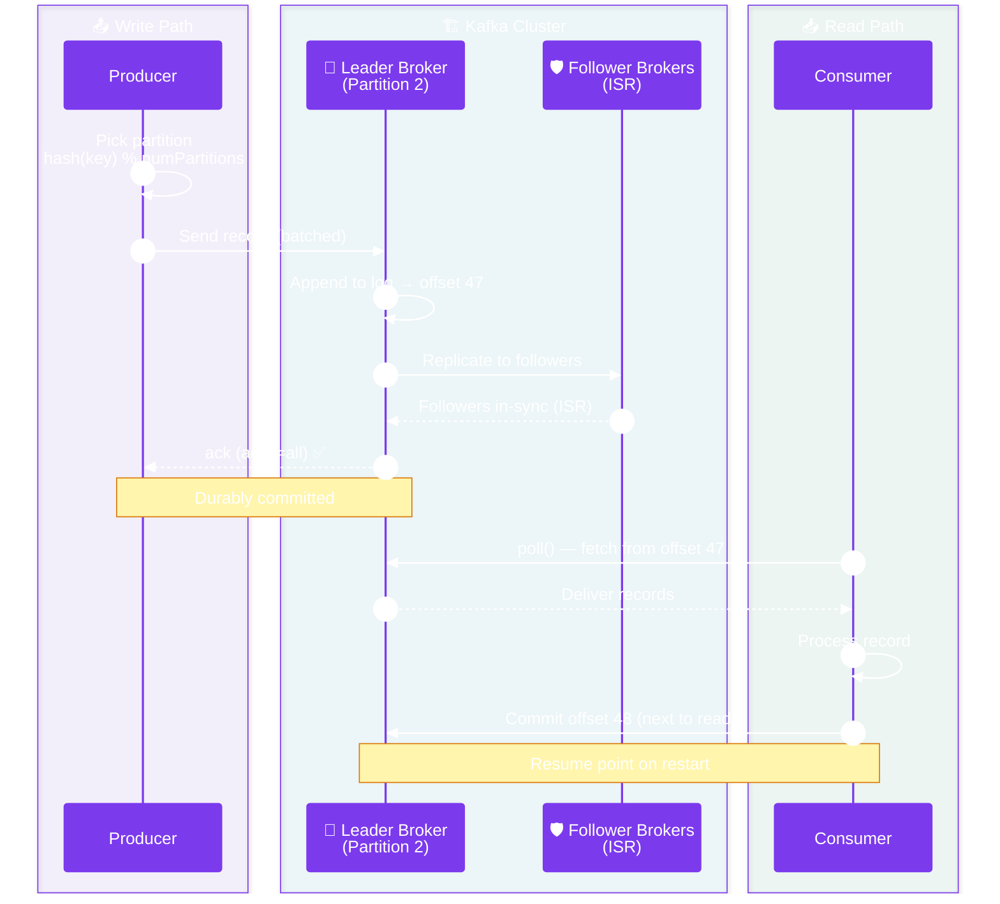

Step by step:

1. **Pick a partition.** The producer hashes the message **key** to choose one partition (keyless → sticky/round-robin). Same key → same partition → ordered. *(§2 Q5)*
2. **Send (batched).** The producer buffers messages and sends them in batches for throughput, not one by one. *(§2 Q1, Q6)*
3. **Append to the leader's log.** The partition has one **leader** broker. The leader appends the record to the end of the on-disk log and gives it the next **offset** (say 47). *(§1 Q2)*
4. **Replicate.** Follower brokers copy the record to stay in sync. *(§1 Q5)*
5. **ISR confirms.** Followers that are caught up form the **In-Sync Replica** set.
6. **Ack.** With `acks=all`, the leader confirms to the producer only after the ISR has the record. That is the durability guarantee. *(§2 Q2)*
7. **Consumer polls.** A consumer in a group is assigned that partition and **pulls** records (Kafka never pushes). It asks "give me everything from offset 47." *(§3 Q1)*
8. **Deliver.** The broker returns the records from page cache / disk.
9. **Process.** The consumer runs your business logic.
10. **Commit offset.** The consumer records "I've finished through 47, next is 48" in the internal `__consumer_offsets` topic. On restart it resumes from 48.
    - ⚠️ Be careful with the guarantee here. Manual commit lets you *choose* whether the commit happens before or after step 9. That choice, not the commit itself, decides the semantics.
    - Commit-after-process (the normal choice) is **at-least-once**. If the consumer crashes between 9 and 10, the replacement re-reads 47.
    - *(§3 Q1, §4 Q1 — and the doubt block just below.)*

> 🔑 **Pull, not push.** Consumers *fetch* at their own pace. This is why a slow consumer can't be overloaded. It is also why replay is easy: you just move the offset back.

<details>
<summary><strong>🤔 Doubt: Where is the committed offset stored — and how does a replacement consumer get it back when the old one dies?</strong></summary>

**It's stored on the broker, not the consumer.**

- The commit is written to the internal `__consumer_offsets` topic.
- That topic is **itself a regular Kafka topic** on the brokers. It is partitioned (50 partitions by default) and replicated (RF 3) like any other.
- The live consumer keeps only an *in-memory* position for speed. The **durable source of truth lives on the cluster**.
- So the consumer holds no lasting state about its own progress. This is exactly what makes short-lived/spot-instance consumers safe.

**When a consumer dies:**

1. The **group coordinator** (a broker) sees the consumer stop heartbeating → it triggers a **rebalance**.
2. The dead consumer's partition is **reassigned** to another live consumer in the same group.
3. The new owner reads the **last committed offset** for that partition from `__consumer_offsets` and resumes from there.

No position is lost, because it was never on the dead machine.

**Offsets are tracked per partition, inside the group** — keyed by the triple:

```
key   = (group.id, topic, partition)
value = committed offset      e.g. ("notif", "order-events", 2) → 48
```

So every `(group → topic → partition)` has its own independent offset. This explains two things:

- Two different groups reading the same partition keep separate positions (separate rows in `__consumer_offsets`).
- Each partition resumes independently after a rebalance.

**⚖️ The risky part: the gap between processing and commit decides the delivery semantics:**

| Order of operations | Result | Semantic |
|---|---|---|
| process 47 → **die before commit** | replacement re-reads 47 | **at-least-once** (duplicate) |
| commit 48 → **die before processing 47** | 47 is skipped | **at-most-once** (loss) |

End-to-end **exactly-once** has two halves:

- the producer-side guarantee (`acks=all` → ISR)
- this consumer-side guarantee (when you commit)

*(Detail: §4 Delivery Semantics.)*

---

</details>
<br/>

### 4. 🎬 A Concrete Worked Example

**Scenario:** an e-commerce backend. The Order service sends an event every time someone places an order. A Notification service and an Analytics service both react to it.

**Topic `order-events`, 3 partitions, replication factor 3.**

1. Alice places order `ORD-991`. Order service does `send("order-events", key="ORD-991", value={...})`.
2. `hash("ORD-991") % 3 = 2` → the event goes to **Partition 2**, appended at **offset 47**. Partitions 0 and 1 never see it.
3. Partition 2's leader is on Broker 3. Followers on Brokers 1 and 2 copy it. If Broker 3 dies, one in-sync follower (Broker 1 or 2) takes over as leader — **no data lost**.
4. **Notification service** (`group.id = "notif"`) is subscribed. Its consumer for Partition 2 polls offset 47, sends Alice an email, and commits offset 48.
5. **Analytics service** (`group.id = "analytics"`) is a *different group*. So it reads the **same** offset 47 **independently**, with its own separate bookmark. Notification being at 48 doesn't affect Analytics.
6. Seven days later, retention expires and offset 47 is deleted from disk — no matter who read it.

> 💡 One event, written once, read independently by two services. Each service tracks its own position. That is the main point of Kafka: **decoupled, replayable, multi-reader.**

### 5. ❓ The 5 Confusions That Trip Everyone Up

| # | The confusion 😵 | The reality ✅ |
|---|---|---|
| 1 | "A message is copied to all partitions." | **No — one partition only.** Partitioning splits data. Copying is replication (across brokers), a separate idea. |
| 2 | "Reading a message removes it." | **No.** Messages stay until *retention* expires, whether or not anyone consumed them. Consumers just move a pointer (offset). |
| 3 | "Kafka is slow because it writes to disk." | **No.** Sequential append + OS page cache make it fast while it stays durable. *(§1 Q7)* |
| 4 | "A consumer is tied to a fixed partition." | By default (`subscribe`), the coordinator **assigns partitions dynamically** and moves them around on rebalance. Only `assign()` ties a consumer to fixed partitions. *(§1 Q3)* |
| 5 | "More consumers = always more parallelism." | **Limited by partition count.** 4 partitions, 6 consumers in a group → 2 sit idle. *(§1 Q3)* |

### 6. 🗺️ Where Each Concept Is Detailed

Once the flow above makes sense, each section below looks closer at one part of it:

- **§1 Architecture** — brokers, topics, partitions, offsets, ISR/replication, throughput internals, on-disk segment layout.
- **§2 Producer Internals** — how steps 1–6 work: batching, acks, idempotence, partitioner.
- **§3 Consumer Internals** — how steps 7–10 work: offsets, rebalancing, lag, assignment strategies.
- **§4 Delivery Semantics** — at-most/at-least/exactly-once; the guarantees behind the ack + commit steps.
- **§5 Patterns & Error Handling** — DLQ, retries, ordering, backpressure when steps go wrong.
- **§6 Spring Kafka** — how all of this is set up with `@KafkaListener` / `KafkaTemplate`.
- **§7 Kafka vs Alternatives** — when *not* to use Kafka (vs RabbitMQ / SQS).

---

## 1. Kafka Architecture Fundamentals

1. **📨 What is Apache Kafka and why is it used? 🔥🔥**

<!-- -->
<details>
<summary>Answer</summary>

**Answer:**

Apache Kafka is a distributed event streaming platform. It was first built at LinkedIn. Later it was made open source through the Apache Software Foundation. It is built for high-throughput, fault-tolerant, and durable real-time data streaming between systems.

Kafka works as a **distributed commit log**:

- Producers write messages to topics.
- Consumers read messages from topics.
- Unlike traditional message brokers, Kafka persists messages to disk.
- Consumers can replay messages by seeking to any offset.

**① Write path — producers route to partition leaders, followers replicate:**

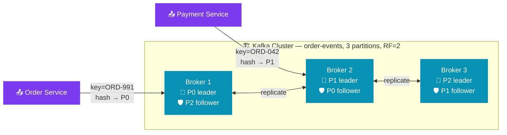

**② Read path — the log is stored once; each group holds its own offsets:**

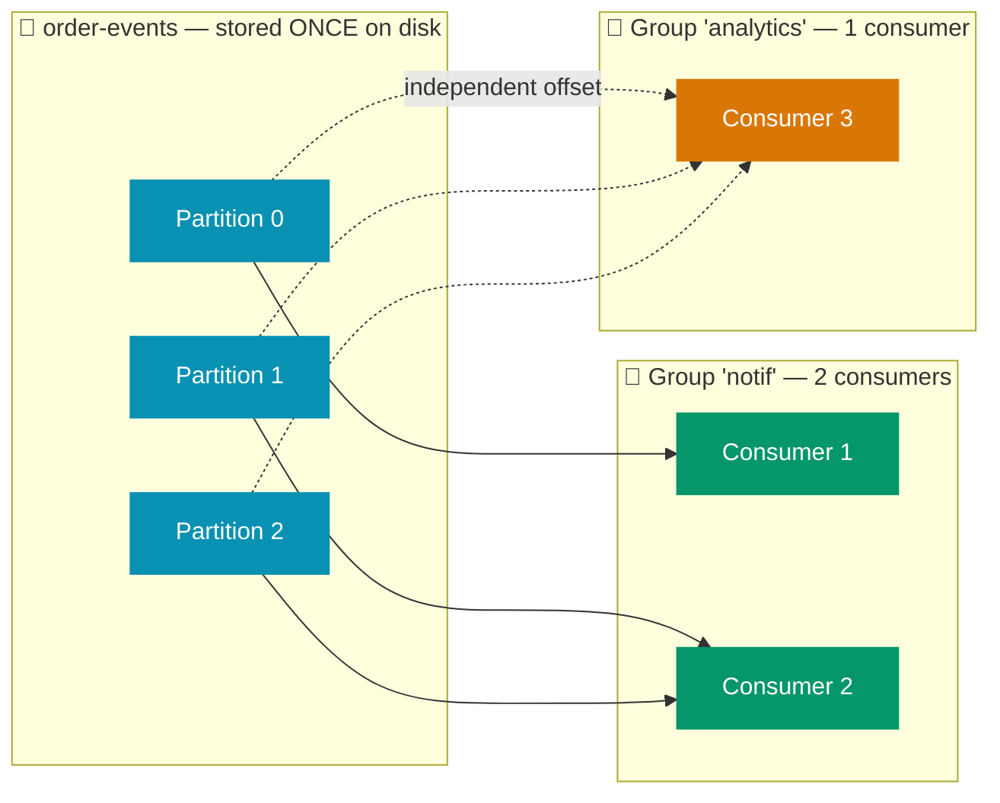

> 🔑 Look at diagram ② carefully: **the same three partitions feed both groups.** Nothing is duplicated. When `analytics` reads a record, it does not take that record away from `notif`. Each group just holds its own offset pointer.

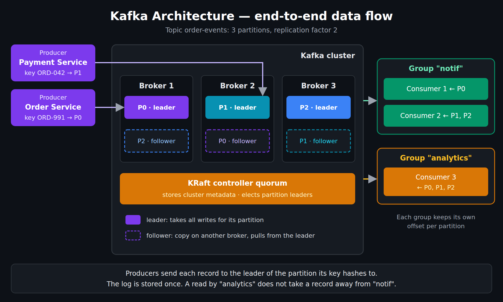

🔑 **Key reasons Kafka is used:**

- ⚡ **High throughput:** Handles millions of messages per second with low latency.
- 💾 **Durability:** Messages are persisted to disk and replicated across brokers.
- 📈 **Scalability:** Horizontal scaling by adding brokers and partitions.
- 🔄 **Decoupling:** Producers and consumers are fully decoupled. They don't need to know about each other.
- 🔁 **Replay capability:** Consumers can re-read messages from any offset. This enables event sourcing and reprocessing.
- 📊 **Stream processing:** Native support for real-time stream processing via Kafka Streams.

🧠 **In Simple Words:**
Kafka is like a high-speed, persistent, distributed "mailbox system". Producers drop messages into topic mailboxes. Any number of consumer groups can read those messages independently, each at its own pace.

🎯 **Interview Tip:** Stress that Kafka is not just a message queue. It is a distributed commit log. This difference matters because it enables replay, ordering guarantees, and exactly-once semantics.

<details>
<summary><strong>🤔 Doubt: "Unlike traditional message brokers, Kafka persists messages to disk" — did traditional brokers store messages in RAM?</strong></summary>

Not only RAM. But they treat the message store **in a very different way** from Kafka. The real contrast is not "RAM vs disk". It is *how* and *why* each one uses the disk.

**🗂️ What traditional brokers actually did (RabbitMQ / ActiveMQ):**

- Messages live in an **in-memory queue** while they wait to be delivered.
- They get written to disk **only when needed**. For example, the message is flagged *persistent*, or memory pressure forces the broker to **page** messages out to disk.
- Once a message is **consumed and acknowledged, it is deleted.** The store is a *temporary holding area*. It is a short-lived buffer, not a log.

> 🧠 Mental model: **RAM is the home, disk is the backup/overflow.**

**📜 What Kafka does differently:**

- **Every message is appended to an on-disk commit log first, always.** Persistence is the default, not an opt-in.
- Messages are **not deleted on consumption.** They stay until a **retention policy** expires them (e.g. 7 days) or a size limit is hit.
- Consumers track their own **offset** (a pointer into the log). So many consumers can read the same data independently. You can also **replay** from any past offset.

> 🧠 Mental model: **disk is the home — the log _is_ the source of truth.**

**⚡ The part that confuses people:** "Kafka writes to disk → Kafka must be slow." It isn't, for two reasons:

1. **Sequential appends** to a log file are far faster than random-access disk writes. They need no disk seek, so even one spinning disk writes over 100 MB/s.
2. Kafka depends on the **OS page cache** (RAM managed by the kernel). Kafka serves newly written messages straight from the page cache, with no disk seek. So reads of recent data run at RAM speed *anyway*. The data is still durably on disk.

So Kafka gets durability **and** speed. Traditional brokers gave up one to get the other.

**🎯 Interview one-liner:** Traditional brokers (RabbitMQ/ActiveMQ) keep messages in memory. They use disk only as optional overflow/persistence, and they delete messages once acknowledged. The queue is a short-lived buffer. Kafka always appends to an immutable on-disk log. It keeps messages for a configured period, whether or not anyone consumed them. It uses sequential I/O + OS page cache to stay fast. That is what makes Kafka a *replayable distributed log* and not just a message queue.

---

</details>
<br/>

<details>
<summary><strong>🤔 Doubt: "Distributed commit log" — are "distributed" and "commit log" the same thing, or two separate properties?</strong></summary>

**Two separate, independent properties.** They answer different questions, so keep them apart. Replication and brokers are *not* what makes Kafka a "commit log."

**📜 "Commit log" = the data model (true even on a single broker, single partition)**

A commit log is a sequence of records with these properties:

- **append-only, immutable, ordered**
- **persisted to disk first**
- read by **offset**
- **retained regardless of consumption**

*One* partition is already all of this. No cluster is needed. This single property gives you:

- **Replay** — seek to any past offset and re-read.
- **Ordering** — strict order *within* a partition.
- **Independent reads** — many consumers at different offsets on the same data.

> 🧠 If you ran Kafka with one broker and one partition, it would still be a commit log. It just would not scale or survive a crash.

**🌐 "Distributed" = the scaling + fault-tolerance layer on top of the log**

Take that single log and spread it across a cluster, in two ways:

- **Partitioning** → split the topic's log into N partitions across brokers → **throughput / parallelism**.
- **Replication** → copy each partition (leader + follower replicas) across brokers → **fault tolerance**.

This is the part with brokers, leaders, followers and the ISR. It is about *scale and survival*, not about the storage model.

**🧭 Putting it together**

```
COMMIT LOG   → what's the data model?    → append-only, immutable, offset-addressed, retained
DISTRIBUTED  → how does it scale/survive? → partitioned (scale) + replicated (fault tolerance)
```

**🎯 Interview one-liner:**

- "Commit log" describes *how Kafka stores and serves data*. It is an append-only, offset-addressed, disk-persisted, replayable log. This is true even of a single partition.
- "Distributed" describes *how that log is scaled and made fault-tolerant*. It is split into partitions and replicated across brokers.
- Replay/ordering come from the **log**. Throughput/durability come from it being **distributed**.

---

</details>
<br/>

---

</details>

---

2. **🏗️ Explain the core components of Kafka: Broker, Topic, Partition, and Offset. 🔥🔥**

<!-- -->
<details>
<summary>Answer</summary>

**Answer:**

Kafka's architecture is built on four basic building blocks:

| Component 🏷️ | Description 📋 | Analogy 🧠 |
|--------------|---------------|-----------|
| **Broker** | A Kafka server instance. It stores data and serves client requests. Multiple brokers form a cluster. | A post office branch |
| **Topic** | A logical category/channel. Messages are published to it. Topics are identified by name. | A mailbox category (e.g., "orders", "payments") |
| **Partition** | A topic is split into partitions for parallelism. Each partition is an ordered, immutable sequence of records. | Shelves within a mailbox category |
| **Offset** | A unique sequential ID given to each message within a partition. Offsets are immutable and always increase. | A page number in a book |

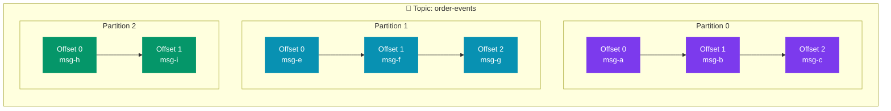

🔑 **Key Points:**

- 📦 **Broker:** Each broker has a unique integer ID. A Kafka cluster typically has 3+ brokers for fault tolerance. Any broker can answer a metadata request. But produce and fetch requests must go to the partition's leader. One controller manages cluster metadata.
- 📂 **Topic:** Topics are multi-subscriber. A topic can have zero, one, or many consumers. Data is kept for a configurable retention period (default 7 days), whether or not it has been consumed.
- 🔀 **Partition:** Partitions enable parallelism. Messages within a partition are strictly ordered. There is no ordering guarantee across partitions. Each partition can live on a different broker.
- 🔢 **Offset:** Consumers track their position in each partition using offsets. Kafka does not delete messages after consumption. The consumer is responsible for managing its offset.

📝 **Note:** The number of partitions sets the maximum parallelism of a consumer group. If a topic has 4 partitions, at most 4 consumers in the same group can read at the same time.

🎯 **Interview Tip:** Draw a diagram of a topic with multiple partitions. Point out that ordering is only guaranteed within a partition. This is one of the most common follow-up questions.

<details>
<summary><strong>🤔 Doubt: When a producer posts a message to a topic, does it go to all partitions or just one?</strong></summary>

Just **one** partition, never all of them. This is the single most important difference to get right. Two different concepts use confusingly similar words: **partitioning** vs **replication**.

**📤 A message goes to exactly ONE partition**

A producer sends a message to a topic. Kafka picks **one** partition for it and appends it there. It is **not** copied into the other partitions. Partitions **split** (shard) the topic's data for parallelism. They do not duplicate it. So if `order-events` has 3 partitions, each message lands in P0 **or** P1 **or** P2 — one of them.

> 📍 *Which* partition is chosen (key-hash vs sticky/round-robin vs explicit) is covered in **§2 Q5 — "key-based partitioning vs round-robin."** The point here is just that it's **one, not all**.

**🛡️ Where the "copy" actually happens — replication**

The thing that *does* get duplicated is each partition, across **brokers**. The **replication factor** controls this:

- A partition has **1 leader replica + N follower replicas** on different brokers.
- The producer writes to the **leader**. Followers copy the data to stay in sync (the ISR — in-sync replicas).
- If the leader's broker dies, a follower is promoted to leader → **no data loss.**

So with replication factor 3, partition P0 exists as 3 physical copies on 3 brokers. That is the redundancy. The other partitions (P1, P2) hold *different data*, and each has its own 3 copies.

**🧭 The two axes — don't mix them up**

```
PARTITIONING  → splits data   → P0, P1, P2 hold DIFFERENT messages       → parallelism / throughput
REPLICATION   → copies data   → each partition has N identical copies     → fault tolerance
                                on different brokers
```

**🎯 Interview one-liner:** A produced message is written to exactly one partition. It is chosen by key-hash, or round-robin if there is no key. Partitions shard the topic; they don't duplicate it. Duplication comes from **replication**, which copies each partition across multiple brokers for fault tolerance. **Partitioning = scale; replication = durability.**

---

</details>
<br/>

<details>
<summary><strong>🤔 Doubt: Offset vs Committed Offset — aren't they the same?</strong></summary>

They are two different things that both say "offset":

- **Offset** — the fixed position of a record *inside a partition*. Kafka stamps it at write time, and it never changes. It is a property of the **message** (like a page number). It exists whether or not anyone ever reads it.
- **Committed offset** — how far a *consumer group* has processed. From time to time, the group saves "I'm done up to offset N" into the internal `__consumer_offsets` topic. The key is group + topic + partition. It is a property of the **reader**, not the message.

**Why the split matters:**

- The same record's offset is the same for everyone. But each consumer group keeps its *own* committed offset. So two groups can read the same partition fully independently, at different positions.
- On crash/restart, a consumer resumes from the **committed offset**, not from the beginning. That is what makes processing recoverable.

**One line:** offset = where a record *is*; committed offset = where a group has *got to*.

---

</details>
<br/>

<details>
<summary><strong>🤔 Doubt: 5 messages → 3 partitions — what single thing forces ordering?</strong></summary>

Messages within a partition are strictly ordered. But there is **no ordering guarantee across partitions**. 5 messages with no key → round-robin/sticky across the 3 partitions → no global order.

**The fix: give all 5 messages the same key.** Kafka routes by `murmur2(key) % partitions`. So identical keys → same partition → strict order kept. (*Which* partition is chosen — key-hash vs sticky/round-robin vs explicit — is covered in §2 Q5.)

In practice:

- **Key by the entity whose order matters.** For example, all events for one `order_id` share a key → one partition → ordered.
- The simple but rough alternative is a single-partition topic. It works, but it loses all parallelism. So it is rarely the right answer.
- The cost of keying: a **hot key can create a skewed/hot partition**. That is the standard follow-up.

---

</details>
<br/>

---

</details>

---

3. **👥 What are Consumer Groups and how does partition assignment work? 🔥🔥**

<!-- -->
<details>
<summary>Answer</summary>

**Answer:**

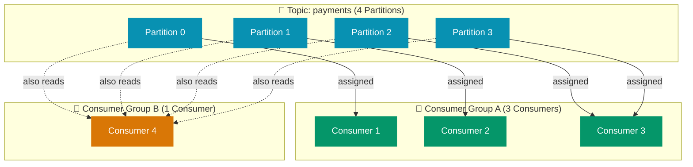

🔑 **Key Rules:**

- ⚖️ **One partition → one consumer (per group):** Within a consumer group, each partition is assigned to exactly one consumer. A consumer can read from multiple partitions.
- 📈 **Max parallelism = number of partitions:** If there are 4 partitions and 5 consumers in a group, one consumer will sit idle.
- 🔄 **Multiple groups = independent reads:** Different consumer groups consume independently. Group A at offset 100 does not affect Group B at offset 50.
- 🏷️ **Group ID:** Every consumer in a group shares the same `group.id` configuration.

| Scenario 🔧 | Partitions 📂 | Consumers 👤 | Result 📋 |
|------------|-------------|------------|---------|
| **Balanced** | 4 | 4 | 1 partition per consumer |
| **Fewer consumers** | 4 | 2 | 2 partitions per consumer |
| **More consumers** | 4 | 6 | 4 active, 2 idle |
| **Single consumer** | 4 | 1 | All 4 partitions to one consumer |

🧠 **In Simple Words:**
Think of consumer groups as teams working on the same project. The work (partitions) is divided among team members. Two different teams (groups) each get a full copy of the work, independently.

💡 **Pro Tip:** Sometimes two services must each process the same Kafka topic on their own (e.g., an analytics service and a notification service). Give them different `group.id` values. This is how Kafka supports both queue semantics (single group) and pub-sub semantics (multiple groups).

📌 **`subscribe()` vs `assign()`:**

- By default, a consumer calls `subscribe(topics)`. The **group coordinator then assigns partitions dynamically**, and reshuffles them on every rebalance. You don't pick which partitions.
- The lower-level `assign(topicPartitions)` lets you **pin a consumer to fixed `(topic, partition)` pairs**. There is no consumer group and no rebalancing.
- Use it when you need exact manual control (e.g. a partition-aware processor or replaying one partition).

<details>
<summary><strong>🤔 Doubt: Why is a partition assigned to only ONE consumer in a group — why not let two share it?</strong></summary>

The rule is **one partition → exactly one consumer per group**. The reason is **ownership integrity** (one clear owner per partition), not load:

- Suppose two consumers in the same group read the same partition. They would **both commit offsets** for it → conflicting "how far have we read" positions.
- They would **double-process** records. They would also **break per-partition ordering**, because two readers move forward independently.

So Kafka gives each partition a **single owner** within the group. That owner:

- commits offsets for it with no ambiguity,
- processes its records in order,
- and processes them exactly once *within the group*.

> ⚠️ Don't confuse this with delivery semantics. *When* you commit the offset (before vs after processing) decides at-most-once vs at-least-once. It also decides whether a crash drops or replays a record. That is a separate concern (§4 Delivery Semantics). The single-owner rule is about **who** reads a partition, not **when** they commit.

---

</details>
<br/>

<details>
<summary><strong>🤔 Doubt: An active consumer crashes — does Kafka do anything, or is the partition just stuck?</strong></summary>

Kafka **does** act, automatically.

1. The crashed consumer stops sending **heartbeats**. Once `session.timeout.ms` passes, the **group coordinator** marks it dead.
2. The coordinator triggers a **rebalance**. The dead consumer's partition is **reassigned to a surviving consumer** in the group.
3. The new owner resumes from that partition's **last committed offset**, so no data is lost. It may *reprocess* a few records if the crash happened after reading but before committing.

**Who picks up the partition depends on what's left in the group:**

| Group state when one consumer dies | What happens to its partitions |
|---|---|
| An **idle standby** exists (consumers > partitions) | The standby is promoted to active and takes them over |
| **No standby** (e.g. 4 partitions, 4 consumers) | Redistributed across the **surviving active consumers** — one ends up owning 2 |
| **No consumers left** (the last one died) | Partitions are **unowned; consumption stops** until some consumer (re)joins, which triggers another rebalance |

> So a standby is **not required**. It is just the cheapest failover case. The rule is simply "the partition goes to a *surviving* consumer."

🔑 Two things people get wrong:

- Kafka does not **create** a new consumer. It can only reassign partitions among consumers already in the group. If none remain, the partition waits.
- Kafka is the **active party**. The group coordinator runs the reassignment. The name for this whole process is a **consumer group rebalance** (triggered on any join / leave / crash).

---

</details>
<br/>

<details>
<summary><strong>🤔 Doubt: So who actually *creates* a new consumer — Kafka or my infrastructure?</strong></summary>

**Your infrastructure — never Kafka.** Kafka only assigns partitions to consumers that already exist. It never starts or stops a consumer process. There are two separate actors:

| Layer | Owns | Examples |
|---|---|---|
| **Your platform** | Creating / killing consumer instances | AWS ASG `min`/`max`/`desired`, K8s replicas + HPA, ECS service count |
| **Kafka** (group coordinator) | Detecting membership change + reassigning partitions | JoinGroup → rebalance |

**The handshake when you scale out:**

1. The platform (e.g. AWS ASG / HPA) boots a **new instance**.
2. The consumer process starts and calls `subscribe(topic)` with the **same `group.id`** → it sends a **JoinGroup** request to the coordinator.
3. That join is a membership change → the coordinator triggers a **rebalance**.
4. Partitions are redistributed. A consumer that had **2 partitions drops to 1**, and the newcomer takes the other.

Scale *in* works the opposite way: the platform kills an instance → that is a `leave` → rebalance → the survivors take over the freed partitions.

> ⚠️ **Cap consumers at the partition count.** Max parallelism = number of partitions. Scaling beyond it just leaves the extra consumers idle. Set your ASG/HPA `max` ≤ the topic's partition count.

**One line:** infra controls *how many* consumers exist; Kafka controls *which partitions each gets*.

> ⚠️ **Common trap — "always keep N+1 consumers so an idle standby can kick in."** This is wrong. A standby adds **nothing** to throughput:
>
> - It is idle by definition. It uses a pod to do zero work.
> - The rebalance happens either way. Kafka reassigns to *any* surviving consumer. A standby is only the cheapest failover case, never a requirement.
>
> The correct rule is **max parallelism = partition count**. If the goal is more throughput, the only option is: **add partitions first, then scale consumers up to — never past — the new count.** Partition count is the hard limit on consumer-group parallelism.

---

</details>
<br/>

---

</details>

---

4. **🐘 What is the difference between Zookeeper mode and KRaft mode in Kafka? 🔥**

<!-- -->
<details>
<summary>Answer</summary>

**Answer:**

In the past, Kafka depended on **Apache ZooKeeper** for three jobs:

- managing cluster metadata
- controller election
- storing configuration

**KRaft (Kafka Raft)** mode removes the need for ZooKeeper completely. It came as a preview in Kafka 2.8. It became production-ready in Kafka 3.3+.

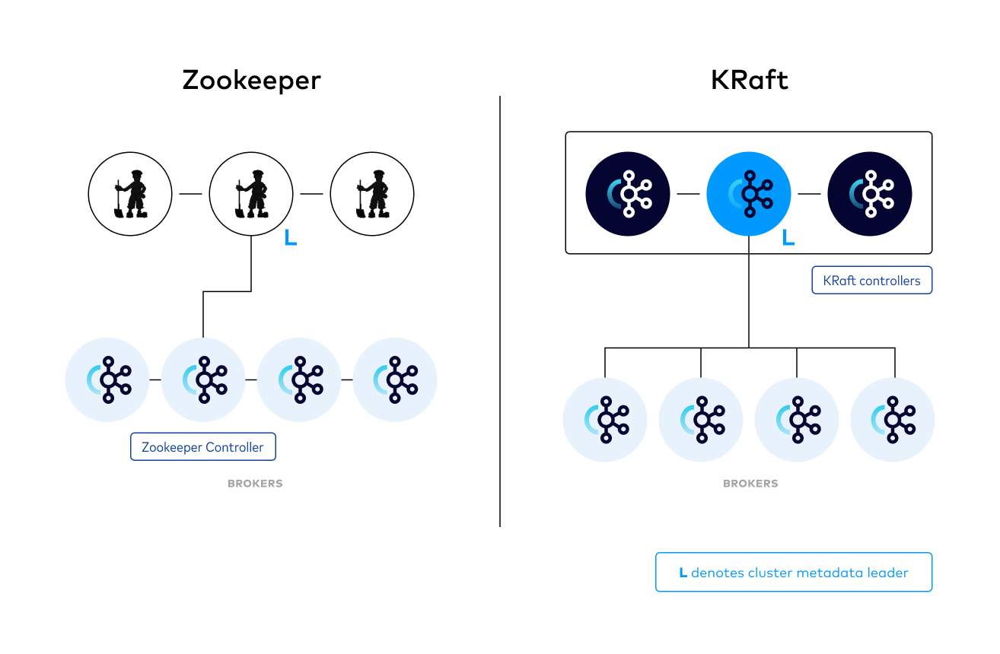

*Side-by-side of the two control planes (source: [Confluent](https://developer.confluent.io/learn/kraft/)):*

- **Left (ZooKeeper):** 3 ZK nodes sit on top, above the brokers. One is marked **L** (leader). One broker is tagged **"Zookeeper Controller"**. So metadata lives in an external ensemble (a separate group of ZooKeeper servers), and one broker is the controller.
- **Right (KRaft):** a dedicated **"KRaft controllers"** quorum box takes the place of ZooKeeper. It has 3 controllers, one marked **L**, and sits above the brokers. There is no external system.
- **Legend:** **"L denotes cluster metadata leader."**

| Feature | ZooKeeper Mode 🐘 | KRaft Mode 🚀 |
|---------|-------------------|---------------|
| **Metadata storage** | Stored in ZooKeeper (external system) | Stored in Kafka's internal `__cluster_metadata` topic |
| **Controller election** | ZooKeeper-based ephemeral nodes | Raft consensus protocol among controller nodes |
| **Operational complexity** | ⚠️ Two systems to manage (Kafka + ZooKeeper) | ✅ Single system to manage |
| **Scalability** | Limited by ZooKeeper's write throughput | ✅ Better partition scalability (millions of partitions) |
| **Recovery time** | 🐢 Slower controller failover | ⚡ Faster controller failover |
| **Deployment** | Requires separate ZooKeeper ensemble (3-5 nodes) | Controller role runs on Kafka nodes — dedicated controllers in production, combined with brokers in dev |
| **Status (2026)** | ❌️ Deprecated in Kafka 3.5+, removed in 4.0 | ✅ Default and recommended |

🏗️ **How KRaft works:**

- In KRaft mode, a small set of Kafka nodes act as **controllers**. Usually there are 3, for fault tolerance. In production they are dedicated nodes. In dev, one node can be both broker and controller (combined mode).
- One controller is elected as the **active controller**. The election uses the Raft consensus algorithm.
- Metadata changes (topic creation, partition reassignment, ISR changes) are written to the `__cluster_metadata` topic. They are replicated to all controllers.
- Non-controller brokers fetch metadata from the active controller.

📝 **Note:** If you are using Kafka 3.3+, always prefer KRaft mode for new deployments. **Kafka 4.0 (2025) removed ZooKeeper support completely.** On any current cluster, KRaft is not a choice — it's the only mode. Knowing this is an easy way to show your knowledge is up to date. Many candidates still describe ZooKeeper as the default.

🎯 **Interview Tip:** Mention that KRaft removes the scalability bottleneck of ZooKeeper. With ZooKeeper, Kafka clusters had a practical limit of ~200K partitions. KRaft supports millions of partitions per cluster.

<details>
<summary><strong>🤔 Doubt: In KRaft, does every broker hold all the metadata and replicate it across the whole cluster?</strong></summary>

This is half right. And the wrong half is the more important half.

**✅ What's true:** Every broker **does** keep a full, local copy of the cluster metadata.

- It replays the `__cluster_metadata` log into an in-memory cache (plus a local snapshot on disk).
- This is a real KRaft property. It is *why* failover is fast.
- A broker never has to "reload from ZooKeeper", because it already has everything in memory.

**❌️ What's wrong — two corrections:**

1. **Not every broker is a controller.** Only a **dedicated subset** — usually **3 or 5 nodes** — are *controllers*. They form the **Raft quorum**. The other brokers are plain brokers. They are not part of the quorum.
2. **The Raft replication is across the controller quorum — NOT "all nodes in the cluster."** Consensus (leader election, committing metadata writes) happens **only among the 3–5 controllers**. Regular brokers are **observers**:
   - they *fetch/replay* the metadata log to build their cache
   - they don't vote
   - the authoritative (official) replicated log does not live on them

**🧭 The accurate mental model:**

```
AUTHORITATIVE LOG  → __cluster_metadata, Raft-replicated across the CONTROLLER QUORUM (3–5 nodes)
                     → one active controller (leader L) commits writes via Raft
BROKERS            → each FETCHES that log → keeps a full read-only cache in memory
                     → fast failover, but they are observers, not quorum voters
```

**🖼️ Link this to the diagram:**

- The **"KRaft controllers"** box (3 nodes, one marked **L**) is the quorum. That's where the metadata log is replicated.
- The **BROKERS** row below is *separate*. Those brokers cache the metadata, but they aren't in the box.

**⚙️ One detail — combined vs dedicated mode:**

- In **combined mode** (dev/small clusters), a single node can play *both* roles: broker and controller. That is likely where the idea "each broker is a controller" comes from.
- But **production = dedicated mode**. Controllers and brokers are separate processes, exactly as the diagram shows.
- In both modes, the replication stays inside the controller quorum.

---

</details>
<br/>

---

</details>

---

5. **🔄 What is ISR (In-Sync Replicas) and how does replication work in Kafka? 🔥**

<!-- -->
<details>
<summary>Answer</summary>

**Answer:**

Kafka replicates each partition across multiple brokers for fault tolerance. The **In-Sync Replica (ISR)** set is the subset of replicas that are "caught up" with the leader. This means they have caught up to the leader's log end offset (LEO) within `replica.lag.time.max.ms`.

🔑 **Key Concepts:**

1. 👑 **Leader replica:** Each partition has exactly one leader. All reads and writes go through the leader.
2. 📋 **Follower replicas:** Passively replicate data from the leader. They **pull** it with fetch requests. They do not serve client requests. Exception: since Kafka 2.4 (KIP-392), a consumer can fetch from the nearest follower. Set `broker.rack`, `replica.selector.class=RackAwareReplicaSelector` and the consumer's `client.rack`.

> 📝 **Note — "async" depends on acks.** Followers fetch from the leader, so it is a pull mechanism. But that doesn't mean replication is *asynchronous from the producer's view*. With `acks=all`, the leader **holds back the ack until the ISR followers have fetched the record**. So durability is **synchronous with respect to the ISR**. Replication only looks "asynchronous" under `acks=1` (ack after leader-only write) or `acks=0` (no wait).
3. 🔄 **ISR (In-Sync Replicas):** The set of replicas (including the leader) that are fully caught up. A follower drops out of ISR if it falls behind by more than `replica.lag.time.max.ms` (default 30 seconds).

> 📝 **Note — the lag trigger is based on time, not on a count.** A follower is removed when it "hasn't fetched up to the leader's log end within 30s". It is **not** removed because it "is N messages behind." Name `replica.lag.time.max.ms` directly in an interview. It shows depth.
4. 📏 **High-Water Mark (HW):** `min(LEO)` across all ISR replicas.
   - A replica's **LEO** (Log End Offset) is the offset the *next* record will get — i.e. `last replicated offset + 1`.
   - The HW is **exclusive**: consumers can read records at offsets **strictly below** it.
   - Records at or above the HW exist on the leader but are not yet committed. So consumers cannot see them.

> ⚠️ **The off-by-one that confuses people.** There are two conventions:
> - Some blog posts call the HW "the last fully-replicated offset" (inclusive).
> - Kafka's own implementation uses the **exclusive** `min(LEO)` definition.
>
> Say the exclusive one, and say it clearly: *"HW is `min(LEO)` over the ISR, and consumers see `offset < HW`."* This is the **same `+1` convention** as committed offsets (§3 Q1 — you commit `lastOffset + 1`). That is why it matters to keep them consistent.

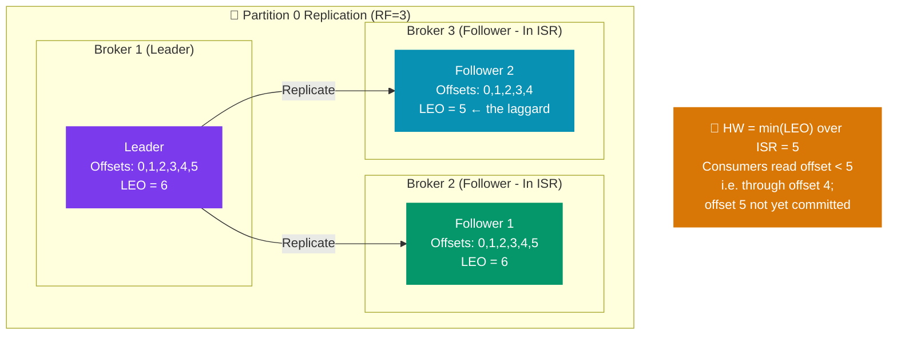

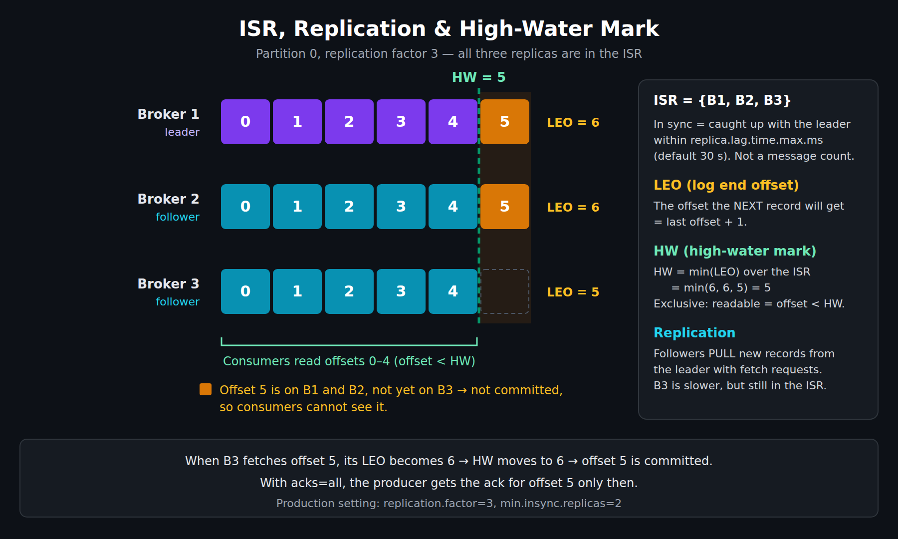

⚙️ **Replication configuration:**

| Property ⚙️ | Description 📋 | Default |
|-------------|---------------|---------|
| `replication.factor` | Number of replicas per partition | **`1`** — the broker's `default.replication.factor`. ⚠️ *Not* 3. |
| `min.insync.replicas` | Minimum ISRs required for a write to succeed (used with `acks=all`) | 1 |
| `replica.lag.time.max.ms` | Max time a follower can lag before being removed from ISR | 30000 (30s) |

> ⚠️ **"Usually 3" is a convention, not a default.**
> - The broker ships with `default.replication.factor=1`.
> - So a topic that gets **auto-created** (`auto.create.topics.enable=true`) ends up with **RF=1 and `min.insync.replicas=1`**.
> - If one broker dies, that partition is simply gone.
>
> This is the same kind of surprise as auto-created topics getting `num.partitions=1` (§2 Q5). **Always create topics explicitly** with a chosen RF, or raise the broker defaults. Naming the real default, not the convention, shows the difference between "I've read about Kafka" and "I've operated it."

⚠️ **Caution:** Say `min.insync.replicas=2` and only 1 replica is in sync (the leader). Then writes with `acks=all` will fail with `NotEnoughReplicasException`. This is a safety mechanism to prevent data loss.

💡 **Pro Tip:** The recommended production setup is `replication.factor=3` and `min.insync.replicas=2`. With this, the cluster can survive one broker failure without data loss or unavailability.

🌍 **Where those 3 replicas physically sit — rack awareness.** RF=3 gives you nothing if all three replicas are in the same availability zone (AZ) and that AZ goes down. Kafka handles this with **`broker.rack`**:

- Set it on each broker, to the AZ id.
- The replica-assignment algorithm then spreads a partition's replicas across *different* racks before it reuses one.

| Concern 🎯 | Setting / mechanism ⚙️ | Why it matters |
|---|---|---|
| Survive an AZ failure | `broker.rack=<az-id>` on every broker | Replicas are assigned round-robin across racks — RF=3 over 3 AZs means one AZ loss still leaves 2 in the ISR, so `min.insync.replicas=2` keeps writes flowing |
| Read from the nearest replica | `replica.selector.class=…RackAwareReplicaSelector` (broker) + `client.rack` (consumer) — **KIP-392** | A consumer can **fetch from an in-sync follower in its own AZ** instead of the (possibly remote) leader |
| Cross-AZ data-transfer cost | Same KIP-392 follower fetching | On a cloud provider, inter-AZ traffic is **billed**. Follower fetching is as much a **cost** decision as a latency one. Mention this in the interview |

⚠️ Follower fetching only serves data **below the high-water mark**. So it never weakens the consistency model. A follower cannot give you an uncommitted record. And it does **not** change writes: producers still go to the leader.

<details>
<summary><strong>🤔 Doubt: Walk the `acks=all` + `min.insync.replicas=2` failure scenario step by step</strong></summary>

Setup: `replication.factor=3`, `min.insync.replicas=2`, producer using `acks=all`.

- So one partition has **3 replicas** (1 leader + 2 followers).
- A write is only acked once **at least 2** of them (leader + ≥1 follower) have it.

| State | ISR size | `acks=all` write | Why |
|---|---|---|---|
| **Healthy** — all 3 caught up | 3 | ✅ Succeeds | Far above the min of 2 |
| **One replica down / lagging** | 2 (leader + 1 follower) | ✅ Still succeeds | ISR (2) **≥** `min.insync.replicas` (2) — the cluster *tolerates one failure* |
| **A second replica also drops** | 1 (leader only) | ❌️ **Fails** → `NotEnoughReplicasException` | ISR (1) **<** min (2); leader refuses the write to avoid an un-replicated (loss-prone) commit |

🧠 **How "synchronous" works:** with `acks=all`, the leader appends the record. But it **holds back the ack until the in-sync followers have fetched it**. That's why durability is *synchronous with respect to the ISR*, not fire-and-forget. (`acks=1` = ack after leader-only write; `acks=0` = no wait at all. Only `acks=all` uses `min.insync.replicas`.)

🔁 **Why retry is safe:** the failure happens **before** the record is committed. So a retry after a follower rejoins ISR won't create a duplicate. The producer just blocks/fails fast until 2 replicas are back in sync.

⚖️ **The trade-off in this setting:** `min.insync.replicas=2` chooses **consistency over availability**. Kafka would rather reject the write than accept one it can't safely replicate. Lowering it to 1 brings back availability, but data loss becomes possible again.

> ⚠️ **The off-by-one that changes your whole fault-tolerance math.** People very often say *"at least two brokers **along with** the leader must acknowledge"*. That describes three replicas, so it is wrong. **`min.insync.replicas` counts the leader itself.** With `min.insync.replicas=2`, the ISR needs leader + ≥1 follower = **2 total**.
>
> That is exactly why RF=3 + `min.insync.replicas=2` survives **one** broker failure:
> - Lose one → ISR=2 → still ≥ 2 → writes succeed.
> - Lose a second → ISR=1 → writes fail.

---

</details>
<br/>

---

</details>

---

6. **🗑️ What is the difference between log compaction and log deletion in Kafka? ⚡**

<!-- -->
<details>
<summary>Answer</summary>

**Answer:**

Kafka provides two cleanup policies to manage data retention in topics: **log deletion** and **log compaction**. They decide what happens to old messages.

| Feature | Log Deletion 🗑️ | Log Compaction 🧹 |
|---------|----------------|------------------|
| **Cleanup policy** | `cleanup.policy=delete` | `cleanup.policy=compact` |
| **Behavior** | Removes entire log segments older than retention period or size | Retains only the latest value for each key |
| **Use case** | Event logs, time-series data, transient messages | Changelogs, snapshots, state restoration |
| **Key requirement** | Keys are optional | Keys are mandatory (the broker rejects a record with a null key) |
| **Retention** | Time-based (`retention.ms`) or size-based (`retention.bytes`) | Keeps at least the latest record per key forever |
| **Data loss** | Old messages are permanently deleted | Only superseded values are removed; latest is always kept |
| **Example topic** | `user-clicks`, `page-views` | `user-profiles`, `__consumer_offsets` |

🧹 **How Log Compaction works:**

```
Before compaction:
  Offset:  0    1    2    3    4    5    6    7
  Key:     A    B    A    C    B    A    C    B
  Value:   v1   v1   v2   v1   v2   v3   v2   v3

After compaction:
  Offset:  5    6    7
  Key:     A    C    B
  Value:   v3   v2   v3
```

Only the latest value for each key is kept. Compaction removes the earlier values.

📝 **Note:** You can also use `cleanup.policy=compact,delete` (both together).

- Kafka will compact the log AND delete segments older than the retention period.
- Use this when you want compaction, but you also want to remove even the latest record for a key after some time.

🔑 **Key Point:** Kafka's internal topic `__consumer_offsets` uses log compaction. This is how Kafka stores consumer group offsets. It keeps only the latest committed offset for each group-partition pair.

🎯 **Interview Tip:** A common follow-up is *"How would you design a CDC (Change Data Capture) system?"* But **log compaction is not the whole answer. If you start with it, it sounds like you've only read about Kafka.** CDC has two halves:

1. **Getting the changes out of the database** → **Debezium** running on **Kafka Connect**. It reads the DB's write-ahead log as it grows (MySQL binlog / Postgres WAL). This is the part the question is really about. *(Detail: §5 Q8.)*
2. **Storing them usefully in Kafka** → key each record by primary key and set `cleanup.policy=compact`. Over time, the topic becomes a replayable snapshot of the current state of each row.

Compaction is the *storage* decision; Debezium + Connect is the *capture* mechanism. Name both.

---

</details>

---

7. **⚡ How does Kafka achieve such high throughput? Explain the key performance optimizations. 🔥**

<!-- -->
<details>
<summary>Answer</summary>

**Answer:**

Kafka's very high throughput (millions of messages/second) comes from several planned optimizations. Some are in the architecture, and some are at the OS level:

| Optimization 🔧 | How It Works 📋 | Impact ⚡ |
|-----------------|----------------|---------|
| **Sequential I/O** | Kafka appends messages to the end of log files sequentially instead of random disk seeks | Sequential throughput is **orders of magnitude** above random — no seek per write |
| **Zero-Copy Transfer** | Uses `sendfile()` system call to transfer data directly from page cache to network socket, bypassing user-space | Eliminates 2 copies and 2 context switches per transfer |
| **Page Cache** | Relies on OS page cache instead of JVM heap for caching. Kafka reads/writes go through the OS filesystem cache | No GC overhead; survives JVM restarts |
| **Batching** | Producers batch multiple messages into a single network request. Consumers fetch in batches | Amortizes network round-trip cost |
| **Compression** | Supports `gzip`, `snappy`, `lz4`, `zstd` compression at the batch level | Reduces network bandwidth and disk storage |
| **Partitioning** | Topics split into partitions that can be distributed across brokers | Linear horizontal scalability |
| **Append-only writes** | Messages are only appended, never updated in place | No write amplification, no fragmentation |

> ⚠️ **Don't quote the "600 MB/s vs 100 KB/s" figure.**
> - That comparison comes from a 2009 ACM Queue article (Adam Jacobs, *"The Pathologies of Big Data"*). The Kafka design docs quote it. It describes **spinning disks**, where a random write cost a physical head seek.
> - Any 2026 cluster runs on **NVMe / gp3**, where random I/O is hundreds of thousands of IOPS. The gap is real, but nothing like 6000×.
> - An interviewer who operates Kafka on SSDs will argue against the number.
>
> Explain the **mechanism** instead: *"sequential appends avoid seeks, let the OS do read-ahead and write-behind batching, and keep the working set in page cache — so the disk is almost never on the critical path."* The argument is still true on new hardware. The number is not.

🏗️ **Zero-Copy explained:**

```
Traditional Transfer (4 copies):
  Disk → Kernel Buffer → User Buffer → Socket Buffer → NIC

Zero-Copy Transfer (2 copies):
  Disk → Kernel Buffer (Page Cache) → NIC
  (Using sendfile() system call)
```

🧠 **In Simple Words:**
Kafka is fast for four reasons:

- It writes like a log (sequential).
- It uses the OS for caching (page cache).
- It sends data by a short path (zero-copy).
- It groups messages together, like a postal service (batching).

It avoids almost every bottleneck that traditional systems have.

⚡ **Performance numbers (typical):**

- Single broker: 500K–1M+ messages/second
- Single partition: 10–100 MB/s throughput
- End-to-end latency: 2–10ms (p99)

💡 **Pro Tip:** When asked "Why is Kafka fast?", mention all four key techniques: **sequential I/O**, **zero-copy**, **page cache**, and **batching**. This shows deeper understanding than just "it's distributed."

<details>
<summary><strong>🤔 Doubt: What are NIC and DMA in the zero-copy diagram — and does "zero-copy" really mean zero copies?</strong></summary>

**NIC = Network Interface Card** (also *Network Interface Controller*). It is the hardware adapter that connects the machine to the network. It physically puts bytes on the wire.

**DMA = Direct Memory Access.** It is a hardware mechanism. It lets a peripheral (disk controller, NIC) read/write main memory **directly**. The CPU does not have to move each byte through its registers.

🏗️ **How DMA works:**

1. CPU tells the DMA controller: *"move N bytes from device X to memory address Y."*
2. CPU is now **free**. It does other work.
3. The DMA controller runs the transfer over the bus on its own.
4. On completion it raises an **interrupt**, and the CPU handles the finish.

So the CPU pays a fixed setup + interrupt cost, not a **per-byte** cost. Without DMA (*programmed I/O*), the CPU would run a copy loop for the whole transfer.

⚠️ **The name "zero-copy" is slightly wrong.** It means **zero CPU copies**, not zero copies overall. The DMA engines still move the bytes. They just never pass them through user space.

| Path 🛣️ | Copies 📋 | Context switches 🔄 |
|---------|----------|---------------------|
| **Traditional** (`read()` + `write()`) | 4 — two **DMA**, two **CPU** | 4 |
| **Zero-copy** (`sendfile()`) | 2 — both **DMA** (needs NIC scatter-gather; else 3, one of them a CPU copy) | 2 |

**Traditional (`read()` + `write()`) — 4 copies, 4 context switches:**

1. Disk → kernel page cache — **DMA copy**
2. Kernel buffer → user buffer — **CPU copy** ❌️
3. User buffer → socket buffer — **CPU copy** ❌️
4. Socket buffer → NIC — **DMA copy**

**Zero-copy (`sendfile()`) — 2 copies (both DMA), 2 context switches:**

Zero-copy removes steps 2 and 3 — the two **CPU copies**. (This needs a NIC with scatter-gather DMA. Without it, one CPU copy from page cache to socket buffer stays, so 3 copies.) In those steps the processor was doing a `memcpy`. It was limited by memory bandwidth the whole time. The two copies that remain (disk → page cache, page cache → NIC) are DMA copies. So they cost the CPU almost nothing.

⚠️ The **copies** and the **context switches** are separate counts. People often mix them up.

- Each of `read()` and `write()` costs 2 switches (user → kernel → user). So the total is 4.
- `sendfile()` is a single syscall. So the total is 2.

💡 **Scatter-gather DMA:** a NIC that supports it can gather data from a list of *scattered* physical pages, not only from one contiguous region.

- This removes even the page-cache → socket-buffer step.
- The kernel just gives the NIC a list of descriptors (pointer + length).
- The NIC's DMA engine then reads bytes straight from the page cache.
- The CPU touches the data **zero** times.

🧠 **In Simple Words:**
Zero-copy doesn't remove all the copies. It removes the **CPU** from the copy path. Kafka gets this through Java's `FileChannel.transferTo()`, which maps to `sendfile()` internally. It sends log segments from page cache to consumer sockets. The data never enters the JVM heap.

---

</details>
<br/>

---

</details>

---

8. **👑 How does partition leadership and failover work in Kafka? ⚡**

<!-- -->
<details>
<summary>Answer</summary>

**Answer:**

Every Kafka partition has exactly one **leader** and zero or more **followers**. The leader handles all produce and consume requests for that partition. The followers passively replicate data.

🔑 **Leadership assignment:**

1️⃣ When a topic is created, Kafka's controller distributes partition leaders evenly across brokers.  
2️⃣ Each broker is the leader for some partitions and a follower for others. This balances the load.  
3️⃣ The leader information is stored in the cluster metadata (ZooKeeper or KRaft metadata topic).

🔄 **Failover process:**

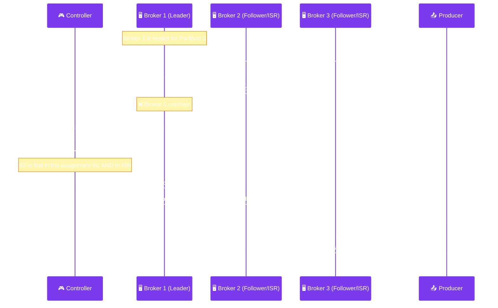

⚙️ **Failover details:**

- 🔍 **Detection:** The controller detects broker failure via heartbeat timeout (ZooKeeper session timeout or KRaft heartbeat).
- 👑 **Election:** The controller goes through the partition's **replica assignment list** (the AR, in *preferred-replica* order). It picks the **first entry that is currently in the ISR**.
  - ⚠️ Say it this way, not "the first replica in the ISR list". The ISR is an unordered set of members. The *ordering* that decides leadership lives in the assignment list.
  - **Preferred-leader election** works on exactly this difference. `auto.leader.rebalance.enable` (default `true`) moves leadership *back* to the first replica in the assignment list, from time to time, once it rejoins the ISR.
  - After a failover, too many leaders can end up on the surviving brokers. This is how Kafka spreads leadership out again (§0 — leadership spread).
- 📢 **Notification:** The controller tells all brokers. Clients are not told directly. Their next request fails (e.g. `NOT_LEADER_OR_FOLLOWER`), so they refresh metadata from any broker.
- ⏱️ **Duration:** Failover typically completes in seconds (faster with KRaft than ZooKeeper).

⚠️ **Unclean leader election:**

Say all ISR replicas are down and `unclean.leader.election.enable=true`. Then Kafka will elect a non-ISR replica as leader. This can cause **data loss**, because the new leader may be missing some committed messages.

| Setting ⚙️ | Behavior 📋 | Trade-off ⚖️ |
|-----------|-----------|------------|
| `unclean.leader.election.enable=false` (default) | Partition stays unavailable until an ISR replica recovers | ✅ No data loss, ❌️ Reduced availability |
| `unclean.leader.election.enable=true` | Non-ISR replica becomes leader | ❌️ Possible data loss, ✅ Higher availability |

🎯 **Interview Tip:** Always recommend `unclean.leader.election.enable=false` for financial or transactional systems where data loss is unacceptable. For logging or metrics systems, enabling it may be acceptable.

---

</details>

---

9. **🗄️ How does Kafka physically store a partition on disk? Explain segments, index files, and how an offset is looked up. ⚡**

<!-- -->
<details>
<summary>Answer</summary>

**Answer:**

A partition is **not one giant file**. It is a **directory** on the broker, split into fixed-size **segments**. Each segment is a set of three files. The files are named after the **base offset** (the offset of its first message):

```
/var/lib/kafka/logs/order-events-0/      ← one directory per partition (topic-partition)
├── 00000000000000000000.log             ← the actual messages (append-only)
├── 00000000000000000000.index           ← offset → byte-position (sparse)
├── 00000000000000000000.timeindex       ← timestamp → offset (sparse)
├── 00000000000000170100.log             ← next segment, base offset = 170100
├── 00000000000000170100.index
├── 00000000000000170100.timeindex
└── leader-epoch-checkpoint
```

🔑 **The key files:**

| File 📁 | Holds 📋 | Purpose |
|---------|----------|---------|
| **`.log`** | The actual records, appended sequentially | The source of truth; this is the "commit log" |
| **`.index`** | A **sparse** map of `offset → byte position in .log` | Jump near an offset without scanning from byte 0 |
| **`.timeindex`** | A **sparse** map of `timestamp → offset` | Powers time-based seeks & retention (`offsetsForTimes`) |

🟢 **Active vs closed segments:**

- Only the **last** segment is **active**. Kafka is currently appending to it.
- When the active segment reaches a size or age limit, Kafka **rolls** it. It closes it (now immutable) and opens a new active segment.

| Roll trigger ⚙️ | Config | Default |
|-----------------|--------|---------|
| Segment reaches size | `segment.bytes` | 1 GB |
| Segment reaches age | `segment.ms` | 7 days |

📍 **How an offset is looked up (e.g. "give me offset 170150"):**

```
1. Pick the segment   → binary search the segment base offsets (the filenames).
                        170150 falls in the 170100 segment (next base is higher).
2. Find a near byte   → binary search 170100.index for the largest indexed
                        offset ≤ 170150  → e.g. offset 170148 @ byte 64512.
3. Scan forward       → read .log sequentially from byte 64512 until offset 170150.
```

The `.index` is **sparse** on purpose.

- It stores an entry only every `index.interval.bytes` (default 4 KB), *not* per message.
- This keeps the index small enough to stay in the **OS page cache**.
- So the lookup is a couple of in-memory binary searches plus a short sequential scan. The index does not grow with every message.

💡 **Why this layout is smart:**

- 🗑️ **Retention/deletion is cheap.** Expiring old data = deleting whole closed segment files. No record-by-record rewriting. *(This is the "removes entire log segments" behavior from Q6.)*
- 🧹 **Compaction works per-segment.** The log cleaner rewrites closed segments, never the active one.
- ⚡ **Append-only + sequential.** Writes only touch the end of the active segment. This is what makes the sequential-I/O and page-cache gains from Q7 possible.

🛠️ **Inspect it yourself:**

```bash
# See the segment files of a partition
ls -lh /var/lib/kafka/logs/order-events-0/

# Decode a .log (or .index) segment into human-readable records
kafka-dump-log.sh --files /var/lib/kafka/logs/order-events-0/00000000000000000000.log --print-data-log
```

🎯 **Interview one-liner:**

- A partition is a directory of segment files, named by base offset.
- Each segment is a `.log` (the records) plus a sparse `.index` (offset→byte) and `.timeindex` (time→offset).
- Only the newest segment is active/appendable. Older ones are immutable.
- An offset read = binary-search the segment, binary-search its sparse index for a nearby byte, then scan forward.
- Deletion/compaction work on whole segments. So retention is just file removal.

<details>
<summary><strong>🤔 Doubt: Retention is capped by broker disk — how do you keep months of history without giant brokers?</strong></summary>

**Tiered storage (KIP-405)** — GA (generally available) since **Kafka 3.9 / 4.0**. It splits the log into two tiers. The segment layout above is exactly what makes this possible.

| Tier | Holds | Backed by |
|---|---|---|
| **Local** | The active segment + a recent window (`local.retention.ms`) | Broker's own disk |
| **Remote** | All older **closed** segments | Object storage (S3, GCS, Azure Blob) |

**Why the segment design makes this possible:** closed segments are **immutable whole files**.

- Once rolled, a segment can be uploaded to S3 and deleted locally, with no rewriting.
- A consumer that reads an old offset gets it fetched back from remote. The consumer does not see any difference.
- The API doesn't change. Only the storage location does.

```properties
remote.storage.enable=true
retention.ms=7776000000        # 90 days total history
local.retention.ms=86400000    # but only 1 day on broker disk
```

🔑 **Why it matters in interviews:** it removes the old trade-off *"long retention = expensive brokers."*

- Before, keeping 90 days meant sizing broker disks for 90 days.
- Brokers store data *and* serve traffic. So you were paying for compute just to hold cold (rarely read) bytes.
- Now retention is independent of broker sizing.
- This makes "just replay from the beginning" practical at large scale. Before, at that scale, it was a question of cost.

⚠️ Trade-off: when a read is not in the local tier, it gets object-storage latency (tens to hundreds of ms vs page-cache microseconds). This is fine for backfills and new-consumer replay. It is not fine for real-time consumers that care about tail latency.

---

</details>
<br/>

---

</details>

---

10. **🔒 How is Kafka secured? Explain authentication, authorization, and encryption. ⚡**

<!-- -->
<details>
<summary>Answer</summary>

**Answer:**

Kafka security has **three independent layers**. Interviewers ask about this because candidates often mix all three into "we use SSL". That answers only one third of the question.

| Layer | Question it answers | Mechanism |
|---|---|---|
| 🔐 **Encryption in transit** | Can someone read the traffic on the network? | **TLS/SSL** on the listener |
| 🪪 **Authentication** | *Who* is this client? | **SASL** (`PLAIN`, `SCRAM-SHA-512`, `GSSAPI`/Kerberos, `OAUTHBEARER`) or mTLS client certs |
| 🛡️ **Authorization** | What is this principal *allowed* to do? | **ACLs** (or RBAC in commercial distros) |

🔑 **Protocols you pick per listener.** This combination is what you actually configure:

| `security.protocol` | Encryption | Authentication |
|---|---|---|
| `PLAINTEXT` | ❌️ none | ❌️ none — dev only |
| `SSL` | ✅ TLS | mTLS client certificate (optional) |
| `SASL_PLAINTEXT` | ❌️ none | ✅ SASL — ⚠️ data is unencrypted; with `PLAIN`, the password is too |
| `SASL_SSL` | ✅ TLS | ✅ SASL — **← the production answer** |

🛠️ **Client config (`SASL_SSL` + SCRAM):**

```properties
security.protocol=SASL_SSL
sasl.mechanism=SCRAM-SHA-512
sasl.jaas.config=org.apache.kafka.common.security.scram.ScramLoginModule required \
    username="order-service" password="${KAFKA_PASSWORD}";
ssl.truststore.location=/etc/kafka/secrets/truststore.jks
ssl.truststore.password=${TRUSTSTORE_PASSWORD}
```

🛡️ **ACLs — authorization is per (principal, operation, resource):**

```bash
# Let order-service WRITE to the orders topic
kafka-acls.sh --bootstrap-server localhost:9092 --add \
  --allow-principal User:order-service \
  --operation Write --topic orders

# Let notification-service READ orders — and note it needs the GROUP ACL too
kafka-acls.sh --bootstrap-server localhost:9092 --add \
  --allow-principal User:notification-service \
  --operation Read --topic orders \
  --operation Read --group notif
```

> ⚠️ **The mistake almost everyone makes:** a consumer needs **two** ACLs.  
> - `Read` on the **topic** *and* `Read` on the **group**.  
> - If you grant only the topic ACL, the consumer fails with `GroupAuthorizationException`. At first, this does not look like a permissions problem at all.  
> - In the same way, a transactional producer needs `Write` on the topic **plus** `Write` on the `transactional.id` resource.

📝 **Other things worth naming:**

- **`allow.everyone.if.no.acl.found`** — defaults to `false`.
  - Once you enable an authorizer, *everything* is denied until you grant it explicitly.
  - If you set it to `true` to "make things work", you silently turn off your authorization model.
- **Encryption at rest** is **not** a Kafka feature. It is done at disk level (LUKS, EBS encryption) or at application level (encrypt the payload before `send()`). Kafka has no built-in message encryption.
- **Quotas** (`producer_byte_rate`, `consumer_byte_rate`, `request_percentage`) are set per principal/client-id. They stop one tenant from using up the whole cluster's resources.

🎯 **Interview one-liner:** Three separate layers:
- **TLS** for encryption in transit.
- **SASL** (SCRAM or Kerberos, or mTLS certs) for authentication.
- **ACLs** for authorization.

Production uses `SASL_SSL`. Encryption at rest is *not* Kafka's job. It is done at disk level, or by the application before publishing. And a consumer always needs both a topic ACL and a group ACL.

---

</details>

---

11. **🩺 How do you tell whether a Kafka cluster is healthy? Which broker-side metrics matter? ⚡**

<!-- -->
<details>
<summary>Answer</summary>

**Answer:**

Consumer lag (§3 Q4) tells you whether *your application* is keeping up. It says nothing about whether the **cluster** is healthy. The metrics below are the broker-side signals. Each one maps to a concrete failure you have already seen in earlier questions.

| Metric 📊 | Healthy value | What a bad value means | Ties back to |
|---|---|---|---|
| **`UnderReplicatedPartitions`** | **0** | Partitions whose ISR < replication factor. A broker is down or lagging. Your durability margin is gone. | §1 Q5 (ISR) |
| **`UnderMinIsrPartitionCount`** | **0** | ISR has fallen *below* `min.insync.replicas` → `acks=all` **writes are already failing** | §1 Q5, §2 Q2 |
| **`OfflinePartitionsCount`** | **0** | Partitions with **no leader** → completely unavailable for read *and* write | §1 Q8 |
| **`ActiveControllerCount`** | exactly **1** cluster-wide | `0` = no controller (no leader elections possible); `>1` = split brain | §1 Q4 |
| **`IsrShrinksPerSec` / `IsrExpandsPerSec`** | ~0, and shrink ≈ expand | If it keeps going up and down = a broker that is always slow (disk or network is at its limit) | §1 Q5 |
| **`RequestHandlerAvgIdlePercent`** | **> 30%** | Broker request threads are fully busy. The broker is the bottleneck, not your consumer. | §1 Q7 |
| **`NetworkProcessorAvgIdlePercent`** | **> 30%** | Network threads fully busy | §1 Q7 |
| **`LeaderCount` spread** | even across brokers | Uneven leadership = one broker is a hotspot while the others sit idle | §1 Q8 |

🚨 **The three that need action right away, even at 3 AM:** `OfflinePartitionsCount > 0`, `UnderMinIsrPartitionCount > 0`, and `ActiveControllerCount != 1`.
- Everything else is a warning.
- These three mean data is unavailable, or writes are being rejected *right now*.

🛠️ **How you actually collect them:**

```bash
# Quick CLI check — which partitions are under-replicated?
kafka-topics.sh --bootstrap-server localhost:9092 --describe --under-replicated-partitions

# Any partition with no leader at all?
kafka-topics.sh --bootstrap-server localhost:9092 --describe --unavailable-partitions
```

Brokers expose all metrics over **JMX**. The standard production stack is **JMX Exporter → Prometheus → Grafana**. You add Kafka Exporter for consumer-group lag (`kafka_consumergroup_lag`).

🌍 **Multi-cluster / DR — the usual follow-up question:**

**MirrorMaker 2** (built on Kafka Connect) copies topics between clusters. You use it for disaster recovery, geo-locality, or cluster migration.

- By default, it **prefixes** copied topics with the source alias (`us-east.orders`). This prevents replication loops in active-active setups.
- It also copies **consumer group offsets**, so a group can resume in the failover cluster. This needs `sync.group.offsets.enabled=true` (default `false`, added in 2.7). Without it, MM2 only writes checkpoints, and you must translate the offsets yourself.
  - But offsets are *translated*, not identical.
  - The reason: the same record generally lands at a **different offset** in the target cluster.
- ⚠️ Replication is **asynchronous** → a regional failover has a real **RPO > 0** (RPO = how much recent data you can lose).
  - You can lose the in-flight tail (the last records not yet copied).
  - If someone claims zero-data-loss cross-region Kafka failover, they are promising more than Kafka gives.

🎯 **Interview one-liner:** Consumer lag is an *application* signal. Cluster health is:
- `UnderReplicatedPartitions`, `UnderMinIsrPartitionCount`, `OfflinePartitionsCount`, and `ActiveControllerCount == 1`.
- Plus request-handler idle percentage, to tell whether the broker itself is overloaded.

You scrape them from JMX via Prometheus. For cross-cluster DR, use MirrorMaker 2. Be honest about the limit: async replication means a non-zero RPO.

---

</details>

---

## 2. Producer Internals

1. **📤 Explain the Kafka producer architecture. How does a message get from the producer to the broker? 🔥**

<!-- -->
<details>
<summary>Answer</summary>

**Answer:**

The Kafka producer sends messages through a pipeline of several stages. This makes sending efficient:

**① The application thread — turn a record into a queued batch:**


**② The background Sender thread: send batches and handle the ack:**

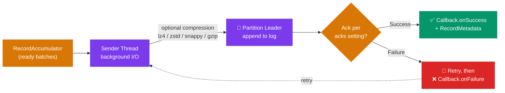

> 🔑 **The split between these two diagrams is the interview point.**  
> - `send()` only takes the record as far as the in-memory accumulator (diagram ①). That is why it returns instantly.  
> - Everything that can actually fail (network, leader election, `acks` durability, retries) happens later, on the **Sender thread** (diagram ②).  
> - That is why failures show up via callback/`Future`, and not as an exception thrown from `send()` itself.

🏗️ **Step-by-step process:**

1️⃣ **ProducerRecord creation:** The application creates a `ProducerRecord` with topic, optional key, value, optional partition, and optional headers.

2️⃣ **Serialization:** The configured serializers (`key.serializer`, `value.serializer`) serialize the key and value. Common serializers include `StringSerializer` (Apache Kafka), `JsonSerializer` (Spring Kafka), and `KafkaAvroSerializer` (Confluent).

3️⃣ **Partitioning:** The partitioner decides which partition the message goes to:
- If a partition is explicitly specified, use it.
- If a key is given, hash the key (`murmur2` hash), then take it modulo the number of partitions.
- If no key, use a sticky partitioner. It fills one partition's batch, then switches (Kafka 2.4+). Since Kafka 3.3 (KIP-794) it is adaptive: it also avoids slow brokers.

4️⃣ **Batching:** The message goes into the `RecordAccumulator`. It batches messages per topic-partition. `batch.size` and `linger.ms` control batching.

5️⃣ **Sending:** Compression (optional) happens earlier, when records are added to the batch in the accumulator, on the caller's thread. The background `Sender` thread picks up ready batches. It sends them as network requests to the partition leader.

6️⃣ **Acknowledgement:** The broker responds based on the `acks` setting. On success, the producer calls the callback. On failure, the producer may retry.

🛠️ **Example:**

```java
Properties props = new Properties();
props.put(ProducerConfig.BOOTSTRAP_SERVERS_CONFIG, "localhost:9092");
props.put(ProducerConfig.KEY_SERIALIZER_CLASS_CONFIG, StringSerializer.class.getName());
props.put(ProducerConfig.VALUE_SERIALIZER_CLASS_CONFIG, StringSerializer.class.getName());

KafkaProducer<String, String> producer = new KafkaProducer<>(props);

ProducerRecord<String, String> record =
    new ProducerRecord<>("orders", "order-123", "{\"amount\": 99.99}");

// Asynchronous send with callback
producer.send(record, (metadata, exception) -> {
    if (exception == null) {
        System.out.printf("Sent to partition %d, offset %d%n",
            metadata.partition(), metadata.offset());
    } else {
        exception.printStackTrace();
    }
});

producer.close();
```

📝 **Note:** The `send()` method is asynchronous. It returns a `Future<RecordMetadata>`. You can call `.get()` on it for synchronous behavior. But this greatly reduces throughput.

<details>
<summary><strong>🤔 Doubt: Synchronous vs Asynchronous?</strong></summary>

The one difference: *does the caller wait for the result before it moves to the next line?*

| | **Synchronous** | **Asynchronous** |
|---|---|---|
| Caller behavior | Calls, then **waits** for the result | Calls, **moves on** immediately |
| When you get the result | Inline, as the return value | Later — via callback / `Future` / event |
| Calling thread | Stuck until the work finishes | Free to do other work |
| Analogy | 📞 Phone call — you hold the line | 💬 Text message — go do other things |

**Synchronous:**
```java
User user = fetchUser(id);   // thread BLOCKS here until user comes back
sendEmail(user);             // only runs after fetchUser returns
```

**Asynchronous:**
```java
CompletableFuture<User> f = fetchUserAsync(id);  // returns INSTANTLY, no result yet
f.thenAccept(user -> sendEmail(user));           // "when it's ready, do this"
doSomethingElse();                               // runs NOW, doesn't wait
```

💡 **Why it matters:** the benefit is **thread utilization** (how well threads are used).
- A blocking (sync) call wastes a thread. The thread sits idle during I/O.
- 200 concurrent sync DB calls need ~200 parked threads.
- Async lets a small number of threads start all 200 calls. They handle the results as they arrive.
- That is the whole reason for reactive stacks (WebFlux, Netty).

⚠️ **The trap:** async is not "better". It has costs:
- It is harder to read. Stack traces break into pieces across callbacks.
- Error handling moves into `.exceptionally()` instead of `try/catch`.

Sync is simpler and correct for most CRUD code. Async is worth its complexity only when you are I/O-bound and short of threads.

🔗 **Kafka link:** `producer.send()` returns a `Future`, so it is *async*.
- Whether the actual network I/O happens *in parallel* depends on the Sender thread + broker.
- Async is the **calling model**. Parallel is the **runtime execution property**.
- One does not imply the other.

---

</details>
<br/>

---

</details>

---

2. **✅ What is the difference between acks=0, acks=1, and acks=all? When would you use each? 🔥🔥**

<!-- -->
<details>
<summary>Answer</summary>

**Answer:**

The `acks` (acknowledgements) configuration controls how many broker acknowledgements the producer needs. Only after it gets them does it treat a write as successful. It is the most important Kafka setting for choosing between durability and performance.

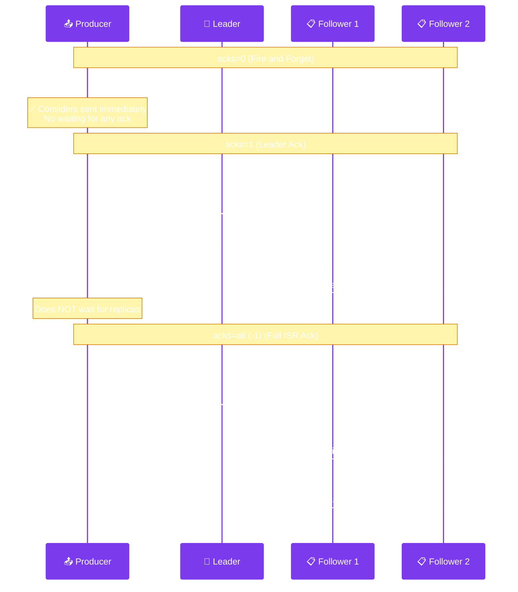

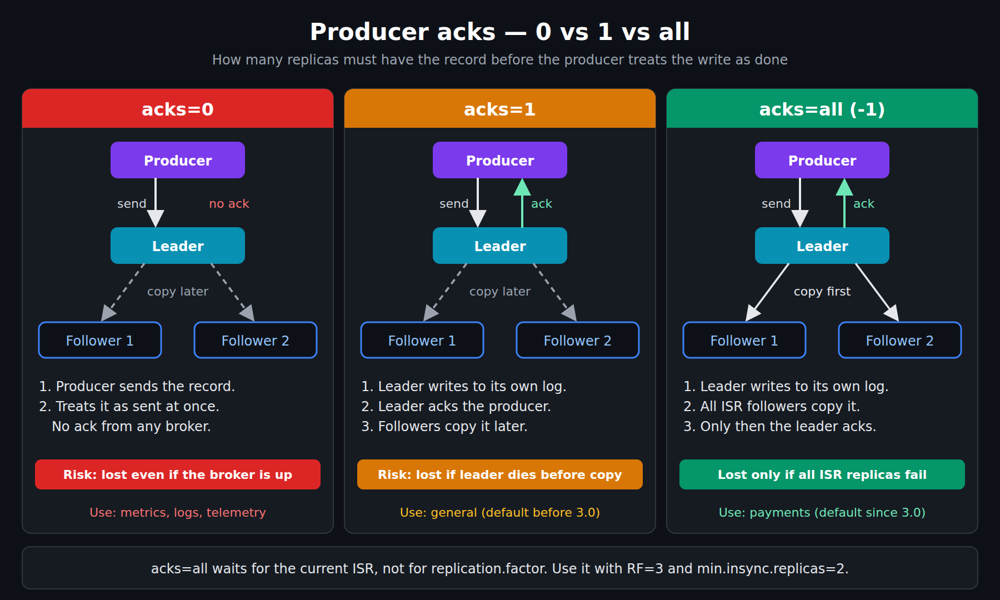

| Setting ⚙️ | Durability 🛡️ | Performance ⚡ | Data Loss Risk 🚨 | Use Case 🎯 |
|-----------|-------------|-------------|-----------------|----------|
| **`acks=0`** | ❌️ None | ⚡⚡⚡ Fastest | High — message may be lost even if broker is up | Metrics, logs, non-critical telemetry |
| **`acks=1`** | ⚠️ Leader only | ⚡⚡ Fast | Medium — lost if leader crashes before replication | Default before Kafka 3.0; general-purpose use cases |
| **`acks=all` (`-1`)** | ✅ Full ISR | ⚡ Slower | Low — lost only if all ISR replicas fail simultaneously | **Default since Kafka 3.0.** Financial transactions, payments, order processing |

⚠️ **Critical detail about `acks=all`:**

`acks=all` only guarantees that all replicas **in the ISR** have acknowledged. Say `min.insync.replicas=1` and there is only one replica in the ISR. Then `acks=all` behaves like `acks=1`. For true durability:

```properties
# Recommended production settings for critical data
acks=all
min.insync.replicas=2
replication.factor=3
```

This means: "Write succeeds only if at least 2 replicas (including the leader) have the message." The cluster can tolerate 1 broker failure.

⚠️ **Every replica count in Kafka includes the leader.** This is the most common off-by-one mistake in this answer. People read:
- `replication.factor=3` as "leader + 3 copies"
- `min.insync.replicas=2` as "leader + 2 followers"

Both are wrong:

| Setting ⚙️ | Counts the leader? | `=3` / `=2` actually means 📋 |
|---|---|---|
| `replication.factor=3` | ✅ Yes | **3 copies total** — leader + **2** followers |
| `min.insync.replicas=2` | ✅ Yes | leader + **1** follower must have the write |
| **ISR** (at full health) | ✅ Yes | all 3 — leader + both followers |

So with `replication.factor=3` + `min.insync.replicas=2`:

- **1 broker dies** → ISR drops to 2 → still ≥ the floor → writes continue. ✅
- **2 brokers die** → ISR = 1 → below the floor → broker rejects the produce with **`NotEnoughReplicasException`**. 🚨

That is exactly what "tolerates one broker failure" means. Note the opposite trap too: `replication.factor=1` is not "no replication plus a leader". It is **one copy total**: the leader alone, with no redundancy at all.

> 🧠 **Don't compute the ack set from `replication.factor`.**  
> - RF is the *upper limit*: how many copies the topic is configured to have.  
> - The **ISR** is what `acks=all` actually waits on. It shrinks dynamically when a follower lags (time-based, `replica.lag.time.max.ms`, 30s default).  
> - With RF=3 but both followers lagging, the ISR is `{leader}`. If `min.insync.replicas=1`, `acks=all` acks after the leader alone.  
> - `min.insync.replicas` is the **floor that makes that case fail with a clear error, not silently**. It is never the thing the producer waits on.

🧠 **In Simple Words:**
- `acks=0`: "I sent it, I don't care if anyone received it." (fire and forget)
- `acks=1`: "The leader got it, good enough." (leader only)
- `acks=all`: "Everyone in the sync group got it, now I'm satisfied." (full durability)

🎯 **Interview Tip:** When you discuss durability, always pair `acks=all` with `min.insync.replicas=2`. Interviewers look for this exact combination to test your depth.

---

</details>

---

3. **🔁 What are producer retries and the idempotent producer? How does enable.idempotence work? 🔥**

<!-- -->
<details>
<summary>Answer</summary>

**Answer:**

**Producer retries** handle transient failures (network issues, broker leader changes). The producer automatically resends failed messages. The **idempotent producer** makes sure that retries do not create duplicate messages.

⚙️ **Retry configuration:**

| Property ⚙️ | Description 📋 | Default |
|-------------|---------------|---------|
| `retries` | Maximum number of retry attempts | `2147483647` (Integer.MAX) |
| `retry.backoff.ms` | Wait time between retries | `100` ms |
| `delivery.timeout.ms` | Total time for a send (including retries) | `120000` (2 min) |
| `max.in.flight.requests.per.connection` | Max unacknowledged requests per broker connection | `5` |

🚨 **The duplication problem:**

Without idempotence, this can happen:
1. The producer sends a message, and the broker writes it.
2. The ack is lost (network issue).
3. The producer retries, and the broker writes the same message again.

The result is **duplicates**.

```
Producer sends msg-A  →  Broker writes msg-A  →  Ack lost!
Producer retries msg-A  →  Broker writes msg-A again  →  DUPLICATE!
```

🛡️ **Idempotent Producer (`enable.idempotence=true`):**

When it is enabled, Kafka gives each producer a unique **Producer ID (PID)**. Each message gets a **sequence number**. The broker tracks the last sequence number per PID per partition, and rejects duplicates.

```properties
# Enable idempotent producer
enable.idempotence=true
# Implicitly sets:
#   acks=all
#   retries=Integer.MAX_VALUE
#   max.in.flight.requests.per.connection <= 5
```

🔑 **Key Points:**

- 🆔 **PID (Producer ID):** The broker assigns it when the producer initializes. Unique per producer instance.
- 🔢 **Sequence Number:** Producer-side. Monotonically increasing per partition. The broker validates: `expected_seq = last_committed_seq + 1`.
- 🛡️ **Guarantee:** Exactly-once delivery to a single partition (within a single producer session).
- ⚠️ **Limitation:** Idempotence alone does not guarantee exactly-once across multiple partitions or across producer restarts. For that, you need the **transactional producer**.

🛠️ **Example:**

```java
Properties props = new Properties();
props.put(ProducerConfig.BOOTSTRAP_SERVERS_CONFIG, "localhost:9092");
props.put(ProducerConfig.ENABLE_IDEMPOTENCE_CONFIG, true);   // Enable idempotence
props.put(ProducerConfig.KEY_SERIALIZER_CLASS_CONFIG, StringSerializer.class.getName());
props.put(ProducerConfig.VALUE_SERIALIZER_CLASS_CONFIG, StringSerializer.class.getName());

KafkaProducer<String, String> producer = new KafkaProducer<>(props);
// Now retries will not produce duplicates
```

📝 **Note:** Since Kafka 3.0, `enable.idempotence=true` is the **default**. You get exactly-once per partition automatically, unless you explicitly disable it.

🎯 **Scope of the guarantee — say this exactly:** exactly-once delivery **to a single partition, within a single producer session.**

❌️ **What idempotence does *not* cover:**

| Gap | Why it fails |
|---|---|
| **Across multiple partitions** | The PID + sequence-number state is tracked **per partition**. There is no atomicity spanning partitions. |
| **Across producer restarts** | A restart gets a **brand-new PID**, so the broker's dedup state for the old PID is useless. And nothing fences the old instance, so it can continue to write. |

The **transactional producer (Q4)** closes exactly these two gaps. It uses a stable `transactional.id` instead of a short-lived PID.

> ⚠️ **Where the duplicate actually comes from:** the failure is in the **ack path, not the write path.**  
> - The broker *did* commit the record. Only the acknowledgement was lost.  
> - The producer then retries and appends the record again.  
> - PID is **broker-assigned**. The sequence number is **producer-side and per-partition**. The broker validates `expected_seq = last_committed_seq + 1`.

🎯 **Interview Tip:** Clearly separate the idempotent producer (exactly-once to a single partition) from the transactional producer (exactly-once across multiple partitions). This is a common trick question.

---

</details>

---

4. **🔐 What is a transactional producer and how does it enable exactly-once semantics? 🔥**

<!-- -->
<details>
<summary>Answer</summary>

**Answer:**

The **transactional producer** extends the idempotent producer. It gives exactly-once semantics across multiple partitions and topics, within a single atomic transaction. It uses a protocol similar to two-phase commit (`2PC`). A **Transaction Coordinator** on the broker side coordinates it.

🏗️ **How it works:**

1️⃣ The producer is assigned a `transactional.id` (configured by the application, survives restarts).  
2️⃣ On startup, the producer registers with the Transaction Coordinator. It gets a **Producer Epoch** (this fences out zombie instances with the same `transactional.id`).  
3️⃣ Messages sent inside a transaction are written to the target partitions, but marked as **uncommitted**.  
4️⃣ On `commitTransaction()`, the coordinator writes a commit marker to all involved partitions.  
5️⃣ Consumers configured with `isolation.level=read_committed` only see committed messages.

🛠️ **Example:**

```java
Properties props = new Properties();
props.put(ProducerConfig.BOOTSTRAP_SERVERS_CONFIG, "localhost:9092");
props.put(ProducerConfig.ENABLE_IDEMPOTENCE_CONFIG, true);
props.put(ProducerConfig.TRANSACTIONAL_ID_CONFIG, "order-processing-txn-1");
props.put(ProducerConfig.KEY_SERIALIZER_CLASS_CONFIG, StringSerializer.class.getName());
props.put(ProducerConfig.VALUE_SERIALIZER_CLASS_CONFIG, StringSerializer.class.getName());

KafkaProducer<String, String> producer = new KafkaProducer<>(props);
producer.initTransactions();  // Required: register with Transaction Coordinator

try {
    producer.beginTransaction();

    // Send to multiple topics/partitions atomically
    producer.send(new ProducerRecord<>("orders", "key1", "order-created"));
    producer.send(new ProducerRecord<>("inventory", "key1", "stock-decremented"));
    producer.send(new ProducerRecord<>("notifications", "key1", "email-queued"));

    producer.commitTransaction();  // All or nothing
} catch (ProducerFencedException e) {
    // Another producer with same transactional.id took over
    producer.close();
} catch (KafkaException e) {
    producer.abortTransaction();  // Rollback all messages in this transaction
}
```

🔑 **Key Properties:**

| Property ⚙️ | Purpose 📋 |
|-------------|-----------|
| `transactional.id` | Unique identifier for the transactional producer. Survives restarts. |
| `enable.idempotence` | Must be `true` (automatically set when `transactional.id` is configured) |
| `isolation.level` (consumer) | `read_committed` to only read committed transactional messages |

⚠️ **Caution:** Transactional writes cost extra latency and throughput.
- **Describe the cost per *commit*, not per record.**
  - The overhead is the transaction-coordinator round trips, plus the commit markers written to every partition the transaction touched.
  - You pay it **once per `commitTransaction()`**.
- So what you really control is your **transaction size / commit interval**.
  - Put thousands of records in one transaction. Then the overhead per record becomes tiny.
  - If you commit after every record, the overhead becomes the largest cost.
- ⚠️ **Don't quote a hard millisecond figure** in an interview.
  - It depends entirely on commit frequency, partition fan-out and network RTT.
  - An interviewer can easily question a specific number.
- Use transactions only when you really need atomicity across partitions (e.g. read-process-write in stream processing).

🧠 **In Simple Words:**
Think of the transactional producer like a database transaction. Either all messages in the transaction are committed and visible to consumers, or none of them are. There is no partial write.

<details>
<summary><strong>🤔 Doubt: If `transactional.id` is a fixed value (e.g. "order-service-1"), it stays the same after a producer restart — isn't that a problem?</strong></summary>

It is the **opposite**. The `transactional.id` *must* stay the same across restarts. This stable ID **is** what lets exactly-once keep working after a restart.

When the restarted producer calls `initTransactions()`, the broker (transaction coordinator) does two things. Both are keyed by that `transactional.id`:

🛡️ **1. Epoch bump (zombie fencing):**
- The coordinator keeps a `(transactional.id → producer epoch)` mapping.
- Every `initTransactions()` **increments the epoch** for that ID.
- Say an *older* instance is still alive with the same ID but a **lower epoch**. Its next send/commit is rejected with `ProducerFencedException`.
- The old JVM may still be alive. For example, it may be hung, paused by GC, or cut off by a network partition. This is called a "zombie". Even then, it can no longer write. **Latest epoch wins → exactly one active producer per ID.**

♻️ **2. In-flight transaction recovery:**
- `initTransactions()` also **aborts (rolls back) any pending transaction** that the previous instance left half-open.
- This makes recovery atomic. Say a transaction started but was never committed before the crash. The coordinator cleans it up before the new instance continues.
- No leftover state. No partial writes leak to `read_committed` consumers.

```java
props.put(ProducerConfig.TRANSACTIONAL_ID_CONFIG, "order-service-1");
// ...
producer.initTransactions();   // on restart: bumps epoch, fences zombies,
                               // aborts the previous instance's pending txn
```

❌️ **What would actually break things:** assigning a **random/new** ID on each restart.
- The crashed instance's hung transaction never gets aborted (nothing bumps its epoch) → stuck/abandoned transactions.
- No fencing → a zombie old instance keeps producing duplicates alongside the new one.

✅ **The real rule (the detail interviewers test):**

> `transactional.id` must be **stable across restarts of the *same logical producer*, but unique across *different concurrent producers*.**

- One logical producer that restarts → reuse the same ID.
- Two instances running **at the same time** must **not** share an ID.
  - They would fence *each other* again and again (each `initTransactions()` bumps the epoch and kills the other).
  - Give them `"order-service-1"`, `"order-service-2"`, etc.

This is why **Kafka Streams** builds `transactional.id` for you. The old `exactly_once` (v1) used one producer per task: `application.id + task id`. `exactly_once_v2` (Kafka 3.0+) uses one producer per stream thread. Fencing of zombies then uses the consumer group generation (KIP-447).

---

</details>
<br/>

<details>
<summary><strong>🤔 Doubt: Is it mandatory to configure `transactional.id` manually — and what does a configured value look like?</strong></summary>

**It depends on which guarantee you want:**

- **Transactions (atomic multi-partition / exactly-once across partitions)** → ✅ **mandatory, no default.**
  - `transactional.id` has *no* auto-generated value. You must set it explicitly.
  - This is on purpose. The broker needs a stable ID that you choose. It uses this ID to fence zombies across restarts.
  - Calling `initTransactions()` / `beginTransaction()` without it throws: `IllegalStateException: Cannot use transactional methods without enabling transactions by setting the transactional.id`.
- **Idempotence only (exactly-once *per partition*, dedup on retries)** → ❌️ **don't set it.**
  - Idempotence uses an auto-assigned **PID** from the broker.
  - `enable.idempotence=true` is the **default since Kafka 3.0**. You configure nothing.

🛠️ **Example 1 — raw `KafkaProducer` (set it explicitly):**

```java
Properties props = new Properties();
props.put(ProducerConfig.BOOTSTRAP_SERVERS_CONFIG, "localhost:9092");
props.put(ProducerConfig.KEY_SERIALIZER_CLASS_CONFIG, StringSerializer.class.getName());
props.put(ProducerConfig.VALUE_SERIALIZER_CLASS_CONFIG, StringSerializer.class.getName());

// 👇 The transactional.id — a stable, human-chosen string
props.put(ProducerConfig.TRANSACTIONAL_ID_CONFIG, "order-service-tx-1");
// enable.idempotence=true is auto-set once transactional.id is present

KafkaProducer<String, String> producer = new KafkaProducer<>(props);
producer.initTransactions();   // registers the id with the coordinator, bumps epoch

try {
    producer.beginTransaction();
    producer.send(new ProducerRecord<>("orders", "order-42", "CREATED"));
    producer.send(new ProducerRecord<>("audit",  "order-42", "ORDER_CREATED"));
    producer.commitTransaction();   // both topics commit atomically, or neither
} catch (KafkaException e) {
    producer.abortTransaction();
}
```

The value `"order-service-tx-1"` is just a string you choose. Common conventions:
- `<service>-tx-<instance>` → `payment-service-tx-1`
- `<service>-<pod-ordinal>` → `order-service-2` (e.g. a StatefulSet pod index)
- `<app>-<partition>` → `inventory-consumer-p3` (read-process-write, one ID per input partition)

🛠️ **Example 2 — Spring Kafka (set a *prefix*, Spring makes it unique):**

```properties
spring.kafka.producer.transaction-id-prefix=order-service-tx-
```

```java
@Transactional   // Spring begins/commits the Kafka transaction around this method
public void placeOrder(Order order) {
    kafkaTemplate.send("orders", order.id(), "CREATED");
    kafkaTemplate.send("audit",  order.id(), "ORDER_CREATED");
}
```

Spring adds a per-producer suffix to your prefix → `order-service-tx-0`, `order-service-tx-1`, … This keeps concurrent producers unique automatically.

🛠️ **Example 3 — Kafka Streams (you don't set it; it's derived):**

```properties
application.id=order-processor
processing.guarantee=exactly_once_v2
```

With `exactly_once_v2`, Streams derives `transactional.id` internally per stream thread, as ~`order-processor-<processId>-<threadIdx>`. (The old v1 used one per task, e.g. `order-processor-0_3`.) You never write `transactional.id` yourself.

> ⚠️ Whatever value you pick, only one rule matters: **stable across restarts of the same logical producer, unique across concurrently-running producers.**

---

</details>
<br/>

<details>
<summary><strong>🤔 Doubt: If a transactional producer sends msg-1 then msg-2, how does the broker know msg-2 isn't a duplicate — is dedup the transaction's job?</strong></summary>

**No — the transactional producer does no deduplication of its own. It gets it from the idempotent producer underneath.**

Setting `transactional.id` auto-sets `enable.idempotence=true`. So the dedup mechanism underneath is exactly the **PID + per-partition sequence number** of Q3. The transaction layer adds nothing to it.

🔢 **What actually separates a new message from a retry:** the sequence number is assigned **once, at first send, and is never re-assigned on retry.**

```
msg-1  → seq 5   broker: last=4, expects 5  → accept (new)
msg-2  → seq 6   broker: last=5, expects 6  → accept (new)
retry of msg-1 → still seq 5
                 broker: last=5, expects 6  → duplicate → discard, ack anyway
```

The thing that tells them apart is the **sequence number**. It is never the payload, and never a timestamp.
- So two *deliberately identical* payloads get two different sequence numbers, and **both get written**.
- This is correct: Kafka dedups **retries**, not **repeats**.

🧱 **The two layers, kept separate:**

| Layer | Solves | Mechanism |
|---|---|---|
| **Idempotence** | "don't write the same record twice" — one partition, one session | PID + per-partition sequence, `expected_seq = last + 1` |
| **Transaction** | "make N writes visible all-or-nothing" + "survive restarts, fence zombies" | `transactional.id`, producer **epoch**, commit markers, consumer `isolation.level=read_committed` |

🔗 **Why the layering matters (this is the key interview point):**
- A plain idempotent producer gets a **fresh anonymous PID** on restart. So its dedup state is lost with the old PID.
- That is exactly the "does not survive producer restarts" gap in Q3.
- A transactional producer gets its PID back **through the Transaction Coordinator, keyed to the stable `transactional.id`**.
- The transaction layer does not dedup. It gives dedup a **durable identity** (an ID that survives restarts).

> 🎯 **Say it like this:** "Transactions don't deduplicate — idempotence does, via PID plus sequence number. Transactions add atomic multi-partition visibility and, by pinning a stable `transactional.id`, let that dedup state survive a restart."

---

</details>
<br/>

<details>
<summary><strong>🤔 Doubt: Is the producer epoch a timestamp? And does bumping it delete the old instance's messages?</strong></summary>

**No to both.** There are three separate wrong ideas here. Each one alone can fail you in an interview.

🔢 **1. The epoch is a counter, not a clock.**

It is a monotonically increasing integer (`short`, starts at `0`).
- The Transaction Coordinator holds it per `transactional.id`.
- It is persisted durably in the internal **`__transaction_state`** topic.
- Every `initTransactions()` does `epoch = epoch + 1`.
- No wall-clock time is read anywhere.

> 🧠 **Why it cannot be a timestamp:**  
> - Clocks skew across machines. Fencing must be an **exact** yes/no: "is this writer stale?".  
> - So Kafka uses a number that the coordinator itself owns and increments.  
> - The same reasoning explains why offsets order the log instead of times. It also explains why `replica.lag.time.max.ms` is measured broker-side, and not by comparing producer timestamps.  
> - **Distributed systems fence with generation numbers, never with time.**

🚪 **2. Fencing works only forward in time. It blocks future writes; it does not remove past ones.**

| ❌️ Misconception | ✅ Reality |
|---|---|
| Bumping the epoch discards messages sent before it | **Committed transactions are untouched**: durable, visible, done. Only the one **still-open** transaction from the previous epoch is aborted. |
| Fencing removes past writes | The zombie's **next** send/commit is rejected with `ProducerFencedException`. Nothing already written is revoked. |

🗑️ **3. An aborted transaction's records are not deleted.**

Kafka is an **append-only log — nothing is erased.**
- The coordinator writes an **abort marker**.
- Consumers on `isolation.level=read_committed` **skip** those records while reading.
- The bytes stay on disk until ordinary retention removes them. A `read_uncommitted` consumer still sees them.

♻️ **The corrected sequence (GC-paused pod, replacement started):**

1. New pod calls `initTransactions()` → coordinator bumps epoch `4 → 5`. It **aborts** whatever the epoch-4 instance left open (abort marker written; records remain, `read_committed` skips them).
2. New pod writes at epoch 5. Normal operation.
3. Zombie wakes up holding epoch 4 and tries to commit → `4 < 5` → **`ProducerFencedException`**. Its transaction was already aborted in step 1.

Everything epoch-4 **committed** before the pause is still there and still valid.

📦 **What actually travels over the network:** the record batch header (v2 format, since 0.11) carries these fields, **once per batch**:

| Field | Type | Purpose |
|---|---|---|
| `producerId` (PID) | int64 | who is writing |
| `producerEpoch` | int16 | which generation of that writer |
| `baseSequence` | int32 | dedup anchor; each record stores only a varint delta from it |
| attributes | bit flags | includes `isTransactional`, `isControlBatch` |

⚠️ **`transactional.id` is never sent per message.**
- It is used exactly once, at `initTransactions()`, to resolve to a `(PID, epoch)` pair.
- After that, the PID **is** the short ID that stands for it.
- Compare the cost on the hot path (the code that runs on every send): a string of any length like `payment-service-tx-1`, versus 10 fixed bytes.

Two consequences to remember:

- 📉 **Per batch, not per record.** One header covers thousands of records. This is part of why Kafka batching is so cheap. It links directly to `batch.size` / `linger.ms` and the sticky partitioner *(§2 Q1, §2 Q6)*.
- 🏷️ **Commit/abort markers are themselves control batches.** They are written into every partition the transaction touched, and carry the same PID + epoch. That is how a `read_committed` consumer knows what to skip: it reads the markers from the same log, in order.

> 🎯 **The one-liner:** both broker-side checks are integer comparisons on that header: `epoch >= current` (fencing) and `sequence == last + 1` (dedup). **No strings, no clocks.**

---

</details>
<br/>

---

</details>

---

5. **🔑 Explain key-based partitioning vs round-robin. How does the default partitioner work? ⚡**

<!-- -->
<details>
<summary>Answer</summary>

**Answer:**

The Kafka producer's **partitioner** decides which partition a message goes to. The strategy depends on whether the message has a key.

| Strategy 🔧 | When Used 📋 | Behavior ⚙️ | Ordering Guarantee 📊 |
|------------|------------|-----------|---------------------|
| **Key-based hashing** | Message has a non-null key | `toPositive(murmur2(key)) % numPartitions` | ✅ Same key always goes to same partition |
| **Sticky partitioner** (2.4+; replaced by *adaptive* in 3.3 — see below) | Message has null key | Fills one batch for a chosen partition, then switches | ❌️ No ordering guarantee |
| **Round-robin** (legacy) | Message has null key (pre-2.4) | Distributes one message per partition in rotation | ❌️ No ordering guarantee |

🔑 **Key-based partitioning:**

```java
// These two messages will ALWAYS go to the same partition
producer.send(new ProducerRecord<>("orders", "user-123", "order-A"));
producer.send(new ProducerRecord<>("orders", "user-123", "order-B"));

// This will likely go to a different partition
producer.send(new ProducerRecord<>("orders", "user-456", "order-C"));
```

⚠️ **Warning:** If the number of partitions changes (e.g., from 4 to 6), the key-to-partition mapping changes. Messages for the same key may now go to a different partition. Do not change the partition count for topics that depend on key-based ordering.

🏗️ **Sticky Partitioner (Kafka 2.4+):**

The sticky partitioner makes batching more efficient for keyless messages.

- Round-robin spreads messages across partitions one at a time. This gives many small batches.
- The sticky partitioner "sticks" to one partition until the batch is full. Then it switches to another.
- The result is fewer, larger batches and better throughput.

```
Round-robin (old):     msg1→P0, msg2→P1, msg3→P2, msg4→P0  (3 small batches)
Sticky (new):          msg1→P0, msg2→P0, msg3→P0, msg4→P1  (1 full batch + 1 partial)
```

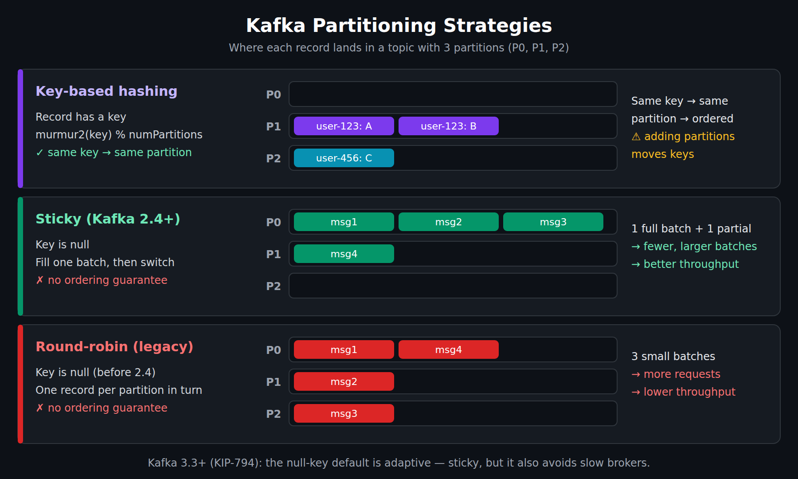

📝 **Note:** For ordered event processing, always use a message key. For example, all events for user-123 must be processed in order. The key sends all messages for that entity to the same partition. Kafka guarantees order within a partition.

🆕 **Up-to-date check — "sticky" is no longer the full answer (KIP-794, Kafka 3.3).**

- `DefaultPartitioner` and `UniformStickyPartitioner` were **deprecated in 3.3**.
- The built-in null-key behaviour became **adaptive partitioning**.
- The producer no longer switches partition only when the batch fills. It also tracks the queue depth per broker.
- It **sends more records to brokers that are keeping up**, and avoids a slow or overloaded broker.

Three settings came with it:

| Property ⚙️ | Meaning 📋 | Default |
|---|---|---|
| `partitioner.adaptive.partitioning.enable` | Steer null-key records toward faster brokers instead of pure sticky rotation | `true` |
| `partitioner.availability.timeout.ms` | How long a broker must be unresponsive before it's skipped for new batches (`0` disables the behaviour) | `0` |
| `partitioner.ignore.keys` | Ignore the key entirely and partition as if keyless — throughput over per-key ordering | `false` |

In an interview, you still describe the sticky *idea* (batch-then-switch). But do not say "default since 2.4" as if nothing changed. Say **"sticky since 2.4, and adaptive since 3.3, which additionally avoids lagging brokers."** That one clause answers the next likely question before the interviewer asks it: *"and has that changed since?"*

<details>
<summary><strong>🤔 Doubt: Where do we configure key-based vs round-robin, and what exactly is "the key"?</strong></summary>

There is **no config property** that switches between the two. It is decided **per message**: did you put a **key** in the `ProducerRecord` or not? The "key" is an optional field you pass at send time.

🔑 **Where the key lives — in `ProducerRecord`:**

```java
// ProducerRecord(topic, key, value)
//                       ↑ THIS is the key

// 1️⃣ WITH a key → key-based partitioning (hash the key)
producer.send(new ProducerRecord<>("orders", "user-42", "ORDER_CREATED"));
//                                            ^^^^^^^^^  key = "user-42"
// → partition = toPositive(murmur2(key)) % numPartitions
// → every record with "user-42" lands on the SAME partition → ordered per user

// 2️⃣ WITHOUT a key → sticky/round-robin (load-balanced)
producer.send(new ProducerRecord<>("orders", "ORDER_CREATED"));
//                                  no key → null
// → spread across partitions for throughput, NO per-entity ordering
```

So the "switch" is just: **provide a key, or don't.** With the same producer and the same topic, you can do both on different sends.

🧩 **What the key actually is:** your choice of **grouping field**. It is the field whose records must stay in order together on one partition:
- `userId` → all of one user's events ordered
- `orderId` → all updates to one order ordered
- `accountId`, `deviceId`, `tenantId` — any entity identity

`key.serializer` serializes the key (separate from `value.serializer`). The key is also what **log compaction** (Kafka keeps only the latest record per key) uses.

⚙️ **How the default partitioner decides (routing order):**

| Condition | Partition chosen |
|---|---|
| Partition explicitly set in `ProducerRecord` | Use that exact partition |
| Key is present (non-null) | `toPositive(murmur2(keyBytes)) % numPartitions` — **deterministic** |
| Key is null | **Sticky partitioning** — fill one partition's batch, then switch (adaptive since 3.3) |

🛠️ **You can override routing entirely** with a custom partitioner (the Q7 topic):

```java
props.put(ProducerConfig.PARTITIONER_CLASS_CONFIG, MyCustomPartitioner.class.getName());
```

🔢 **And what is `numPartitions`?** It is **not a producer setting**. It is a property *of the topic*, fixed when the topic is created. The producer just fetches it from cluster metadata and puts it into the formula. You set it at the **topic level**:

```bash
# Explicit at topic creation (--partitions 12 → numPartitions = 12)
kafka-topics.sh --create --topic orders \
  --partitions 12 \
  --replication-factor 3 --bootstrap-server localhost:9092
```

```java
// Programmatic (Spring / AdminClient)
@Bean
public NewTopic ordersTopic() {
    return TopicBuilder.name("orders").partitions(12).replicas(3).build();
}
```

If a topic is **auto-created** (`auto.create.topics.enable=true`), it uses the broker default `num.partitions=1`. This is a common trap: it leaves you with zero parallelism. Always create topics explicitly, with a count you chose on purpose.

The producer does not control this number. On the first send:

- it fetches **metadata** → learns the partition count → computes `toPositive(murmur2(keyBytes)) % count`
- it caches the count and refreshes it (`metadata.max.age.ms`, default 5 min), so it notices newly added partitions.

📊 **Why the count matters (interview angle):**

| Concern | Effect of partition count |
|---|---|
| **Parallelism** | Max active consumers in a group = numPartitions. 12 partitions → 13th consumer sits idle. |
| **Throughput** | More partitions → more parallel writes/reads → higher aggregate throughput. |
| **Ordering** | Guaranteed only *within* a partition (i.e. per key). |
| **Key stability** | Routing is `% numPartitions`, so changing it reshuffles every key's mapping. |

⚠️ **Trap:** `hash % numPartitions` means **adding partitions reshuffles the mapping**.

- `user-42` may move to a different partition after the topic grows. Its old and new events then sit on different partitions.
- You can only **increase** partitions, never decrease. Increasing breaks key→partition stability.
- Per-key ordering holds only *from that point on*.
- On a keyed topic, **give it plenty of partitions at the start**. Do not plan to add more later.

📐 **Rough sizing rule:** `numPartitions ≈ max(target_throughput / per_partition_throughput, peak_consumers_in_group)`, rounded up with spare room. Typical values: 6–12 for moderate topics, 30+ for high-volume ones.

---

</details>
<br/>

---

</details>

---

6. **⚙️ What are the key producer configuration parameters for performance tuning? ⚡**

<!-- -->
<details>
<summary>Answer</summary>

**Answer:**

You can tune Kafka producer performance a lot. The settings with the biggest effect fall into three groups: batching, memory, and reliability.

| Property ⚙️ | Description 📋 | Default | Tuning Guidance 🎯 |
|-------------|---------------|---------|-------------------|
| `batch.size` | Max bytes per batch (per partition) | `16384` (16 KB) | Increase to 32-64 KB for higher throughput |
| `linger.ms` | Time to wait for additional messages before sending a batch | `0` (`5` since Kafka 4.0, KIP-1030) | Set to 5-50 ms to allow batch filling |
| `buffer.memory` | Total memory for buffering unsent messages | `33554432` (32 MB) | Increase if producer is faster than broker |
| `max.in.flight.requests.per.connection` | Max unacked requests per broker | `5` | ⚠️ **Leave at 5.** Dropping to `1` for ordering is old advice. Idempotence (on by default since 3.0) already keeps order up to 5. See the caution below. |
| `compression.type` | Compression algorithm | `none` | Use `lz4` (fastest) or `zstd` (best ratio) |
| `max.request.size` | Max size of a produce request | `1048576` (1 MB) | Increase if sending large messages |
| `delivery.timeout.ms` | Total time for send including retries | `120000` (2 min) | Adjust based on SLA requirements |

🛠️ **Example — High-throughput configuration:**

```java
Properties props = new Properties();
props.put(ProducerConfig.BOOTSTRAP_SERVERS_CONFIG, "broker1:9092,broker2:9092");
props.put(ProducerConfig.BATCH_SIZE_CONFIG, 65536);        // 64 KB batches
props.put(ProducerConfig.LINGER_MS_CONFIG, 20);            // Wait up to 20ms
props.put(ProducerConfig.BUFFER_MEMORY_CONFIG, 67108864);  // 64 MB buffer
props.put(ProducerConfig.COMPRESSION_TYPE_CONFIG, "lz4");  // Fast compression

// ⚠️ These two MUST be set together — see the caution below.
// Since Kafka 3.0 `enable.idempotence` defaults to TRUE, and an idempotent
// producer REQUIRES acks=all. Setting acks=1 while leaving idempotence at its
// default is an illegal combination: the client either refuses to start
// (ConfigException) or silently drops idempotence with only an INFO log, depending on
// the version. If you genuinely want leader-only acks, disable it explicitly.
props.put(ProducerConfig.ENABLE_IDEMPOTENCE_CONFIG, false); // Opt OUT deliberately
props.put(ProducerConfig.ACKS_CONFIG, "1");                // Leader ack only
```

> 🚨 **The silent-failure trap in that snippet — this is the main point.** `enable.idempotence=true` is the **default since Kafka 3.0**. Idempotence has three hard requirements: `acks=all`, `retries > 0`, and `max.in.flight.requests.per.connection ≤ 5`. If you break any one of them **without** also setting `enable.idempotence=false`, you get one of two bad outcomes:
>
> | You set | If `enable.idempotence` is left at its default | Result |
> |---|---|---|
> | `acks=1` or `acks=0` | Conflicts with the required `acks=all` | ❌️ `ConfigException` on startup, or **idempotence silently disabled** with only an INFO log — version-dependent |
> | `retries=0` | Conflicts with the required `retries > 0` | Same — start-up failure or a silent downgrade |
> | `max.in.flight… = 6+` | Exceeds the idempotent producer's cap of 5 | Same |
>
> The dangerous case is the *silent* one. You copy a "high-throughput" profile, and everything starts cleanly. But you have quietly lost duplicate protection. **Rule: if you override `acks`, `retries`, or `max.in.flight` downward, set `enable.idempotence` explicitly — never leave it implicit.** ✅ Saying this in an interview shows that your knowledge is up to date. The default changed in 3.0, and most candidates still describe idempotence as opt-in.

🛠️ **Example — High-reliability configuration:**

```java
Properties props = new Properties();
props.put(ProducerConfig.BOOTSTRAP_SERVERS_CONFIG, "broker1:9092,broker2:9092");
props.put(ProducerConfig.ACKS_CONFIG, "all");
props.put(ProducerConfig.ENABLE_IDEMPOTENCE_CONFIG, true);
props.put(ProducerConfig.MAX_IN_FLIGHT_REQUESTS_PER_CONNECTION, 5); // Safe with idempotence
props.put(ProducerConfig.RETRIES_CONFIG, Integer.MAX_VALUE);
props.put(ProducerConfig.DELIVERY_TIMEOUT_MS_CONFIG, 300000);       // 5 min timeout
```

📦 **Message-size limits form a *chain*. Raising one limit alone silently breaks the others.** `max.request.size` above is only the producer's half. A record has to pass **five** independent limits on its way to a consumer:

| Where 📍 | Property ⚙️ | Default | What happens if it's too small |
|---|---|---|---|
| Producer | `max.request.size` | `1048576` (1 MB) | `RecordTooLargeException` **client-side**, before anything is sent |
| Broker (cluster-wide) | `message.max.bytes` | `1048588` (~1 MB) | Broker rejects the produce request → `RecordTooLargeException` |
| Topic (per-topic override) | `max.message.bytes` | inherits `message.max.bytes` | Same, but only for that topic |
| Broker (replication) | `replica.fetch.max.bytes` | `1048576` (1 MB) | Not a hard limit since 0.10.1 (KIP-74) — an oversized batch is still fetched. Before that: 🚨 see below |
| Consumer | `max.partition.fetch.bytes` | `1048576` (1 MB) | Not a hard limit since 0.10.1 (KIP-74) — an oversized batch is still returned. Before that, the consumer got stuck |

> 🚨 **The old failure mode (Kafka before 0.10.1).** Say you raised `message.max.bytes` on the brokers but forgot `replica.fetch.max.bytes`:
>
> - The **producer succeeded**. The leader accepted and stored the record.
> - But the **followers could never fetch it**. They fell behind and dropped out of the ISR (in-sync replicas).
> - With `min.insync.replicas=2`, your `acks=all` writes started failing. Yet nothing in the cluster looked broken.
>
> Since 0.10.1 (KIP-74), a fetch always returns at least the first batch, even when it is larger than the limit. So this exact stall no longer happens. The producer, broker and topic limits are still hard limits. **Always raise the whole chain together.**
>
> 🎯 **The better answer to "how do you put a 10 MB PDF through Kafka?" is: you don't.** Use the **claim-check pattern**:
>
> - Write the blob to object storage (S3/GCS).
> - Publish a small event with the **key/URL + checksum + metadata**.
> - Let the consumer fetch the blob.
>
> Kafka then keeps only small records. Batching, compression and page cache all keep working. Retention stays cheap. Large payloads do not slow down replication. Use a larger `message.max.bytes` for the "a few MB, occasionally" case. Do not use Kafka as a blob store.

💡 **Pro Tip:** The relationship between `batch.size` and `linger.ms` is critical:
- `linger.ms=0` + small `batch.size` = low latency, low throughput (each message sent immediately)
- `linger.ms=50` + large `batch.size` = high latency, high throughput (batches fill up before sending)
- Find the right balance for your use case.

⚠️ **Caution on `max.in.flight.requests.per.connection`:**

- **Without idempotence:** setting this > 1 can cause out-of-order delivery when retries happen. A retried batch can land *after* a later batch that already succeeded.
- **With `enable.idempotence=true`:** the broker uses the per-partition sequence numbers to reject and re-order. So **ordering is kept for up to 5 in-flight requests**.
- Idempotence is the **default from Kafka 3.0**. So "set it to 1 for ordering" is advice only for pre-3.0 or explicitly non-idempotent producers. On a modern producer with default config, it costs you throughput and gives you nothing.

---

</details>

---

7. **🔧 How would you implement a custom partitioner in Kafka? 💤**

<!-- -->
<details>
<summary>Answer</summary>

**Answer:**

A custom partitioner lets you control exactly which partition a message is routed to.

📝 **First — the simplest option (no custom class):** you can override partitioning **per-record**. Set the partition directly in `ProducerRecord`. This has worked since early Kafka, and it skips any partitioner entirely:

```java
// Explicitly send to partition 3 — bypasses the partitioner
new ProducerRecord<>("topic", 3, "key", "value");
```

Use this for one-off explicit routing. Sometimes you need **programmatic routing logic** that runs automatically on every record. Then implement the `org.apache.kafka.clients.producer.Partitioner` interface instead.

🛠️ **Use cases for a custom partitioner:**

- 🎯 Route high-priority messages to dedicated partitions
- ⚖️ Implement weighted partitioning (some partitions get more traffic)
- 🏢 Route by region, tenant, or business unit
- 🔀 Handle hot-key skew (spread a popular key across multiple partitions)

🛠️ **Example — Priority-based custom partitioner:**

```java
import org.apache.kafka.clients.producer.Partitioner;
import org.apache.kafka.common.Cluster;
import org.apache.kafka.common.PartitionInfo;
import java.util.List;
import java.util.Map;

public class PriorityPartitioner implements Partitioner {

    @Override
    public void configure(Map<String, ?> configs) {
        // Read any custom configuration if needed
    }

    @Override
    public int partition(String topic, Object key, byte[] keyBytes,
                         Object value, byte[] valueBytes, Cluster cluster) {

        List<PartitionInfo> partitions = cluster.partitionsForTopic(topic);
        int numPartitions = partitions.size();

        // 🛡️ Guard: reserving partition 0 only makes sense if there is at least
        // one other partition to hash into. With numPartitions == 1 the
        // "% (numPartitions - 1)" below would be a division by zero.
        if (numPartitions < 2) {
            return 0;
        }

        if (key == null) {
            // No key — use last partition as default
            return numPartitions - 1;
        }

        String keyStr = key.toString();

        // Route VIP orders to partition 0 (dedicated consumer)
        if (keyStr.startsWith("VIP-")) {
            return 0;
        }

        // All other keys: hash to remaining partitions (1 to N-1).
        // Note: Math.abs(x % n) is safe — unlike Math.abs(x) % n, it cannot
        // overflow on Integer.MIN_VALUE, because the modulo runs first.
        return Math.abs(keyStr.hashCode() % (numPartitions - 1)) + 1;
    }

    @Override
    public void close() {
        // Cleanup resources if any
    }
}
```

🛠️ **Registering the custom partitioner:**

```java
Properties props = new Properties();
props.put(ProducerConfig.BOOTSTRAP_SERVERS_CONFIG, "localhost:9092");
props.put(ProducerConfig.PARTITIONER_CLASS_CONFIG, PriorityPartitioner.class.getName());
props.put(ProducerConfig.KEY_SERIALIZER_CLASS_CONFIG, StringSerializer.class.getName());
props.put(ProducerConfig.VALUE_SERIALIZER_CLASS_CONFIG, StringSerializer.class.getName());

KafkaProducer<String, String> producer = new KafkaProducer<>(props);
```

⚠️ **Caution:** Custom partitioners do not follow the default key-based hashing rule. All producers for the same topic must use the same partitioner. Otherwise the routing is not consistent.

⚠️ **Two traps a reviewer will look for in exactly this code:**

1. **Reserving a partition shrinks your hash space.** With `numPartitions == 2`, *every* non-VIP key goes into partition 1. Partition 0 sits idle, waiting for VIPs. So for normal traffic, the topic works like a single-partition topic. If you reserve partitions, you need many more partitions than the number you reserve.
2. **Guard the edge case.** `% (numPartitions - 1)` throws `ArithmeticException: / by zero` on a one-partition topic. Auto-created topics get `num.partitions=1` by default (§2 Q5), so this can really happen.

---

</details>

---

## 3. Consumer Internals

1. **📍 How does consumer offset management work? What is the difference between auto and manual commit? 🔥🔥**

<!-- -->
<details>
<summary>Answer</summary>

**Answer:**

Consumer offsets track the position of each consumer in each partition. Kafka stores committed offsets in the internal `__consumer_offsets` topic. There are two main ways to commit offsets:

| Feature | Auto Commit ⚙️ | Manual Commit 🎛️ |
|---------|---------------|-----------------|
| **Configuration** | `enable.auto.commit=true` | `enable.auto.commit=false` |
| **Commit trigger** | Periodic (every `auto.commit.interval.ms`, default 5s) | Explicit call by application code |
| **Delivery guarantee** | At-least-once if you process inside the poll loop. Loss is possible if you hand records to other threads | Precise control (at-least-once or exactly-once) |
| **Complexity** | ✅ Simple, no code needed | ⚠️ More code, more control |
| **Risk** | Crash after processing, before the next auto-commit → duplicates on restart. With async processing, the offset can be committed before processing → message loss | Developer controls exactly when offset is committed |

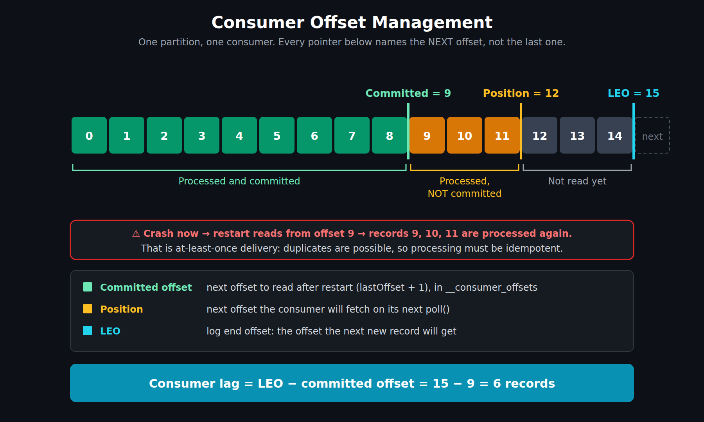

🛠️ **Auto commit (simple, less control):**

```java
Properties props = new Properties();
props.put(ConsumerConfig.ENABLE_AUTO_COMMIT_CONFIG, true);
props.put(ConsumerConfig.AUTO_COMMIT_INTERVAL_MS_CONFIG, 5000); // Every 5 seconds

KafkaConsumer<String, String> consumer = new KafkaConsumer<>(props);
consumer.subscribe(List.of("orders"));

while (true) {
    ConsumerRecords<String, String> records = consumer.poll(Duration.ofMillis(100));
    for (ConsumerRecord<String, String> record : records) {
        processRecord(record);  // If this crashes, these offsets are not committed yet → reprocessed
    }
    // Offsets of this batch are committed automatically in the next poll() call
}
```

🛠️ **Manual synchronous commit (precise control):**

```java
Properties props = new Properties();
props.put(ConsumerConfig.ENABLE_AUTO_COMMIT_CONFIG, false);

KafkaConsumer<String, String> consumer = new KafkaConsumer<>(props);
consumer.subscribe(List.of("orders"));

while (true) {
    ConsumerRecords<String, String> records = consumer.poll(Duration.ofMillis(100));
    for (ConsumerRecord<String, String> record : records) {
        processRecord(record);
    }
    consumer.commitSync();  // Block until offset is committed
    // Guarantees: process first, then commit (at-least-once)
}
```

🛠️ **Manual commit per partition (finest control):**

```java
while (true) {
    ConsumerRecords<String, String> records = consumer.poll(Duration.ofMillis(100));
    for (TopicPartition partition : records.partitions()) {
        List<ConsumerRecord<String, String>> partRecords = records.records(partition);
        for (ConsumerRecord<String, String> record : partRecords) {
            processRecord(record);
        }
        // Commit offset for this partition only
        long lastOffset = partRecords.get(partRecords.size() - 1).offset();
        consumer.commitSync(Map.of(partition,
            new OffsetAndMetadata(lastOffset + 1)));  // +1 = next offset to read
    }
}
```

🔑 **Key Point:** When you commit manually, always commit `lastOffset + 1`, not `lastOffset`. The committed offset is the next offset to read. It is not the last offset you processed.

🎯 **Interview Tip:** In an interview, recommend manual commit with `commitSync()` after processing. This gives at-least-once semantics. Mention that `commitAsync()` is faster, but it can fail without any error being shown.

---

</details>

---

2. **🔄 What triggers a consumer rebalance? Explain the rebalancing process. 🔥**

<!-- -->
<details>
<summary>Answer</summary>

**Answer:**

A **consumer rebalance** is the process of moving partition assignments around among the consumers in a group.

⚠️ **"Stop-the-world" depends on the protocol. Say which one you mean:**

| Protocol | Behavior during rebalance |
|---|---|
| **Eager** (`RangeAssignor`, `RoundRobinAssignor`, `StickyAssignor`) | Every consumer revokes **all** its partitions → the whole group stops consuming → genuinely stop-the-world |
| **Cooperative** (`CooperativeStickyAssignor`, default-recommended since 2.4) | Only the partitions that actually need to **move** are revoked; consumers keep processing everything they retain → **no group-wide stall** |

So the general claim "a rebalance stops all consumption" is true only for the **eager** protocol. On a modern cooperative setup, the handover is partial and happens step by step. *(Assignor comparison: §3 Q3.)*

🚨 **What triggers a rebalance:**

- ➕ A new consumer joins the group
- ➖ A consumer leaves the group (graceful shutdown or crash)
- ⏰ A consumer does not send a heartbeat within `session.timeout.ms`
- ⏰ A consumer takes too long between `poll()` calls (`max.poll.interval.ms` exceeded)
- 📂 Someone adds a new partition to a subscribed topic
- 🔀 The topic subscription pattern matches a new topic

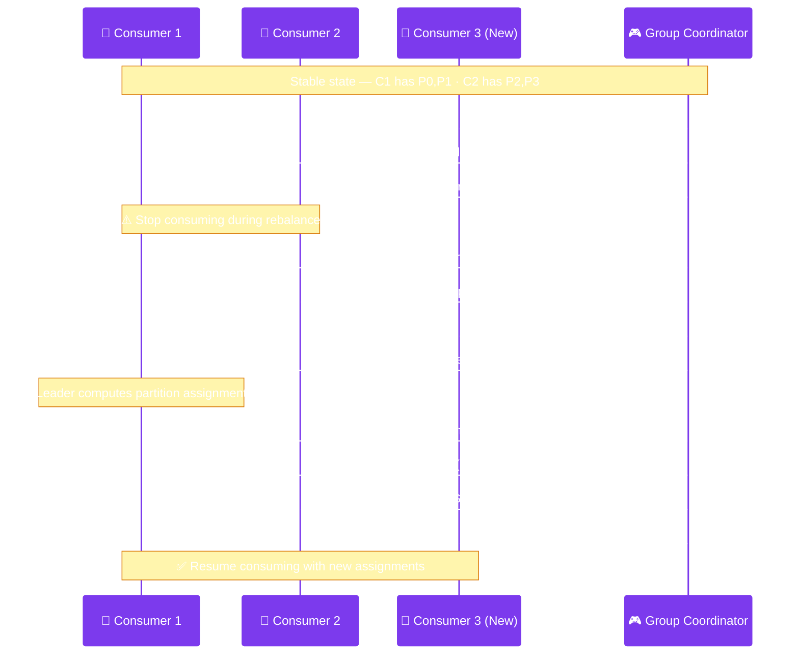

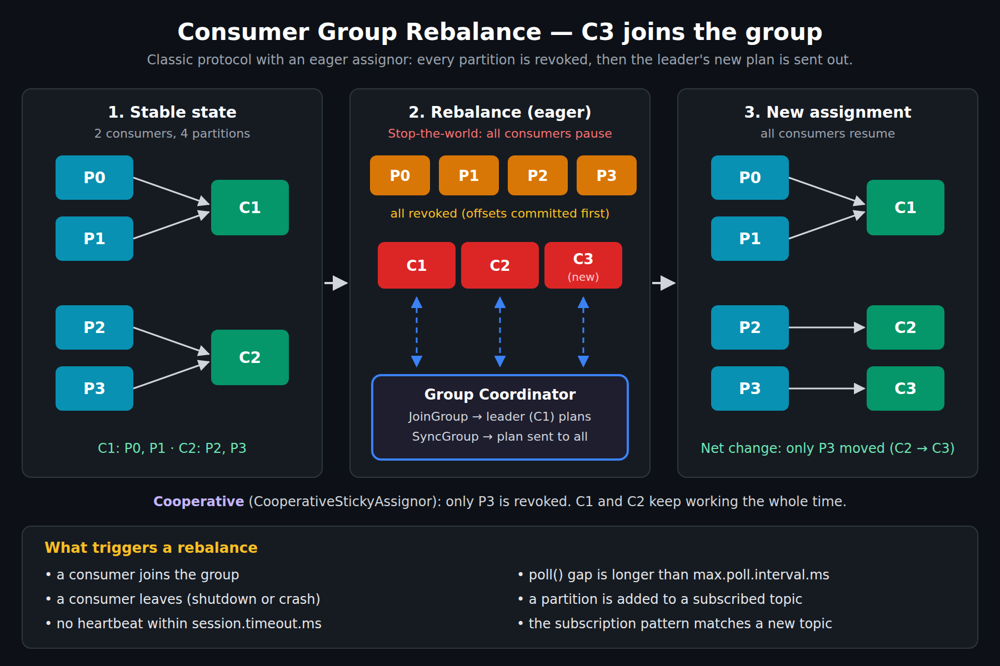

🏗️ **Rebalance protocol steps** *(this is the **`classic`** protocol — see the currency note at the end of this answer):*

1️⃣ **Trigger:** The coordinator detects a membership change.  
2️⃣ **Revocation:** All consumers revoke their current partitions (commit offsets).
   - Each consumer's `onPartitionsRevoked` callback runs *while it still owns* the partitions.
   - It **commits offsets first, then releases** the partitions.
   - Why commit before release: otherwise another consumer may re-read from an old (stale) offset → duplicates.
   - In the **eager** protocol (Range/RoundRobin), *all* partitions are revoked. With **CooperativeSticky**, only the partitions that actually move are revoked.  

3️⃣ **JoinGroup:** All consumers send a JoinGroup request to the coordinator.  
4️⃣ **Leader election:** The coordinator picks one consumer as the group leader.  
5️⃣ **Assignment:** The leader computes the partition assignment using the configured strategy.  
6️⃣ **SyncGroup:** The leader sends the assignment to the coordinator, which distributes it to all consumers.  
7️⃣ **Resume:** Consumers start consuming from their newly assigned partitions.  

⚠️ **Rebalance impact:**

- 🛑 With the **eager** protocol, all consumers in the group stop processing until the rebalance ends. With **cooperative**, only consumers that lose a partition pause, and only for those partitions.
- ⏱️ A rebalance can take seconds to minutes. It depends on group size.
- 🔄 Duplicate processing may happen if offsets were not committed before revocation.

💡 **Pro Tip:** To reduce rebalance impact:
- Use `CooperativeStickyAssignor` (incremental rebalancing — only affected partitions are reassigned)
- Tune `session.timeout.ms` and `heartbeat.interval.ms` to avoid false rebalances
- Use static group membership (`group.instance.id`) for containers/K8s deployments

> 🆕 **Currency note — everything above describes the `classic` protocol.** Since **Kafka 4.0 (KIP-848)**, there is a **new consumer group protocol**.  
> - The **broker-side coordinator** computes the assignment, not an elected consumer leader.  
> - Rebalancing is incremental even **without** a cooperative assignor.  
>
> The JoinGroup → leader-computes → SyncGroup sequence above is now the legacy (old) path. Describe it first, then name the change. Showing this difference earns you a lot in a 2026 interview. *(Full answer: §3 Q9.)*

---

</details>

---

3. **📊 Compare the partition assignment strategies: RoundRobin, Range, Sticky, and CooperativeSticky. ⚡**

<!-- -->
<details>
<summary>Answer</summary>

**Answer:**

Kafka has four built-in partition assignment strategies. They decide how partitions are split among consumers during a rebalance:

| Feature | RoundRobin 🔄 | Range 📏 | Sticky 🧲 | CooperativeSticky 🤝 |
|---------|-------------|---------|---------|---------------------|
| **Class** | `RoundRobinAssignor` | `RangeAssignor` | `StickyAssignor` | `CooperativeStickyAssignor` |
| **Algorithm** | Assign partitions in round-robin across consumers | Divide partitions per topic among consumers | Sticky + balanced (minimize reassignment) | Cooperative protocol + sticky |
| **Rebalance type** | Eager (stop-the-world) | Eager (stop-the-world) | Eager (stop-the-world) | ✅ Incremental (cooperative) |
| **Ordering** | All partitions sorted globally, then distributed | Partitions sorted per topic, then divided in ranges | Like RoundRobin but preserves prior assignment | Like Sticky but non-blocking |
| **Balanced?** | ✅ Very balanced | ⚠️ Can be unbalanced with multiple topics | ✅ Balanced | ✅ Balanced |
| **Reassignment on rebalance** | ⚠️ All partitions reshuffled | ⚠️ All partitions reshuffled | ✅ Minimal reassignment | ✅ Minimal reassignment |
| **Downtime during rebalance** | ⚠️ Full stop | ⚠️ Full stop | ⚠️ Full stop | ✅ Only affected partitions stop |

🛠️ **Example — Range Assignor imbalance:**

```
Topic-A: P0, P1, P2  |  Topic-B: P0, P1, P2
Consumer-1, Consumer-2

Range assigns per topic:
  Topic-A: C1 gets [P0, P1], C2 gets [P2]
  Topic-B: C1 gets [P0, P1], C2 gets [P2]

Result: C1 has 4 partitions, C2 has 2  →  UNBALANCED!
```

🛠️ **Example — RoundRobin (balanced):**

```
Same setup:
  All partitions sorted: A-P0, A-P1, A-P2, B-P0, B-P1, B-P2
  C1: A-P0, A-P2, B-P1  (3 partitions)
  C2: A-P1, B-P0, B-P2  (3 partitions)

Result: Balanced!
```

🔑 **Key Point:** `CooperativeStickyAssignor` is the recommended strategy for production since Kafka 2.4+. It uses **incremental cooperative rebalancing**. Only the partitions that need to move are revoked. Other consumers keep processing without a break.

🛠️ **Configuration:**

```java
props.put(ConsumerConfig.PARTITION_ASSIGNMENT_STRATEGY_CONFIG,
    CooperativeStickyAssignor.class.getName());
```

🎯 **Interview Tip:** When asked how to reduce rebalance impact, recommend `CooperativeStickyAssignor`. Interviewers want this answer. It shows you know about cooperative rebalancing.

---

</details>

---

4. **📈 What is consumer lag? How do you monitor it? 🔥**

<!-- -->
<details>
<summary>Answer</summary>

**Answer:**

**Consumer lag** is the gap between two offsets in a partition:
- the latest offset (log-end offset)
- the consumer's committed offset

It shows how far the consumer is behind real-time.

```
Log-End Offset (LEO):     100  (offset the next new message will get)
Consumer Committed Offset:  85  (next offset to read; 0–84 are done)
Consumer Lag:               15  messages behind
```

🚨 **Why consumer lag matters:**

- 📈 **Growing lag:** The consumer is slower than the producer. This points to a processing bottleneck. You need more consumers or partitions.
- 📉 **Stable lag:** The consumer keeps up, but with a fixed delay. This may be fine, depending on the SLA.
- ⚠️ **Lag exceeds retention:** If the oldest unread message gets older than `retention.ms`, Kafka deletes it before it is consumed. This is **data loss**.

🛠️ **Monitoring tools:**

1️⃣ **Kafka CLI:**

```bash
# Check consumer lag for a specific group
kafka-consumer-groups.sh --bootstrap-server localhost:9092 \
    --describe --group my-consumer-group
```

📤 **Output:**

```
GROUP           TOPIC     PARTITION  CURRENT-OFFSET  LOG-END-OFFSET  LAG
my-group        orders    0          85              100             15
my-group        orders    1          120             120             0
my-group        orders    2          45              200             155
```

2️⃣ **JMX Metrics:** Kafka exposes consumer lag via JMX:
- `kafka.consumer:type=consumer-fetch-manager-metrics,client-id=*` → `records-lag-max`

3️⃣ **Burrow** (LinkedIn's open-source tool): It monitors consumer lag across all groups. It rates lag health as OK, WARNING or ERROR.

4️⃣ **Prometheus + Grafana:** Use the `kafka_consumergroup_lag` metric from Kafka Exporter.

💡 **Pro Tip:** Set alerts on consumer lag limits:
- ⚠️ Warning: Lag > 1000 messages that stays for 5 minutes
- 🚨 Critical: Lag > 10000 or growing all the time

🔑 **Key Point:** A sudden jump in lag often means one of these:
- a slow downstream dependency (database, API)
- a consumer crash
- a rebalance in progress

---

</details>

---

5. **⏱️ Explain session.timeout.ms, heartbeat.interval.ms, and max.poll.interval.ms. How do they interact? 🔥**

<!-- -->
<details>
<summary>Answer</summary>

**Answer:**

These three timeout configs control two things: detecting whether a consumer is alive, and triggering a rebalance. People often mix them up in interviews:

| Property ⚙️ | Purpose 📋 | Default | Thread |
|-------------|-----------|---------|--------|
| `session.timeout.ms` | Time the broker waits without a heartbeat before declaring the consumer dead | `45000` (45s) — 🆕 **raised from 10s in Kafka 3.0 (KIP-735)** | Background heartbeat thread |
| `heartbeat.interval.ms` | Frequency at which the consumer sends heartbeats to the broker | `3000` (3s) | Background heartbeat thread |
| `max.poll.interval.ms` | Max time between two consecutive `poll()` calls before the consumer is considered stuck | `300000` (5 min) | Application thread |

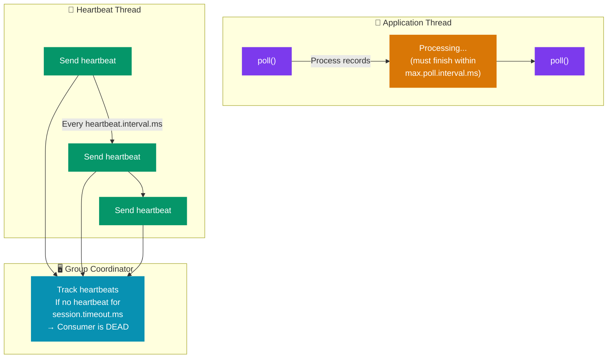

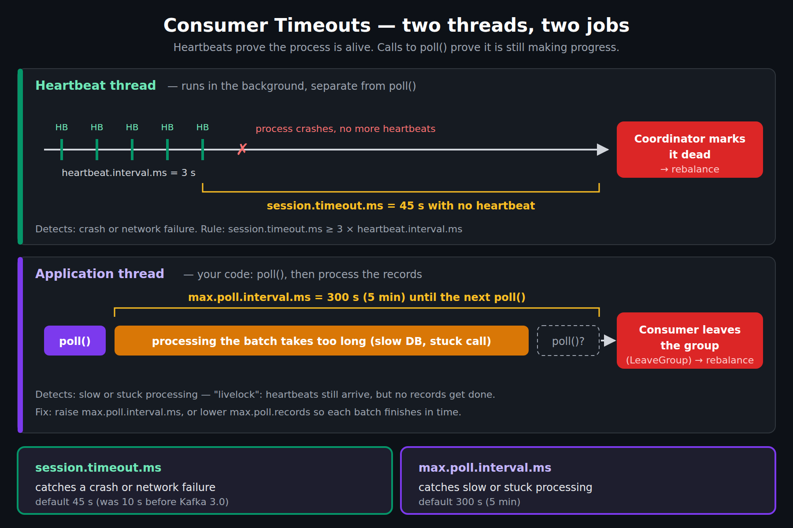

🔑 **How they interact:**

- 💓 **Heartbeats** go out on a background thread, separate from `poll()`. Even when the application is busy processing records, heartbeats keep going out.
- ⏰ **`session.timeout.ms`:** If the broker gets no heartbeat within this window, it triggers a rebalance. Simple rule: `session.timeout.ms >= 3 * heartbeat.interval.ms`.
- 🔄 **`max.poll.interval.ms`:** Say the application takes longer than this between `poll()` calls. Then the consumer leaves the group on its own (it sends a LeaveGroup request).
  - This protects against "livelock": a consumer that sends heartbeats but never processes messages.

🚨 **Common problems:**

| Symptom 🚨 | Cause 🔍 | Fix 🔧 |
|-----------|---------|------|
| Frequent rebalances | `session.timeout.ms` too low | Increase to 30-45s |
| Consumer considered dead during processing | Heavy processing exceeds `max.poll.interval.ms` | Increase `max.poll.interval.ms` or reduce `max.poll.records` |
| Slow failure detection | `session.timeout.ms` too high | Decrease but keep > 3x heartbeat interval |

🛠️ **Recommended production configuration:**

```properties
session.timeout.ms=45000
heartbeat.interval.ms=15000
max.poll.interval.ms=600000
max.poll.records=100
```

🎯 **Interview Tip:** Explain the split clearly:
- `session.timeout.ms` handles network failures (consumer crash).
- `max.poll.interval.ms` handles processing delays (livelock).

They run on different threads and have different jobs.

---

</details>

---

6. **🎮 What is the Consumer Group Coordinator? How does it work? 💤**

<!-- -->
<details>
<summary>Answer</summary>

**Answer:**

The **Group Coordinator** is a Kafka broker that manages a specific consumer group. Each consumer group is assigned to exactly one coordinator broker.

🏗️ **How Kafka picks the coordinator:**

The coordinator for a group is the broker that hosts the leader partition of `__consumer_offsets` for that group. Kafka calculates the partition like this:

```
partition = hash(group.id) % num_partitions_of___consumer_offsets
```

The `__consumer_offsets` topic has 50 partitions by default. So the group maps to one of these 50 partitions. The leader broker of that partition becomes the coordinator.

🔑 **Coordinator responsibilities:**

- 👥 **Group membership management:** Track which consumers belong to the group, using heartbeats.
- 🔄 **Rebalance orchestration:** Start and coordinate rebalances when membership changes.
- 📍 **Offset storage:** Handle offset commit and fetch requests for the group.
- 👑 **Leader election:** Choose one consumer as the group leader (who computes partition assignments).
- ⏰ **Liveness detection:** Monitor heartbeats to detect dead consumers. (The `max.poll.interval.ms` check runs in the client. The client then leaves the group on its own — §3 Q5.)

🧠 **In Simple Words:**
The Group Coordinator is like a team manager.
- It knows who is on the team (consumers).
- It assigns work (partitions).
- It notices when someone stops working (heartbeat timeout).

If the coordinator broker crashes, the group moves automatically to the new leader of the `__consumer_offsets` partition.

📝 **Note:** The Group Coordinator is a regular Kafka broker. Any broker can be the coordinator for some groups. This spreads the coordination load across the cluster.

---

</details>

---

7. **🏷️ What is static group membership and when should you use it? 💤**

<!-- -->
<details>
<summary>Answer</summary>

**Answer:**

**Static group membership** was added in Kafka 2.3. You configure `group.instance.id`, and the consumer keeps the same identity across restarts. This prevents unneeded rebalances when a consumer restarts quickly.

| Feature | Dynamic Membership 🔄 | Static Membership 🏷️ |
|---------|----------------------|---------------------|
| **Configuration** | Default (no `group.instance.id`) | Set `group.instance.id` per consumer |
| **On consumer restart** | ⚠️ Gets new member ID → triggers rebalance | ✅ Retains member ID → no rebalance (within session timeout) |
| **On consumer crash** | Rebalance after `session.timeout.ms` | Rebalance after `session.timeout.ms` |
| **Partition sticky?** | ❌️ May get different partitions after restart | ✅ Gets same partitions back |
| **Best for** | Elastic scaling, short-lived consumers | Kubernetes pods, rolling deployments |

🛠️ **Configuration:**

```java
Properties props = new Properties();
props.put(ConsumerConfig.GROUP_INSTANCE_ID_CONFIG, "consumer-pod-1");
props.put(ConsumerConfig.SESSION_TIMEOUT_MS_CONFIG, 300000);  // 5 min — allow for restart
// Other configs...
```

🎯 **When to use static membership:**

- 🐳 **Kubernetes/container deployments:** Pods restart often during rolling updates. Without static membership, each restart triggers a rebalance.
- 📊 **Stateful consumers:** Some consumers keep local state tied to specific partitions (e.g., Kafka Streams). Static membership makes sure such a consumer gets the same partitions back.
- ⏱️ **Short maintenance windows:** Say you know a consumer will be back within `session.timeout.ms`. Then static membership avoids the rebalance completely.

⚠️ **Caution:** Each `group.instance.id` must be unique within the consumer group. If two consumers use the same static ID, the newer one takes over the ID. The older one is fenced out with a `FencedInstanceIdException` (classic protocol).

💡 **Pro Tip:** In Kubernetes, use the pod name or a stable identifier (like the StatefulSet ordinal) as `group.instance.id`. Use it together with `CooperativeStickyAssignor`. This greatly reduces rebalance overhead in container environments.

---

</details>

---

8. **⏮️ A brand-new consumer group subscribes to a topic that already has 10M messages. Where does it start reading? Explain `auto.offset.reset`. 🔥**

<!-- -->
<details>
<summary>Answer</summary>

**Answer:**

It depends fully on **`auto.offset.reset`**. The most important thing to say first is **when this setting applies at all.**

> 🔑 **Kafka reads `auto.offset.reset` ONLY when the group has no valid committed offset on that partition.** Once a group has committed even once, Kafka ignores this setting from then on. It is a *start-up/recovery* rule, not a rule for normal operation.

⚙️ **The values** (three classic ones, plus `by_duration` since Kafka 4.0):

| Value | Behavior | Use when |
|---|---|---|
| **`latest`** (default) | Start at the **end**. The consumer reads only messages produced *after* it joins. It **never sees** the 10M existing messages. | Live processing where old data does not matter (metrics, notifications, real-time alerts) |
| **`earliest`** | Start at the **oldest retained offset**. Replay all 10M, then continue live. | Building a projection / materialized view, backfills, a new analytics consumer, event sourcing |
| **`none`** | Throw `NoOffsetForPartitionException` and refuse to start. | You want a hard failure, not a silent guess. Someone must set the consumer's start position on purpose |
| **`by_duration:<ISO-8601>`** (Kafka 4.0+, KIP-1106) | Start at the first offset whose timestamp is within that duration of now. Example: `by_duration:PT1H` = the last hour. | A new consumer that needs only recent history, not all of it |

🚨 **Two situations trigger it. The second one is the dangerous one:**

1. **New consumer group.** No offsets exist yet. This is expected and harmless.
2. **The committed offset is no longer valid.** The group *had* an offset. But retention **deleted the data** at that offset while the group was down (`OffsetOutOfRangeException`). Kafka falls back to `auto.offset.reset`, and the result is very different for each value:

| On an expired offset | With `latest` | With `earliest` |
|---|---|---|
| What happens | **Silently skips** everything between the old position and the log end | **Silently reprocesses** everything still retained |
| Failure mode | 🔇 **Invisible data loss** | 🔁 A flood of duplicates / reprocessing spike |

> ⚠️ **This is the real interview point.** A consumer group that is down longer than `retention.ms` loses its place. With the **default `latest`**, it resumes at the end, and the gap is gone. There is no exception, no alert, and nothing in the logs to show that messages were skipped. This is the same "lag exceeds retention" risk from §3 Q4. That is why you alert when lag gets *close to* retention, instead of reacting after.

🕳️ **The related trap almost nobody mentions: `offsets.retention.minutes`.** Case 2 above is "the *data* was deleted." There is a third way to end up in the same place: **the *offset* is deleted while the data is still there.**

The group coordinator deletes a group's committed offsets after the group has been **empty (no live members) for `offsets.retention.minutes`**.

- This is a broker-side setting. The **default is 10080 minutes = 7 days**.
- It was raised from 24 h in Kafka 2.0 by **KIP-186**.
- **KIP-211** in 2.1 made the clock start when the group *becomes empty*, not at commit time.

A consumer that is only **idle** can hit this. Examples: a service scaled to zero over a long weekend, a seasonal batch job, or a disaster-recovery consumer left unused for a month. When it comes back, it has *no committed offset at all*, so Kafka uses `auto.offset.reset`. Under the default `latest`, it **silently skips everything that arrived while it was away.** The result is the same silent skip, but the cause is completely different.

| Trap | What expired | Typical trigger |
|---|---|---|
| `OffsetOutOfRangeException` (case 2 above) | the **records**, via topic `retention.ms` | consumer down/lagging longer than the topic keeps data |
| Offset expiry | the **committed offset**, via `offsets.retention.minutes` | consumer *group* empty longer than 7 days (data may be fully intact) |

✅ **Defences:**

- Set `auto.offset.reset=earliest` (or `none`) on any consumer that can be idle for long periods.
- Raise `offsets.retention.minutes` for groups that run rarely.
- Or keep one member alive, so the group is never empty.

🎯 **The line to say:** *"a group can lose its place in two different ways — the data ages out, or the **offset** ages out because the group sat empty past `offsets.retention.minutes`. Both dump you into `auto.offset.reset`, and the default `latest` makes both silent."*

🛠️ **Configuration:**

```java
props.put(ConsumerConfig.AUTO_OFFSET_RESET_CONFIG, "earliest");
```

```yaml
spring:
  kafka:
    consumer:
      auto-offset-reset: earliest
```

📌 **Beyond the reset — seeking by hand.** `auto.offset.reset` gives you only "beginning" or "end" (or, since Kafka 4.0, "a duration back from now"). For an exact position, you seek manually:

```java
// Replay from a specific offset
consumer.seek(new TopicPartition("orders", 2), 15000L);

// Replay from a point in TIME — this is what the .timeindex from §1 Q9 powers
long yesterday = Instant.now().minus(Duration.ofDays(1)).toEpochMilli();
Map<TopicPartition, Long> query = Map.of(new TopicPartition("orders", 2), yesterday);
consumer.offsetsForTimes(query)
        .forEach((tp, offsetAndTs) -> {
            if (offsetAndTs != null) {
                consumer.seek(tp, offsetAndTs.offset());
            }
        });
```

You can do the same thing from the command line, without code:

```bash
# Reset a group to the beginning (group must be inactive/stopped)
kafka-consumer-groups.sh --bootstrap-server localhost:9092 \
    --group notif --topic orders --reset-offsets --to-earliest --execute

# Or to a timestamp
kafka-consumer-groups.sh --bootstrap-server localhost:9092 \
    --group notif --topic orders --reset-offsets \
    --to-datetime 2026-07-29T00:00:00.000 --execute
```

⚠️ The group must be **inactive**. Kafka refuses to reset offsets for a group with live members. Replace `--execute` with `--dry-run` to preview.

🎯 **Interview one-liner:** `auto.offset.reset` applies **only** when no valid committed offset exists. This happens in three cases:

- a new group,
- a committed offset that retention has already deleted,
- an offset the coordinator expired after the group sat empty past `offsets.retention.minutes`.

`latest` (the default) skips existing history. `earliest` replays it. `none` fails loudly. The trap is the silent cases: the group resumes at the end, and the gap is gone with no error. For exact positions, use `seek()` / `offsetsForTimes()` or `kafka-consumer-groups.sh --reset-offsets`.

---

</details>

---

9. **🆕 What changed about consumer groups in Kafka 4.0? Explain KIP-848 and `group.protocol=consumer`. 🔥**

<!-- -->
<details>
<summary>Answer</summary>

**Answer:**

**KIP-848** replaced Kafka's consumer group rebalance protocol.

- It went **GA in Kafka 4.0 (March 2025)**.
- It is enabled **server-side by default**.
- Clients opt in with a single property:

```properties
group.protocol=consumer     # the new protocol; "classic" is the legacy one
```

The old protocol (everything in §3 Q2 and §3 Q3) is now officially the **`classic`** path. It is still supported, and it is still the client-side default, even in the 4.0 client. But Kafka is no longer developing that design further.

🧠 **The one-sentence version:** *KIP-848 moves partition assignment **from the group leader to the broker** and makes rebalancing **incremental and asynchronous**, so there is no group-wide synchronisation barrier any more.*

⚖️ **Classic vs the new consumer protocol:**

| Aspect 🔍 | Classic (`group.protocol=classic`) | New (`group.protocol=consumer`) |
|---|---|---|
| **Who computes the assignment** | One elected **consumer** — the group leader | The **group coordinator (a broker)** |
| **How the protocol runs** | JoinGroup → leader computes → SyncGroup, with a **synchronisation barrier**: everyone waits for the slowest member | Coordinator pushes target assignments via **heartbeats**. Each member updates on its own — **no barrier** |
| **Incremental rebalance** | Only if you configure `CooperativeStickyAssignor` | **Built in** — you don't need a cooperative assignor to get it |
| **Member identity** | Temporary member id, issued again on every reconnect (hence `group.instance.id` for static membership) | **Stable member IDs** generated by the client. The ID stays the same for the whole life of the consumer process, even after leave/rejoin. A restart still needs `group.instance.id` |
| **Effect of one slow member** | Can stall the whole group's rebalance | Limited to that member — other members keep consuming |
| **Where assignor logic runs** | Client JAR — changing the strategy means redeploying every consumer | **Server-side**, so the cluster can change strategy without redeploying all consumers |

🚨 **Why this matters more than a typical small fact:**

1. **It makes half of the standard answer outdated.** "The group leader computes the assignment and distributes it via SyncGroup" (§3 Q2) is now the *legacy* path. Describe it, then say *"…that's the classic protocol; since 4.0 the coordinator does the assignment."* That one sentence is a strong sign of seniority.
2. **It is the other half of the "what changed in Kafka 4.0?" question.** The well-known answer is *ZooKeeper removal* (§1 Q4). An interviewer who knows the release well wants to hear **both**.
3. **`CooperativeStickyAssignor` is no longer the main advice.** Incremental rebalancing is now part of the protocol, not a result of your assignor choice.

⚠️ **The honest limits. Say these instead of claiming too much:**

- It is **opt-in on the client**. Brokers support it by default in 4.0, but a consumer still gets the classic protocol until you set `group.protocol=consumer`. Upgrading only your broker changes nothing for your apps.
- **Mixed groups are supported** during migration. Classic and new-protocol members can exist together in one group. This is what makes a rolling upgrade possible.
- It **does not change delivery semantics**. Offsets, commits, `auto.offset.reset`, at-least-once — all stay the same. It only changes *how partitions get handed out*.

🎯 **Interview one-liner:** KIP-848, GA in Kafka 4.0, moves partition assignment from the elected consumer leader to the **broker-side group coordinator**. It runs the assignment through heartbeats instead of a JoinGroup/SyncGroup barrier. So rebalances become **incremental by default**, one slow member can't stall the group, and member IDs stay stable for the life of the consumer. Clients opt in with `group.protocol=consumer`; the old behaviour is now called `classic`.

---

</details>

---

## 4. Delivery Semantics

1. **📬 Explain the three delivery semantics: at-most-once, at-least-once, and exactly-once. 🔥🔥**

<!-- -->
<details>
<summary>Answer</summary>

**Answer:**

Delivery semantics define how many times Kafka guarantees a message is delivered and processed. This is one of the most important decisions in a distributed messaging system.

| Semantic | Description 📋 | Message Loss 🚨 | Duplicates 🔁 | Use Case 🎯 |
|----------|---------------|----------------|-------------|----------|
| **At-most-once** 🔹 | Message is delivered 0 or 1 times. Send and do not wait for a reply. | ⚠️ Possible | ✅ None | Logging, metrics, non-critical telemetry |
| **At-least-once** 🔸 | Message is delivered 1 or more times. Retry on failure. | ✅ None | ⚠️ Possible | Most business applications (with idempotent processing) |
| **Exactly-once** 🔷 | The message's effect happens exactly 1 time. It may be delivered again, but duplicates are rolled back or filtered. | ✅ None | ✅ None | Financial transactions, payments, inventory |

🏗️ **How Kafka achieves each one:**

**At-most-once:**

```java
// Producer: fire and forget
props.put(ProducerConfig.ACKS_CONFIG, "0");

// Consumer: commit before processing
while (true) {
    ConsumerRecords<String, String> records = consumer.poll(Duration.ofMillis(100));
    consumer.commitSync();  // Commit FIRST
    for (ConsumerRecord<String, String> record : records) {
        process(record);    // If this fails, message is lost (offset already committed)
    }
}
```

**At-least-once:**

```java
// Producer: acks=all with retries
// (Without idempotence, retries can duplicate or reorder records. Fine for at-least-once.)
props.put(ProducerConfig.ACKS_CONFIG, "all");
props.put(ProducerConfig.RETRIES_CONFIG, Integer.MAX_VALUE);

// Consumer: commit after processing
while (true) {
    ConsumerRecords<String, String> records = consumer.poll(Duration.ofMillis(100));
    for (ConsumerRecord<String, String> record : records) {
        process(record);    // Process FIRST
    }
    consumer.commitSync();  // If crash before this, messages are reprocessed (duplicates)
}
```

**Exactly-once (end-to-end):**

```java
// Producer: transactional + idempotent
props.put(ProducerConfig.TRANSACTIONAL_ID_CONFIG, "my-txn-id");
props.put(ProducerConfig.ENABLE_IDEMPOTENCE_CONFIG, true);

// Consumer: read_committed
props.put(ConsumerConfig.ISOLATION_LEVEL_CONFIG, "read_committed");
```

🔑 **Key Point:** Real end-to-end exactly-once needs all three:
1. Idempotent + transactional producer
2. Consumer with `isolation.level=read_committed`
3. Atomic read-process-write using `sendOffsetsToTransaction()`

🧠 **In Simple Words:**
- **At-most-once:** "I'd rather lose a message than process it twice."
- **At-least-once:** "I'd rather process a message twice than lose it."
- **Exactly-once:** "I want every message processed once and only once, with nothing lost and nothing repeated."

🎯 **Interview Tip:** Most real-world systems use at-least-once with idempotent consumers. Exactly-once is expensive. It is usually needed only for financial/transactional workloads. Saying this shows practical experience.

---

</details>

---

2. **🎯 How do you achieve exactly-once semantics end-to-end in Kafka? 🔥🔥**

<!-- -->
<details>
<summary>Answer</summary>

**Answer:**

End-to-end exactly-once semantics in Kafka needs the producer, broker, and consumer to work together. There are two main patterns:

**Pattern 1: Kafka-to-Kafka (read-process-write)**

This is the consume-transform-produce pattern used in stream processing. It does four steps, all inside a single transaction:

- The consumer reads from an input topic.
- It processes the data.
- It produces to an output topic.
- It commits the consumer offset.

```java
// Configuration
Properties props = new Properties();
props.put(ProducerConfig.BOOTSTRAP_SERVERS_CONFIG, "localhost:9092");
props.put(ProducerConfig.TRANSACTIONAL_ID_CONFIG, "stream-processor-1");
props.put(ProducerConfig.ENABLE_IDEMPOTENCE_CONFIG, true);

KafkaProducer<String, String> producer = new KafkaProducer<>(props);
KafkaConsumer<String, String> consumer = new KafkaConsumer<>(consumerProps);

producer.initTransactions();
consumer.subscribe(List.of("input-topic"));

while (true) {
    ConsumerRecords<String, String> records = consumer.poll(Duration.ofMillis(100));

    producer.beginTransaction();
    try {
        for (ConsumerRecord<String, String> record : records) {
            // Process and produce to output topic
            String result = transform(record.value());
            producer.send(new ProducerRecord<>("output-topic", record.key(), result));
        }

        // Commit consumer offsets as part of the transaction
        Map<TopicPartition, OffsetAndMetadata> offsets = getOffsetsToCommit(records);
        producer.sendOffsetsToTransaction(offsets, consumer.groupMetadata());

        producer.commitTransaction();  // Atomic: output + offset commit
    } catch (Exception e) {
        producer.abortTransaction();   // Rollback everything
        // The consumer's position has already moved past these records.
        // Seek back to the last committed offsets, or the next poll() skips them.
        // (Your own helper, not a Kafka API: seek each partition to consumer.committed().)
        resetToLastCommittedPositions(consumer);
    }
}
```

**Pattern 2: Kafka-to-External System (idempotent consumer)**

When you write to an external system (database, API), real exactly-once needs the consumer to be **idempotent** (processing the same message twice gives the same result as once):

```java
// Store offset alongside business data in the same DB transaction
@Transactional
public void processAndStore(ConsumerRecord<String, String> record) {
    // Check if already processed (idempotency check)
    if (offsetRepository.isProcessed(record.topic(), record.partition(), record.offset())) {
        return;  // Skip duplicate
    }

    // Process business logic
    Order order = parseOrder(record.value());
    orderRepository.save(order);

    // Store offset in same transaction
    offsetRepository.save(record.topic(), record.partition(), record.offset());
    // Both succeed or both rollback — exactly-once to external DB
}
```

🔑 **Key Components for Exactly-Once:**

| Component 🏷️ | Requirement 📋 |
|-------------|---------------|
| **Producer** | `enable.idempotence=true` + `transactional.id` configured |
| **Broker** | Nothing EOS-specific. The `__transaction_state` topic needs 3 brokers by default. (`min.insync.replicas >= 2` is for durability, not for EOS.) |
| **Consumer** | `isolation.level=read_committed` |
| **Processing** | `sendOffsetsToTransaction()` for Kafka-to-Kafka, or idempotent writes for external systems |

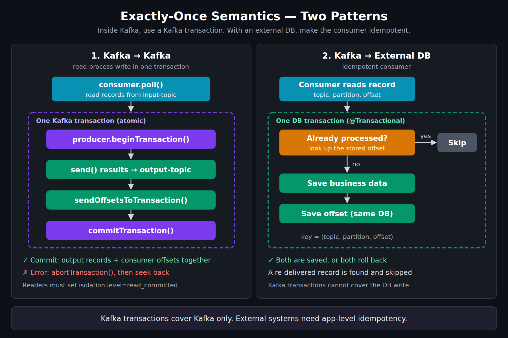

⚠️ **Caution:** Exactly-once costs throughput.

- The cost is **per transaction commit** (coordinator round trips + commit markers on every partition touched).
- So your commit interval / transaction size controls the cost. It is not a fixed cost per record.
- Use it only when business requirements need it — *(cost model: §2 Q4)*.

> 🚨 **The cost people forget is not latency. It is a new failure mode: head-of-line blocking** (one stuck item blocks everything behind it). A `read_committed` consumer can only read up to the **Last Stable Offset (LSO)**. The LSO is the offset of the **earliest still-open transaction** on that partition. Records after it may belong to a transaction that ends up aborted. So the broker refuses to hand them over.
>
> The result: **one hung transactional producer blocks *every* `read_committed` consumer of that partition.** It blocks not just its own records, but everything appended after it.
>
> - The block lasts until the transaction commits, aborts, or the coordinator times it out at **`transaction.timeout.ms`**.
> - That timeout has a default of **60 s**. The broker's `transaction.max.timeout.ms` (default 15 min) sets its upper limit.
> - Consumer lag grows on a partition where nothing is broken, and no error is logged anywhere.
>
> | Consumer `isolation.level` | Reads up to | Sees aborted records? |
> |---|---|---|
> | `read_uncommitted` (default) | the **high-water mark** | ✅ yes — no transaction filtering at all |
> | `read_committed` | the **LSO** ≤ HW | ❌️ no — the client filters out aborted batches using the partition's abort index |
>
> ⚠️ Note the default: **`read_uncommitted`**. A common mistake is to turn on transactions on the producer side and forget the consumer flag. This is a half-configured exactly-once setup. You pay all the producer cost and still read aborted data. 🎯 **The one-liner:** *"Exactly-once doesn't mainly cost latency; it costs you a head-of-line-blocking failure mode — a stuck open transaction stalls the LSO and every `read_committed` reader of that partition behind it."*

🎯 **Interview Tip:** The key point: Kafka's transactional API gives exactly-once only within Kafka (read-process-write). For external systems, you need application-level idempotency. This difference is what makes a great answer better than a good one.

---

</details>

---

3. **🛡️ What are idempotent consumer patterns? How do you handle duplicate messages? 🔥**

<!-- -->
<details>
<summary>Answer</summary>

**Answer:**

At-least-once delivery is the most common semantic. So you must design consumers to handle duplicate messages safely. An **idempotent consumer** produces the same result no matter how many times it processes the same message.

🏗️ **Common idempotent consumer patterns:**

**Pattern 1: Unique Identifier (Deduplication Key)**

```java
@KafkaListener(topics = "orders")
public void processOrder(ConsumerRecord<String, String> record) {
    Header header = record.headers().lastHeader("message-id");
    if (header == null) {
        throw new IllegalStateException("Missing message-id header at offset " + record.offset());
    }
    // ⚠️ header.value() is a byte[] — calling .toString() on it yields "[B@1a2b3c",
    //    which silently makes every message look unique and defeats deduplication.
    String messageId = new String(header.value(), StandardCharsets.UTF_8);

    // Check if already processed
    if (processedMessageRepository.existsById(messageId)) {
        log.info("Duplicate message {}, skipping", messageId);
        return;
    }

    // Process the order
    Order order = objectMapper.readValue(record.value(), Order.class);
    orderService.createOrder(order);

    // Mark as processed
    processedMessageRepository.save(new ProcessedMessage(messageId));
}
```

**Pattern 2: Database Upsert (Natural Idempotency)**

```java
@KafkaListener(topics = "user-updates")
public void processUserUpdate(ConsumerRecord<String, String> record) {
    User user = objectMapper.readValue(record.value(), User.class);

    // Insert-or-update — naturally idempotent
    // If user exists, update; if not, insert
    // ⚠️ save() = SELECT then INSERT/UPDATE. It is NOT atomic: two concurrent
    //    inserts of the same id can both miss, and one fails on the primary key.
    //    For a true atomic upsert, use native INSERT ... ON CONFLICT.
    userRepository.save(user);
}
```

**Pattern 3: Conditional Update (Optimistic Locking)**

```java
@KafkaListener(topics = "inventory-updates")
public void processInventoryUpdate(ConsumerRecord<String, String> record) {
    InventoryEvent event = parse(record.value());

    // Only apply if version is newer
    int updated = jdbcTemplate.update(
        "UPDATE inventory SET quantity = ?, version = ? WHERE sku = ? AND version < ?",
        event.getQuantity(), event.getVersion(), event.getSku(), event.getVersion()
    );

    if (updated == 0) {
        log.info("Stale event for SKU {}, version {}", event.getSku(), event.getVersion());
    }
}
```

**Pattern 4: Offset-based Deduplication (Store offset with data)**

```java
@Transactional
public void processWithOffset(ConsumerRecord<String, String> record) {
    String offsetKey = record.topic() + "-" + record.partition() + "-" + record.offset();

    if (offsetStore.exists(offsetKey)) {
        return;  // Already processed this exact offset
    }

    businessLogic(record);
    offsetStore.save(offsetKey);
}
```

| Pattern 🔧 | Pros ✅ | Cons ⚠️ |
|-----------|--------|--------|
| **Unique ID** | Universal, works for any message | Requires dedup store (Redis/DB), adds latency |
| **Upsert** | Simple, no extra storage | Only works for create/update operations |
| **Conditional update** | Handles ordering issues too | Requires versioning in messages |
| **Offset-based** | Precise dedup | Tied to Kafka offsets, breaks if partitions change |

🎯 **Interview Tip:** The most practical answer for interviews is: "Use at-least-once delivery with idempotent consumers. Store a deduplication key (message ID or business key) and check before processing." Most production systems do this.

---

</details>

---

4. **🔗 Explain the transactional read-process-write pattern in Kafka. 🔥**

<!-- -->
<details>
<summary>Answer</summary>

**Answer:**

The **read-process-write** pattern is the core exactly-once stream processing pattern in Kafka. It does four steps atomically, all within a single Kafka transaction:

- It reads from an input topic.
- It processes the data.
- It writes to an output topic.
- It commits the consumer offset.

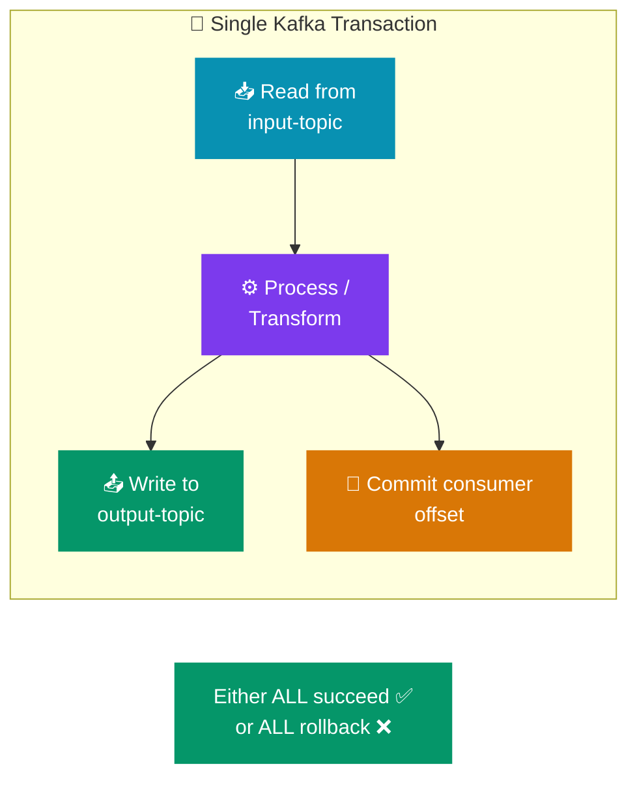

🔑 **Why atomicity matters:**

Without transactions, a crash can happen after writing to the output topic but before committing the consumer offset. Then the message is reprocessed, and the output topic gets duplicates. The transaction makes sure that one of these is true:
- The output message is produced AND the offset is committed (success), or
- Neither happens (abort on failure).

🛠️ **Implementation details:**

```java
producer.initTransactions();
consumer.subscribe(List.of("input-topic"));

while (true) {
    ConsumerRecords<String, String> inputRecords =
        consumer.poll(Duration.ofMillis(200));

    if (inputRecords.isEmpty()) continue;

    producer.beginTransaction();
    try {
        Map<TopicPartition, OffsetAndMetadata> offsetsToCommit = new HashMap<>();

        for (ConsumerRecord<String, String> record : inputRecords) {
            // Transform
            String enriched = enrichPayment(record.value());

            // Write to output topic (within transaction)
            producer.send(new ProducerRecord<>("enriched-payments",
                record.key(), enriched));

            // Track offset to commit
            offsetsToCommit.put(
                new TopicPartition(record.topic(), record.partition()),
                new OffsetAndMetadata(record.offset() + 1)
            );
        }

        // Commit offsets within the same transaction
        producer.sendOffsetsToTransaction(offsetsToCommit,
            consumer.groupMetadata());

        producer.commitTransaction();

    } catch (ProducerFencedException | OutOfOrderSequenceException e) {
        // Fatal — cannot recover, must close
        producer.close();
        break;
    } catch (KafkaException e) {
        // Abort, then seek back to the last committed offsets so the batch is retried.
        // Without the seek, the next poll() skips these records.
        producer.abortTransaction();
        resetToLastCommittedPositions(consumer);   // your helper, not a Kafka API
    }
}
```

📝 **Note:** Kafka Streams uses this same pattern internally. If you use Kafka Streams, you get exactly-once semantics just by setting `processing.guarantee=exactly_once_v2`.

💡 **Pro Tip:** In interviews, say that `sendOffsetsToTransaction()` is the "magic method". It links the consumer offset commit to the producer transaction. Without it, you cannot get exactly-once in the consume-transform-produce pattern.

---

</details>

---

5. **📝 Compare different consumer offset commit strategies and their delivery guarantees. ⚡**

<!-- -->
<details>
<summary>Answer</summary>

**Answer:**

The moment you commit offsets decides the delivery guarantee:

| Strategy 🔧 | Code Pattern 💻 | Delivery Guarantee 📬 | Risk 🚨 |
|------------|----------------|---------------------|--------|
| **Auto commit** | `enable.auto.commit=true` | 🔸 At-least-once in a simple poll loop | Duplicates after a crash. Loss only if records are processed on other threads |
| **Commit before processing** | `commitSync()` then `process()` | 🔹 At-most-once | Message lost if processing fails after commit |
| **Commit after processing** | `process()` then `commitSync()` | 🔸 At-least-once | Duplicate processing if crash after process, before commit |
| **Commit per record** | `commitSync()` per record | 🔸 At-least-once (minimal duplicates) | Very slow (one commit per message) |
| **Commit per batch** | `process(batch)` then `commitSync()` | 🔸 At-least-once | Entire batch reprocessed on crash |
| **Transactional commit** | `sendOffsetsToTransaction()` | 🔷 Exactly-once | Higher latency, complexity |

🛠️ **Commit after processing (at-least-once, recommended default):**

```java
while (true) {
    ConsumerRecords<String, String> records = consumer.poll(Duration.ofMillis(100));
    for (ConsumerRecord<String, String> record : records) {
        processRecord(record);  // Process first
    }
    consumer.commitSync();      // Then commit
}
```

🛠️ **Async commit with sync fallback (best performance + safety):**

```java
while (true) {
    ConsumerRecords<String, String> records = consumer.poll(Duration.ofMillis(100));
    for (ConsumerRecord<String, String> record : records) {
        processRecord(record);
    }
    consumer.commitAsync((offsets, exception) -> {
        if (exception != null) {
            log.error("Async commit failed for offsets {}", offsets, exception);
        }
    });
}

// On shutdown: use sync commit for final guarantee
try {
    consumer.commitSync();
} finally {
    consumer.close();
}
```

🔑 **Key Point:**

- `commitAsync()` is non-blocking and faster, but it can fail silently.
- `commitSync()` blocks and retries, but it is reliable.
- The recommended pattern: `commitAsync()` during normal processing, and `commitSync()` during shutdown.

🎯 **Interview Tip:** The most common production pattern is "commit after processing with `commitSync()`" for at-least-once, together with idempotent consumers. Mention this to show practical experience.

---

</details>

---

## 5. Kafka Patterns and Error Handling

1. **💀 What is the Dead Letter Queue (DLQ) pattern in Kafka? 🔥**

<!-- -->
<details>
<summary>Answer</summary>

**Answer:**

A **Dead Letter Queue (DLQ)** is a separate Kafka topic. Messages go there when processing still fails after all retry attempts. This has two benefits:

- One bad message does not block the whole consumer.
- You can check and reprocess the message later.

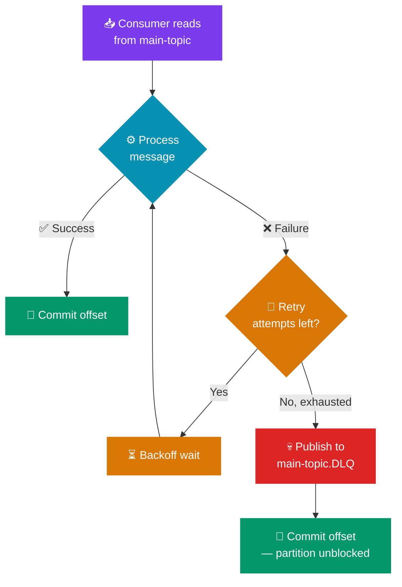

> 🔑 **The commit at the end is the most important step.** Publishing to the DLQ is only half the pattern. After it, you must **commit the offset**. Then the poison record (a message that always fails) stops blocking its partition. If you skip that commit, the DLQ does nothing: the consumer reads the same bad record again, forever. After the DLQ topic comes the human loop: **alert → inspect → fix → replay back to the main topic**. This loop is done with operations tools. It is not part of the code that consumes messages.

🛠️ **Implementation example:**

```java
@Component
public class OrderConsumer {

    private static final int MAX_RETRIES = 3;

    @Autowired
    private KafkaTemplate<String, String> kafkaTemplate;

    @KafkaListener(topics = "orders")
    public void consume(ConsumerRecord<String, String> record) {
        int attempts = 0;
        while (attempts < MAX_RETRIES) {
            try {
                processOrder(record.value());
                return;  // Success — exit
            } catch (RetryableException e) {
                // ⚠️ Only RetryableException is caught. Any other exception escapes:
                //    no retry here, and no DLQ.
                attempts++;
                log.warn("Retry {}/{} for offset {}", attempts, MAX_RETRIES, record.offset());
                // ⚠️ LINEAR backoff (1s, 2s, 3s) — not exponential. See the caution below.
                sleep(1000L * attempts);
            }
        }

        // All retries exhausted — send to DLQ
        log.error("Sending to DLQ after {} retries: {}", MAX_RETRIES, record.value());
        kafkaTemplate.send("orders.DLQ", record.key(), record.value());
    }
}
```

> 🚨 **The follow-up question that shows the bug in this snippet: "what happens to your consumer group while you're sleeping?"** Those `sleep()` calls run **on the poll thread**.
>
> - Between two `poll()` calls you have at most **`max.poll.interval.ms` (default 5 min)**.
> - `poll()` returns up to **`max.poll.records` (default 500)** records per batch.
> - Sleeping 1s+2s+3s = **6 s per failing record**. So ~50 failures in a row use up the whole time budget.
> - Then the coordinator marks the consumer as stuck, and a **rebalance** starts.
> - The consumer that gets the partition next reprocesses the whole batch.
> - If the failure hits every record (e.g. the downstream DB is down), this can loop forever.
>
> *(Timeout mechanics: §3 Q5.)*
>
> **What to say instead:** blocking retry is only safe when *(total backoff × max.poll.records)* stays well under `max.poll.interval.ms`. You can limit it in three ways:
>
> - lower `max.poll.records`;
> - put a cap on the total backoff;
> - the real answer: move to **non-blocking retry topics** (§5 Q6) or `@RetryableTopic` (§6 Q4). There, the record is *republished* with a delay. The thread does not sleep on it.
>
> Also note that the backoff above is **linear**, not exponential. Exponential is `base × 2^attempt` (§5 Q6).

🔑 **DLQ best practices:**

- 📝 **Include metadata:** When you send to the DLQ, add headers with: original topic, partition, offset, error message, timestamp, retry count.
- 🔍 **Monitoring:** Set up alerts when the DLQ receives messages. A message there means a problem that needs a human to look at it.
- 🔄 **Reprocessing:** Build a tool to replay DLQ messages back to the main topic after you fix the root cause.
- 🏷️ **Naming convention:** Use `{original-topic}.DLQ` or `{original-topic}-dead-letter` so the topic is easy to find.

💡 **Pro Tip:** Spring Kafka has built-in DLQ support through `DefaultErrorHandler` with `DeadLetterPublishingRecoverer`. In Spring Boot applications, you don't need to build it by hand (covered in the Spring Kafka section).

---

</details>

---

2. **☠️ What are poison pill messages and how do you handle them? ⚡**

<!-- -->
<details>
<summary>Answer</summary>

**Answer:**

A **poison pill** is a message that makes a consumer fail again and again. Retrying does not help, no matter how many times you retry. Common causes:

- 🚨 **Deserialization failure:** Malformed JSON, incompatible Avro schema, corrupted bytes.
- 💥 **Business logic error:** Null required field, invalid data format, division by zero.
- 🔒 **Authorization failure:** Message references a resource the consumer cannot access.

🏗️ **The problem:**

Without proper handling, a poison pill blocks the consumer forever. The consumer keeps failing on the same message. So it cannot move forward in the partition.

```
Normal: msg1 ✅ → msg2 ✅ → msg3 ✅ → msg4 ✅
Poison:  msg1 ✅ → msg2 ✅ → POISON ❌️ → retry ❌️ → retry ❌️ → STUCK!
```

🛠️ **Handling strategies:**

**Strategy 1: Deserialization error handler (catch before processing)**

```java
// ErrorHandlingDeserializer wraps the real deserializer and converts a failure
// into a DeserializationException the error handler can route to a DLQ,
// instead of letting the consumer die in an un-skippable poll loop.
props.put(ConsumerConfig.KEY_DESERIALIZER_CLASS_CONFIG,
    ErrorHandlingDeserializer.class);
props.put(ConsumerConfig.VALUE_DESERIALIZER_CLASS_CONFIG,
    ErrorHandlingDeserializer.class);

// ⚠️ Each wrapper needs its OWN delegate. Setting only the VALUE delegate
//    while the key deserializer is also an ErrorHandlingDeserializer fails
//    at startup — the key wrapper has nothing to delegate to.
props.put(ErrorHandlingDeserializer.KEY_DESERIALIZER_CLASS,
    StringDeserializer.class.getName());
props.put(ErrorHandlingDeserializer.VALUE_DESERIALIZER_CLASS,
    JsonDeserializer.class.getName());
```

**Strategy 2: Try-catch with DLQ routing**

```java
@KafkaListener(topics = "events")
public void consume(ConsumerRecord<String, String> record) {
    try {
        Event event = deserialize(record.value());
        process(event);
    } catch (DeserializationException e) {
        // Poison pill — cannot deserialize, no point retrying
        log.error("Poison pill at offset {}: {}", record.offset(), e.getMessage());
        kafkaTemplate.send("events.DLQ", record.key(), record.value());
    } catch (RetryableException e) {
        // Transient error — worth retrying
        throw e;  // Let the error handler retry
    }
}
```

**Strategy 3: Skip and log (for non-critical topics)**

```java
@KafkaListener(topics = "metrics")
public void consume(ConsumerRecord<String, String> record) {
    try {
        processMetric(record.value());
    } catch (Exception e) {
        log.error("Skipping bad message at offset {}: {}", record.offset(), e.getMessage());
        // Simply skip — acceptable for metrics/logs
    }
}
```

| Strategy 🔧 | When to Use 🎯 | Trade-off ⚖️ |
|------------|--------------|------------|
| **DLQ routing** | Critical messages that need investigation | Adds complexity, needs DLQ monitoring |
| **Skip and log** | Non-critical data (metrics, logs) | Simple, but messages are lost |
| **ErrorHandlingDeserializer** | Schema mismatch, serialization issues | Catches poison pills at the framework level |
| **Schema validation** | Prevent poison pills at the producer side | Requires Schema Registry infrastructure |

🎯 **Interview Tip:** Separate the two kinds of errors:

- **Retryable errors:** network timeout, DB unavailable.
- **Non-retryable errors:** bad data, schema mismatch.

Poison pills are always non-retryable. Send them to the DLQ right away. Do not waste retries on them.

---

</details>

---

3. **🚦 How do you handle backpressure in Kafka consumers? ⚡**

<!-- -->
<details>
<summary>Answer</summary>

**Answer:**

**Backpressure** happens when the consumer cannot process messages as fast as the producer sends them. Then consumer lag keeps growing. RabbitMQ and similar brokers are **push**-based. Kafka's consumer model is **pull**-based. This model has backpressure built into its delivery mechanism.

🔑 **Kafka's built-in backpressure mechanism:**

Kafka consumers pull data with `poll()`. So they limit their own rate in a natural way. If processing is slow, the consumer just polls less often. The messages stay safe in Kafka's persistent log until the consumer catches up.

🛠️ **Strategies to handle backpressure:**

**Strategy 1: Tune `max.poll.records` and `max.poll.interval.ms`**

```properties
# Fetch fewer records per poll to reduce processing time per batch
max.poll.records=50

# Allow more time between polls for heavy processing
max.poll.interval.ms=600000
```

**Strategy 2: Increase consumer parallelism**

```java
// Option A: Add more consumers to the group (up to partition count)
// Option B: Increase partitions

// Option C: Run more consumers in this app (Spring concurrency)
@KafkaListener(topics = "events", concurrency = "4")
public void consume(ConsumerRecord<String, String> record) {
    // 4 consumers in the same group, one thread each (not 4 threads in one consumer)
    process(record);
}
```

**Strategy 3: Decouple polling from processing**

```java
// Poll thread fills a queue, worker threads drain it
private final BlockingQueue<ConsumerRecord<String, String>> workQueue =
    new LinkedBlockingQueue<>(1000);

// Poll thread
while (true) {
    ConsumerRecords<String, String> records = consumer.poll(Duration.ofMillis(100));
    for (ConsumerRecord<String, String> record : records) {
        workQueue.put(record);  // Blocks if queue is full (backpressure!)
    }
}

// Worker threads process from the queue
executorService.submit(() -> {
    while (true) {
        ConsumerRecord<String, String> record = workQueue.take();
        process(record);
    }
});
```

**Strategy 4: Pause and resume partitions**

```java
while (true) {
    ConsumerRecords<String, String> records = consumer.poll(Duration.ofMillis(100));

    if (workQueue.size() > HIGH_WATERMARK) {
        consumer.pause(consumer.assignment());  // Stop fetching
    } else if (workQueue.size() < LOW_WATERMARK) {
        consumer.resume(consumer.assignment()); // Resume fetching
    }

    for (ConsumerRecord<String, String> record : records) {
        // ✅ put(), NOT offer() — offer() returns false when the bounded queue is
        // full and DROPS the record; the offset is still committed next cycle,
        // so you get silent data loss. The pause() above is what stops put()
        // from blocking for long.
        workQueue.put(record);
    }
}
```

> 🚨 **`offer()` vs `put()`: a silent data-loss bug hidden in one method name.** `BlockingQueue.offer(e)` is the *non-blocking* insert. On a full bounded queue, it **returns `false` and discards the element**.
>
> - Almost every snippet on the internet ignores that boolean. If you ignore it too, the record disappears.
> - The consumer's position has already moved forward. So the **offset gets committed on the next cycle**.
> - Result: the record is gone. There is no exception, no log line, and no lag.
>
> Use **`put()`**. It blocks until space is free, which is the correct backpressure tool. Or check the return value and retry. ⚠️ The same trap applies to `Queue.add()` (throws `IllegalStateException`). It also applies to `ExecutorService` with a bounded queue + a discard `RejectedExecutionHandler`.

📝 **Note:** The `pause()`/`resume()` approach is the most Kafka-native way to handle backpressure. It stops fetching new records, but the loop keeps calling `poll()`. So `max.poll.interval.ms` is never exceeded, and no rebalance happens. It is also why `put()` here won't block for long. Above the high watermark, `pause()` has already stopped new records from coming in.

⚙️ **Fetch-side tuning (the settings people forget):**

| Property ⚙️ | Effect 📋 | Default |
|-------------|----------|---------|
| `max.poll.records` | Records returned per `poll()`. The main setting that controls per-batch processing time | `500` |
| `fetch.min.bytes` | Broker waits until this much data is available before it responds. Gives fewer, larger fetches | `1` |
| `fetch.max.wait.ms` | Max time the broker waits to reach `fetch.min.bytes` | `500` |
| `max.partition.fetch.bytes` | Max bytes returned per partition per fetch | `1048576` (1 MB) |

- Raising `fetch.min.bytes` gives more throughput but adds latency.
- Lowering `max.poll.records` is the standard fix for `max.poll.interval.ms` timeouts.

🎯 **Interview Tip:** Say Kafka's advantage exactly like this: *the consumer decides when to ask for data. Unread data costs the broker nothing, because the broker wrote it to the log anyway.*

> ⚠️ **Don't claim too much, like "push brokers can't do backpressure."** RabbitMQ has `basic.qos` **prefetch**. It caps the unacknowledged messages in flight per consumer. That *is* backpressure, and a strong interviewer will say so. The real difference is **where the unread backlog lives and what it costs**:
>
> - **Kafka:** the backlog is already in the on-disk log. Kafka wrote it there whether or not consumers exist. A slow consumer is just a **lag number**. It costs the broker nothing extra. It cannot affect other consumer groups.
> - **RabbitMQ:** the backlog builds up in the **queue**, and the broker must hold it. A slow consumer grows broker memory/disk. It can trigger **memory alarms and global flow control**. Then the broker gets slower *for every other publisher and consumer*.
>
> So: both have backpressure. But only in Kafka, a slow consumer **causes no problem for anyone else**. That's the sentence to say. *(Same reasoning appears in §7 Q5 row 4.)*

---

</details>

---

4. **📊 Explain ordering guarantees in Kafka. How do you ensure message ordering? 🔥**

<!-- -->
<details>
<summary>Answer</summary>

**Answer:**

Kafka provides **ordering guarantees only within a single partition**. There is no ordering guarantee across partitions within a topic.

🔑 **Ordering rules:**

- ✅ **Within a partition:** Messages are strictly ordered by offset. The consumer reads them in the exact order the producer wrote them.
- ❌️ **Across partitions:** No ordering guarantee. Messages in partition 0 and partition 1 can be consumed mixed together, in any order.
- 🔑 **Key-based ordering:** Messages with the same key go to the same partition, so all messages for a given key are ordered.

🛠️ **Ensuring ordering for a business entity:**

```java
// All events for order-123 will be in the same partition → ordered
producer.send(new ProducerRecord<>("order-events", "order-123", "CREATED"));
producer.send(new ProducerRecord<>("order-events", "order-123", "PAID"));
producer.send(new ProducerRecord<>("order-events", "order-123", "SHIPPED"));

// Events for different orders may interleave across partitions
producer.send(new ProducerRecord<>("order-events", "order-456", "CREATED"));
```

⚠️ **Pitfalls that break ordering:**

| Pitfall 🚨 | Cause 🔍 | Fix 🔧 |
|-----------|---------|------|
| **Retries with `max.in.flight > 1`** | Retry of msg-1 arrives after msg-2 | Enable `enable.idempotence=true` (handles up to 5 in-flight) or set `max.in.flight.requests.per.connection=1` |
| **Partition count change** | Key hash changes → messages for same key go to different partition | Never change partition count for ordering-sensitive topics |
| **Multiple producers for same key** | No coordination between producers | Ensure single-writer principle per key or use transactional producer |
| **Async processing** | Multi-threaded consumer processes messages out of order | Process per-partition messages on a single thread |

📝 **Note:** Sometimes you need global ordering across all messages, not just per key. Then use a topic with **a single partition**. You lose parallelism, but you get total order. In practice, this is rarely needed.

🎯 **Interview Tip:** When asked "How does Kafka guarantee ordering?", always make this clear first: "Ordering is guaranteed per partition, not per topic." Then explain key-based partitioning. It is the mechanism that keeps ordering for a business entity.

---

</details>

---

5. **📋 How does Schema Registry work with Kafka? Explain schema evolution with Avro. ⚡**

<!-- -->
<details>
<summary>Answer</summary>

**Answer:**

**Schema Registry** (usually Confluent Schema Registry) is a central service. It stores and manages Avro, JSON, or Protobuf schemas for Kafka topics. It supports schema validation, schema evolution, and compatibility checks.

🏗️ **How it works:**

1️⃣ **Producer** registers a schema with Schema Registry before sending the first message.
2️⃣ Schema Registry assigns a unique **schema ID**.
3️⃣ Producer sends the message with the schema ID embedded (first 5 bytes: magic byte + 4-byte schema ID).
4️⃣ **Consumer** reads the schema ID from the message. It fetches the schema from Schema Registry and deserializes.
5️⃣ Schemas are cached on both producer and consumer sides.

🔄 **Schema evolution compatibility modes:**

| Mode 🔧 | Rule 📋 | Example ✅ | Example ❌️ |
|---------|--------|----------|----------|
| **BACKWARD** (default) | **New** consumer reads **old** data | Deleting a field · Adding a field **with** a default | Adding a **required** field (no default) — the new reader has nothing to fill it with |
| **FORWARD** | **Old** consumer reads **new** data | Adding a field (required or optional) · Deleting an **optional** field | Deleting a **required** field — the old reader still demands it |
| **FULL** | Both backward and forward compatible | Adding/removing **optional** fields (i.e. with defaults) | Any change to a required field |
| **NONE** | No compatibility check | Anything goes | — |

> 🧭 **How to work it out instead of memorising the table.** Ask *"who is reading whose data?"* This one question gives you both rows:
> - **BACKWARD = new reader, old data.** The reader must handle a field that isn't there → **the default value fills it**. So you may *add fields with defaults* and *delete fields*.
> - **FORWARD = old reader, new data.** The reader must handle a field it doesn't know → **it just ignores it**. So you may *add fields freely*, but you must not *delete a required one*.
>
> ⚠️ The two ❌️ cases are **mirror images** (exact opposites). Swapping them is the most common mistake on this question:
> - *adding without a default* breaks BACKWARD;
> - *deleting a required field* breaks FORWARD.
>
> BACKWARD is Schema Registry's **default** mode. That is why "just delete the field" is usually safe, and "just add the field" usually isn't.

🛠️ **Avro schema evolution example:**

```json
// V1 - Original schema
{
  "type": "record",
  "name": "Order",
  "fields": [
    {"name": "orderId", "type": "string"},
    {"name": "amount", "type": "double"}
  ]
}

// V2 - Backward compatible (added field with default)
{
  "type": "record",
  "name": "Order",
  "fields": [
    {"name": "orderId", "type": "string"},
    {"name": "amount", "type": "double"},
    {"name": "currency", "type": "string", "default": "USD"}
  ]
}
```

🛠️ **Producer with Schema Registry:**

```java
Properties props = new Properties();
props.put(ProducerConfig.BOOTSTRAP_SERVERS_CONFIG, "localhost:9092");
props.put(ProducerConfig.KEY_SERIALIZER_CLASS_CONFIG, StringSerializer.class.getName());
props.put(ProducerConfig.VALUE_SERIALIZER_CLASS_CONFIG,
    io.confluent.kafka.serializers.KafkaAvroSerializer.class.getName());
props.put("schema.registry.url", "http://localhost:8081");

KafkaProducer<String, Order> producer = new KafkaProducer<>(props);
Order order = Order.newBuilder().setOrderId("123").setAmount(99.99).build();
producer.send(new ProducerRecord<>("orders", order.getOrderId(), order));
```

🔑 **Key Point:** Schema Registry prevents "poison pill" messages caused by schema mismatches. A producer may try to send a message with an incompatible schema. With `auto.register.schemas=true` (the default), the serializer tries to register it. The registry refuses it if it breaks the subject's compatibility rule, so the send fails before it reaches Kafka.

🎯 **Interview Tip:** Recommend `BACKWARD` compatibility as the default. It makes sure new consumers can read old data. This is the most common deployment pattern: teams upgrade consumers before all old data is consumed.

---

</details>

---

6. **🔁 Explain retry patterns in Kafka with exponential backoff. 🔥**

<!-- -->
<details>
<summary>Answer</summary>

**Answer:**

Retry patterns handle transient (temporary) failures: database timeout, network issue, downstream service unavailable. They try the message processing again. The delay between attempts grows each time.

🛠️ **Manual retry with exponential backoff:**

```java
@KafkaListener(topics = "payments")
public void processPayment(ConsumerRecord<String, String> record) {
    int maxRetries = 5;
    long baseDelayMs = 100;

    for (int attempt = 0; attempt < maxRetries; attempt++) {
        try {
            paymentService.process(record.value());
            return;  // Success
        } catch (RetryableException e) {
            long delay = baseDelayMs * (long) Math.pow(2, attempt);  // 100, 200, 400, 800, 1600ms
            long jitter = ThreadLocalRandom.current().nextLong(0, delay / 2);
            log.warn("Attempt {}/{} failed, retrying in {}ms", attempt + 1, maxRetries, delay + jitter);
            try {
                Thread.sleep(delay + jitter);
            } catch (InterruptedException ie) {
                Thread.currentThread().interrupt();
                throw new RuntimeException(ie);
            }
        } catch (NonRetryableException e) {
            // Don't retry — send directly to DLQ
            sendToDlq(record, e);
            return;
        }
    }

    // All retries exhausted
    sendToDlq(record, new RuntimeException("Max retries exceeded"));
}
```

> ⚠️ **This snippet has correct arithmetic, but it is dangerous in production. Know both parts.**
>
> - The `Thread.sleep()` runs **on the poll thread**. In the worst case, it holds that thread for 100+200+400+800+1600 ms ≈ **3.1 s plus jitter, per record**.
> - `poll()` gives you up to `max.poll.records` (**default 500**) at a time.
> - You must call `poll()` again within `max.poll.interval.ms` (**default 5 min**).
> - So about **65–95 failing records in a row are enough to use up the time budget** (fewer with more jitter).
> - That triggers a rebalance. The whole batch goes to another consumer, which retries it from the start.
> - During a downstream outage, *every* record fails. So you hit that limit immediately.
>
> ✅ **Blocking retry is only safe when you can put a limit on it:** `total_backoff × max.poll.records < max.poll.interval.ms`, with spare time left. Otherwise, use the non-blocking retry-topic pattern below. That pattern exists exactly because of this failure mode.

🏗️ **Retry topics pattern (topic-based retry):**

Do not block the consumer thread during backoff. Instead, send failed messages to separate retry topics, each with a longer delay:

```
Main Topic → Retry Topic (1min delay) → Retry Topic (5min delay) → DLQ
```

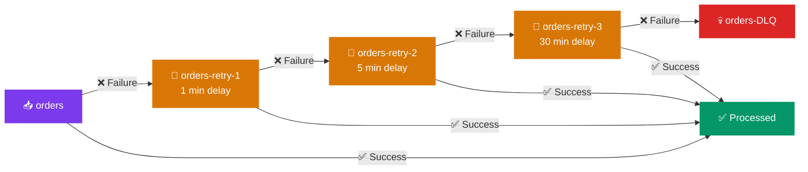

✅ **Advantages of topic-based retry:**
- Non-blocking: the main consumer keeps processing other messages.
- Configurable delays per retry level.
- Audit trail: Each retry attempt is in a separate topic.

⚠️ **Disadvantages:**
- More topics to manage.
- Ordering is not preserved across retries.

💡 **Pro Tip:** Spring Kafka's `@RetryableTopic` annotation does the topic-based retry pattern for you (covered in the Spring Kafka section). It creates the retry topics and the DLQ automatically.

---

</details>

---

7. **📖 How can Kafka be used for Event Sourcing? 💤**

<!-- -->
<details>
<summary>Answer</summary>

**Answer:**

**Event Sourcing** is an architectural pattern. You store state changes as a sequence of immutable events. You do not store the current state directly. Kafka's log is append-only, immutable and ordered. So Kafka is a good fit for event sourcing.

🏗️ **Architecture:**

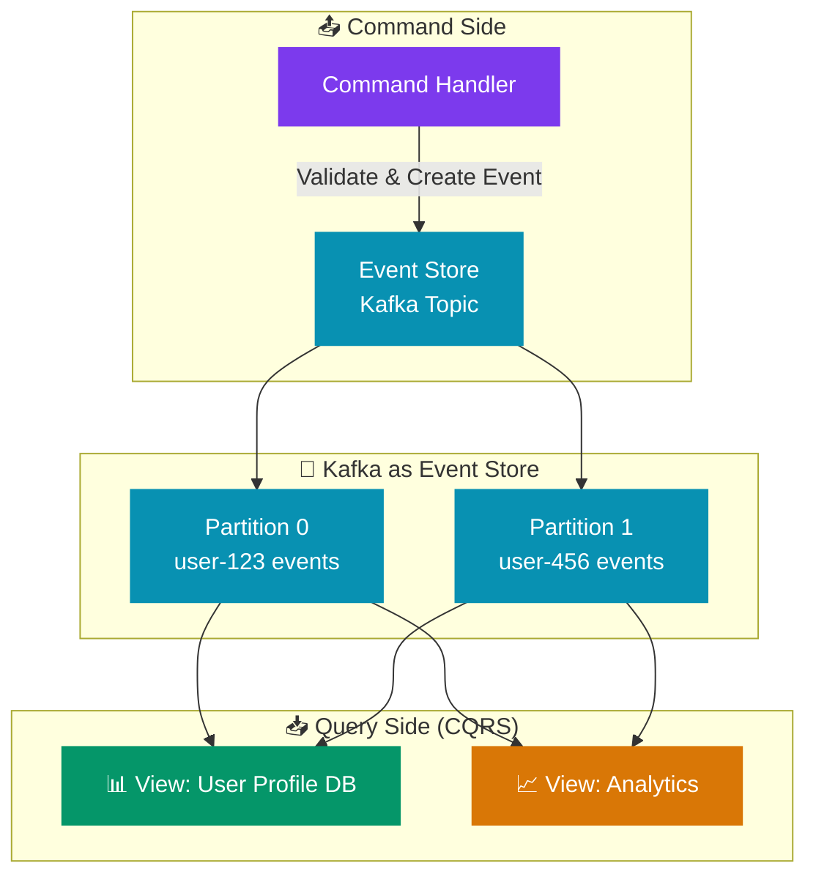

🛠️ **Example — Order lifecycle as events:**

```java
// Events stored in Kafka topic "order-events", key = orderId
// Each event is immutable and appended in order

public sealed interface OrderEvent {
    record OrderCreated(String orderId, String customerId,
                        List<Item> items, Instant createdAt) implements OrderEvent {}
    record OrderPaid(String orderId, double amount,
                     String paymentId, Instant paidAt) implements OrderEvent {}
    record OrderShipped(String orderId, String trackingNumber,
                        Instant shippedAt) implements OrderEvent {}
    record OrderCancelled(String orderId, String reason,
                          Instant cancelledAt) implements OrderEvent {}
}

// Rebuild current state by replaying events
public Order rebuildOrder(String orderId, List<OrderEvent> events) {
    Order order = new Order(orderId);
    for (OrderEvent event : events) {
        switch (event) {
            case OrderCreated e -> order.setStatus("CREATED").setItems(e.items());
            case OrderPaid e -> order.setStatus("PAID").setPaymentId(e.paymentId());
            case OrderShipped e -> order.setStatus("SHIPPED").setTracking(e.trackingNumber());
            case OrderCancelled e -> order.setStatus("CANCELLED").setReason(e.reason());
        }
    }
    return order;
}
```

🔑 **Kafka properties for Event Sourcing:**

| Property ⚙️ | Recommended Value 📋 | Reason 🎯 |
|-------------|---------------------|---------|
| `cleanup.policy` | `delete` (never `compact`) | Compaction keeps only the latest event per key, so it destroys the event history |
| `retention.ms` | `-1` (infinite) or very long | Events are the source of truth — never delete |
| `replication.factor` | `3` | Durability — events cannot be lost |
| `min.insync.replicas` | `2` | Strong durability guarantee |

✅ **Advantages of Kafka for Event Sourcing:**
- 💾 Persistent, durable, replicated event log.
- 🔁 Replay capability — rebuild state from any point.
- 📊 Multiple projections (CQRS) — each consumer group builds a different view.
- ⏱️ Temporal queries — "What was the order state at 3pm yesterday?"

⚠️ **Limitations:**
- Kafka has no native "read events by aggregate ID" query. For fast lookups, you need a snapshot mechanism or a separate read store.
- Long event histories need snapshotting (saving the current state from time to time). Without it, state rebuilds are slow.

🎯 **Interview Tip:** Pair event sourcing with CQRS (Command Query Responsibility Segregation).
- Kafka topics store the events. This is the command/write side.
- Materialized views in databases act as the read side.

This is a very strong system design answer.

---

</details>

---

8. **🔌 What is Kafka Connect, and how would you stream changes from a MySQL/Postgres database into Kafka? 🔥**

<!-- -->
<details>
<summary>Answer</summary>

**Answer:**

**Kafka Connect** is a separate, declarative framework. It moves data **between Kafka and external systems**. You do not write producer/consumer code. You POST JSON configuration to its REST API. Connect then does the data-moving work for you.

| Connector type | Direction | Examples |
|---|---|---|
| **Source** | External system → Kafka | Debezium (MySQL, Postgres, MongoDB), JDBC Source, S3 Source |
| **Sink** | Kafka → external system | JDBC Sink, Elasticsearch, S3, Snowflake, BigQuery |

🔑 **Why it exists — the answer to "why not just write a consumer?":** Connect gives you these things for free. Without it, you would rebuild them yourself, and usually badly:
- **offset tracking** for the external system
- **restart/resume** semantics
- **distributed workers with rebalancing**
- **schema handling** via Schema Registry
- **dead-letter queues** (sink connectors only)
- **single-message transforms (SMTs)** (small changes applied to each record in flight)

Say you write a custom consumer to load Kafka into Postgres. Then you must build all of that yourself.

🏗️ **CDC with Debezium — the standard answer to the MySQL→Kafka question:**

Debezium is a **source connector**. It does true Change Data Capture by **tailing the database's transaction log** (reading new entries as they are written):
- MySQL **binlog**
- Postgres **WAL** (via a logical replication slot)
- MongoDB oplog

```json
{
  "name": "loan-db-connector",
  "config": {
    "connector.class": "io.debezium.connector.mysql.MySqlConnector",
    "database.hostname": "mysql.internal",
    "database.include.list": "lending",
    "table.include.list": "lending.loan_application,lending.disbursement",
    "topic.prefix": "cdc",
    "snapshot.mode": "initial",
    "schema.history.internal.kafka.topic": "schema-history.lending"
  }
}
```

Each table streams to its own topic (`cdc.lending.loan_application`). Events are keyed by primary key. Every event carries a `before` and `after` image. It also carries an operation code (`c`reate / `u`pdate / `d`elete / `r`ead-snapshot).

⚖️ **Log-tailing vs the simple alternative — this comparison is what interviewers want:**

| | **Query-based polling** (JDBC Source, `WHERE updated_at > ?`) | **Log-based CDC** (Debezium) |
|---|---|---|
| **DELETEs** | ❌️ Invisible — a deleted row simply stops appearing | ✅ Captured as a delete event |
| **Intermediate updates** | ❌️ Missed — two updates between polls collapse into one | ✅ Every change captured in order |
| **DB load** | ⚠️ Repeated queries against live tables | ✅ Reads the replication log, negligible query load |
| **Latency** | Poll interval (seconds to minutes) | Near real-time (ms) |
| **Schema requirement** | Needs a reliable monotonic `updated_at`/`id` column | None |
| **Setup cost** | ✅ Trivial | ⚠️ Needs binlog/WAL access, replication privileges, a slot |

🔑 **The outbox pattern — where this becomes a system-design answer:**

Dual-writing (commit to DB, then publish to Kafka) is **not atomic**. If the app crashes between the two steps, the DB and Kafka no longer match. The fix:

1. In the **same DB transaction** as the business write, insert a row into an `outbox` table.
2. Debezium tails the outbox table and publishes each row to Kafka.

The DB transaction is the only atomic unit. Publishing to Kafka then always follows from it. It is no longer a second step that can fail on its own. This is the standard solution to the dual-write problem. It works directly together with Saga orchestration.

⚠️ **Operational cautions:**

- A Postgres **logical replication slot** keeps WAL until it is consumed. If the connector dies and nobody notices, **the source database's disk fills up**. This is a real cause of production outages. Alert on slot lag.
- Debezium topics should use **`cleanup.policy=compact`** and be keyed by PK. Then the topic moves toward the current state of each row. *(§1 Q6.)*
- Connect runs as its **own cluster** of workers. It is real infrastructure you must run, not a library in your app.

🎯 **Interview one-liner:** Kafka Connect is a declarative framework of source/sink connectors. It handles offset tracking, restarts and distributed workers for you. For DB→Kafka you use **Debezium**. It tails the **binlog/WAL** instead of polling. So it captures deletes and every intermediate update, with near-zero query load. Query-based polling can do neither. Add the **outbox pattern**, and it solves the dual-write problem. The DB transaction becomes the single atomic unit.

---

</details>

---

## 6. Spring Kafka Integration

1. **🎧 How do you configure @KafkaListener for consuming messages in Spring Boot? 🔥**

<!-- -->
<details>
<summary>Answer</summary>

**Answer:**

`@KafkaListener` is Spring Kafka's annotation for creating message consumers. It handles these things automatically: partition assignment, offset management, deserialization and error handling.

🛠️ **Basic usage:**

```java
@Component
public class OrderConsumer {

    // Simple string consumer
    @KafkaListener(topics = "orders", groupId = "order-service")
    public void consumeOrder(String message) {
        log.info("Received order: {}", message);
    }

    // Consumer with full record access
    @KafkaListener(topics = "orders", groupId = "order-service")
    public void consumeWithMetadata(ConsumerRecord<String, String> record) {
        log.info("Topic: {}, Partition: {}, Offset: {}, Key: {}, Value: {}",
            record.topic(), record.partition(), record.offset(),
            record.key(), record.value());
    }

    // Consumer with acknowledgement (manual commit)
    @KafkaListener(topics = "orders", groupId = "order-service")
    public void consumeWithAck(String message, Acknowledgment ack) {
        try {
            processOrder(message);
            ack.acknowledge();  // Manual offset commit
        } catch (Exception e) {
            // ⚠️ Not acking does NOT redeliver it. The consumer moves on. The next
            //    ack commits a later offset, so this record is skipped.
            //    To retry, rethrow the exception or call ack.nack(Duration).
            log.error("Failed to process: {}", e.getMessage());
        }
    }

    // Consumer with headers
    @KafkaListener(topics = "orders", groupId = "order-service")
    public void consumeWithHeaders(
            @Payload String message,
            @Header(KafkaHeaders.RECEIVED_PARTITION) int partition,
            @Header(KafkaHeaders.OFFSET) long offset,
            @Header(KafkaHeaders.RECEIVED_KEY) String key) {
        log.info("Partition: {}, Offset: {}, Key: {}", partition, offset, key);
    }

    // Batch consumer
    @KafkaListener(topics = "orders", groupId = "order-service",
                   containerFactory = "batchFactory")
    public void consumeBatch(List<ConsumerRecord<String, String>> records) {
        log.info("Received batch of {} records", records.size());
        records.forEach(record -> processOrder(record.value()));
    }
}
```

🛠️ **Advanced configurations:**

```java
// Multiple topics
@KafkaListener(topics = {"orders", "returns"}, groupId = "order-service")

// Topic pattern
@KafkaListener(topicPattern = "order-.*", groupId = "order-service")

// Specific partitions
@KafkaListener(topicPartitions = @TopicPartition(
    topic = "orders",
    partitions = {"0", "1"}
))

// Concurrency (multiple consumer threads)
@KafkaListener(topics = "orders", groupId = "order-service", concurrency = "3")

// Custom container factory
@KafkaListener(topics = "orders", containerFactory = "customFactory")
```

📝 **Note:** The `concurrency` parameter creates multiple `KafkaMessageListenerContainer` instances. Each one has its own consumer. This is the same as having multiple consumers in the same group.

🎯 **Interview Tip:** Mention that `@KafkaListener` supports:
- both record-level and batch-level consumption
- manual acknowledgement via `Acknowledgment`
- concurrent consumers via `concurrency`

This shows full knowledge of Spring Kafka.

---

</details>

---

2. **📤 How do you use KafkaTemplate to produce messages in Spring Boot? ⚡**

<!-- -->
<details>
<summary>Answer</summary>

**Answer:**

`KafkaTemplate` is Spring Kafka's high-level abstraction for producing messages. It wraps the native `KafkaProducer`. It works with Spring's dependency injection, transaction management and callback mechanisms.

🛠️ **Basic producer configuration and usage:**

```java
@Service
public class OrderProducer {

    private final KafkaTemplate<String, String> kafkaTemplate;

    public OrderProducer(KafkaTemplate<String, String> kafkaTemplate) {
        this.kafkaTemplate = kafkaTemplate;
    }

    // Simple send
    public void sendOrder(String orderId, String orderJson) {
        kafkaTemplate.send("orders", orderId, orderJson);
    }

    // Send with callback (async)
    public void sendWithCallback(String topic, String key, String value) {
        CompletableFuture<SendResult<String, String>> future =
            kafkaTemplate.send(topic, key, value);

        future.whenComplete((result, ex) -> {
            if (ex == null) {
                log.info("Sent to partition={}, offset={}",
                    result.getRecordMetadata().partition(),
                    result.getRecordMetadata().offset());
            } else {
                log.error("Failed to send: {}", ex.getMessage());
            }
        });
    }

    // Send to specific partition
    public void sendToPartition(String orderId, String orderJson) {
        kafkaTemplate.send("orders", 0, orderId, orderJson);
    }

    // Send with headers
    public void sendWithHeaders(String orderId, String orderJson) {
        ProducerRecord<String, String> record =
            new ProducerRecord<>("orders", orderId, orderJson);
        record.headers().add("source", "order-service".getBytes());
        record.headers().add("correlation-id", UUID.randomUUID().toString().getBytes());
        kafkaTemplate.send(record);
    }

    // Synchronous send (blocking)
    public void sendSync(String orderId, String orderJson) throws Exception {
        SendResult<String, String> result =
            kafkaTemplate.send("orders", orderId, orderJson).get(10, TimeUnit.SECONDS);
        log.info("Sent synchronously to offset: {}",
            result.getRecordMetadata().offset());
    }
}
```

🛠️ **JSON producer with custom serializer:**

```java
@Configuration
public class KafkaProducerConfig {

    @Bean
    public ProducerFactory<String, Order> producerFactory() {
        Map<String, Object> config = new HashMap<>();
        config.put(ProducerConfig.BOOTSTRAP_SERVERS_CONFIG, "localhost:9092");
        config.put(ProducerConfig.KEY_SERIALIZER_CLASS_CONFIG, StringSerializer.class);
        config.put(ProducerConfig.VALUE_SERIALIZER_CLASS_CONFIG, JsonSerializer.class);
        config.put(ProducerConfig.ACKS_CONFIG, "all");
        config.put(ProducerConfig.ENABLE_IDEMPOTENCE_CONFIG, true);
        return new DefaultKafkaProducerFactory<>(config);
    }

    @Bean
    public KafkaTemplate<String, Order> kafkaTemplate() {
        return new KafkaTemplate<>(producerFactory());
    }
}
```

🔑 **Key Point:** `KafkaTemplate` is thread-safe. Share it across the application (typically as a singleton Spring bean). Do not create a new instance per send.

📝 **Note:** Since Spring Kafka 3.0 (Spring Boot 3.x), `KafkaTemplate.send()` returns `CompletableFuture` instead of the deprecated `ListenableFuture`.

---

</details>

---

3. **🔧 How do you configure error handling and retry with DefaultErrorHandler in Spring Kafka? 🔥**

<!-- -->
<details>
<summary>Answer</summary>

**Answer:**

Spring Kafka's `DefaultErrorHandler` gives configurable retry and error recovery for consumer errors. It was introduced in Spring Kafka 2.8. It replaced `SeekToCurrentErrorHandler`.

🛠️ **Basic configuration:**

```java
@Configuration
public class KafkaConsumerConfig {

    @Bean
    public DefaultErrorHandler errorHandler(KafkaTemplate<String, String> kafkaTemplate) {
        // DLQ recovery: send failed messages to DLQ topic
        DeadLetterPublishingRecoverer recoverer =
            new DeadLetterPublishingRecoverer(kafkaTemplate,
                (record, ex) -> new TopicPartition(record.topic() + ".DLQ", -1));

        // Retry with exponential backoff. Intervals: 1s, 2s, 4s.
        // setMaxAttempts() (Spring 6.1+) gives an exact retry count.
        // Older versions only have setMaxElapsedTime(): a budget on TOTAL wait time,
        // not an attempt count.
        ExponentialBackOff backOff = new ExponentialBackOff(1000L, 2.0);
        backOff.setMaxInterval(4000L);      // cap a single wait at 4s
        backOff.setMaxAttempts(3);          // exactly 3 retries → 1s, 2s, 4s

        DefaultErrorHandler errorHandler = new DefaultErrorHandler(recoverer, backOff);

        // Don't retry certain exceptions
        errorHandler.addNotRetryableExceptions(
            DeserializationException.class,
            NullPointerException.class,
            ClassCastException.class
        );

        return errorHandler;
    }

    @Bean
    public ConcurrentKafkaListenerContainerFactory<String, String>
            kafkaListenerContainerFactory(
                ConsumerFactory<String, String> consumerFactory,
                DefaultErrorHandler errorHandler) {

        ConcurrentKafkaListenerContainerFactory<String, String> factory =
            new ConcurrentKafkaListenerContainerFactory<>();
        factory.setConsumerFactory(consumerFactory);
        factory.setCommonErrorHandler(errorHandler);
        factory.getContainerProperties()
            .setAckMode(ContainerProperties.AckMode.RECORD);
        return factory;
    }
}
```

🔑 **Key features of `DefaultErrorHandler`:**

| Feature ⚙️ | Description 📋 |
|-----------|---------------|
| **Backoff strategies** | `FixedBackOff`, `ExponentialBackOff`, custom `BackOff` |
| **Not-retryable exceptions** | Skip retries for known non-transient (permanent) errors |
| **Recovery** | `DeadLetterPublishingRecoverer` for DLQ, or custom `ConsumerRecordRecoverer` |
| **Seek behavior** | Seeks back to the failed record for retry (does not skip) |
| **Batch support** | Works with both record-level and batch-level listeners |

🛠️ **Custom recovery logic (instead of DLQ):**

```java
@Bean
public DefaultErrorHandler errorHandler() {
    return new DefaultErrorHandler((record, exception) -> {
        // Custom recovery: log, alert, save to DB, etc.
        log.error("All retries exhausted for record: topic={}, partition={}, offset={}, error={}",
            record.topic(), record.partition(), record.offset(),
            exception.getMessage());
        alertService.sendAlert("Kafka processing failure", exception);
    }, new FixedBackOff(2000L, 3));  // 3 retries, 2 seconds apart
}
```

💡 **Pro Tip:** Some errors will never succeed on retry (deserialization errors, null pointers). Use `addNotRetryableExceptions()` to skip retries for them. This saves time and reduces unneeded load.

---

</details>

---

4. **🔄 How does @RetryableTopic work for automatic retry topics in Spring Kafka? 🔥**

<!-- -->
<details>
<summary>Answer</summary>

**Answer:**

`@RetryableTopic` (introduced in Spring Kafka 2.7) automates the topic-based retry pattern. It does three things automatically:
- It creates retry topics and a DLQ.
- It routes failed messages through the retry topics, with configurable delays.
- It sends the message to the DLQ when all retries are used up.

🛠️ **Basic usage:**

```java
@Component
public class PaymentConsumer {

    @RetryableTopic(
        attempts = "4",                                    // 1 original + 3 retries
        backoff = @Backoff(delay = 1000, multiplier = 2),  // 1s, 2s, 4s
        autoCreateTopics = "true",
        topicSuffixingStrategy = TopicSuffixingStrategy.SUFFIX_WITH_INDEX_VALUE,
        dltStrategy = DltStrategy.FAIL_ON_ERROR
    )
    @KafkaListener(topics = "payments", groupId = "payment-service")
    public void processPayment(String message) throws JsonProcessingException {
        PaymentEvent event = objectMapper.readValue(message, PaymentEvent.class);
        paymentService.process(event);  // Throws exception on failure
    }

    // DLQ handler — invoked when all retries are exhausted
    @DltHandler
    public void handleDlt(String message, @Header(KafkaHeaders.RECEIVED_TOPIC) String topic) {
        log.error("DLT handler: message={} from topic={}", message, topic);
        alertService.notifyFailedPayment(message);
    }
}
```

📂 **Topics created automatically** (the example above explicitly sets `SUFFIX_WITH_INDEX_VALUE`):

```
payments              ← Main topic
payments-retry-0      ← 1st retry (1s delay)
payments-retry-1      ← 2nd retry (2s delay)
payments-retry-2      ← 3rd retry (4s delay)
payments-dlt          ← Dead Letter Topic
```

📝 **Remove `topicSuffixingStrategy` and you get different names.** The **default** is `SUFFIX_WITH_DELAY_VALUE`. So the same config would produce `payments-retry-1000`, `payments-retry-2000`, `payments-retry-4000`. The suffix is the **delay in ms**, not the index.
- Delay-suffixed names explain themselves in the topic list.
- Index-suffixed names stay the same when you change the backoff.

Choose on purpose. If you rename retry topics later, any messages still in the old topics are left behind.

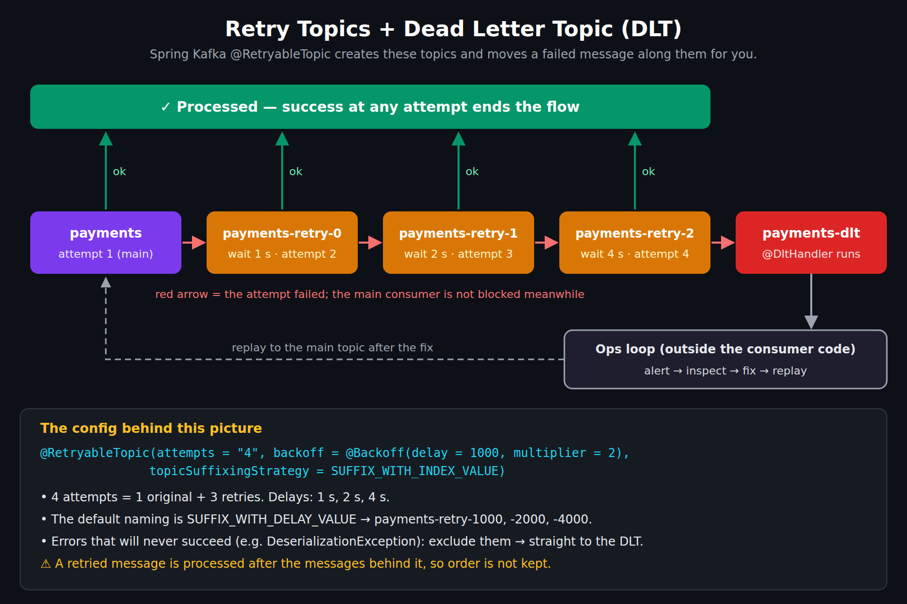

🔑 **Configuration options:**

| Parameter ⚙️ | Description 📋 | Default |
|-------------|---------------|---------|
| `attempts` | Total attempts (including initial) | `3` |
| `backoff` | Delay between retries | `1000ms, multiplier=1` |
| `include` / `exclude` | Exception types to retry or not retry | All exceptions retried |
| `autoCreateTopics` | Auto-create retry and DLT topics | `true` |
| `topicSuffixingStrategy` | Naming: `SUFFIX_WITH_INDEX_VALUE` or `SUFFIX_WITH_DELAY_VALUE` | **`SUFFIX_WITH_DELAY_VALUE`** — i.e. `payments-retry-1000`, `-retry-2000`. *(Exception: fixed-delay configs spread over multiple topics are suffixed by index.)* |
| `retryTopicSuffix` / `dltTopicSuffix` | Suffix appended before the strategy's value | `-retry` / `-dlt` |
| `dltStrategy` | `FAIL_ON_ERROR` or `ALWAYS_RETRY_ON_ERROR` | `ALWAYS_RETRY_ON_ERROR` |

🛠️ **Exclude non-retryable exceptions:**

```java
@RetryableTopic(
    attempts = "4",
    backoff = @Backoff(delay = 2000, multiplier = 2),
    exclude = {DeserializationException.class, ValidationException.class}
)
@KafkaListener(topics = "payments")
public void processPayment(String message) {
    // DeserializationException goes directly to DLT without retry
    // ValidationException goes directly to DLT without retry
    // All other exceptions are retried
    process(message);
}
```

✅ **Advantages over `DefaultErrorHandler`:**
- Non-blocking retries (failed messages move to retry topics, and the main consumer keeps going).
- Configurable delays between retry levels.
- Built-in DLQ handling.
- Audit trail through retry topics.

⚠️ **Caution:** `@RetryableTopic` does not keep ordering. A message that fails goes through retry topics. So it is processed out of order compared to the messages after it.

🎯 **Interview Tip:** `@RetryableTopic` is the modern, recommended approach for non-blocking retries in Spring Kafka. If you mention it, you show you know the current Spring Kafka features.

---

</details>

---

5. **🏭 What is ConcurrentKafkaListenerContainerFactory and how do you customize it? 💤**

<!-- -->
<details>
<summary>Answer</summary>

**Answer:**

`ConcurrentKafkaListenerContainerFactory` is the factory class that creates the listener containers used by `@KafkaListener`. It configures:
- how consumers are created
- how many concurrent threads run
- error handling
- acknowledgement modes

🛠️ **Comprehensive configuration:**

```java
@Configuration
@EnableKafka
public class KafkaConsumerConfig {

    @Value("${spring.kafka.bootstrap-servers}")
    private String bootstrapServers;

    @Bean
    public ConsumerFactory<String, String> consumerFactory() {
        Map<String, Object> props = new HashMap<>();
        props.put(ConsumerConfig.BOOTSTRAP_SERVERS_CONFIG, bootstrapServers);
        props.put(ConsumerConfig.KEY_DESERIALIZER_CLASS_CONFIG, StringDeserializer.class);
        props.put(ConsumerConfig.VALUE_DESERIALIZER_CLASS_CONFIG, StringDeserializer.class);
        props.put(ConsumerConfig.AUTO_OFFSET_RESET_CONFIG, "earliest");
        props.put(ConsumerConfig.ENABLE_AUTO_COMMIT_CONFIG, false);
        props.put(ConsumerConfig.MAX_POLL_RECORDS_CONFIG, 100);
        return new DefaultKafkaConsumerFactory<>(props);
    }

    // Record-level listener factory
    @Bean
    public ConcurrentKafkaListenerContainerFactory<String, String>
            kafkaListenerContainerFactory(DefaultErrorHandler errorHandler) {

        ConcurrentKafkaListenerContainerFactory<String, String> factory =
            new ConcurrentKafkaListenerContainerFactory<>();
        factory.setConsumerFactory(consumerFactory());
        factory.setConcurrency(3);  // 3 consumer threads
        factory.setCommonErrorHandler(errorHandler);
        factory.getContainerProperties()
            .setAckMode(ContainerProperties.AckMode.MANUAL_IMMEDIATE);
        factory.getContainerProperties()
            .setIdleBetweenPolls(100);
        return factory;
    }

    // Batch listener factory
    @Bean("batchFactory")
    public ConcurrentKafkaListenerContainerFactory<String, String>
            batchKafkaListenerContainerFactory() {

        ConcurrentKafkaListenerContainerFactory<String, String> factory =
            new ConcurrentKafkaListenerContainerFactory<>();
        factory.setConsumerFactory(consumerFactory());
        factory.setConcurrency(3);
        factory.setBatchListener(true);  // Enable batch mode
        factory.getContainerProperties()
            .setAckMode(ContainerProperties.AckMode.BATCH);
        return factory;
    }

    // JSON deserialization factory
    @Bean("jsonFactory")
    public ConcurrentKafkaListenerContainerFactory<String, Order>
            jsonKafkaListenerContainerFactory() {

        Map<String, Object> props = new HashMap<>();
        props.put(ConsumerConfig.BOOTSTRAP_SERVERS_CONFIG, bootstrapServers);
        props.put(ConsumerConfig.KEY_DESERIALIZER_CLASS_CONFIG, StringDeserializer.class);
        props.put(ConsumerConfig.VALUE_DESERIALIZER_CLASS_CONFIG, JsonDeserializer.class);
        props.put(JsonDeserializer.TRUSTED_PACKAGES, "com.example.model");

        ConsumerFactory<String, Order> factory =
            new DefaultKafkaConsumerFactory<>(props);

        ConcurrentKafkaListenerContainerFactory<String, Order> containerFactory =
            new ConcurrentKafkaListenerContainerFactory<>();
        containerFactory.setConsumerFactory(factory);
        return containerFactory;
    }
}
```

🔑 **Key configuration options:**

| Method ⚙️ | Purpose 📋 |
|-----------|-----------|
| `setConcurrency(n)` | Number of consumer threads (each gets a `KafkaMessageListenerContainer`) |
| `setBatchListener(true)` | Enable batch consumption |
| `setCommonErrorHandler()` | Set error handler for retry/DLQ |
| `setAckMode()` | `RECORD`, `BATCH`, `MANUAL`, `MANUAL_IMMEDIATE` |
| `setRecordFilterStrategy()` | Filter messages before they reach the listener |
| `setRecordInterceptor()` | Intercept records before/after processing |

📝 **Note:** The `concurrency` value should not be more than the number of partitions in the topic. Each partition is assigned to only one consumer. So extra threads will sit idle.

---

</details>

---

6. **📋 Show a complete Spring Kafka producer and consumer configuration using application.yml. 💤**

<!-- -->
<details>
<summary>Answer</summary>

**Answer:**

🛠️ **`application.yml` — comprehensive Kafka configuration:**

```yaml
spring:
  kafka:
    bootstrap-servers: localhost:9092

    producer:
      key-serializer: org.apache.kafka.common.serialization.StringSerializer
      value-serializer: org.springframework.kafka.support.serializer.JsonSerializer
      acks: all
      # ⚠️ `retries` is deliberately NOT set — see the note below.
      batch-size: 32768          # 32 KB
      buffer-memory: 67108864    # 64 MB
      compression-type: lz4
      properties:
        enable.idempotence: true
        max.in.flight.requests.per.connection: 5
        linger.ms: 20
        delivery.timeout.ms: 120000

    consumer:
      group-id: order-service
      auto-offset-reset: earliest
      enable-auto-commit: false
      key-deserializer: org.apache.kafka.common.serialization.StringDeserializer
      value-deserializer: org.springframework.kafka.support.serializer.JsonDeserializer
      max-poll-records: 100
      properties:
        spring.json.trusted.packages: "com.example.model,com.example.events"
        session.timeout.ms: 45000
        heartbeat.interval.ms: 15000
        max.poll.interval.ms: 600000
        partition.assignment.strategy: org.apache.kafka.clients.consumer.CooperativeStickyAssignor

    listener:
      ack-mode: manual-immediate
      concurrency: 3
      type: single               # or 'batch' for batch listeners

    # Topic auto-creation (Spring Kafka)
    admin:
      auto-create: true
```

> ⚠️ **Why `retries` is missing, and why the obvious `retries: 3` would be a bug here.**
>
> - `retries` already defaults to `Integer.MAX_VALUE` (since Kafka 2.1), so you do not need to write it. Idempotence needs `retries > 0` (§2 Q3).
> - If you write `retries: 3` next to it, this **sets the value back down to 3**.
> - Now the producer gives up much earlier than the `delivery.timeout.ms: 120000` in the same config allows.
> - Example: a leader election takes longer than three quick retries. The producer now reports a failed send. Without the override, the producer would keep retrying, and the send could still succeed once the election ends.
> - Since **KIP-91 (Kafka 2.1)** the advice is: **leave `retries` unset and limit retrying with `delivery.timeout.ms`**.
> - `delivery.timeout.ms` is the total time limit (wall-clock time) for a `send()`, including all retries.
> - So you have one setting, measured in time, instead of two settings that can disagree.

🛠️ **Topic creation via Spring beans:**

```java
@Configuration
public class KafkaTopicConfig {

    @Bean
    public NewTopic ordersTopic() {
        return TopicBuilder.name("orders")
            .partitions(6)
            .replicas(3)
            .config(TopicConfig.MIN_IN_SYNC_REPLICAS_CONFIG, "2")
            .config(TopicConfig.RETENTION_MS_CONFIG, "604800000")  // 7 days
            .build();
    }

    @Bean
    public NewTopic ordersDlqTopic() {
        return TopicBuilder.name("orders.DLQ")
            .partitions(3)
            .replicas(3)
            .build();
    }
}
```

🛠️ **Complete producer service:**

```java
@Service
@RequiredArgsConstructor
public class OrderProducerService {

    private final KafkaTemplate<String, Order> kafkaTemplate;

    public void publishOrderEvent(Order order) {
        CompletableFuture<SendResult<String, Order>> future =
            kafkaTemplate.send("orders", order.getOrderId(), order);

        future.whenComplete((result, ex) -> {
            if (ex == null) {
                log.info("Published order {} to partition {} offset {}",
                    order.getOrderId(),
                    result.getRecordMetadata().partition(),
                    result.getRecordMetadata().offset());
            } else {
                log.error("Failed to publish order {}: {}",
                    order.getOrderId(), ex.getMessage());
            }
        });
    }
}
```

🛠️ **Complete consumer service:**

```java
@Service
@RequiredArgsConstructor
public class OrderConsumerService {

    private final OrderProcessingService processingService;

    @KafkaListener(topics = "orders", groupId = "order-service")
    public void consumeOrder(
            @Payload Order order,
            @Header(KafkaHeaders.RECEIVED_PARTITION) int partition,
            @Header(KafkaHeaders.OFFSET) long offset,
            Acknowledgment ack) {

        log.info("Received order {} from partition {} offset {}",
            order.getOrderId(), partition, offset);

        try {
            processingService.process(order);
            ack.acknowledge();
        } catch (Exception e) {
            log.error("Failed to process order {}: {}",
                order.getOrderId(), e.getMessage());
            // Don't ack — error handler will retry or send to DLQ
            throw e;
        }
    }
}
```

🔑 **Key Point:** Spring Boot auto-configures `KafkaTemplate`, `ConsumerFactory`, and `ProducerFactory` from `application.yml`. You need your own `@Configuration` beans only for custom behavior (multiple factories, custom serializers, etc.).

---

</details>

---

7. **🧪 How do you test Kafka consumers and producers using EmbeddedKafka in Spring Boot? 💤**

<!-- -->
<details>
<summary>Answer</summary>

**Answer:**

`EmbeddedKafka` starts a real Kafka broker inside the test JVM. It writes its log files to a temp directory. So you do not need an external Kafka cluster during tests.

🛠️ **Maven dependency:**

```xml
<dependency>
    <groupId>org.springframework.kafka</groupId>
    <artifactId>spring-kafka-test</artifactId>
    <scope>test</scope>
</dependency>
```

🛠️ **Test — Producer verification:**

```java
@SpringBootTest
// ⚠️ Do NOT pin a port (the old `listeners=PLAINTEXT://localhost:9092` + `port=9092`
//    idiom). It collides with a locally-running broker and breaks parallel CI runs.
//    Let the broker pick a random port and inject it via ${spring.embedded.kafka.brokers}.
@EmbeddedKafka(partitions = 1, topics = {"orders", "orders.DLQ"})
@TestPropertySource(properties = {
    "spring.kafka.bootstrap-servers=${spring.embedded.kafka.brokers}"
})
class OrderProducerTest {

    @Autowired
    private OrderProducerService producerService;

    @Autowired
    private EmbeddedKafkaBroker embeddedKafkaBroker;

    @Test
    void shouldSendOrderToKafka() throws Exception {
        // Arrange
        Order order = new Order("order-123", "user-456", 99.99);

        // Create a test consumer to verify the message
        Map<String, Object> consumerProps = KafkaTestUtils.consumerProps(
            "test-group", "true", embeddedKafkaBroker);
        consumerProps.put(ConsumerConfig.AUTO_OFFSET_RESET_CONFIG, "earliest");

        DefaultKafkaConsumerFactory<String, String> cf =
            new DefaultKafkaConsumerFactory<>(consumerProps);

        Consumer<String, String> consumer = cf.createConsumer();
        embeddedKafkaBroker.consumeFromAnEmbeddedTopic(consumer, "orders");

        // Act
        producerService.publishOrderEvent(order);

        // Assert
        ConsumerRecords<String, String> records =
            KafkaTestUtils.getRecords(consumer, Duration.ofSeconds(10));

        assertThat(records.count()).isEqualTo(1);
        ConsumerRecord<String, String> record = records.iterator().next();
        assertThat(record.key()).isEqualTo("order-123");
        assertThat(record.value()).contains("99.99");

        consumer.close();
    }
}
```

🛠️ **Test — Consumer verification:**

```java
@SpringBootTest
@EmbeddedKafka(partitions = 1, topics = "orders")
@TestPropertySource(properties = {
    "spring.kafka.bootstrap-servers=${spring.embedded.kafka.brokers}",
    // Send raw JSON text. The app's JsonSerializer would wrap the String in quotes.
    "spring.kafka.producer.value-serializer=org.apache.kafka.common.serialization.StringSerializer"
})
class OrderConsumerTest {

    @Autowired
    private KafkaTemplate<String, String> kafkaTemplate;

    @SpyBean  // Spring Boot 3.4+: use @MockitoSpyBean (@SpyBean is deprecated)
    private OrderProcessingService processingService;

    @Test
    void shouldConsumeAndProcessOrder() throws Exception {
        // Arrange
        String orderJson = "{\"orderId\":\"order-123\",\"amount\":99.99}";

        // Act — send message to embedded Kafka
        kafkaTemplate.send("orders", "order-123", orderJson).get();

        // Assert — verify consumer processed the message
        await().atMost(Duration.ofSeconds(10))
            .untilAsserted(() ->
                verify(processingService).process(argThat(
                    order -> order.getOrderId().equals("order-123")
                ))
            );
    }
}
```

🔑 **Key testing patterns:**

| Pattern 🔧 | Purpose 📋 |
|-----------|-----------|
| `@EmbeddedKafka` | Start a real Kafka broker inside the test JVM |
| `KafkaTestUtils.getRecords()` | Read messages sent by producer under test |
| `KafkaTemplate.send().get()` | Send test messages to consumer under test (synchronous) |
| `@SpyBean` (Boot 3.4+: `@MockitoSpyBean`) + `verify()` | Verify consumer's downstream calls |
| `Awaitility` | Wait for async consumer processing to complete |

📝 **Note:** For integration tests with Testcontainers (more realistic):

```java
@Testcontainers
@SpringBootTest
class OrderIntegrationTest {

    @Container
    static KafkaContainer kafka = new KafkaContainer(
        DockerImageName.parse("confluentinc/cp-kafka:7.5.0"));

    @DynamicPropertySource
    static void kafkaProperties(DynamicPropertyRegistry registry) {
        registry.add("spring.kafka.bootstrap-servers", kafka::getBootstrapServers);
    }

    // Tests here use a real Kafka container
}
```

🎯 **Interview Tip:** Mention both options:

- `@EmbeddedKafka` — fast, runs in the same process, good for unit tests.
- Testcontainers — realistic, uses real Kafka, good for integration tests.

This shows you understand the testing pyramid and the pros and cons of each.

---

</details>

---

## 7. Kafka vs Alternatives

1. **⚖️ Compare Kafka vs RabbitMQ vs Amazon SQS. 🔥**

<!-- -->
<details>
<summary>Answer</summary>

**Answer:**

| Feature | Apache Kafka 📊 | RabbitMQ 🐰 | Amazon SQS ☁️ |
|---------|----------------|-------------|--------------|
| **Model** | Distributed commit log (pull) | Message broker (push, `basic.consume`) | Managed message queue (pull) |
| **Message ordering** | ✅ Per-partition ordering | ⚠️ Per-queue, and only with a single consumer + `prefetch=1` | ⚠️ FIFO queues only (Standard queues are explicitly best-effort order) |
| **Throughput** | ⚡ Millions of msgs/sec | 🔸 Tens of thousands/sec | **Standard:** ✅ effectively unlimited (near-unlimited API calls/s) · **FIFO:** 🔸 300 API calls/s per action → ~3,000 msg/s batched (high-throughput mode: up to 70,000 API calls/s per action in the largest regions, lower in others) |
| **Retention** | ✅ Configurable (days/weeks/infinite) | ❌️ Deleted after acknowledgement (classic queues; Streams keep a retained log) | ❌️ Up to 14 days, deleted after processing |
| **Replay** | ✅ Yes (seek to any offset) | ❌️ No for classic queues (deleted after ack). RabbitMQ Streams (3.9+) can replay | ❌️ No |
| **Delivery semantics** | At-most-once, at-least-once, exactly-once | At-least-once, at-most-once | At-least-once (standard), exactly-once *processing* within a 5-min dedup window (FIFO) |
| **Consumer groups** | ✅ Native | ❌️ Not native (use competing consumers) | ❌️ Not native |
| **Routing** | Topic + partition key | ✅ Complex routing (exchange, binding, routing key) | ❌️ Simple queue |
| **Protocol** | Custom binary protocol | AMQP 0.9.1 | HTTP/HTTPS (AWS API) |
| **Operational overhead** | ⚠️ High (cluster management) | 🔸 Medium | ✅ Zero (fully managed) |
| **Scaling** | ✅ Add partitions/brokers | ⚠️ Limited (clustering is complex) | ✅ Auto-scales |
| **Best for** | Event streaming, log aggregation, high throughput | Task queues, RPC, complex routing | Simple queuing, serverless, AWS-native |

> ⚠️ **Do not say "SQS caps at ~3,000 msg/s."**
>
> - That number is for **FIFO with batching** (300 API calls/s × 10 messages per batch).
> - **Standard** SQS has no documented throughput limit. It scales horizontally and is not the bottleneck.
> - If you get this wrong in front of an interviewer who knows AWS, they stop trusting your whole comparison.
> - The honest way to say it: *SQS's limit isn't throughput, it's the absence of retention/replay and of native consumer groups.*

🧠 **When to choose each:**

- 📊 **Choose Kafka** when you need: high throughput, message replay, event sourcing, real-time streaming, multiple consumers reading the same data independently, or strict per-key ordering.

- 🐰 **Choose RabbitMQ** when you need: complex message routing (fan-out, topic-based, header-based), request-reply patterns, priority queues, message-level acknowledgement, or traditional task distribution.

- ☁️ **Choose SQS** when you need: zero operational overhead, simple queue semantics, serverless architecture (Lambda integration), or you're already in the AWS ecosystem and don't need replay or high throughput.

🎯 **Interview Tip:** Build the comparison around the **basic architectural difference**:

- Kafka is a distributed log. Messages persist and can be replayed.
- RabbitMQ/SQS are traditional message brokers. Messages are deleted after consumption.

This one difference causes all the other differences.

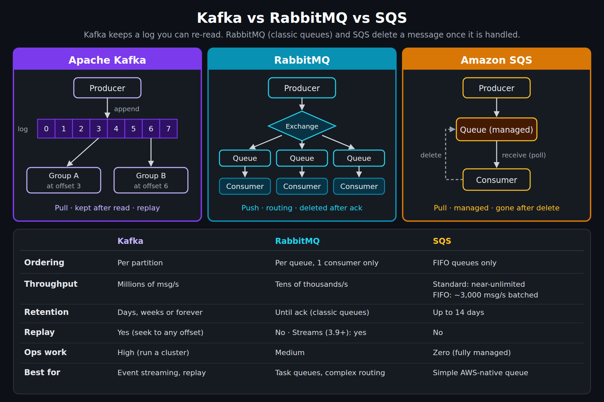

---

</details>

---

2. **🎯 When should you choose Kafka over other messaging systems? ⚡**

<!-- -->
<details>
<summary>Answer</summary>

**Answer:**

Kafka is the right choice when your requirements match its main strengths. Use this checklist to decide:

✅ **Choose Kafka when:**

- ⚡ **High throughput is required:** You need to handle hundreds of thousands or millions of events per second (log aggregation, clickstream, IoT).
- 🔁 **Replay is needed:** Consumers need to re-read old messages (event sourcing, reprocessing after bug fix, building new projections).
- 👥 **Multiple independent consumers:** Different services need to independently consume the same data stream (analytics + notifications + audit).
- 📊 **Stream processing:** You need real-time transformations, aggregations, or joins on streaming data (Kafka Streams, ksqlDB).
- 🔑 **Ordering guarantees:** You need per-entity ordering (all events for user-123 in order).
- 💾 **Long-term storage:** Messages need to be retained for days, weeks, or indefinitely.
- 🏗️ **Event-driven microservices:** You're building an event-driven architecture with many producers and consumers.

❌️ **Don't choose Kafka when:**

- 🔀 **Complex routing needed:** You need topic exchanges, header-based routing, or priority queues (use RabbitMQ).
- 🔄 **Request-reply pattern:** Synchronous RPC-style messaging (use RabbitMQ or gRPC).
- ☁️ **Zero ops required:** You have no infrastructure team and need a fully managed solution (use SQS, SNS, or Confluent Cloud).
- 📦 **Low message volume:** You have a few hundred messages per minute. Kafka's overhead is not worth it here. Use SQS or RabbitMQ.
- ⏱️ **Delayed/scheduled messages:** You need to deliver messages at a future time (use RabbitMQ's delayed message plugin or SQS delay queues).
- 🔒 **Message-level acknowledgement:** You need to acknowledge individual messages out of order (a Kafka consumer group commits offsets in order). Kafka 4.0 added share groups (KIP-932, early access), which ack each record, but they are new.

💡 **Pro Tip:** In system design interviews, support your Kafka choice with specific requirements. For example: "We need Kafka here because we have 500K events/second, multiple consumer groups for analytics and notifications, and we need replay capability for reprocessing. RabbitMQ's throughput ceiling and lack of replay on classic queues make it unsuitable."

---

</details>

---

3. **🔄 How does Kafka differ from traditional message brokers? ⚡**

<!-- -->
<details>
<summary>Answer</summary>

**Answer:**

Kafka's architecture is very different from traditional message brokers (RabbitMQ, ActiveMQ, IBM MQ). Here are the key differences:

| Aspect 🏷️ | Traditional Broker 🔹 | Kafka 🔸 |
|-----------|---------------------|---------|
| **Data model** | Message queue (messages deleted after consumption) | Distributed commit log (messages persisted regardless of consumption) |
| **Delivery model** | Push (broker pushes to consumers) | Pull (consumers pull from brokers) |
| **Message lifecycle** | Deleted after acknowledgement | Retained for configurable duration (even after consumption) |
| **Consumer state** | Broker tracks what's been delivered | Consumer tracks its own offset |
| **Scaling** | Add consumers (limited by broker) | Add partitions + consumers (linear scaling) |
| **Ordering** | Queue-level ordering (single consumer) | Partition-level ordering (parallel consumers) |
| **Throughput** | Tens of thousands/sec per node, as in Q1 (the broker does more work per message) | Millions/sec (consumers do more work) |
| **Consumer independence** | Messages consumed once (unless topic/fanout) | Multiple consumer groups independently read the same data |
| **Storage** | Memory-first. Durable queues with persistent messages are written to disk, but deleted after ack | Always disk-persisted (append-only log) |
| **Replay** | ❌️ Not possible with classic queues (the message is gone after ack). RabbitMQ Streams (3.9+) add a replayable log | ✅ Seek to any offset |

🧠 **In Simple Words:**

- **Traditional broker** = a "pipeline" that delivers packages and destroys them after delivery. Each package goes to one recipient.
- **Kafka** = a "library" that stores books permanently. Anyone can come in and read from any page, at any time, without affecting other readers.

🎬 **Analogy — Live TV vs Netflix:**

| | 📺 **Live Television** = traditional broker | 🎞️ **Netflix** = Kafka |
|---|---|---|
| **Availability** | Airs once — miss it and it's gone | Stays in the library — watch anytime (retention) |
| **Replay** | ❌️ Can't rewind a live broadcast | ✅ Rewind/replay to any point (seek to any offset) |
| **Your position** | Everyone sees the same frame at once | Each viewer has their own "resume watching" point (consumer offset) |
| **Independent viewers** | One broadcast for all | Many people watch the same show independently at their own pace (multiple consumer groups) |
| **Pace control** | Broadcaster sets the pace (push) | You press play/pause — you-paced (pull / consumer-controlled) |

> ⚠️ The analogy covers **retention + replay + independent offsets**. It does not cover partitioning/ordering. It is also a little too simple: RabbitMQ *can* persist & redeliver, so it is not purely "ephemeral live TV" (gone once shown). Use it to help you remember, not as an exact spec.

🔑 **Key architectural insight:**

- In traditional brokers, the broker is "smart" (tracks consumers, manages delivery, routes messages) and consumers are "dumb."
- In Kafka, the broker is "dumb" (stores data in a log) and consumers are "smart" (track their own position, manage their own processing).

This "dumb broker, smart consumer" model lets Kafka scale to millions of messages per second. The broker's job is simple (append to log, serve reads), so it can do it very fast.

🎯 **Interview Tip:** You may be asked "Why did Kafka choose a log-based architecture?" Explain it like this:

- Traditional brokers don't scale well. Per-message bookkeeping (tracking delivery status per consumer) becomes a bottleneck.
- Kafka's log-based approach removes this. It makes consumers responsible for their own state.

---

</details>

---

4. **🌊 Briefly compare Kafka Streams vs Apache Flink vs Apache Spark Streaming. 💤**

<!-- -->
<details>
<summary>Answer</summary>

**Answer:**

These three are the most popular stream processing frameworks. Each one follows a different design approach:

| Feature | Kafka Streams 📊 | Apache Flink 🔥 | Spark Streaming ⚡ |
|---------|-----------------|----------------|-------------------|
| **Architecture** | Library (embedded in your app) | Standalone cluster | Standalone cluster (part of Spark) |
| **Deployment** | No separate cluster needed | Requires Flink cluster | Requires Spark cluster |
| **Processing model** | True event-at-a-time | True event-at-a-time | Micro-batch (near real-time) |
| **Latency** | ⚡ Low (milliseconds) | ⚡ Very low (milliseconds) | 🔸 Higher (~100 ms to seconds, due to micro-batch) |
| **State management** | RocksDB (local state store) | RocksDB + distributed snapshots | In-memory / external store |
| **Exactly-once** | ✅ Yes (within Kafka) | ✅ Yes (end-to-end) | ✅ Yes (with checkpointing) |
| **Data sources** | Kafka only | ✅ Kafka, files, sockets, JDBC, etc. | ✅ Kafka, files, sockets, etc. |
| **SQL support** | ksqlDB (separate) | ✅ Flink SQL (powerful) | ✅ Spark SQL |
| **Windowing** | Tumbling, Hopping, Sliding, Session | ✅ All window types + custom | Tumbling, Sliding, Session (3.2+) |
| **Operational complexity** | ✅ Minimal (just a Java app) | ⚠️ High (cluster management) | ⚠️ High (Spark cluster) |
| **Best for** | Kafka-to-Kafka transformations, simple enrichments | Complex event processing, low-latency analytics | Batch + stream unified, ML pipelines |

🧠 **When to choose each:**

- 📊 **Kafka Streams:** Your data is in Kafka, your output goes to Kafka, and you want minimal operational overhead. It's just a library. You deploy it as a regular Spring Boot app. Best for microservice-level stream processing.

- 🔥 **Apache Flink:** You need complex event processing, event-time semantics (using the time the event happened, not the time it arrived), or multi-source joins. It's the most powerful and flexible, but it requires a dedicated cluster. Best for platform-level stream processing.

- ⚡ **Spark Streaming (Structured Streaming):** You already use Spark for batch processing and want to add streaming. It puts batch and stream under one API. Best for analytics and ML pipeline integrations.

🎯 **Interview Tip:**

- For most microservice-based systems, recommend Kafka Streams. It needs no extra infrastructure.
- For complex analytics or multi-source processing, recommend Flink.

This shows you can make practical decisions.

---

</details>

---

5. **📢 Two teams (analytics + notifications) both need every message on `order-events`. How does Kafka serve both at once, and what would RabbitMQ have to do instead? 🔥**

<!-- -->
<details>
<summary>Answer</summary>

**Answer:**

⚠️ **First, clear up the common mistake.** Many candidates answer *"RabbitMQ can't do this — once analytics acks the message, it's deleted, so notifications never sees it."*

- **That is wrong.** Saying it makes you look like you know only the basics.
- RabbitMQ can fan out with no problem.
- The scenario described is a **misconfiguration**, not a limitation.

**🐰 RabbitMQ — how it actually works:**

Producers do **not** publish to a queue. They publish to an **exchange**. The exchange routes a **separate copy** into every bound queue.

```
                    ┌───────────────────────┐
producer ──────────▶│ exchange: order-events│  (fanout / topic)
                    └───────┬───────────┬───┘
                            │           │
                  copy ─────┘           └───── copy
                    ▼                           ▼
            ┌───────────────┐          ┌──────────────────┐
            │  analytics-q  │          │ notifications-q  │
            └───────┬───────┘          └────────┬─────────┘
                    ▼                           ▼
             analytics team              notifications team
```

Each queue holds its **own physical copy** with its **own independent ack state**. When analytics acks and deletes from `analytics-q`, the copy in `notifications-q` is not touched. ✅ Both teams get every message.

The "message disappears for the other team" scenario only happens if both teams consume from **the same queue**. That is the **competing consumers** pattern:

- It is correct for load-balancing N instances of the *same* service.
- It is a bug when used across two *different* services.

**📊 Kafka — how it works:**

Each team runs its own **consumer group**. The partition log is stored **once**. Each group keeps its own **offset** pointer into it. Reading does not delete anything. When a consumer moves its offset forward, nothing changes for anyone else.

🏗️ **Both brokers support both patterns. They just set them up differently:**

| Pattern | Kafka 📊 | RabbitMQ 🐰 |
|---------|---------|-------------|
| **Fan-out** (2 teams, both get everything) | 2 **consumer groups**, independent offsets | 2 **queues** bound to one exchange |
| **Competing consumers** (N instances of 1 team split the load) | N consumers **within** one group → partitions divided | N consumers on **one** queue → round-robin |

🧠 **So where is the real difference?** Not *"can it fan out"* — it's **what the copy costs you**:

| # | Dimension | Kafka 📊 | RabbitMQ 🐰 |
|---|-----------|---------|-------------|
| 1 | **Storage** | Message stored **once**; N groups = N offset pointers into the same bytes | Message **physically duplicated** into every bound queue — 5 teams = 5 copies |
| 2 | **Late joiners** | New group with `auto.offset.reset=earliest` → **replays full retained history**. No producer or topology change | New queue receives only messages published **after the binding existed**. All history is gone — already acked and deleted |
| 3 | **Replay** | ✅ Reset the group's offsets, reprocess | ❌️ Acked messages are deleted. Recovery requires re-publishing from an external store |
| 4 | **Slow/dead consumer** | Just a growing **lag** number. The log was written once regardless; healthy groups are unaffected | Its queue grows in broker memory/disk → can trip **memory alarms + flow control**, degrading the broker **for everyone** |
| 5 | **Ordering** | ✅ Guaranteed per partition; one consumer per partition preserves it | ⚠️ Holds within a queue only with a single consumer and `prefetch=1` — add concurrency and ordering is lost |

**#2 is the one that really matters in system design.** Say a third team joins next month and wants order history:

- In Kafka, you just start a new consumer group and replay from the beginning.
- In RabbitMQ, that data no longer exists anywhere in the broker.

🎯 **Interview Tip — the one-line answer interviewers want:**

> Kafka is a **durable log that consumers read at their own offset**. The broker forgets nothing. So reading does not delete messages, and readers are decoupled in **time**.  
> RabbitMQ is a **router where reading deletes the message**. It can copy a message to many queues, but once acked it's gone. So consumers are decoupled in **space** but not in **time**.

That *"decoupled in time"* property is exactly why Kafka is the default for event streaming: **you can add a consumer that didn't exist when the event was produced.**

---

</details>

---
