# REST API Design Interview Questions

**REST API Design Interview Questions** | A full guide to REST principles, HTTP methods, API design patterns, error handling, performance, and security. Also see: [Spring Core](https://github.com/vikas9dev/java/blob/main/1_interview_questions/09_Spring_Core_Interview_Questions.md) | [Spring Security](https://github.com/vikas9dev/java/blob/main/1_interview_questions/18_Spring_Security_JWT_Interview_Questions.md) | [Microservices](https://github.com/vikas9dev/java/blob/main/1_interview_questions/17_Spring_Microservices_Interview_Questions.md)

📊 **Question Count by Section**

| # | Section | Questions |
|---|---|---|
| 1 | [REST Principles](#rest-principles) | 5 |
| 2 | [HTTP Methods and Semantics](#http-methods-and-semantics) | 6 |
| 3 | [API Design Patterns](#api-design-patterns) | 6 |
| 4 | [Error Handling Standards](#error-handling-standards) | 5 |
| 5 | [Performance and Scalability](#performance-and-scalability) | 6 |
| 6 | [Security Considerations](#security-considerations) | 5 |
| | **Total** | **33** |

> 🔥🔥 Very High — asked in almost every Tier-1 loop &nbsp;·&nbsp; 🔥 High — very frequent in Tier-1 interviews &nbsp;·&nbsp; ⚡ Medium — commonly asked &nbsp;·&nbsp; 💤 Low — good to know, rarely asked

<a id="rest-principles"></a>

## 1. REST Principles

1. **🌐 What is REST? Explain the six architectural constraints of REST. 🔥🔥**

<!-- -->
<details>
<summary>Answer</summary>

**Answer:**

REST (Representational State Transfer) is an architectural style. Roy Fielding defined it in his 2000 PhD thesis. It gives a set of constraints for designing networked applications that are scalable, stateless, and loosely coupled. REST uses the existing HTTP protocol. It works on **resources**, and URIs identify each resource.

The six architectural constraints of REST are:

1. **Client-Server:** The client and server are separate, so each can change on its own. The client handles the UI and user experience. The server manages data storage and business logic. This separation makes the client more portable and the server more scalable.

2. **Stateless:** Each request from client to server must carry all the information needed to process it. The server does not store any session state between requests. This improves scalability, because the server does not need to manage session data across requests.

3. **Cacheable:** Each response must clearly mark itself as cacheable or non-cacheable. If a response is cacheable, the client can reuse that response data for later equivalent requests. This reduces the number of calls to the server.

4. **Uniform Interface:** This is the most basic constraint. It makes the architecture simpler and less coupled, so each part can change on its own. It has four sub-constraints:
   - 🔗 **Resource Identification:** Resources are identified by URIs (e.g., `/api/employees/101`)
   - 📦 **Resource Manipulation through Representations:** Clients hold a representation of a resource (JSON/XML). It contains enough information to modify or delete the resource
   - 📝 **Self-descriptive Messages:** Each message carries enough information to describe how to process it (Content-Type, status codes)
   - 🔗 **HATEOAS:** Hypermedia as the Engine of Application State — responses contain links to related actions

5. **Layered System:** The architecture can be built from hierarchical layers (load balancers, proxies, gateways). Each component cannot see beyond the layer it talks to directly. This improves scalability through shared caches. It also enforces security policies.

6. **Code on Demand (Optional):** Servers can add to client functionality for a short time. They do this by sending code that the client runs (e.g., JavaScript). This is the only optional constraint.

**① The six REST constraints — five mandatory, one optional:**

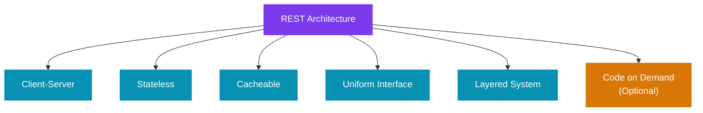

**② Zooming into "Uniform Interface" — its four sub-constraints:**

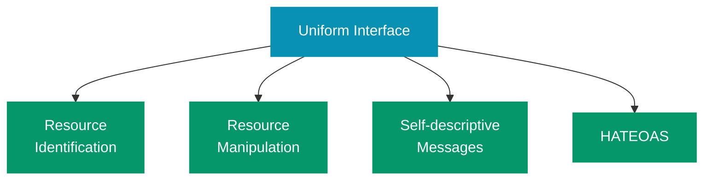

> `UI` is the same node in both diagrams. ② shows the details of the one constraint that interviewers ask about most. (HATEOAS is Richardson Level 3, covered next.)

🧠 **In Simple Words:** REST is a set of rules for how web services should talk to each other. Think of it as a contract: "I send you a request with everything you need, you give me back the data, and neither of us remembers the conversation afterwards."

🎯 **Interview Tip:** Always mention that REST is an **architectural style**, not a protocol. SOAP is a protocol with strict standards. REST is a set of guidelines built on top of HTTP.

---

</details>

---

2. **📊 What is the Richardson Maturity Model? Explain each level. 🔥**

<!-- -->
<details>
<summary>Answer</summary>

**Answer:**

Leonard Richardson developed the Richardson Maturity Model (RMM). It sorts REST APIs into four levels of maturity. The level depends on how well the API follows REST constraints. The model gives a way to judge how RESTful an API really is.

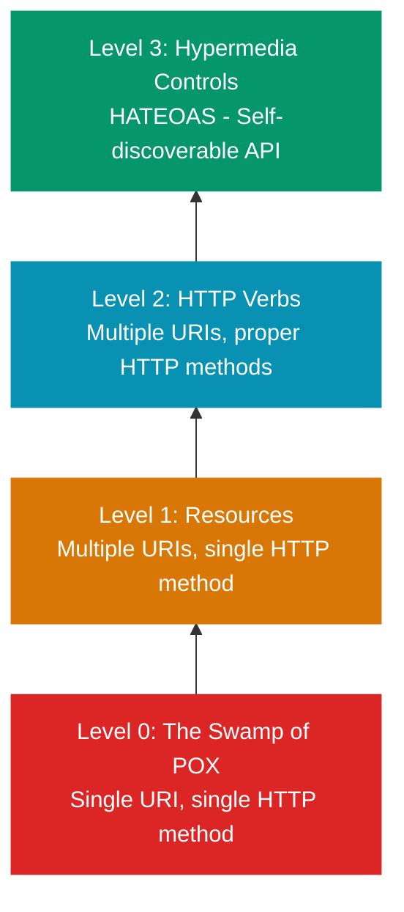

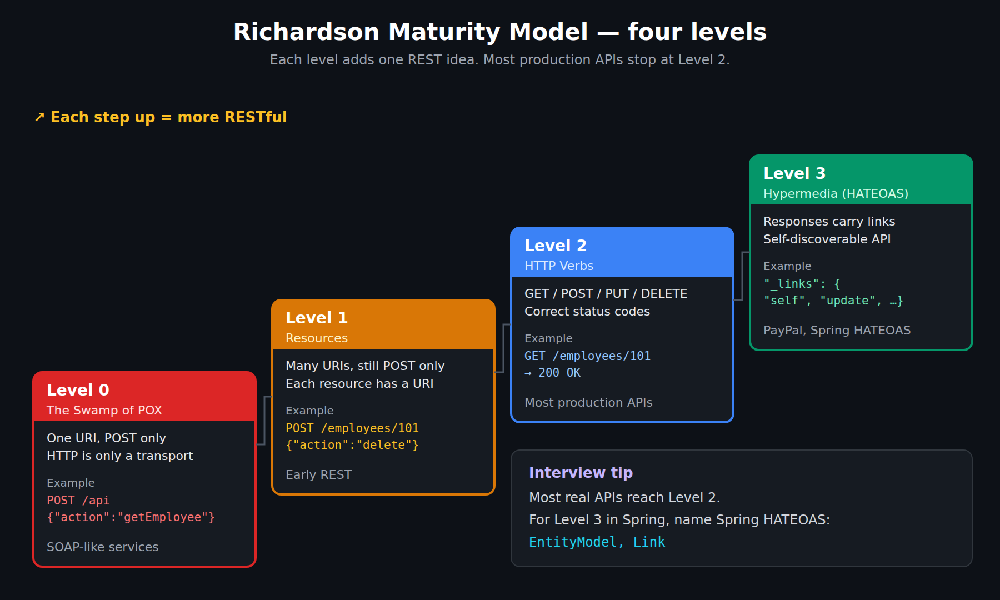

**Level 0 - The Swamp of POX (Plain Old XML):**
- 🔴 Uses HTTP as a transport mechanism only
- Single endpoint for all operations (e.g., `/api`)
- Typically uses POST for everything
- Similar to XML-RPC or SOAP

```json
// Level 0: Everything goes to one endpoint
POST /api
{
  "action": "getEmployee",
  "employeeId": 101
}

POST /api
{
  "action": "createEmployee",
  "name": "Alice",
  "salary": 50000
}
```

**Level 1 - Resources:**
- 🟠 Adds the idea of individual resources, each with a unique URI
- Still uses a single HTTP method (usually POST) for all operations
- Better than Level 0 because each resource has its own address (URI)

```json
// Level 1: Different URIs but still only POST
POST /employees
{ "name": "Alice", "salary": 50000 }

POST /employees/101
{ "action": "delete" }
```

**Level 2 - HTTP Verbs:**
- 🔵 Uses proper HTTP methods (GET, POST, PUT, DELETE, PATCH)
- Uses correct HTTP status codes (200, 201, 404, etc.)
- Most production REST APIs are at this level

```json
// Level 2: Proper HTTP methods and status codes
GET /employees/101          → 200 OK
POST /employees             → 201 Created
PUT /employees/101          → 200 OK
DELETE /employees/101       → 204 No Content
```

**Level 3 - Hypermedia Controls (HATEOAS):**
- 🟢 Responses include hypermedia links that guide the client
- The API is self-discoverable. Clients do not need to hardcode URIs
- Considered the "Glory of REST"

```json
// Level 3: Response includes navigation links
GET /employees/101 → 200 OK
{
  "id": 101,
  "name": "Alice",
  "salary": 50000,
  "_links": {
    "self": { "href": "/employees/101" },
    "update": { "href": "/employees/101", "method": "PUT" },
    "delete": { "href": "/employees/101", "method": "DELETE" },
    "department": { "href": "/departments/5" },
    "all-employees": { "href": "/employees" }
  }
}
```

| Level | Resources | HTTP Verbs | Hypermedia | Real-World Adoption |
|-------|-----------|------------|------------|---------------------|
| **Level 0** | ❌️ Single URI | ❌️ POST only | ❌️ None | SOAP-like services |
| **Level 1** | ✅ Multiple URIs | ❌️ POST only | ❌️ None | Early REST adoption |
| **Level 2** | ✅ Multiple URIs | ✅ GET/POST/PUT/DELETE | ❌️ None | Most production APIs |
| **Level 3** | ✅ Multiple URIs | ✅ GET/POST/PUT/DELETE | ✅ HATEOAS | PayPal REST API (`links` with `rel` + `method`), Spring HATEOAS / HAL APIs |

🎯 **Interview Tip:** Most real-world APIs reach Level 2. If asked about HATEOAS, mention the Spring HATEOAS library. It provides `RepresentationModel`, `EntityModel`, and `Link` classes to implement Level 3.

---

</details>

---

3. **🏷️ What are the best practices for resource naming in REST APIs? 🔥**

<!-- -->
<details>
<summary>Answer</summary>

**Answer:**

Resource naming is one of the most important parts of REST API design. Well-designed URIs make APIs easy to understand, consistent, and self-documenting.

**Core Principles:**

- 📦 **Use nouns, not verbs:** Resources represent entities. The HTTP method already tells the action.
- 📋 **Use plural nouns for collections:** `/employees` not `/employee`
- 🔗 **Use hierarchical structure for relationships:** `/departments/5/employees`
- 🔤 **Use lowercase with hyphens:** `/employee-contracts` not `/employeeContracts` or `/employee_contracts`
- 🚫 **Never expose implementation details:** No file extensions, no database table or column names in the path. (A resource ID like `/employees/101` is fine.)

**Good vs Bad URI Examples:**

| Bad URI | Good URI | Reason |
|---------|----------|--------|
| `GET /getEmployees` | `GET /employees` | Verb in URI is redundant |
| `POST /createEmployee` | `POST /employees` | HTTP method already implies create |
| `GET /employee` | `GET /employees` | Use plural for collections |
| `DELETE /deleteEmployee/101` | `DELETE /employees/101` | Verb is redundant |
| `GET /employee_list` | `GET /employees` | Avoid underscores, use plural |
| `PUT /employees/101/updateSalary` | `PATCH /employees/101` | Action in URI is an anti-pattern |
| `GET /Employees/101` | `GET /employees/101` | Use lowercase |
| `GET /employees/101/address` | `GET /employees/101/addresses` | Plural for sub-collections |

**Resource Naming Patterns:**

```yaml
# Collection resource
GET    /employees              # List all employees
POST   /employees              # Create a new employee

# Singleton resource
GET    /employees/101          # Get employee 101
PUT    /employees/101          # Update employee 101
PATCH  /employees/101          # Partial update employee 101
DELETE /employees/101          # Delete employee 101

# Sub-resource (one-to-many relationship)
GET    /departments/5/employees         # All employees in department 5
POST   /departments/5/employees         # Add employee to department 5
GET    /departments/5/employees/101     # Employee 101 in department 5

# Filtering with query parameters (NOT in the path)
GET    /employees?department=engineering&status=active
GET    /employees?sort=name,asc&page=0&size=20

# Actions that don't map cleanly to CRUD (use verb sub-resources sparingly)
POST   /employees/101/activate
POST   /orders/500/cancel
```

📝 **Note:** Some actions do not map to standard CRUD. For these, it is acceptable to use a verb as a sub-resource (e.g., `/orders/500/cancel`). These are called **controller resources**. Use them only rarely.

🔑 **Key Point:** The URI should identify the resource, not the operation. The HTTP method identifies the operation.

---

</details>

---

4. **⚖️ Compare REST vs SOAP vs GraphQL. ⚡**

<!-- -->
<details>
<summary>Answer</summary>

**Answer:**

REST, SOAP, and GraphQL are three different ways to build web APIs. Each has its own features, strengths, and use cases.

| Feature | REST | SOAP | GraphQL |
|---------|------|------|---------|
| **Type** | Architectural style | Protocol | Query language |
| **Data Format** | JSON, XML, YAML, text | XML only | JSON (by convention; the spec does not require it) |
| **Transport** | HTTP | HTTP, SMTP, TCP, JMS | HTTP, WebSocket |
| **Schema** | Optional (OpenAPI/Swagger) | WSDL (mandatory) | Schema (mandatory, strongly typed) |
| **Caching** | ✅ Built-in HTTP caching | ❌️ No native caching | ❌️ Complex (requires custom) |
| **Over-fetching** | ⚠️ Returns fixed structure | ⚠️ Returns fixed structure | ✅ Client specifies exactly what it needs |
| **Under-fetching** | ⚠️ May need multiple requests | ⚠️ May need multiple requests | ✅ Single request fetches all needed data |
| **Error Handling** | HTTP status codes | SOAP Fault element | Usually 200 with an `errors` field (4xx for a bad request is allowed) |
| **State** | Stateless | Usually stateless; can be stateful (e.g. WS-ReliableMessaging sequences) | Stateless |
| **Learning Curve** | 🟢 Low | 🔴 High | 🟠 Medium |
| **Security** | HTTPS, OAuth2, JWT | WS-Security (built-in) | HTTPS, custom auth |
| **Performance** | ⚡ Fast (lightweight JSON) | 🐢 Slower (XML overhead, envelope) | ⚡ Efficient (no over-fetching) |
| **Versioning** | URI/Header versioning | WSDL versioning | Schema evolution (deprecation) |
| **Best For** | Public APIs, microservices | Enterprise, banking, ACID transactions | Mobile apps, complex data graphs |

**When to Choose Each:**

- 🌐 **REST:** Best for public-facing APIs, microservices communication, and CRUD operations. Also best when HTTP caching is important. It is the most widely used.
- 🏦 **SOAP:** Best for enterprise applications that need formal contracts (WSDL), built-in security (WS-Security), ACID transactions, and reliable messaging. Common in banking and government.
- 📱 **GraphQL:** Best when clients need flexible queries. Also good for mobile applications where bandwidth is limited, or when the data model has deeply nested relationships.

**Beyond REST, SOAP and GraphQL — other styles that this same question often leads to:**

| Style | Shape | Reach for it when | Cost |
|---|---|---|---|
| **gRPC** | Binary, Protocol Buffers over HTTP/2, contract-first `.proto` | **Internal** service-to-service calls where latency and payload size matter | No native browser support (needs grpc-web + a proxy); payloads aren't human-readable, so debugging needs tooling |
| **WebSocket** | One long-lived, bidirectional TCP connection | The **server** must push unprompted — chat, live scores, collaborative editing, trading | Stateful connections complicate load balancing and scaling; pure overhead if you only ever poll |
| **Webhook** | Server-to-server HTTP callback: "don't call us, we'll call you" | Async completion of something slow — payment settled, CI build finished, document processed | You must supply retries, idempotency and signature verification; the receiver has to be publicly reachable |

🎯 **The discriminator worth stating:** REST/SOAP/GraphQL are all *client pulls*. WebSocket is a **persistent duplex channel** (both sides can send on one open connection). A webhook is a **server-initiated push**. So if the requirement is "the user sees it without refreshing", the right answer is one of the last two (or SSE, Server-Sent Events). It is not a REST endpoint polled faster.

🧠 **In Simple Words:**
- **REST** is like ordering from a fixed menu — you get a predefined dish.
- **SOAP** is like a formal contract with a catering company — rigid but guaranteed.
- **GraphQL** is like a buffet — you pick exactly what you want on your plate.

🎯 **Interview Tip:** For backend Java roles, REST is the main focus. Mention that Spring Boot supports REST natively with `@RestController`, and SOAP with `spring-boot-starter-web-services`. For GraphQL, mention `spring-boot-starter-graphql` (Spring for GraphQL).

---

</details>

---

5. **🔗 What is HATEOAS? How is it implemented in Spring Boot? 💤**

<!-- -->
<details>
<summary>Answer</summary>

**Answer:**

HATEOAS (Hypermedia as the Engine of Application State) is a REST constraint that makes APIs self-discoverable. Clients do not hardcode URIs. Instead, the server includes hypermedia links in its responses. These links tell the client which actions are available and how to navigate the API.

**Why HATEOAS Matters:**
- 🔗 Clients do not need to build URIs. They follow links that the server provides
- 🔄 The server can change URIs without breaking clients
- 📖 The API is self-documenting through its responses
- 🛡️ The server controls the application state transitions

**Spring HATEOAS Implementation:**

Spring provides the `spring-boot-starter-hateoas` dependency. Its key classes are:

```java
// 1. Add dependency
// spring-boot-starter-hateoas

// 2. Model class extending RepresentationModel
@Data
@EqualsAndHashCode(callSuper = true)   // include the links from the parent
@NoArgsConstructor
@AllArgsConstructor
public class EmployeeModel extends RepresentationModel<EmployeeModel> {
    private Long id;
    private String name;
    private String department;
    private Double salary;
}

// 3. Controller with HATEOAS links
@RestController
@RequestMapping("/api/employees")
public class EmployeeController {

    @Autowired
    private EmployeeService employeeService;

    @GetMapping("/{id}")
    public ResponseEntity<EmployeeModel> getEmployee(@PathVariable Long id) {
        EmployeeModel employee = employeeService.findById(id);

        // Add self link
        employee.add(linkTo(methodOn(EmployeeController.class)
                .getEmployee(id)).withSelfRel());

        // Add link to all employees
        employee.add(linkTo(methodOn(EmployeeController.class)
                .getAllEmployees()).withRel("all-employees"));

        // Add link to department
        employee.add(linkTo(methodOn(DepartmentController.class)
                .getDepartment(employee.getDepartment()))
                .withRel("department"));

        return ResponseEntity.ok(employee);
    }

    @GetMapping
    public ResponseEntity<CollectionModel<EmployeeModel>> getAllEmployees() {
        List<EmployeeModel> employees = employeeService.findAll();

        employees.forEach(emp ->
            emp.add(linkTo(methodOn(EmployeeController.class)
                    .getEmployee(emp.getId())).withSelfRel())
        );

        CollectionModel<EmployeeModel> collection =
                CollectionModel.of(employees);
        collection.add(linkTo(methodOn(EmployeeController.class)
                .getAllEmployees()).withSelfRel());

        return ResponseEntity.ok(collection);
    }
}
```

**Response with HATEOAS Links:**

```json
{
  "id": 101,
  "name": "Alice Martin",
  "department": "Engineering",
  "salary": 50000.0,
  "_links": {
    "self": {
      "href": "http://localhost:8080/api/employees/101"
    },
    "all-employees": {
      "href": "http://localhost:8080/api/employees"
    },
    "department": {
      "href": "http://localhost:8080/api/departments/Engineering"
    }
  }
}
```

| Spring HATEOAS Class | Purpose |
|---------------------|---------|
| **`RepresentationModel`** | Base class for adding links to a resource |
| **`EntityModel<T>`** | Wraps a single resource with links |
| **`CollectionModel<T>`** | Wraps a collection of resources with links |
| **`Link`** | Represents a hypermedia link |
| **`WebMvcLinkBuilder`** | Provides `linkTo()` and `methodOn()` for type-safe link building |

💡 **Pro Tip:** In practice, most APIs stop at Level 2 (Richardson Maturity Model). Few public APIs reach full Level 3.
- **PayPal's REST API** is the usual example. Its responses carry a `links` array with `href`, `rel` and `method`, so the client learns the next actions from the response.
- **GitHub's API** is often called Level 3, but that is debatable. It returns related URLs (`repos_url`, `followers_url`), but not actions or methods. If an interviewer pushes back on "GitHub is HATEOAS", agree. It is hypermedia-*ish*, not full HATEOAS.
 In interviews, knowing the concept and explaining the benefits matters more than deep implementation knowledge.

---

</details>

---

<a id="http-methods-and-semantics"></a>

## 2. HTTP Methods and Semantics

1. **📡 Explain HTTP methods, their idempotency, and safety properties. 🔥🔥**

<!-- -->
<details>
<summary>Answer</summary>

**Answer:**

HTTP methods define the type of operation to perform on a resource. HTTP methods have two important properties — **safety** and **idempotency**:

- 🛡️ **Safe methods:** Do not modify the resource on the server. They are read-only operations. Calling them has no side effects.
- 🔄 **Idempotent methods:** They produce the same result, no matter how many times you send the request. One call or many calls leave the server in the same state.

| HTTP Method | Purpose | Safe | Idempotent | Request Body | Response Body | Typical Status Code |
|-------------|---------|------|------------|--------------|---------------|---------------------|
| **GET** | Retrieve a resource | ✅ Yes | ✅ Yes | ⚠️ Allowed, but no defined meaning | ✅ Yes | 200 OK |
| **HEAD** | Same as GET but no body | ✅ Yes | ✅ Yes | ⚠️ Allowed, but no defined meaning | ❌️ No | 200 OK |
| **OPTIONS** | Describe communication options | ✅ Yes | ✅ Yes | ⚠️ Allowed, but no defined meaning | ✅ Yes | 200 OK / 204 No Content |
| **POST** | Create a new resource | ❌️ No | ❌️ No | ✅ Yes | ✅ Yes | 201 Created |
| **PUT** | Replace entire resource | ❌️ No | ✅ Yes | ✅ Yes | ✅ Optional | 200 OK / 204 No Content |
| **PATCH** | Partial update of resource | ❌️ No | ❌️ No* | ✅ Yes | ✅ Yes | 200 OK |
| **DELETE** | Remove a resource | ❌️ No | ✅ Yes | ⚠️ Allowed, but no defined meaning | ✅ Optional | 200 OK / 204 No Content |
| **TRACE** | Loop-back diagnostic test | ✅ Yes | ✅ Yes | ❌️ No | ✅ Yes | 200 OK |
| **CONNECT** | Establish tunnel to server | ❌️ No | ❌️ No | ❌️ No | ❌️ No | 200 OK |

**Why POST is NOT Idempotent:**

```yaml
# Calling POST twice creates TWO resources
POST /employees { "name": "Alice" }  →  201 Created (id: 101)
POST /employees { "name": "Alice" }  →  201 Created (id: 102)  # Different!
```

**Why PUT IS Idempotent:**

```yaml
# Calling PUT twice results in the SAME state
PUT /employees/101 { "name": "Alice", "salary": 50000 }  →  200 OK
PUT /employees/101 { "name": "Alice", "salary": 50000 }  →  200 OK  # Same state!
```

**Why DELETE IS Idempotent:**

```yaml
# Calling DELETE twice — the resource is still gone
DELETE /employees/101  →  200 OK (deleted)
DELETE /employees/101  →  404 Not Found (already gone, but server state is same)
```

📝 **Note:** *PATCH can be idempotent. It depends on the implementation. If the patch instruction is "set salary to 50000," it is idempotent. If it is "increment salary by 5000," it is not.

📝 **Note on CONNECT:** RFC 9110 §9.3.6 says it clearly: *"A CONNECT request message does not have content"*. Also, a server must not send `Content-Length`/`Transfer-Encoding` on a 2xx CONNECT response. After the 2xx, the connection becomes an **opaque TCP tunnel** (the server just passes raw bytes through). The bytes that pass through belong to the tunnelled protocol. They are not an HTTP response body.

🔑 **Key Point:** Idempotency is about the **server state**, not the response. DELETE is idempotent because the resource is gone after the first call. Later calls do not change the server state any further. This is true even if the response changes from 200 to 404.

---

</details>

---

2. **🔀 What is the difference between PUT and PATCH? When should you use each? 🔥🔥**

<!-- -->
<details>
<summary>Answer</summary>

**Answer:**

Both PUT and PATCH update resources. But they handle the update in very different ways.

| Feature | PUT | PATCH |
|---------|-----|-------|
| **Update Type** | Full replacement | Partial update |
| **Request Body** | Complete resource representation | Only changed fields |
| **Missing Fields** | Set to null/default | Left unchanged |
| **Idempotent** | ✅ Always | ⚠️ Depends on implementation |
| **Bandwidth** | Higher (sends entire object) | Lower (sends only changes) |
| **Use Case** | Replace entire resource | Update specific fields |

**PUT Example — Full Replacement:**

```json
// Original resource at GET /employees/101
{
  "id": 101,
  "name": "Alice",
  "email": "alice@company.com",
  "salary": 50000,
  "department": "Engineering"
}

// PUT /employees/101 — replaces ENTIRE resource
// Fields NOT included are set to null
{
  "id": 101,
  "name": "Alice Martin",
  "email": "alice.martin@company.com",
  "salary": 55000,
  "department": "Engineering"
}
```

**PATCH Example — Partial Update:**

```json
// PATCH /employees/101 — updates ONLY specified fields
// Other fields remain unchanged
{
  "salary": 55000
}
```

**Spring Boot Implementation:**

```java
@RestController
@RequestMapping("/api/employees")
public class EmployeeController {

    @Autowired
    private EmployeeService employeeService;

    // PUT - Full replacement
    @PutMapping("/{id}")
    public ResponseEntity<Employee> updateEmployee(
            @PathVariable Long id,
            @RequestBody Employee employee) {
        employee.setId(id);
        Employee updated = employeeService.save(employee);
        return ResponseEntity.ok(updated);
    }

    // PATCH - Partial update
    @PatchMapping(path = "/{id}",
                  consumes = MediaType.APPLICATION_JSON_VALUE)
    public ResponseEntity<Employee> patchEmployee(
            @PathVariable Long id,
            @RequestBody Map<String, Object> updates) {
        Employee existing = employeeService.findById(id);

        updates.forEach((key, value) -> {
            // Reject unknown fields instead of silently dropping them
            if (!PATCHABLE.contains(key)) {
                throw new ResponseStatusException(HttpStatus.BAD_REQUEST,
                        "Unknown or non-patchable field: " + key);
            }
            switch (key) {
                case "name" -> existing.setName((String) value);
                case "email" -> existing.setEmail((String) value);
                // value may be an explicit JSON null — do not blind-cast
                case "salary" -> existing.setSalary(
                        value == null ? null : ((Number) value).doubleValue());
                case "department" -> existing.setDepartment((String) value);
                default -> throw new IllegalStateException("unreachable");
            }
        });

        Employee patched = employeeService.save(existing);
        return ResponseEntity.ok(patched);
    }

    private static final Set<String> PATCHABLE =
            Set.of("name", "email", "salary", "department");
}
```

⚠️ **Caution — two traps in the hand-rolled `Map<String, Object>` approach:**

| Trap | What happens | Fix |
|------|--------------|-----|
| **Unknown field silently dropped** | `{"emial": "x"}` matches no `case`, so the `switch` falls through. The client gets **200 OK and thinks the update was applied** | Check keys against an allow-list and return 400 (shown above) |
| **Explicit `null` blind-cast** | `{"salary": null}` → `((Number) null).doubleValue()` → **NPE → 500** | Null-check before casting (shown above) |

📝 **Note — the map *can* tell a missing field from an explicit null.**
- Jackson deserialises `{"email": null}` into a map that **contains** the key with a `null` value.
- `{}` gives an empty map.
- So `updates.forEach(...)` correctly tells "don't touch email" apart from "clear email".

The map form *cannot* express an operation inside an array (e.g. "replace element 2 of `skills`"). RFC 6902 is made for that case.

**The two standard PATCH formats:**

| Format | Media type | Body shape | `null` means |
|--------|-----------|------------|--------------|
| **JSON Merge Patch (RFC 7396)** | `application/merge-patch+json` | A partial document — same shape as the resource | **Delete the field** |
| **JSON Patch (RFC 6902)** | `application/json-patch+json` | An array of operations (`add` · `remove` · `replace` · `move` · `copy` · `test`) | A literal value |

```json
// RFC 7396 — merge patch: raise salary, clear the email
{ "salary": 55000, "email": null }

// RFC 6902 — json patch: same intent, plus an array-element edit
[
  { "op": "replace", "path": "/salary", "value": 55000 },
  { "op": "remove",  "path": "/email" },
  { "op": "replace", "path": "/skills/2", "value": "Kafka" },
  { "op": "test",    "path": "/version",  "value": 5 }
]
```

**Standards-based implementation (Jakarta JSON-P — `jakarta.json`):**

```java
@PatchMapping(path = "/{id}",
              consumes = "application/merge-patch+json")
public ResponseEntity<Employee> mergePatch(
        @PathVariable Long id, @RequestBody String body) {

    JsonObject original = toJson(employeeService.findById(id));

    JsonMergePatch patch;
    try (JsonReader reader = Json.createReader(new StringReader(body))) {
        patch = Json.createMergePatch(reader.readValue());
    }
    JsonObject patched = patch.apply(original).asJsonObject();

    return ResponseEntity.ok(
            employeeService.save(fromJson(patched)));
}

@PatchMapping(path = "/{id}",
              consumes = "application/json-patch+json")
public ResponseEntity<Employee> jsonPatch(
        @PathVariable Long id, @RequestBody String body) {

    JsonObject original = toJson(employeeService.findById(id));

    JsonPatch patch;
    try (JsonReader reader = Json.createReader(new StringReader(body))) {
        patch = Json.createPatch(reader.readArray());
    }
    JsonObject patched = patch.apply(original);

    return ResponseEntity.ok(
            employeeService.save(fromJson(patched)));
}

// Bridge between the JPA entity and the JSON-P document model
private JsonObject toJson(Employee employee) {
    try (JsonReader reader = Json.createReader(
            new StringReader(objectMapper.writeValueAsString(employee)))) {
        return reader.readObject();
    } catch (JsonProcessingException e) {
        throw new IllegalStateException(e);
    }
}

private Employee fromJson(JsonObject json) {
    try {
        return objectMapper.readValue(json.toString(), Employee.class);
    } catch (JsonProcessingException e) {
        throw new ResponseStatusException(HttpStatus.BAD_REQUEST,
                "Patch produced an invalid representation", e);
    }
}
```

💡 **Pro Tip:** `{ "op": "test", ... }` is the one people often miss. RFC 6902 aborts the **whole** patch if a `test` fails. This gives you optimistic concurrency inside the request body. It does the same job that `If-Match` + ETag does at the header level. Another option is the library `com.github.java-json-tools:json-patch`. It applies both formats over a Jackson `JsonNode` instead of a JSON-P `JsonObject`.

🧠 **In Simple Words:**
- **PUT** is like rewriting an entire document — you must provide every field.
- **PATCH** is like using correction tape — you fix only what needs changing.

🎯 **Interview Tip:** Many real-world APIs use PUT and PATCH as if they were the same. This is incorrect. In an interview:
- Say clearly that PUT should replace the entire resource, and PATCH should update only the given fields.
- Then name the two RFC formats and say which one you would pick:
  - **merge patch** for a simple field-level API (the body looks like the resource).
  - **JSON Patch** when clients need to edit array elements or want the `test` operation.

---

</details>

---

3. **🛡️ What are safe methods and why are they important? ⚡**

<!-- -->
<details>
<summary>Answer</summary>

**Answer:**

Safe methods are HTTP methods that do not change the state of the resource on the server. They are only read operations, with no side effects.

**Safe Methods:** GET, HEAD, OPTIONS, TRACE

**Why Safe Methods Matter:**

- 🔄 **Caching:** Browsers, CDNs, and proxy servers can safely cache safe methods. This is because they do not change server state.
- 🤖 **Crawling:** Web crawlers (Googlebot) follow links that use safe methods (GET) with no risk of changing data.
- 🔁 **Retry Logic:** A client can retry safe methods automatically on failure, without risk. If a GET request times out, the client can retry it with no worry about side effects.
- 📊 **Prefetching:** Browsers can prefetch (load early) resources using safe methods. This makes the page feel faster to the user.
- ⚙️ **Load Balancers:** They can freely spread safe requests across servers, with no worry about consistency.

**Common Mistake — Using GET for Mutations:**

```java
// WRONG: GET should never modify state
@GetMapping("/employees/{id}/delete")
public ResponseEntity<String> deleteEmployee(@PathVariable Long id) {
    employeeService.delete(id);  // Side effect in a GET request!
    return ResponseEntity.ok("Deleted");
}

// CORRECT: Use DELETE for removing resources
@DeleteMapping("/employees/{id}")
public ResponseEntity<Void> deleteEmployee(@PathVariable Long id) {
    employeeService.delete(id);
    return ResponseEntity.noContent().build();
}
```

⚠️ **Caution:** Suppose you use GET for operations that change state. Then web crawlers or browser prefetching could delete or change your data by accident. This is a real security and reliability problem.

📝 **Note:** "Safe" does not mean the request has no effect at all. Safe methods may still have some side effects:
- logging
- incrementing a request counter
- updating a "last accessed" timestamp

These count as server-side record-keeping, not changes to the resource state.

---

</details>

---

4. **🔢 What are HTTP status codes? Explain the best practices for using them in REST APIs. 🔥**

<!-- -->
<details>
<summary>Answer</summary>

**Answer:**

HTTP status codes are three-digit numbers. The server returns them to show the result of a client's request. They are grouped into five categories.

**2xx Success Codes:**

| Code | Name | When to Use |
|------|------|-------------|
| **200** | OK | General success. GET, PUT, PATCH responses |
| **201** | Created | Resource successfully created. POST response with `Location` header |
| **202** | Accepted | Request accepted for async processing (not yet completed) |
| **204** | No Content | Success but no response body. DELETE response, PUT with no body |

**3xx Redirection Codes:**

| Code | Name | When to Use |
|------|------|-------------|
| **301** | Moved Permanently | Resource has a new permanent URI |
| **302** | Found | Temporary redirect |
| **304** | Not Modified | Resource has not changed since last request (ETag/If-None-Match) |

**4xx Client Error Codes:**

| Code | Name | When to Use |
|------|------|-------------|
| **400** | Bad Request | Generic client error — malformed syntax, bad framing, unparseable body |
| **401** | Unauthorized | Authentication required or failed (missing/invalid token) |
| **403** | Forbidden | Authenticated but insufficient permissions for the resource |
| **404** | Not Found | Resource does not exist at the given URI |
| **405** | Method Not Allowed | HTTP method not supported for this resource |
| **406** | Not Acceptable | Server cannot produce response matching `Accept` header |
| **409** | Conflict | Request conflicts with current state (e.g., duplicate resource) |
| **413** | Content Too Large | Request body exceeds the server limit (RFC 9110 renamed it from "Payload Too Large") |
| **415** | Unsupported Media Type | Request body format not supported (`Content-Type` issue) |
| **422** | Unprocessable Content | Well-formed request but semantic errors (validation failures). RFC 9110 §15.5.21 renamed it from "Unprocessable Entity". Spring 6 uses `HttpStatus.UNPROCESSABLE_ENTITY`. Spring 7.0 adds `UNPROCESSABLE_CONTENT` and deprecates the old name |
| **429** | Too Many Requests | Rate limit exceeded |

**5xx Server Error Codes:**

| Code | Name | When to Use |
|------|------|-------------|
| **500** | Internal Server Error | Unexpected server-side error |
| **502** | Bad Gateway | Upstream server returned invalid response |
| **503** | Service Unavailable | Server temporarily overloaded or under maintenance |
| **504** | Gateway Timeout | Upstream server did not respond in time |

**Best Practices:**

- ✅ Always return the most specific status code that fits
- ✅ Use 201 for successful POST (resource creation), not 200
- ✅ Use 204 for successful DELETE with no response body
- ✅ Use 409 for business logic conflicts (e.g., duplicate email)
- ✅ Pick **one** of 400/422 for validation errors and apply it consistently across the whole API
- ❌️ Never return 200 for errors with an error message in the body
- ❌️ Never return 500 for client-side input errors

⚖️ **400 vs 422 for validation — both are valid choices. Many people say 400 "means syntax only". That claim is wrong.** RFC 9110 §15.5.1 defines 400 as *"the server cannot or will not process the request due to something that is perceived to be a client error"*. The syntax examples in the RFC are only examples, not a restriction.

| | 400 Bad Request | 422 Unprocessable Content |
|---|---|---|
| **Argument for** | Framework default — Spring's `ResponseEntityExceptionHandler` returns 400 for `MethodArgumentNotValidException`; Google and Microsoft API style guides do the same | More specific: "I parsed you fine, your *meaning* is invalid" — lets clients separate "my JSON is broken" from "my data is wrong" |
| **Cost** | Client cannot distinguish a malformed body from a failed constraint | You are overriding the framework default in every handler, and 422 originates in WebDAV (RFC 4918) so some proxies/SDKs treat it as exotic |

A safe answer for the interview: *"Either works. I use 422 for field-level constraint violations and reserve 400 for a body the server could not parse at all — but the thing that actually matters is that one API never uses both for the same class of failure."*

🔑 **Key Point:** The difference between 401 and 403 is very important. **401 Unauthorized** means "I don't know who you are" (authentication issue). **403 Forbidden** means "I know who you are, but you don't have permission" (authorization issue).

---

</details>

---

5. **📬 Explain content negotiation in REST APIs. What are the Accept and Content-Type headers? ⚡**

<!-- -->
<details>
<summary>Answer</summary>

**Answer:**

Content negotiation is how a client and server agree on the format of the data they exchange. HTTP headers handle it.

**Key Headers:**

| Header | Direction | Purpose | Example |
|--------|-----------|---------|---------|
| **`Content-Type`** | Request & Response | Indicates the media type of the body | `application/json` |
| **`Accept`** | Request only | Tells server what response formats the client can handle | `application/json, application/xml` |

**How Content Negotiation Works:**

1. 📤 The client sends a request with an `Accept` header specifying preferred response formats
2. 📥 If the client sends a body, it includes a `Content-Type` header describing the body format
3. ⚙️ The server checks if it can produce a response in any of the accepted formats
4. 📤 The server responds with the data in the negotiated format and sets the `Content-Type` in the response

**Spring Boot Implementation:**

```java
@RestController
@RequestMapping("/api/employees")
public class EmployeeController {

    // Produces JSON only (default)
    @GetMapping(value = "/{id}",
                produces = MediaType.APPLICATION_JSON_VALUE)
    public ResponseEntity<Employee> getEmployeeJson(
            @PathVariable Long id) {
        return ResponseEntity.ok(employeeService.findById(id));
    }

    // Produces both JSON and XML
    @GetMapping(value = "/{id}/flexible",
                produces = { MediaType.APPLICATION_JSON_VALUE,
                             MediaType.APPLICATION_XML_VALUE })
    public ResponseEntity<Employee> getEmployeeFlexible(
            @PathVariable Long id) {
        return ResponseEntity.ok(employeeService.findById(id));
    }

    // Consumes JSON, produces JSON
    @PostMapping(
            consumes = MediaType.APPLICATION_JSON_VALUE,
            produces = MediaType.APPLICATION_JSON_VALUE)
    public ResponseEntity<Employee> createEmployee(
            @RequestBody Employee employee) {
        Employee saved = employeeService.save(employee);

        // 201 without a Location header is an incomplete 201
        URI location = ServletUriComponentsBuilder.fromCurrentRequest()
                .path("/{id}")
                .buildAndExpand(saved.getId())
                .toUri();

        return ResponseEntity.created(location).body(saved);
    }
}
```

📝 **Note:** `ResponseEntity.created(location)` is `status(201) + Location: <uri>`. The status-code table earlier says that 201 carries a `Location` header. An interviewer who read that answer will look for it in your code. So add it on every create endpoint.

**Accept Header Priority:**

```yaml
# Client prefers XML, falls back to JSON
Accept: application/xml, application/json;q=0.9

# q=1.0 (default) for XML, q=0.9 for JSON
# Server returns XML if supported, otherwise JSON

# Client accepts anything
Accept: */*

# 406 is very rare with */* (only if no converter can write the type)
```

| Scenario | Accept Header | Server Support | Result |
|----------|--------------|----------------|--------|
| JSON only | `application/json` | JSON ✅ | ✅ 200 OK (JSON) |
| XML only | `application/xml` | JSON only | ❌️ 406 Not Acceptable |
| Both | `application/xml, application/json` | JSON only | ✅ 200 OK (JSON) |
| Any | `*/*` | JSON only | ✅ 200 OK (JSON) |

📝 **Note:** To support XML responses in Spring Boot, add the `jackson-dataformat-xml` dependency. By default, Spring Boot only supports JSON (using Jackson).

⚠️ **Caution:** With no `Accept` header, Spring uses the first message converter that can write the type. Spring Boot puts JSON first, so you get `application/json`. If the server cannot produce the requested format, it returns **406 Not Acceptable**.

---

</details>

---

6. **🏷️ Explain ETag and conditional requests (If-None-Match, If-Match). ⚡**

<!-- -->
<details>
<summary>Answer</summary>

**Answer:**

An ETag (Entity Tag) is an opaque identifier (the client does not read its contents). The server assigns it to a specific version of a resource. Servers and clients use it for cache validation and optimistic concurrency control.

**How ETags Work:**

```yaml
# Step 1: Client requests a resource
GET /api/employees/101
→ 200 OK
→ ETag: "abc123"
→ { "id": 101, "name": "Alice", "salary": 50000 }

# Step 2: Client sends conditional request with If-None-Match
GET /api/employees/101
If-None-Match: "abc123"
→ 304 Not Modified (no body — use cached version)

# Step 3: If resource has changed, server returns new data
GET /api/employees/101
If-None-Match: "abc123"
→ 200 OK
→ ETag: "def456"
→ { "id": 101, "name": "Alice", "salary": 55000 }
```

**Conditional Request Headers:**

| Header | Used With | Purpose |
|--------|-----------|---------|
| **`If-None-Match`** | GET | Return resource only if ETag does NOT match (caching) |
| **`If-Match`** | PUT/PATCH/DELETE | Update only if ETag matches (optimistic locking) |

**Optimistic Concurrency with If-Match:**

```yaml
# User A and User B both read the same employee
GET /api/employees/101 → ETag: "v1"

# User A updates first
PUT /api/employees/101
If-Match: "v1"
{ "name": "Alice Updated", "salary": 55000 }
→ 200 OK, ETag: "v2"

# User B tries to update with stale ETag
PUT /api/employees/101
If-Match: "v1"
{ "name": "Other Update", "salary": 60000 }
→ 412 Precondition Failed (ETag mismatch — someone else updated)
```

**Spring Boot Implementation:**

```java
@RestController
@RequestMapping("/api/employees")
public class EmployeeController {

    @GetMapping("/{id}")
    public ResponseEntity<Employee> getEmployee(
            @PathVariable Long id, WebRequest request) {
        Employee employee = employeeService.findById(id);
        String etag = String.valueOf(employee.getVersion());

        // Check If-None-Match header
        if (request.checkNotModified(etag)) {
            return null; // Returns 304 automatically
        }

        return ResponseEntity.ok()
                .eTag(etag)
                .body(employee);
    }
}
```

**Types of ETags:**

| Type | Generation | Example | Use Case |
|------|------------|---------|----------|
| **Strong ETag** | Hash of entire response body | `"abc123"` | Byte-for-byte comparison |
| **Weak ETag** | Semantic version or timestamp | `W/"v2"` | Semantic equivalence check |

💡 **Pro Tip:** Spring provides `ShallowEtagHeaderFilter`. It automatically generates ETags from the MD5 hash of the response body. Add it as a bean to get automatic ETag support without changing controllers.

```java
@Bean
public Filter shallowEtagHeaderFilter() {
    return new ShallowEtagHeaderFilter();
}
```

⚠️ **Caution — know what `ShallowEtagHeaderFilter` does *not* save.** The name "Shallow" is accurate. The filter **buffers the entire response in memory and hashes it only after the controller has already run every query**.
- It saves **bandwidth** (a 304 instead of a body).
- It never saves server CPU or database load.
- Because it buffers, it does not work with streaming/async responses (`SseEmitter`, `StreamingResponseBody`).

To skip the work as well, you need a **deep** ETag:
1. Derive it from a cheap value you already have (a `@Version` column or `updated_at`).
2. Compare it *before* loading the full aggregate.
3. Return 304 early.

The `request.checkNotModified(etag)` example above uses a cheap `@Version` value, but it still loads the full entity first. For a true deep ETag, read only the version (e.g. a `findVersionById` query), compare, and load the entity only when it changed.

🎯 **Interview Tip:** ETags are a great answer when you are asked about API performance or concurrent updates. Mention both use cases: caching (If-None-Match) and optimistic locking (If-Match with 412 Precondition Failed).

---

</details>

---

<a id="api-design-patterns"></a>

## 3. API Design Patterns

1. **🔄 What are the different API versioning strategies? Compare their pros and cons. 🔥🔥**

<!-- -->
<details>
<summary>Answer</summary>

**Answer:**

API versioning lets you change your API without breaking existing clients. There are four major versioning strategies, plus a date-based variant of the custom header.

| Strategy | Example | Where Version Lives |
|----------|---------|---------------------|
| **URI Path** | `GET /api/v1/employees` | URL path |
| **Query Parameter** | `GET /api/employees?version=1` | Query string |
| **Custom Header** | `X-API-Version: 1` | Request header |
| **Content Negotiation** | `Accept: application/vnd.company.v1+json` | Accept header (media type) |
| **Date-based (pinned)** | `Stripe-Version: 2024-06-20` | Custom header, defaulting to a version **pinned per account** |

**Detailed Comparison:**

| Criteria | URI Path | Query Param | Custom Header | Content Negotiation |
|----------|----------|-------------|---------------|---------------------|
| **Visibility** | ✅ Very visible in URL | ✅ Visible in URL | ❌️ Hidden in headers | ❌️ Hidden in headers |
| **Caching** | ✅ Easy (different URLs) | ✅ Easy (different URLs) | ⚠️ Requires Vary header | ⚠️ Requires Vary header |
| **Simplicity** | ✅ Simple to implement | ✅ Simple | ⚠️ Moderate | ❌️ Complex |
| **REST Purity** | ❌️ Violates URI = resource | ❌️ Version is not a filter | ⚠️ Acceptable | ✅ Most RESTful |
| **Browser Testing** | ✅ Easy with browser | ✅ Easy with browser | ❌️ Needs tool (Postman) | ❌️ Needs tool (Postman) |
| **Breaking Changes** | ✅ Clean separation | ✅ Clean separation | ⚠️ Easy to miss | ⚠️ Easy to miss |
| **Used By** | Twitter (`/2/tweets`), Facebook (`/v19.0/`), Google (`/drive/v3/`), Microsoft Graph (`/v1.0/`, `/beta/`) | AWS query-protocol services (`Version=2012-11-05`), Azure (`?api-version=2023-01-01`) | GitHub (`X-GitHub-Api-Version: 2022-11-28`) | Legacy GitHub v3, some hypermedia APIs |

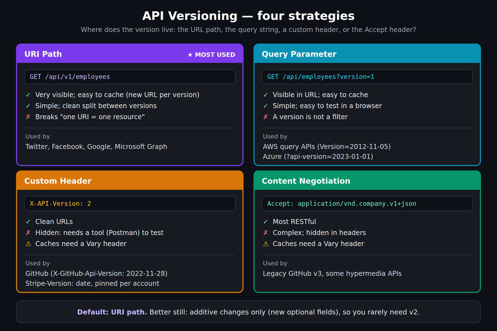

**Spring Boot Implementation — URI Path Versioning:**

```java
@RestController
@RequestMapping("/api/v1/employees")
public class EmployeeControllerV1 {

    @GetMapping("/{id}")
    public ResponseEntity<EmployeeV1> getEmployee(
            @PathVariable Long id) {
        // V1 response: basic fields only
        return ResponseEntity.ok(employeeServiceV1.findById(id));
    }
}

@RestController
@RequestMapping("/api/v2/employees")
public class EmployeeControllerV2 {

    @GetMapping("/{id}")
    public ResponseEntity<EmployeeV2> getEmployee(
            @PathVariable Long id) {
        // V2 response: includes department and skills
        return ResponseEntity.ok(employeeServiceV2.findById(id));
    }
}
```

**Spring Boot Implementation — Custom Header Versioning:**

```java
@RestController
@RequestMapping("/api/employees")
public class EmployeeController {

    @GetMapping(value = "/{id}", headers = "X-API-Version=1")
    public ResponseEntity<EmployeeV1> getEmployeeV1(
            @PathVariable Long id) {
        return ResponseEntity.ok(employeeServiceV1.findById(id));
    }

    @GetMapping(value = "/{id}", headers = "X-API-Version=2")
    public ResponseEntity<EmployeeV2> getEmployeeV2(
            @PathVariable Long id) {
        return ResponseEntity.ok(employeeServiceV2.findById(id));
    }
}
```

🔑 **Key Point:** **URI Path versioning** is the most commonly used strategy in practice. It is simple, visible, and easy to cache. Twitter, Facebook, Google and Microsoft Graph all use it.

⚠️ **Two examples that candidates often get wrong:**

- **Stripe does *not* use URI-path versioning.** The `v1` in `api.stripe.com/v1/charges` has not changed for over a decade. It does not hold the version. Stripe versions by **date** (`2024-06-20`). The version is **pinned per account** (fixed for each account). A request can override it with the `Stripe-Version` header. So a new integration gets today's version, and old integrations keep working with no changes. There is no separate `/v2/` API to run.
- **GitHub moved *off* media-type versioning in November 2022.** `Accept: application/vnd.github+json` no longer carries a version. GitHub now uses the **`X-GitHub-Api-Version`** custom header with date values (`2022-11-28`). If you give GitHub as the Content-Negotiation example, you describe the API as it was, not as it is now.

📝 **Note — the harder part is *retiring* v1, not releasing v2.** A version strategy is incomplete without a sunset policy (a plan to remove the old version). The policy has these steps:

- Send `Deprecation: @<unix-seconds>` (RFC 9745) and `Sunset: <http-date>` (RFC 8594) on the old version's responses.
- Add `Link: <docs-url>; rel="deprecation"`.
- Measure **per-version consumer traffic**. Then you know who is still on v1 before you remove it.
- Give a fixed window (6–12 months is typical).

Interviewers use this to tell apart people who have run an API from people who have only read about one.

🎯 **Interview Tip:** If asked which to choose, recommend URI path versioning for most use cases. Also say that the ideal approach is to design APIs that are backward-compatible. That means **additive changes only**: new optional fields, and never removing existing fields or changing their type. Then you rarely need a new version at all.

---

</details>

---

2. **📄 Compare offset-based vs cursor-based pagination. When should you use each? 🔥**

<!-- -->
<details>
<summary>Answer</summary>

**Answer:**

Pagination is essential for APIs that return large datasets. The two main approaches are offset-based and cursor-based pagination.

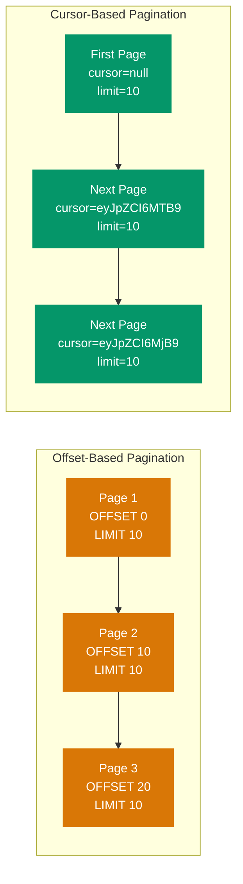

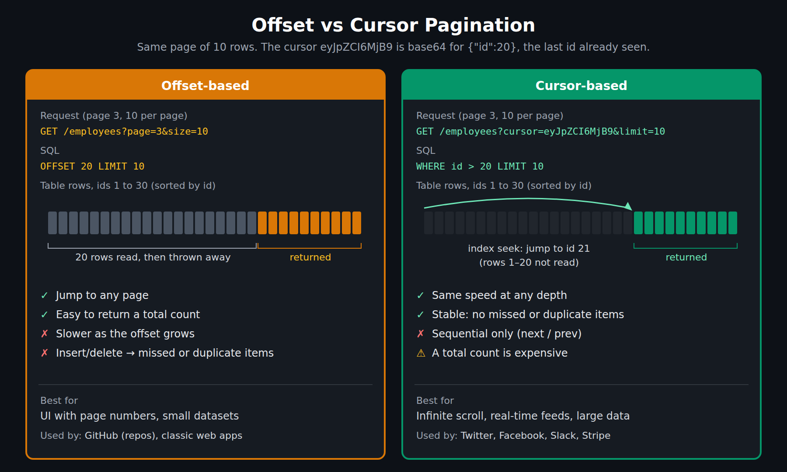

**Comparison:**

| Feature | Offset-Based | Cursor-Based |
|---------|-------------|--------------|
| **Request** | `?page=2&size=10` | `?cursor=abc123&limit=10` |
| **SQL** | `OFFSET 10 LIMIT 10` | `WHERE id > 10 LIMIT 10` |
| **Jump to Page** | ✅ Can jump to any page | ❌️ Sequential only (next/prev) |
| **Performance** | ❌️ Degrades with large offsets | ✅ Consistent performance |
| **Data Consistency** | ❌️ Missed/duplicate items on insert/delete | ✅ Stable — no missed/duplicate items |
| **Total Count** | ✅ Can include total count easily | ⚠️ Expensive to compute total |
| **Implementation** | ✅ Simple | ⚠️ More complex |
| **Best For** | UI with page numbers, small datasets | Infinite scroll, real-time feeds, large datasets |
| **Used By** | GitHub (repos), traditional web apps | Twitter, Facebook, Slack, Stripe |

**Offset-Based Implementation:**

```java
private static final Set<String> SORTABLE =
        Set.of("id", "name", "salary", "department");

// Request: GET /api/employees?page=0&size=10&sort=name,asc
@GetMapping
public ResponseEntity<Page<Employee>> getAllEmployees(
        @RequestParam(defaultValue = "0") int page,
        @RequestParam(defaultValue = "10") int size,
        @RequestParam(defaultValue = "id,asc") String[] sort) {

    // ?sort=name binds to ["name"] — sort[1] would throw
    String property  = sort.length > 0 ? sort[0] : "id";
    String direction = sort.length > 1 ? sort[1] : "asc";

    // Unknown property → PropertyReferenceException, whose message
    // leaks your entity field names. Allow-list instead.
    if (!SORTABLE.contains(property)) {
        throw new ResponseStatusException(HttpStatus.BAD_REQUEST,
                "Unsupported sort property: " + property);
    }

    Pageable pageable = PageRequest.of(page, Math.min(size, 100),
            Sort.by(Sort.Direction.fromOptionalString(direction)
                    .orElse(Sort.Direction.ASC), property));

    Page<Employee> result = employeeRepository.findAll(pageable);
    return ResponseEntity.ok(result);
}
```

⚠️ **Caution — the naive version of that method has three bugs.**

- `@RequestParam String[] sort` with `?sort=name` binds to `["name"]`. So an unguarded `sort[1]` throws `ArrayIndexOutOfBoundsException` → **500 on a perfectly reasonable request**.
- `Sort.Direction.fromString("ASCENDING")` throws `IllegalArgumentException` (use `fromOptionalString`).
- An unbounded `size` lets a client ask for `?size=1000000`.

The shortest fix is to skip the manual binding. Declare `Pageable pageable` directly as a controller parameter. Then:

- `PageableHandlerMethodArgumentResolver` parses `page` / `size` / `sort` for you.
- `spring.data.web.pageable.max-page-size` caps the size.

But you still need the property allow-list.

```json
// Response
{
  "content": [
    { "id": 1, "name": "Alice", "salary": 50000 },
    { "id": 2, "name": "Bob", "salary": 55000 }
  ],
  "pageable": {
    "pageNumber": 0,
    "pageSize": 10,
    "sort": { "sorted": true, "unsorted": false, "empty": false }
  },
  "totalElements": 150,
  "totalPages": 15,
  "last": false,
  "first": true
}
```

**Cursor-Based Implementation:**

```java
// Request: GET /api/employees?cursor=eyJpZCI6MTB9&limit=10
@GetMapping
public ResponseEntity<CursorPage<Employee>> getEmployees(
        @RequestParam(required = false) String cursor,
        @RequestParam(defaultValue = "10") int limit) {

    Long lastId = decodeCursor(cursor); // Base64 decode → extract ID

    // Fetch limit + 1 rows: the extra row is the "is there a next page?" probe
    Pageable window = PageRequest.of(0, limit + 1);

    List<Employee> employees = (lastId == null)
            ? employeeRepository.findAllByOrderByIdAsc(window)
            : employeeRepository
                    .findByIdGreaterThanOrderByIdAsc(lastId, window);

    boolean hasNext = employees.size() > limit;
    if (hasNext) {
        employees = employees.subList(0, limit);
    }

    String nextCursor = hasNext
            ? encodeCursor(employees.get(employees.size() - 1).getId())
            : null;

    return ResponseEntity.ok(
            new CursorPage<>(employees, nextCursor, hasNext));
}
```

⚠️ **Caution — `findTopByOrderByIdAsc(Pageable)` is a common mistake.** In Spring Data's derived-query grammar, **`findTop` with no number means `findTop1`**. The limit written *in the method name* takes priority over the `Pageable`. So the method returns at most **one** row. `hasNext` is always `false`, and cursor pagination never moves past the first record. Use `findAllByOrderByIdAsc(Pageable)` instead. There, the page size is the only limit that applies.

```json
// Response
{
  "data": [
    { "id": 11, "name": "Charlie", "salary": 60000 },
    { "id": 12, "name": "Diana", "salary": 65000 }
  ],
  "nextCursor": "eyJpZCI6MjB9",
  "hasNext": true
}
```

⚠️ **Caution:** Offset-based pagination with large offsets (e.g., `OFFSET 1000000`) forces the database to scan and skip all earlier rows. This makes performance much worse. This is called the **offset problem**.

🎯 **Interview Tip:** Recommend cursor-based pagination for any API that handles real-time data, large datasets, or infinite scroll. Use offset-based for admin dashboards or UIs that need "jump to page N" functionality.

---

</details>

---

3. **🔍 How do you design filtering, sorting, and field selection in REST APIs? ⚡**

<!-- -->
<details>
<summary>Answer</summary>

**Answer:**

Filtering, sorting, and field selection belong to the query. Always pass them as **query parameters**, never in the URL path.

**Filtering Patterns:**

```yaml
# Simple equality filters
GET /api/employees?department=Engineering&status=active

# Comparison operators
GET /api/employees?salary[gte]=50000&salary[lte]=100000
GET /api/employees?salary=gte:50000,lte:100000

# Multiple values (IN clause)
GET /api/employees?department=Engineering,Marketing,Sales

# Search / full-text
GET /api/employees?search=alice

# Date range
GET /api/employees?joinDate[gte]=2024-01-01&joinDate[lte]=2024-12-31
```

**Sorting Patterns:**

```yaml
# Single field sort
GET /api/employees?sort=name,asc

# Multiple field sort
GET /api/employees?sort=department,asc&sort=salary,desc

# Alternative syntax
GET /api/employees?sortBy=name&sortOrder=asc
GET /api/employees?sort=+name,-salary    # +asc, -desc
```

**Field Selection (Sparse Fieldsets):**

```yaml
# Return only specified fields (reduces payload)
GET /api/employees?fields=id,name,email
GET /api/employees/101?fields=id,name,department

# Response contains only requested fields
{
  "id": 101,
  "name": "Alice",
  "email": "alice@company.com"
}
```

**Spring Boot Implementation:**

```java
@RestController
@RequestMapping("/api/employees")
public class EmployeeController {

    @Autowired
    private EmployeeRepository employeeRepository;

    @GetMapping
    public ResponseEntity<Page<Employee>> getEmployees(
            @RequestParam(required = false) String department,
            @RequestParam(required = false) String status,
            @RequestParam(required = false) Double minSalary,
            @RequestParam(required = false) Double maxSalary,
            @RequestParam(required = false) String search,
            // Let Spring parse page/size/sort — no manual String[] indexing,
            // and spring.data.web.pageable.max-page-size caps the size
            @PageableDefault(size = 20, sort = "id") Pageable pageable) {

        // Spring Data JPA 4.0+ rejects where(null): use Specification.unrestricted()
        Specification<Employee> spec = Specification.where(null);

        if (department != null) {
            spec = spec.and((root, query, cb) ->
                    cb.equal(root.get("department"), department));
        }
        if (minSalary != null) {
            spec = spec.and((root, query, cb) ->
                    cb.greaterThanOrEqualTo(root.get("salary"), minSalary));
        }
        if (maxSalary != null) {
            spec = spec.and((root, query, cb) ->
                    cb.lessThanOrEqualTo(root.get("salary"), maxSalary));
        }
        if (search != null) {
            spec = spec.and((root, query, cb) ->
                    cb.like(cb.lower(root.get("name")),
                            "%" + search.toLowerCase() + "%"));
        }

        return ResponseEntity.ok(
                employeeRepository.findAll(spec, pageable));
    }
}
```

⚠️ **Caution:** `Pageable` resolution does **not** validate the sort property. `?sort=passwordHash,asc` still reaches Spring Data. An unknown property raises a `PropertyReferenceException`, and its message lists your entity's fields. Keep the allow-list check from the pagination answer. Or expose sorting through a fixed enum of named sort options.

📝 **Note:** Spring Data JPA's `Specification` interface lets you build dynamic queries (queries built at runtime from the filters in the request). Your repository must extend `JpaSpecificationExecutor` to get `findAll(spec, pageable)`. This is much cleaner than writing multiple repository methods for every filter combination.

💡 **Pro Tip:** For complex APIs, consider a standard query syntax like OData or RSQL (REST Query Language). Libraries like `rsql-jpa` connect RSQL parsing to JPA specifications.

---

</details>

---

4. **📦 How do you design bulk operations in REST APIs? ⚡**

<!-- -->
<details>
<summary>Answer</summary>

**Answer:**

Bulk operations let clients create, update, or delete multiple resources in a single request. This reduces HTTP overhead and improves performance.

**Approach 1: Batch Endpoint (Most Common)**

```json
// POST /api/employees/batch
// Request: Array of resources
[
  { "name": "Alice", "department": "Engineering", "salary": 50000 },
  { "name": "Bob", "department": "Marketing", "salary": 55000 },
  { "name": "Charlie", "department": "Sales", "salary": 48000 }
]

// Response: Array of results with individual status
{
  "results": [
    { "index": 0, "status": 201, "id": 101, "message": "Created" },
    { "index": 1, "status": 201, "id": 102, "message": "Created" },
    { "index": 2, "status": 422, "id": null, "message": "Salary below minimum" }
  ],
  "summary": {
    "total": 3,
    "succeeded": 2,
    "failed": 1
  }
}
```

**Approach 2: Bulk Delete with Query Parameters**

```yaml
# Delete multiple resources by IDs
DELETE /api/employees?ids=101,102,103

# Or using request body (some debate about DELETE with body)
DELETE /api/employees
Content-Type: application/json
{ "ids": [101, 102, 103] }
```

**Approach 3: Bulk Update with PATCH**

```json
// PATCH /api/employees/batch
[
  { "id": 101, "salary": 55000 },
  { "id": 102, "department": "Engineering" },
  { "id": 103, "status": "inactive" }
]
```

**Spring Boot Implementation:**

```java
@RestController
@RequestMapping("/api/employees")
public class EmployeeController {

    @PostMapping("/batch")
    public ResponseEntity<BulkResponse> createBatch(
            @RequestBody @Valid List<EmployeeRequest> employees) {

        List<BulkResult> results = new ArrayList<>();
        int succeeded = 0, failed = 0;

        for (int i = 0; i < employees.size(); i++) {
            try {
                Employee saved = employeeService.save(
                        employees.get(i).toEntity());
                results.add(new BulkResult(i, 201,
                        saved.getId(), "Created"));
                succeeded++;
            } catch (Exception e) {
                results.add(new BulkResult(i, 422,
                        null, e.getMessage()));
                failed++;
            }
        }

        BulkResponse response = new BulkResponse(results,
                new Summary(employees.size(), succeeded, failed));

        HttpStatus status = failed == 0
                ? HttpStatus.CREATED
                : HttpStatus.MULTI_STATUS; // 207

        return ResponseEntity.status(status).body(response);
    }

    @DeleteMapping("/batch")
    public ResponseEntity<Void> deleteBatch(
            @RequestParam List<Long> ids) {
        employeeService.deleteAllByIds(ids);
        return ResponseEntity.noContent().build();
    }
}
```

**Design Considerations:**

| Concern | Best Practice |
|---------|---------------|
| **Max batch size** | Enforce a limit (e.g., 100 items per request) |
| **Partial failures** | Return 207 Multi-Status with per-item results |
| **Atomicity** | Decide: all-or-nothing (transactional) vs best-effort (partial) |
| **Timeouts** | Large batches may timeout — consider async processing |
| **Idempotency** | Use idempotency keys for retryable batch operations |

🔑 **Key Point:** Use HTTP status **207 Multi-Status** when some items succeed and some fail. This clearly tells the client that the request partly succeeded.

---

</details>

---

5. **🗂️ How do you design sub-resources and nested routes? ⚡**

<!-- -->
<details>
<summary>Answer</summary>

**Answer:**

Sub-resources show the relationship between entities. In REST, you model them as nested routes. The client reaches a child resource through its parent.

**When to Use Nested Routes:**

- 🔗 When a child resource cannot exist without the parent (strong ownership)
- 📋 When the child is always accessed in the context of the parent
- 🏷️ When the URI reads naturally as a hierarchy

**Nested Route Patterns:**

```yaml
# Department → Employees (one-to-many)
GET    /departments/5/employees          # All employees in dept 5
POST   /departments/5/employees          # Add employee to dept 5
GET    /departments/5/employees/101      # Employee 101 in dept 5
PUT    /departments/5/employees/101      # Update employee 101 in dept 5
DELETE /departments/5/employees/101      # Remove employee 101 from dept 5

# Order → Items → Reviews (deep nesting)
GET    /orders/500/items                 # All items in order 500
GET    /orders/500/items/3              # Item 3 of order 500
GET    /orders/500/items/3/reviews      # Reviews for item 3 of order 500
```

**Spring Boot Implementation:**

```java
@RestController
@RequestMapping("/api/departments/{deptId}/employees")
public class DepartmentEmployeeController {

    @Autowired
    private EmployeeService employeeService;

    @GetMapping
    public ResponseEntity<List<Employee>> getEmployeesByDepartment(
            @PathVariable Long deptId) {
        return ResponseEntity.ok(
                employeeService.findByDepartmentId(deptId));
    }

    @PostMapping
    public ResponseEntity<Employee> addEmployeeToDepartment(
            @PathVariable Long deptId,
            @RequestBody Employee employee) {
        employee.setDepartmentId(deptId);
        Employee saved = employeeService.save(employee);

        URI location = ServletUriComponentsBuilder.fromCurrentRequest()
                .path("/{id}")
                .buildAndExpand(saved.getId())
                .toUri();

        return ResponseEntity.created(location).body(saved);
    }

    @GetMapping("/{empId}")
    public ResponseEntity<Employee> getEmployee(
            @PathVariable Long deptId,
            @PathVariable Long empId) {
        return ResponseEntity.ok(
                employeeService.findByDeptIdAndEmpId(deptId, empId));
    }
}
```

**Nested vs Flat — When to Flatten:**

| Approach | URI | When to Use |
|----------|-----|-------------|
| **Nested** | `/departments/5/employees` | Child belongs to parent |
| **Flat** | `/employees?departmentId=5` | Child can exist independently |
| **Both** | Provide both routes | Flexibility for different use cases |

⚠️ **Caution:** Avoid nesting deeper than 2 levels. Deep nesting like `/departments/5/employees/101/projects/3/tasks/7` becomes hard to use. Instead, flatten it with top-level resources: `GET /tasks/7`.

📝 **Note:** A resource may have a globally unique identifier. For example, the employee ID is unique across all departments. In that case, provide a flat route as well: `GET /employees/101`. Then clients do not need to know the department ID just to fetch an employee.

---

</details>

---

6. **📁 How do you design REST APIs for file uploads? 💤**

<!-- -->
<details>
<summary>Answer</summary>

**Answer:**

File upload APIs need special handling, because files are binary data, not JSON. There are several approaches. The right one depends on the use case.

**Approach 1: Multipart Form Data (Most Common)**

```java
@RestController
@RequestMapping("/api/files")
public class FileUploadController {

    @PostMapping("/upload")
    public ResponseEntity<FileResponse> uploadFile(
            @RequestParam("file") MultipartFile file,
            @RequestParam(value = "description",
                          required = false) String description) {

        if (file.isEmpty()) {
            return ResponseEntity.badRequest().build();
        }

        // Validate file type
        String contentType = file.getContentType();
        if (!isAllowedType(contentType)) {
            return ResponseEntity.status(HttpStatus.UNSUPPORTED_MEDIA_TYPE)
                    .build();
        }

        // Validate file size (also configure in properties)
        if (file.getSize() > MAX_FILE_SIZE) {
            return ResponseEntity.status(HttpStatus.PAYLOAD_TOO_LARGE)
                    .build();
        }

        String savedPath = fileService.store(file);

        FileResponse response = new FileResponse(
                file.getOriginalFilename(),
                savedPath,
                file.getSize(),
                contentType);

        URI location = URI.create("/api/files/" + savedPath);

        return ResponseEntity.created(location).body(response);
    }

    @PostMapping("/upload-multiple")
    public ResponseEntity<List<FileResponse>> uploadMultiple(
            @RequestParam("files") List<MultipartFile> files) {
        List<FileResponse> responses = files.stream()
                .map(file -> fileService.storeAndRespond(file))
                .collect(Collectors.toList());
        return ResponseEntity.status(HttpStatus.CREATED).body(responses);
    }
}
```

**Configuration:**

```yaml
# application.yml
spring:
  servlet:
    multipart:
      max-file-size: 10MB
      max-request-size: 50MB
      enabled: true
```

**Approach 2: Upload with Metadata (Two-Step)**

```yaml
# Step 1: Create resource with metadata
POST /api/documents
Content-Type: application/json
{ "title": "Contract", "category": "legal" }
→ 201 Created, Location: /api/documents/501

# Step 2: Upload file to the resource
PUT /api/documents/501/content
Content-Type: application/pdf
<binary data>
→ 200 OK
```

**Approach 3: Base64 Encoded (Small Files Only)**

```json
// POST /api/documents
{
  "title": "Profile Picture",
  "content": "data:image/png;base64,iVBORw0KGgoAAAANSUhEUg...",
  "contentType": "image/png"
}
```

| Approach | Max Size | Complexity | Use Case |
|----------|----------|------------|----------|
| **Multipart** | Large files | Low | General file uploads |
| **Two-Step** | Large files | Medium | Files with rich metadata |
| **Base64** | Small files (<1MB) | Low | Avatars, thumbnails |
| **Chunked Upload** | Very large files | High | Video, large archives |

📝 **Note:** `HttpStatus.PAYLOAD_TOO_LARGE` is Spring 6's constant name for **413**. Spring 7.0 adds `CONTENT_TOO_LARGE` and deprecates the old name. RFC 9110 §15.5.14 renamed the status to **"Content Too Large"**. The code is the same; only the name is new.

🔑 **Key Point:** Always validate these three things:

- the file type (whitelist the allowed MIME types)
- the file size
- the filename — sanitize it to prevent path traversal attacks (a name like `../` that reaches files outside the upload folder)

Never trust the filename that the client sends.

---

</details>

---

<a id="error-handling-standards"></a>

## 4. Error Handling Standards

1. **📋 What is RFC 9457 / RFC 7807 (Problem Details for HTTP APIs)? How do you implement it? ⚡**

<!-- -->
<details>
<summary>Answer</summary>

**Answer:**

**Problem Details for HTTP APIs** defines a standard format for error responses. It gives clients a machine-readable way to read error details. Without it, every API invents its own error format (envelope).

⚠️ **Get the RFC number right.**

- The original spec was **RFC 7807 (2016)**. It was **obsoleted by RFC 9457 in July 2023** (9457 replaced it).
- The field set and the `application/problem+json` media type are unchanged. So everything you learned about 7807 is still true.
- But say *"RFC 9457, which obsoleted 7807"*.
- Spring's own `ProblemDetail` javadoc now cites 9457.
- RFC 9457 lists three changes: a **registry** of common problem types, rules for **multiple problems**, and advice for `type` URIs that cannot be opened (dereferenced).
- Many problems of the same type go in one extension member, such as `errors`. Do not merge them into `detail`. For problems of different types, return the most important one.

**Standard Problem Details Fields:**

| Field | Type | Required | Description |
|-------|------|----------|-------------|
| **`type`** | URI | No | A URI reference that identifies the problem type |
| **`title`** | String | No | A short, human-readable summary |
| **`status`** | Integer | No | The HTTP status code |
| **`detail`** | String | No | A human-readable explanation specific to this occurrence |
| **`instance`** | URI | No | A URI reference that identifies this specific occurrence |

**Example Problem Details Response:**

```json
{
  "type": "https://api.company.com/errors/employee-not-found",
  "title": "Employee Not Found",
  "status": 404,
  "detail": "Employee with ID 999 does not exist in the system",
  "instance": "/api/employees/999",
  "timestamp": "2026-03-21T10:30:00Z",
  "traceId": "abc-123-def-456"
}
```

**Validation Error with Extensions:**

```json
{
  "type": "https://api.company.com/errors/validation-error",
  "title": "Validation Failed",
  "status": 422,
  "detail": "Request body contains 2 validation errors",
  "instance": "/api/employees",
  "errors": [
    {
      "field": "name",
      "message": "Name must not be blank",
      "rejectedValue": ""
    },
    {
      "field": "salary",
      "message": "Salary must be greater than 0",
      "rejectedValue": -5000
    }
  ]
}
```

**Spring Boot 3.x Implementation (Built-in Support):**

Spring Boot 3.x has built-in support through the `ProblemDetail` class:

```java
@RestControllerAdvice
public class GlobalExceptionHandler {

    @ExceptionHandler(EmployeeNotFoundException.class)
    public ProblemDetail handleEmployeeNotFound(
            EmployeeNotFoundException ex) {
        ProblemDetail problem = ProblemDetail.forStatusAndDetail(
                HttpStatus.NOT_FOUND, ex.getMessage());
        problem.setTitle("Employee Not Found");
        problem.setType(URI.create(
                "https://api.company.com/errors/employee-not-found"));
        problem.setProperty("timestamp", Instant.now());
        problem.setProperty("traceId", MDC.get("traceId"));
        return problem;
    }

    @ExceptionHandler(MethodArgumentNotValidException.class)
    public ProblemDetail handleValidationErrors(
            MethodArgumentNotValidException ex) {
        ProblemDetail problem = ProblemDetail.forStatusAndDetail(
                HttpStatus.UNPROCESSABLE_ENTITY,
                "Request body contains validation errors");
        problem.setTitle("Validation Failed");

        List<Map<String, Object>> errors = ex.getBindingResult()
                .getFieldErrors().stream()
                .<Map<String, Object>>map(error -> Map.of(
                        "field", error.getField(),
                        // getDefaultMessage() CAN be null — Map.of throws NPE on null
                        "message", Objects.requireNonNullElse(
                                error.getDefaultMessage(), "invalid value"),
                        "rejectedValue", Objects.requireNonNullElse(
                                error.getRejectedValue(), "null")
                )).toList();

        problem.setProperty("errors", errors);
        return problem;
    }
}
```

⚠️ **Caution — `Map.of(...)` throws `NullPointerException` on any null value.** And `FieldError.getDefaultMessage()` **can be null**. This happens when a constraint has no `message` and Spring cannot resolve a default message.

- If an exception handler itself throws an NPE, that same handler does not catch it.
- Spring logs a warning and drops the handler's result. It passes the original exception to its default resolvers. Here the client gets Spring Boot's plain **400** error body, with no field list. For other exception types it is often a plain 500.
- That is the exact result the handler exists to prevent.

Wrap every nullable field in `Objects.requireNonNullElse(...)`. Or build the map with `HashMap`, which allows nulls.

📝 **Note:** In Spring Boot 3.x, enable Problem Details globally by setting `spring.mvc.problemdetails.enabled=true` in `application.properties`. The response `Content-Type` will be `application/problem+json`.

🎯 **Interview Tip:** Name the standard **and its current number**. That is what the interviewer listens for. "RFC 9457, formerly 7807" tells them you read the spec, not a 2016 blog post. Then show two things:

- Spring Boot 3 supports it natively through `ProblemDetail`.
- Extension members (`errors`, `traceId`) carry anything the five standard fields do not cover.

---

</details>

---

2. **✅ How do you design validation error responses? 🔥**

<!-- -->
<details>
<summary>Answer</summary>

**Answer:**

Validation error responses should be structured and consistent. They should give the client enough information to find and fix the issue without guessing.

**Validation in Spring Boot:**

```java
// DTO with validation annotations
@Data
public class CreateEmployeeRequest {

    @NotBlank(message = "Name is required")
    @Size(min = 2, max = 100,
          message = "Name must be between 2 and 100 characters")
    private String name;

    @NotBlank(message = "Email is required")
    @Email(message = "Email must be a valid email address")
    private String email;

    @NotNull(message = "Salary is required")
    @Positive(message = "Salary must be greater than 0")
    @Max(value = 10000000,
         message = "Salary cannot exceed 10,000,000")
    private Double salary;

    @NotBlank(message = "Department is required")
    private String department;
}
```

**Controller with @Valid:**

```java
@RestController
@RequestMapping("/api/employees")
public class EmployeeController {

    @PostMapping
    public ResponseEntity<Employee> createEmployee(
            @RequestBody @Valid CreateEmployeeRequest request) {
        Employee saved = employeeService.create(request);

        URI location = ServletUriComponentsBuilder.fromCurrentRequest()
                .path("/{id}")
                .buildAndExpand(saved.getId())
                .toUri();

        return ResponseEntity.created(location).body(saved);
    }
}
```

**Global Exception Handler for Validation:**

```java
@RestControllerAdvice
public class GlobalExceptionHandler {

    @ExceptionHandler(MethodArgumentNotValidException.class)
    public ResponseEntity<ValidationErrorResponse> handleValidation(
            MethodArgumentNotValidException ex) {

        List<FieldViolation> fieldErrors = ex.getBindingResult()
                .getFieldErrors().stream()
                .map(error -> new FieldViolation(
                        error.getField(),
                        error.getDefaultMessage(),
                        error.getRejectedValue()))
                .collect(Collectors.toList());

        ValidationErrorResponse response = new ValidationErrorResponse(
                HttpStatus.UNPROCESSABLE_ENTITY.value(),
                "Validation Failed",
                "Request contains " + fieldErrors.size()
                        + " validation error(s)",
                fieldErrors,
                Instant.now()
        );

        return ResponseEntity
                .unprocessableEntity()
                .body(response);
    }
}

@Data
@AllArgsConstructor
public class ValidationErrorResponse {
    private int status;
    private String title;
    private String detail;
    private List<FieldViolation> errors;
    private Instant timestamp;
}

// Not named FieldError: that name clashes with Spring's
// org.springframework.validation.FieldError used above
@Data
@AllArgsConstructor
public class FieldViolation {
    private String field;
    private String message;
    private Object rejectedValue;
}
```

**Sample Validation Error Response:**

```json
{
  "status": 422,
  "title": "Validation Failed",
  "detail": "Request contains 3 validation error(s)",
  "errors": [
    {
      "field": "name",
      "message": "Name is required",
      "rejectedValue": null
    },
    {
      "field": "email",
      "message": "Email must be a valid email address",
      "rejectedValue": "not-an-email"
    },
    {
      "field": "salary",
      "message": "Salary must be greater than 0",
      "rejectedValue": -5000
    }
  ],
  "timestamp": "2026-03-21T10:30:00Z"
}
```

🔑 **Key Point:** Return **all** validation errors at once, not just the first one. Otherwise the client fixes one error, sends again, and only then finds the next one. These extra round-trips are frustrating.

💡 **Pro Tip:** 422 (RFC 9110 calls it **Unprocessable Content**) is the more precise choice for constraint violations. It means "I parsed you fine, your data is invalid". But do not claim 400 is *wrong*:

- RFC 9110 §15.5.1 defines 400 as any error the server sees as a client error, not only a syntax error.
- **Spring's own `ResponseEntityExceptionHandler` returns 400** for `MethodArgumentNotValidException`.
- The Google and Microsoft API style guides also use 400.

If you return 422, you are changing the framework default on purpose. Say this clearly. And use it on *every* validation path, so one API never mixes both. See the 400-vs-422 comparison in §2.4.

---

</details>

---

3. **🛡️ How do you implement global exception handling with @ControllerAdvice? 🔥🔥**

<!-- -->
<details>
<summary>Answer</summary>

**Answer:**

`@ControllerAdvice` (or `@RestControllerAdvice`) gives you one central place to handle exceptions. It handles exceptions thrown from any controller in the application. So you do not need try-catch blocks in every controller method.

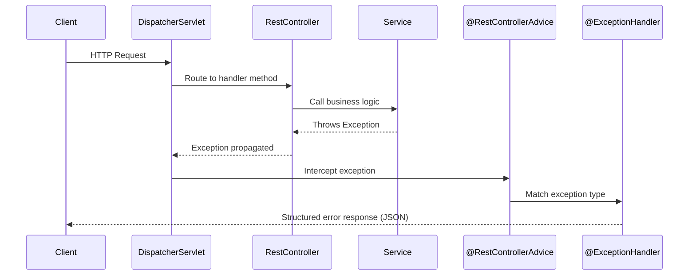

**Comprehensive Global Exception Handler:**

```java
@RestControllerAdvice
@Slf4j
public class GlobalExceptionHandler
        extends ResponseEntityExceptionHandler {   // ← see the caution below

    // Custom business exception
    @ExceptionHandler(ResourceNotFoundException.class)
    public ResponseEntity<ApiErrorResponse> handleNotFound(
            ResourceNotFoundException ex, WebRequest request) {
        log.warn("Resource not found: {}", ex.getMessage());

        ApiErrorResponse error = ApiErrorResponse.builder()
                .status(HttpStatus.NOT_FOUND.value())
                .title("Resource Not Found")
                .detail(ex.getMessage())
                .path(request.getDescription(false))
                .timestamp(Instant.now())
                .build();

        return ResponseEntity.status(HttpStatus.NOT_FOUND).body(error);
    }

    // Validation errors — OVERRIDE, never a second @ExceptionHandler,
    // because the parent already maps MethodArgumentNotValidException
    @Override
    protected ResponseEntity<Object> handleMethodArgumentNotValid(
            MethodArgumentNotValidException ex, HttpHeaders headers,
            HttpStatusCode status, WebRequest request) {
        log.warn("Validation failed: {}", ex.getMessage());

        List<Map<String, Object>> fieldErrors = ex.getBindingResult()
                .getFieldErrors().stream()
                .<Map<String, Object>>map(err -> Map.of(
                        "field", err.getField(),
                        // getDefaultMessage() may be null → Map.of would NPE
                        "message", Objects.requireNonNullElse(
                                err.getDefaultMessage(), "invalid value")))
                .toList();

        ProblemDetail problem = ProblemDetail.forStatusAndDetail(
                HttpStatus.UNPROCESSABLE_ENTITY,
                "Request contains " + fieldErrors.size()
                        + " validation error(s)");
        problem.setTitle("Validation Failed");
        problem.setProperty("errors", fieldErrors);
        problem.setProperty("timestamp", Instant.now());

        return handleExceptionInternal(ex, problem, headers,
                HttpStatus.UNPROCESSABLE_ENTITY, request);
    }

    // Authorization failures — 403, NOT swallowed by the catch-all below
    @ExceptionHandler(AccessDeniedException.class)
    public ResponseEntity<ApiErrorResponse> handleAccessDenied(
            AccessDeniedException ex) {
        log.warn("Access denied: {}", ex.getMessage());

        ApiErrorResponse error = ApiErrorResponse.builder()
                .status(HttpStatus.FORBIDDEN.value())
                .title("Forbidden")
                .detail("You do not have permission to access this resource")
                .timestamp(Instant.now())
                .build();

        return ResponseEntity.status(HttpStatus.FORBIDDEN).body(error);
    }

    // Duplicate resource / conflict
    @ExceptionHandler(DuplicateResourceException.class)
    public ResponseEntity<ApiErrorResponse> handleConflict(
            DuplicateResourceException ex) {
        log.warn("Duplicate resource: {}", ex.getMessage());

        ApiErrorResponse error = ApiErrorResponse.builder()
                .status(HttpStatus.CONFLICT.value())
                .title("Resource Already Exists")
                .detail(ex.getMessage())
                .timestamp(Instant.now())
                .build();

        return ResponseEntity.status(HttpStatus.CONFLICT).body(error);
    }

    // 405 Method Not Allowed, 400 malformed JSON, 400 type mismatch,
    // 404 no handler, 413 upload too large (Spring 6.1+) … are ALL inherited from
    // ResponseEntityExceptionHandler with the correct 4xx code.
    // Override only the ones whose body you want to reshape.

    // Catch-all — now genuinely reached only by unexpected exceptions
    @ExceptionHandler(Exception.class)
    public ResponseEntity<ApiErrorResponse> handleGeneric(
            Exception ex) {
        log.error("Unexpected error", ex);

        ApiErrorResponse error = ApiErrorResponse.builder()
                .status(HttpStatus.INTERNAL_SERVER_ERROR.value())
                .title("Internal Server Error")
                .detail("An unexpected error occurred. "
                        + "Please try again later.")
                .timestamp(Instant.now())
                .build();

        return ResponseEntity.internalServerError().body(error);
    }
}
```

**Error Response Model:**

```java
// Not named ErrorResponse: Spring 6 already has
// org.springframework.web.ErrorResponse
@Data
@Builder
@NoArgsConstructor
@AllArgsConstructor
public class ApiErrorResponse {
    private int status;
    private String title;
    private String detail;
    private String path;
    private Instant timestamp;
    private List<Map<String, String>> fieldErrors;
}
```

⚠️ **Caution — a bare `@ExceptionHandler(Exception.class)` turns client errors into 500s.** Suppose your `@RestControllerAdvice` does *not* extend `ResponseEntityExceptionHandler`. Then the catch-all handler becomes the most specific match for every Spring MVC exception that the advice does not name explicitly:

| Client mistake | Exception Spring raises | Correct status | What the bare catch-all returns |
|---|---|:--:|:--:|
| Malformed JSON body | `HttpMessageNotReadableException` | 400 | ❌️ 500 |
| `GET /employees/abc` where id is `Long` | `MethodArgumentTypeMismatchException` | 400 | ❌️ 500 |
| Blocked by `@PreAuthorize` | `AccessDeniedException` | 403 | ❌️ 500 |

This causes two problems:

- It breaks this file's own rule: *"never return 500 for client-side input errors"*.
- It silently disables your authorization layer. A 500 tells the client nothing about the 403.

If you extend `ResponseEntityExceptionHandler`, the first two rows are fixed with no extra code. `AccessDeniedException` is a Spring **Security** type that the parent does not map. So it still needs its own handler (shown above).

🚨 **The trap in that fix:** `ResponseEntityExceptionHandler` maps ~20 exception types on a **single** `@ExceptionHandler({...})` method. These include `MethodArgumentNotValidException`, `HttpRequestMethodNotSupportedException` and `HttpMessageNotReadableException`. If your subclass declares its *own* `@ExceptionHandler` for any of those, the context **fails to start**. This is the Spring 6.2+ message; Spring 6.1 prints `[class ...MethodArgumentNotValidException]` instead:

```text
IllegalStateException: Ambiguous @ExceptionHandler method mapped for
[ExceptionHandler{exceptionType=...MethodArgumentNotValidException, mediaType=*/*}]
```

So divide the work like this:

- For types the parent already handles, `@Override` its `protected handleXxx(...)` hook method.
- Use `@ExceptionHandler` only for types the parent does not handle: your own business exceptions, `AccessDeniedException`, and the final `Exception.class`.

**Best Practices:**

- ✅ Write a handler for each specific exception, plus one generic `Exception.class` handler. Spring picks the handler whose type is closest to the thrown exception. Method order in the class does not matter.
- ✅ Always log the exception (with stack trace for 5xx errors)
- ✅ Never expose internal details (stack trace, SQL queries) to the client
- ✅ Include a correlation/trace ID for debugging
- ✅ Use `@RestControllerAdvice` instead of `@ControllerAdvice` + `@ResponseBody`
- ❌️ Never return raw exception messages to the client in production

📝 **Note:** `@RestControllerAdvice` = `@ControllerAdvice` + `@ResponseBody`. Spring 4.3 introduced it. It automatically serializes the response to JSON.

---

</details>

---

4. **🔁 What are idempotency keys? How do they make APIs retry-friendly? 🔥**

<!-- -->
<details>
<summary>Answer</summary>

**Answer:**

An idempotency key is a unique ID that the client sends with a request. It makes sure the server does not perform the same operation more than once, even if the client retries the request. This is critical for non-idempotent operations like POST (payment processing, order creation).

**The Problem Without Idempotency Keys:**

```yaml
# Client creates a payment
POST /api/payments
{ "amount": 5000, "to": "merchant-123" }
→ Network timeout (client never receives response)

# Client retries the same request
POST /api/payments
{ "amount": 5000, "to": "merchant-123" }
→ 201 Created (DOUBLE PAYMENT! Customer charged twice)
```

**The Solution With Idempotency Keys:**

```yaml
# Client sends request with idempotency key
POST /api/payments
Idempotency-Key: pay_abc123def456
{ "amount": 5000, "to": "merchant-123" }
→ Network timeout

# Client retries with SAME idempotency key
POST /api/payments
Idempotency-Key: pay_abc123def456
{ "amount": 5000, "to": "merchant-123" }
→ 201 Created (the ORIGINAL response replayed verbatim, no duplicate payment)
→ Idempotent-Replayed: true
```

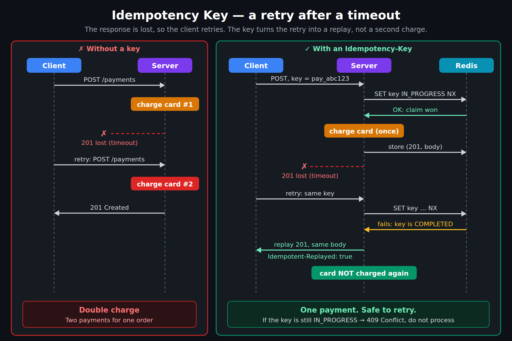

**The three states a key can be in — this is the whole design:**

Suppose an idempotency layer only asks *"have I seen this key?"*. Then it has a **check-then-act race**:

- Two retries arrive milliseconds apart.
- Both miss the cache.
- Both charge the card.

Idempotency keys exist to prevent exactly this failure. The fix: replace the read with an **atomic claim**. The claim puts the key into one of three states.

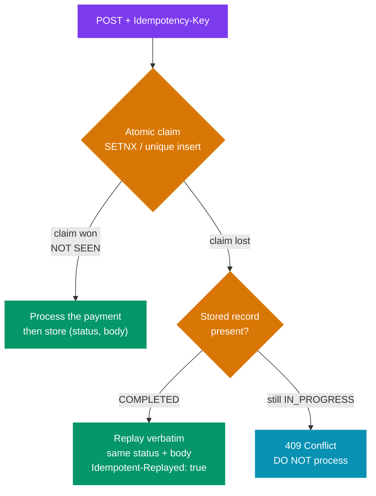

| State | How it is detected | Response |
|-------|--------------------|----------|
| **Not seen** | `SET key IN_PROGRESS NX EX 86400` succeeded — we own the key | Process, then save `(status, body)` |
| **Completed** | Claim failed **and** the stored value is a serialised response | **Replay it exactly** — same status code, same body, plus `Idempotent-Replayed: true` |
| **In flight** | Claim failed **and** the stored value is still the `IN_PROGRESS` marker | **409 Conflict**, and do **not** process. The client retries later |

**Spring Boot Implementation:**

```java
@RestController
@RequestMapping("/api/payments")
public class PaymentController {

    private final PaymentService paymentService;
    private final IdempotencyService idempotency;

    public PaymentController(PaymentService paymentService,
            IdempotencyService idempotency) {
        this.paymentService = paymentService;
        this.idempotency = idempotency;
    }

    @PostMapping
    public ResponseEntity<PaymentResponse> createPayment(
            @RequestHeader("Idempotency-Key") String key,
            @RequestBody @Valid PaymentRequest request) {

        // STATE 1 — atomic claim: SET idem:<key> IN_PROGRESS NX EX 86400
        if (!idempotency.claim(key)) {
            StoredResponse done = idempotency.findCompleted(key);

            // STATE 3 — in flight: another request owns this key RIGHT NOW
            if (done == null) {
                throw new IdempotencyConflictException(
                        "A request with this Idempotency-Key "
                                + "is still in progress");
            }

            // STATE 2 — completed: replay verbatim, same status + body
            return ResponseEntity.status(done.status())
                    .header("Idempotent-Replayed", "true")
                    .body(done.body());
        }

        // We won the claim, so we own the outcome of this key
        try {
            PaymentResponse response = paymentService.process(request);
            idempotency.complete(key,
                    HttpStatus.CREATED.value(), response);

            URI location = ServletUriComponentsBuilder.fromCurrentRequest()
                    .path("/{id}")
                    .buildAndExpand(response.getId())
                    .toUri();
            return ResponseEntity.created(location).body(response);

        } catch (DeterministicPaymentException e) {
            // Business rejection (insufficient funds, blocked payee):
            // the outcome IS known, so free the key for a fresh attempt.
            idempotency.release(key);
            throw e;
        }
        // NOTE: any other exception is deliberately NOT caught —
        // see the caution below on unknown outcomes.
    }
}

record StoredResponse(int status, PaymentResponse body) { }

@ResponseStatus(HttpStatus.CONFLICT)
public class IdempotencyConflictException extends RuntimeException {
    public IdempotencyConflictException(String message) {
        super(message);
    }
}
```

```java
@Service
public class IdempotencyService {

    private static final String IN_PROGRESS = "IN_PROGRESS";
    private static final Duration TTL = Duration.ofHours(24);

    private final StringRedisTemplate redis;
    private final ObjectMapper mapper;

    public IdempotencyService(StringRedisTemplate redis,
            ObjectMapper mapper) {
        this.redis = redis;
        this.mapper = mapper;
    }

    /** SET key IN_PROGRESS NX EX 86400 — true means WE own the key. */
    public boolean claim(String key) {
        return Boolean.TRUE.equals(
                redis.opsForValue()
                        .setIfAbsent(k(key), IN_PROGRESS, TTL));
    }

    /** null = the key exists but is still IN_PROGRESS (state 3). */
    public StoredResponse findCompleted(String key) {
        String raw = redis.opsForValue().get(k(key));
        if (raw == null || IN_PROGRESS.equals(raw)) {
            return null;
        }
        try {
            return mapper.readValue(raw, StoredResponse.class);
        } catch (JsonProcessingException e) {
            // Checked exception — MUST be handled, not ignored
            throw new IllegalStateException(
                    "Corrupt idempotency record: " + key, e);
        }
    }

    /** Overwrite the marker with the real response — status included. */
    public void complete(String key, int status, PaymentResponse body) {
        try {
            redis.opsForValue().set(k(key),
                    mapper.writeValueAsString(
                            new StoredResponse(status, body)), TTL);
        } catch (JsonProcessingException e) {
            throw new IllegalStateException(
                    "Cannot serialise idempotent response", e);
        }
    }

    /** Only for deterministic failures — never for unknown outcomes. */
    public void release(String key) {
        redis.delete(k(key));
    }

    private String k(String key) {
        return "idem:" + key;
    }
}
```

⚠️ **Caution — `ObjectMapper.readValue(...)` and `writeValueAsString(...)` both throw the checked `JsonProcessingException`.** Code that calls them without a `try`/`catch` or a `throws` clause **does not compile**. You have two options:

- Wrap the exception and rethrow it as unchecked (as above).
- Or type the template as `RedisTemplate<String, StoredResponse>` with a `Jackson2JsonRedisSerializer`, and let the serializer do the work.

**What happens when processing fails in the middle? This question shows which candidates are strong and which are weak:**

| Failure | Is the outcome known? | Correct action |
|---------|:---------------------:|----------------|
| Validation / business rejection (insufficient funds) | ✅ Yes — nothing was charged | `release(key)` so a corrected retry can go ahead, **or** store the 4xx as the completed response so the retry replays it. Pick one. Both are valid choices |
| Pod killed, DB down, **timeout calling the payment provider** | ❌️ **No** — the charge may or may not have happened | **Leave the claim in place.** Retries get 409 until the 24 h TTL expires, or until a reconciliation job asks the provider and finalises the record. If you release here, you get a double charge |
| Our own code threw after the provider succeeded | ❌️ No | Same as above — the claim is the only thing preventing a second charge |

🔒 **The durable safety net — a DB unique constraint.** Redis is a cache. A flush or failover loses claims. When money is involved, also store the claim in a database table:

```sql
CREATE TABLE payment_idempotency (
    id               BIGSERIAL PRIMARY KEY,
    user_id          BIGINT       NOT NULL,
    idempotency_key  VARCHAR(64)  NOT NULL,
    state            VARCHAR(16)  NOT NULL,   -- IN_PROGRESS | COMPLETED
    response_status  INT,
    response_body    JSONB,
    created_at       TIMESTAMPTZ  NOT NULL DEFAULT now(),
    CONSTRAINT ux_payment_idempotency
        UNIQUE (user_id, idempotency_key)
);
```

The insert **is** the atomic claim. A duplicate raises `DataIntegrityViolationException`. You catch it in the same place where the code above checks `!claim(key)`. The unique constraint covers the pair `(user_id, idempotency_key)`. So one tenant also cannot damage another tenant's keys.

**Design Considerations:**

| Aspect | Best Practice |
|--------|---------------|
| **Key Generation** | Client generates a UUID; the server never derives it from the body |
| **Storage** | Redis for speed, a unique DB constraint as the durable source of truth |
| **TTL** | 24–48 hours (Stripe uses 24 hours) |
| **Scope** | `(authenticated user / API key, idempotency key)` — never the key alone |
| **Replay** | Store **`(status, body)`** and replay both. 201 first, 201 on replay |
| **Concurrent retry** | 409 Conflict while the first attempt is still `IN_PROGRESS` |
| **Same key, different body** | 422 Unprocessable Content (IETF Idempotency-Key draft) — fingerprint the body (e.g. SHA-256) and compare on replay |
| **Required For** | POST, and any non-idempotent operation involving money or state |

🔑 **Key Point:** Do not replay with a *different* status code than the original (200 on replay, 201 on first call). That breaks the whole point: the client can no longer use the status code to decide what to do. Stripe replays the original response and marks it with an `Idempotent-Replayed: true` header. Do the same.

🎯 **Interview Tip:** Start with the race condition, not the normal success case. "A cache lookup followed by a write is check-then-act — two retries both miss and both charge. So the first thing the handler does is an atomic claim: `SETNX` in Redis, or an insert against a unique index on `(user_id, idempotency_key)`. That gives me three states — not seen, completed, in flight — and the in-flight case has to be a 409, not a second charge." Then raise the unknown-outcome case yourself, because the interviewer will ask it next.

🔗 **Pairs with:** the caller side of this design. Retries with exponential backoff are only safe because the endpoint is idempotent. So a retry policy and an idempotency key are one design, not two (see the webhook retry code in the async-patterns question in §5).

---

</details>

---

5. **🔍 How do you design consistent error responses across a REST API? 🔥**

<!-- -->
<details>
<summary>Answer</summary>

**Answer:**

Consistent error responses make an API much easier to use. Every error should follow the same structure, whatever its source. Then clients can handle all errors in the same way.

**Standard Error Envelope:**

```json
{
  "error": {
    "code": "EMPLOYEE_NOT_FOUND",
    "status": 404,
    "message": "Employee with ID 999 was not found",
    "timestamp": "2026-03-21T10:30:00Z",
    "path": "/api/employees/999",
    "traceId": "trace-abc-123",
    "details": null
  }
}
```

**Error Code Registry:**

Create one central enum for all application error codes:

```java
@Getter
@AllArgsConstructor
public enum ErrorCode {

    // Resource errors
    RESOURCE_NOT_FOUND("RESOURCE_NOT_FOUND",
            HttpStatus.NOT_FOUND, "Requested resource was not found"),
    DUPLICATE_RESOURCE("DUPLICATE_RESOURCE",
            HttpStatus.CONFLICT, "Resource already exists"),

    // Validation errors
    VALIDATION_FAILED("VALIDATION_FAILED",
            HttpStatus.UNPROCESSABLE_ENTITY, "Validation failed"),
    INVALID_INPUT("INVALID_INPUT",
            HttpStatus.BAD_REQUEST, "Invalid input provided"),

    // Auth errors
    UNAUTHORIZED("UNAUTHORIZED",
            HttpStatus.UNAUTHORIZED, "Authentication required"),
    FORBIDDEN("FORBIDDEN",
            HttpStatus.FORBIDDEN, "Insufficient permissions"),

    // Rate limiting
    RATE_LIMIT_EXCEEDED("RATE_LIMIT_EXCEEDED",
            HttpStatus.TOO_MANY_REQUESTS, "Rate limit exceeded"),

    // Server errors
    INTERNAL_ERROR("INTERNAL_ERROR",
            HttpStatus.INTERNAL_SERVER_ERROR,
            "An unexpected error occurred");

    private final String code;
    private final HttpStatus httpStatus;
    private final String defaultMessage;
}
```

**Custom Business Exception:**

```java
@Getter
public class ApiException extends RuntimeException {
    private final ErrorCode errorCode;
    private final String detail;

    public ApiException(ErrorCode errorCode) {
        super(errorCode.getDefaultMessage());
        this.errorCode = errorCode;
        this.detail = errorCode.getDefaultMessage();
    }

    public ApiException(ErrorCode errorCode, String detail) {
        super(detail);
        this.errorCode = errorCode;
        this.detail = detail;
    }
}

// Usage in service layer
public Employee findById(Long id) {
    return employeeRepository.findById(id)
            .orElseThrow(() -> new ApiException(
                    ErrorCode.RESOURCE_NOT_FOUND,
                    "Employee with ID " + id + " was not found"));
}
```

**Benefits of Consistent Error Handling:**

- 🤖 **Client SDK generation:** With one consistent structure, clients can parse errors automatically
- 📊 **Monitoring:** Standard error codes make dashboards and alerts possible
- 🔍 **Debugging:** Trace IDs link errors to server-side logs
- 📝 **Documentation:** Error codes can be documented in OpenAPI/Swagger spec
- 🌐 **Internationalization:** Error codes can be mapped to localized messages

💡 **Pro Tip:** Always include a `traceId` in error responses. The client can then give the trace ID to support. Support searches the server logs for the exact error details. Use Micrometer Tracing for automatic trace ID propagation. (Spring Cloud Sleuth did this on Spring Boot 2. It does not support Boot 3.)

---

</details>

---

<a id="performance-and-scalability"></a>

## 5. Performance and Scalability

1. **🚦 Explain rate limiting algorithms: Token Bucket, Sliding Window, and Fixed Window. 🔥🔥**

<!-- -->
<details>
<summary>Answer</summary>

**Answer:**

Rate limiting controls how many requests a client can make to an API in a given time period. It protects APIs from abuse. It stops the server from running out of resources, and it keeps usage fair.

**Token Bucket Algorithm:**

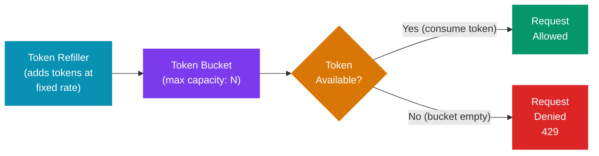

**How Token Bucket Works:**
1. A bucket holds tokens (max capacity = N)
2. Tokens are added at a fixed rate (e.g., 10 tokens/second)
3. Each request consumes one token
4. If the bucket is empty, the request is denied (429)
5. Allows bursts up to the bucket capacity

**Comparison of Rate Limiting Algorithms:**

| Feature | Token Bucket | Fixed Window | Sliding Window Log | Sliding Window Counter |
|---------|-------------|--------------|--------------------|-----------------------|
| **How it Works** | Tokens added at fixed rate, consumed per request | Counter resets at fixed intervals | Tracks timestamp of each request | Weighted mix of current and previous window |
| **Burst Handling** | ✅ Allows controlled bursts | ⚠️ Burst at window boundaries | ✅ No bursts allowed | ✅ Smooths boundary bursts |
| **Memory** | 🟢 Low (counter + timestamp) | 🟢 Low (counter only) | 🔴 High (stores all timestamps) | 🟢 Low (two counters) |
| **Accuracy** | ✅ High | ⚠️ Boundary issue | ✅ Very high | ✅ High |
| **Complexity** | 🟡 Medium | 🟢 Simple | 🔴 Complex | 🟡 Medium |
| **Used By** | AWS, Stripe, most cloud providers | Simple APIs | Low-volume, strict limits (e.g. login attempts) | Cloudflare, Redis-based limiters |

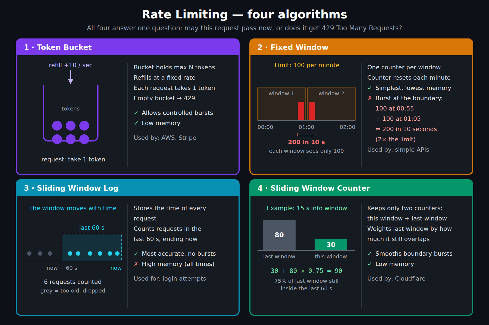

**The Fixed Window Boundary Problem:**

```yaml
# Fixed Window: 100 requests per minute

# Window 1: 00:00 - 00:59
# At 00:55 → 100 requests → allowed
# Window 2: 01:00 - 01:59
# At 01:05 → 100 requests → allowed

# Result: 200 requests in 10 seconds! (00:55 to 01:05)
# The limit is effectively doubled at window boundaries
```

**Spring Boot Rate Limiting with Bucket4j — the distributed, per-client version:**

```java
@Component
public class RateLimitFilter extends OncePerRequestFilter {

    private static final long CAPACITY = 20;

    // Redis-backed: every replica shares one bucket per key.
    private final ProxyManager<String> proxyManager;

    public RateLimitFilter(ProxyManager<String> proxyManager) {
        this.proxyManager = proxyManager;
    }

    @Override
    protected void doFilterInternal(HttpServletRequest request,
            HttpServletResponse response, FilterChain chain)
            throws ServletException, IOException {

        // Bucket key = endpoint + caller. NOT one bucket for everyone.
        String bucketKey = request.getRequestURI()
                + ":" + resolveClientId(request);

        BucketConfiguration config = BucketConfiguration.builder()
                .addLimit(Bandwidth.builder()
                        .capacity(CAPACITY)
                        .refillIntervally(10, Duration.ofMinutes(1))
                        .build())
                .build();

        Bucket bucket = proxyManager.builder()
                .build(bucketKey, () -> config);
        ConsumptionProbe probe = bucket.tryConsumeAndReturnRemaining(1);

        response.setHeader("RateLimit-Limit", String.valueOf(CAPACITY));
        response.setHeader("RateLimit-Remaining",
                String.valueOf(probe.getRemainingTokens()));

        if (probe.isConsumed()) {
            chain.doFilter(request, response);
            return;
        }

        // Integer division would emit Retry-After: 0 for any sub-second
        // wait, and a well-behaved client would hot-loop. Round UP.
        long retryAfter = Math.max(1L,
                (probe.getNanosToWaitForRefill() + 999_999_999L)
                        / 1_000_000_000L);

        response.setStatus(HttpStatus.TOO_MANY_REQUESTS.value());
        response.setHeader(HttpHeaders.RETRY_AFTER,
                String.valueOf(retryAfter));
        response.setContentType(MediaType.APPLICATION_JSON_VALUE);
        response.getWriter().write(
                "{\"error\":\"Rate limit exceeded\",\"retryAfter\":"
                        + retryAfter + "}");
    }

    private String resolveClientId(HttpServletRequest request) {
        String apiKey = request.getHeader("X-API-Key");
        return apiKey != null ? apiKey : request.getRemoteAddr();
    }
}
```

⚠️ **Caution — the textbook Bucket4j snippet has two mistakes. Both come up as follow-up questions.**

| Anti-pattern | Why it breaks | Fix |
|---|---|---|
| `private final Bucket bucket = Bucket.builder()...` as a controller field | It is **one bucket shared by every caller**, so a single abusive client leaves no tokens for anyone else. It also lives **in the JVM heap**, so three replicas make the real limit 3× the configured one | Use one bucket per client key (`ConcurrentHashMap<String, Bucket>` for one JVM, `ProxyManager` over Redis for many) |
| `Bandwidth.classic(20, Refill.intervally(...))` | The `Refill` / `Bandwidth.classic` API is **deprecated** in Bucket4j 8.x | `Bandwidth.builder().capacity(20).refillIntervally(10, Duration.ofMinutes(1)).build()` |

For a single-instance service, the in-JVM version is fine. But it must still keep one bucket per key:

```java
private final Map<String, Bucket> buckets = new ConcurrentHashMap<>();

private Bucket bucketFor(String clientId) {
    return buckets.computeIfAbsent(clientId, id -> Bucket.builder()
            .addLimit(Bandwidth.builder()
                    .capacity(20)
                    .refillIntervally(10, Duration.ofMinutes(1))
                    .build())
            .build());
}
```

**Rate Limit Response Headers — what is actually standard:**

| Header | Status | Notes |
|--------|--------|-------|
| `Retry-After` | ✅ **Real standard** — RFC 9110 §10.2.3 | Seconds, or an HTTP-date. The only one an interviewer can check you against |
| `RateLimit-Limit` · `RateLimit-Remaining` · `RateLimit-Reset` | 🚧 IETF draft (`draft-ietf-httpapi-ratelimit-headers`) | No prefix, on purpose. Later drafts merge these into a single `RateLimit` structured field plus `RateLimit-Policy` |
| `X-RateLimit-Limit` · `X-RateLimit-Remaining` · `X-RateLimit-Reset` | ⚠️ **De-facto convention only** | GitHub/Twitter made it popular, but **RFC 6648 deprecates the `X-` prefix** for new headers |

⚠️ **Caution:** whichever set you send, **spell it the same way in code and in your docs**. `X-Rate-Limit-Remaining` (three segments) and `X-RateLimit-Remaining` (two) are different headers. A client written for the wrong one reads `null`, with no error. Also, remember `Access-Control-Expose-Headers` if a browser needs to read them.

🔑 **Key Point:** Token Bucket is the most widely used algorithm, because it handles bursts smoothly and still keeps a steady average rate. AWS API Gateway, Stripe, and most cloud providers use it.

---

</details>

---

2. **⚡ What are the key differences between HTTP/2 and HTTP/1.1 for REST APIs? ⚡**

<!-- -->
<details>
<summary>Answer</summary>

**Answer:**

HTTP/2 is a major new version of the HTTP protocol. It improves performance a lot over HTTP/1.1, especially for APIs that make multiple concurrent requests.

| Feature | HTTP/1.1 | HTTP/2 |
|---------|----------|--------|
| **Multiplexing** | ❌️ One request **at a time** per connection (keep-alive reuses it serially; pipelining exists but has HOL (head-of-line) blocking) | ✅ Many concurrent streams on one connection — **application-layer** HOL blocking removed, TCP-layer HOL blocking remains |
| **Header Compression** | ❌️ Headers sent as plain text (repeated on every request) | ✅ HPACK compression (removes redundant headers) |
| **Server Push** | ❌️ Not supported | ⚠️ Specified, but **removed from browsers** — see the caution below |
| **Binary Protocol** | ❌️ Text-based (human-readable) | ✅ Binary framing (machine-efficient) |
| **Stream Priority** | ❌️ No prioritization | ⚠️ In the original spec, but RFC 9113 deprecated that scheme. RFC 9218 `Priority` header replaces it |
| **Connection** | Multiple TCP connections per domain (browsers open up to 6 per host) | Single TCP connection with multiplexed streams |
| **TLS** | Optional | Practically required (all major browsers require HTTPS) |

**Impact on REST APIs:**

- 🚀 **Reduced latency:** Multiple API calls can be made over a single connection without waiting for previous responses
- 📦 **Smaller headers:** JWT tokens and cookies are often large. HPACK compression shrinks repeated headers a lot: a header sent before becomes a small table index
- ⚡ **Connection reuse:** No more connection limit per domain. This removes the need for domain sharding (spreading assets across several domains to get more connections)
- 💨 **Early hints instead of push:** `103 Early Hints` (RFC 8297) with `Link: </css/app.css>; rel=preload` lets the server tell the client what to fetch **while** the real response is still being computed. It is the supported replacement for Server Push

⚠️ **Caution — do not recommend HTTP/2 Server Push in 2026.** **Chrome disabled it by default in Chrome 106 (September 2022)** and later removed the implementation. Firefox did the same. **nginx removed the `http2_push` directives in 1.25.1**. It is still in the RFC. So "specified but effectively dead in browsers" is the correct phrasing. Naming `103 Early Hints` as the replacement is the strong answer.

⚠️ **Caution — "HTTP/2 has no head-of-line blocking" claims too much. The interviewer will ask about it next.** HTTP/2 removes HOL blocking at the **application layer**: streams no longer queue behind one another in the HTTP framing. But all those streams still share **one TCP connection**, and TCP guarantees in-order delivery. So **a single lost segment stalls every multiplexed stream at once**. On a lossy link, HTTP/2 can therefore be *slower* than HTTP/1.1 with six parallel connections. With six connections, one loss stalls only one connection.

**Spring Boot HTTP/2 Configuration:**

```yaml
# application.yml
server:
  http2:
    enabled: true
  ssl:
    enabled: true
    key-store: classpath:keystore.p12
    key-store-password: secret
    key-store-type: PKCS12
```

📝 **Note:** HTTP/2 requires TLS (HTTPS) in practice. The spec allows HTTP/2 over plain TCP (h2c). But browsers and most clients only support HTTP/2 over TLS.

<details>
<summary><strong>🤔 Doubt: If HTTP/2 already multiplexes, why does HTTP/3 exist?</strong></summary>

Because HTTP/2's multiplexing sits **on top of TCP**, and TCP is the part that blocks. One dropped segment stops delivery of *every* stream on the connection until it is retransmitted. This is the TCP-layer HOL blocking from the caution above. You cannot fix that inside HTTP. You have to replace the transport.

**HTTP/3 runs over QUIC, a transport built on UDP** (RFC 9114 for HTTP/3, RFC 9000 for QUIC). What you get from it:

| Property | Why it matters |
|---|---|
| **Per-stream loss isolation** | QUIC tracks ordering per stream, so a lost packet stalls only the stream it belonged to. This is *the* reason HTTP/3 exists |
| **TLS 1.3 built into the handshake** | Transport + crypto set up together: **1-RTT** for a new connection, **0-RTT** when reconnecting to a server seen before |
| **Connection migration** | The connection is identified by a **connection ID**, not the 4-tuple (source and destination IP and port). So a phone switching Wi-Fi → cellular keeps the same connection and does not re-handshake |
| **Congestion control in user space** | Ships with the application, so improvements do not wait for OS kernel upgrades |

**The honest limits.** This is the part interviewers actually want to hear:

- HTTP/3's gain is mostly on **lossy, high-latency, mobile** clients.
- Service-to-service calls inside a data centre (east-west traffic) lose almost no packets. For these calls, HTTP/3 gives almost nothing over HTTP/2.
- In practice, your Spring app rarely terminates HTTP/3 itself. **The CDN or load balancer speaks HTTP/3 to the internet** (CloudFront and Cloudflare support it; AWS ALB does not, and AWS NLB only passes QUIC through). It speaks plain HTTP/1.1 or HTTP/2 to your origin.
- Corporate network devices (middleboxes, such as firewalls) are also more likely to block UDP. This is why servers advertise HTTP/3 (via the `Alt-Svc` header or an `HTTPS` DNS record), and clients fall back to HTTP/2 when UDP is blocked.

---

</details>
<br/>

🎯 **Interview Tip:** When asked about API performance, mention HTTP/2 multiplexing as a key improvement. Then answer the follow-up question before the interviewer asks it. Name the TCP-level HOL blocking it does *not* solve, and say where HTTP/3 takes over. If you name the limit of your own answer without being asked, it counts for more than the answer itself.

---

</details>

---

3. **🔌 How do you implement connection pooling for downstream REST calls? ⚡**

<!-- -->
<details>
<summary>Answer</summary>

**Answer:**

Connection pooling reuses existing TCP connections. It does not create a new one for every HTTP call to downstream services. This greatly reduces latency and resource use.

**Without Connection Pooling:**
Each request opens a new TCP connection (3-way handshake + TLS handshake) → sends request → receives response → closes connection. This overhead is large when you make hundreds of calls per second.

**With Connection Pooling:**
The pool keeps connections alive and reuses them across requests. The TCP and TLS handshake cost is paid only once per connection.

**RestTemplate with Connection Pooling (Apache HttpClient):**

```java
@Configuration
public class RestTemplateConfig {

    @Bean
    public RestTemplate restTemplate() {
        // Connection pool configuration
        PoolingHttpClientConnectionManager connectionManager =
                new PoolingHttpClientConnectionManager();
        connectionManager.setMaxTotal(200);          // Max total connections
        connectionManager.setDefaultMaxPerRoute(50); // Max per host

        CloseableHttpClient httpClient = HttpClients.custom()
                .setConnectionManager(connectionManager)
                .setKeepAliveStrategy(new DefaultConnectionKeepAliveStrategy())
                .evictIdleConnections(TimeValue.ofSeconds(30)) // HttpClient 5 takes TimeValue, not Duration
                .build();

        HttpComponentsClientHttpRequestFactory factory =
                new HttpComponentsClientHttpRequestFactory(httpClient);
        factory.setConnectTimeout(Duration.ofSeconds(5));
        factory.setReadTimeout(Duration.ofSeconds(10)); // Spring 6.2+ (Boot 3.4+)

        return new RestTemplate(factory);
    }
}
```

**WebClient with Connection Pooling (Reactor Netty):**

```java
@Configuration
public class WebClientConfig {

    @Bean
    public WebClient webClient() {
        ConnectionProvider provider = ConnectionProvider.builder("custom")
                .maxConnections(200)
                .maxIdleTime(Duration.ofSeconds(30))
                .maxLifeTime(Duration.ofMinutes(5))
                .pendingAcquireMaxCount(100)
                .pendingAcquireTimeout(Duration.ofSeconds(60))
                .evictInBackground(Duration.ofSeconds(120))
                .build();

        HttpClient httpClient = HttpClient.create(provider)
                .responseTimeout(Duration.ofSeconds(10))
                .option(ChannelOption.CONNECT_TIMEOUT_MILLIS, 5000);

        return WebClient.builder()
                .clientConnector(new ReactorClientHttpConnector(httpClient))
                .build();
    }
}
```

**Connection Pool Parameters:**

| Parameter | Description | Recommended |
|-----------|-------------|-------------|
| **Max Total** | Total connections across all routes | 100-500 |
| **Max Per Route** | Max connections to a single host | 20-100 |
| **Connection Timeout** | Time to establish TCP connection | 3-5 seconds |
| **Read Timeout** | Time to wait for response data | 5-30 seconds |
| **Idle Timeout** | Time before idle connection is closed | 30-60 seconds |
| **Keep-Alive** | Keep connection alive between requests | Enabled |

⚠️ **Caution:** For database connection pooling, Spring Boot uses HikariCP by default, with sensible defaults (min-idle: 10, max-pool-size: 10). For HTTP, you must size the pool yourself. A plain `new RestTemplate()` uses the JDK `HttpURLConnection`, with no pool you can configure. If Apache HttpClient 5 is on the classpath, `RestTemplateBuilder` uses it. But its default pool is small: 25 connections in total and 5 per host.

🔑 **Key Point — choose the client by execution model, not by how new it is.** "Always use `WebClient`" was correct advice in 2019, but it is out of date now:

| Client | Status | Use when |
|--------|--------|----------|
| **`RestClient`** | Spring Framework **6.1** / Boot **3.2** (Nov 2023) | ✅ **The default for synchronous calls.** Same fluent API as `WebClient`, but blocking — no reactive stack, no `.block()` |
| **`WebClient`** | Spring 5.0+ | Reactive or streaming code: a WebFlux app, or when you really need non-blocking concurrency and backpressure |
| **`RestTemplate`** | Maintenance mode | Legacy code only. No new features. Spring plans to deprecate it in Framework 7.1 (planned for Nov 2026) and remove it in 8.0 |

⚠️ **Caution:** do not pull `spring-boot-starter-webflux` into a blocking Spring MVC service *just* to get `WebClient`, and then call `.block()` on every result. This is a known anti-pattern. You pay for a Netty event loop and get none of its benefit. `RestClient` was created for exactly this case. Note: you configure connection pooling the same way for `RestClient` as for `RestTemplate`. Pass it a `HttpComponentsClientHttpRequestFactory` built on the pool above, via `RestClient.builder().requestFactory(factory)`.

---

</details>

---

4. **💾 Explain HTTP caching headers: ETag, Cache-Control, and Last-Modified. 🔥**

<!-- -->
<details>
<summary>Answer</summary>

**Answer:**

HTTP caching reduces the number of requests to the server and lowers response latency. There are three main caching mechanisms.

**Cache-Control Header (Most Important):**

| Directive | Meaning | Example |
|-----------|---------|---------|
| `max-age=N` | Cache for N seconds | `Cache-Control: max-age=3600` |
| `s-maxage=N` | Cache for N seconds (CDN/proxy only) | `Cache-Control: s-maxage=86400` |
| `no-cache` | Must revalidate before using cache | `Cache-Control: no-cache` |
| `no-store` | Never cache (sensitive data) | `Cache-Control: no-store` |
| `private` | Only browser can cache (not CDN) | `Cache-Control: private, max-age=600` |
| `public` | Any cache can store this | `Cache-Control: public, max-age=3600` |
| `must-revalidate` | Must check with server after expiry | `Cache-Control: must-revalidate` |
| `immutable` | Content will never change | `Cache-Control: immutable, max-age=31536000` |

**Caching Strategies by Resource Type:**

| Resource | Cache-Control | Reasoning |
|----------|--------------|-----------|
| Static assets (CSS, JS, images) | `public, max-age=31536000, immutable` | Versioned by hash, never change |
| Public API (product list) | `public, max-age=300, s-maxage=600` | Changes occasionally |
| User-specific data | `private, max-age=60` | Personal, no CDN caching |
| Sensitive data (passwords, tokens) | `no-store` | Never cache |
| Real-time data (stock prices) | `no-cache` | Always revalidate |

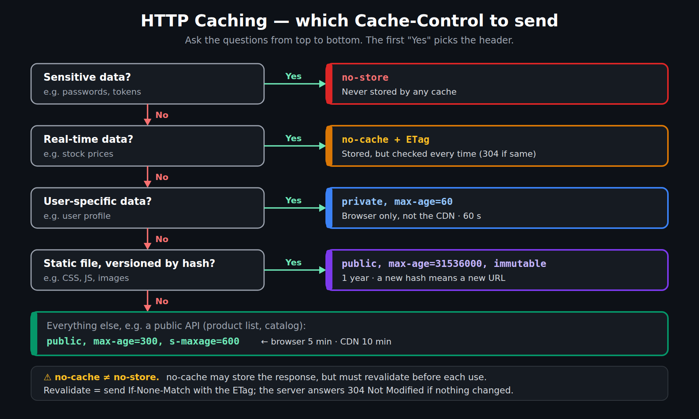

**Spring Boot Implementation:**

```java
@RestController
@RequestMapping("/api")
public class CachingController {

    // Public resource — cache for 1 hour
    @GetMapping("/products")
    public ResponseEntity<List<Product>> getProducts() {
        return ResponseEntity.ok()
                .cacheControl(CacheControl.maxAge(1, TimeUnit.HOURS)
                        .cachePublic())
                .body(productService.findAll());
    }

    // User-specific — private cache for 5 minutes
    @GetMapping("/profile")
    public ResponseEntity<UserProfile> getProfile() {
        return ResponseEntity.ok()
                .cacheControl(CacheControl.maxAge(5, TimeUnit.MINUTES)
                        .cachePrivate())
                .body(userService.getCurrentProfile());
    }

    // Sensitive data — never cache
    @GetMapping("/api-keys")
    public ResponseEntity<List<ApiKey>> getApiKeys() {
        return ResponseEntity.ok()
                .cacheControl(CacheControl.noStore())
                .body(apiKeyService.findAll());
    }

    // ETag-based validation
    @GetMapping("/employees/{id}")
    public ResponseEntity<Employee> getEmployee(
            @PathVariable Long id, WebRequest request) {
        Employee employee = employeeService.findById(id);
        String etag = "\"v" + employee.getVersion() + "\"";

        if (request.checkNotModified(etag)) {
            return null; // 304 Not Modified
        }

        return ResponseEntity.ok()
                .eTag(etag)
                .cacheControl(CacheControl.maxAge(60, TimeUnit.SECONDS))
                .body(employee);
    }

    // Last-Modified based validation
    @GetMapping("/reports/{id}")
    public ResponseEntity<Report> getReport(
            @PathVariable Long id, WebRequest request) {
        Report report = reportService.findById(id);
        long lastModified = report.getUpdatedAt()
                .toEpochMilli();

        if (request.checkNotModified(lastModified)) {
            return null; // 304 Not Modified
        }

        return ResponseEntity.ok()
                .lastModified(lastModified)
                .body(report);
    }
}
```

**Validation Flow (ETag):**

```yaml
# First request — no cache
GET /api/employees/101
→ 200 OK
→ ETag: "v5"
→ Cache-Control: max-age=60
→ { "id": 101, "name": "Alice" }

# Within 60 seconds — served from browser cache (no request to server)

# After 60 seconds — browser revalidates
GET /api/employees/101
If-None-Match: "v5"
→ 304 Not Modified (no body — use cached version)
# Or if changed:
→ 200 OK, ETag: "v6", new body
```

⚠️ **Caution — `Last-Modified` is precise only to one second.** HTTP-date has no sub-second part. So if a resource is written **twice within the same second**, the server cannot tell the second write from the first. It then answers `304 Not Modified` with stale data. RFC 9110 §8.8.2 notes this problem. It says: treat a validator as strong only if the origin server can guarantee that no two writes have the same timestamp. Use an **ETag** derived from a version counter, not `Last-Modified`, for:

- anything that changes faster than once per second
- anything where a stale read is a correctness bug

💡 **Pro Tip:** Use `Cache-Control: max-age` for time-based expiry. Use `ETag` or `Last-Modified` for validation-based caching. Using both together gives the best performance: the browser serves from cache during `max-age`, then revalidates using ETag after expiry.

---

</details>

---

5. **🗜️ How do you implement response compression in REST APIs? 💤**

<!-- -->
<details>
<summary>Answer</summary>

**Answer:**

Response compression makes HTTP response bodies smaller. This uses less bandwidth and gives faster response times. Gzip compression usually makes a JSON payload 60-80% smaller.

**How Compression Works:**

1. Client sends `Accept-Encoding: gzip, deflate, br` header
2. Server compresses the response body
3. Server responds with `Content-Encoding: gzip` header
4. Client decompresses the response

**Spring Boot Configuration:**

```yaml
# application.yml
server:
  compression:
    enabled: true
    mime-types: application/json,application/xml,text/plain,text/html,text/css,application/javascript
    min-response-size: 1024  # Only compress responses > 1KB
```

```properties
# application.properties
server.compression.enabled=true
server.compression.mime-types=application/json,application/xml,text/plain,text/html
server.compression.min-response-size=1024
```

**Compression Algorithms:**

| Algorithm | Compression Ratio | Speed | Browser Support |
|-----------|------------------|-------|-----------------|
| **gzip** | Good (60-80% for JSON) | Fast | ✅ Universal |
| **deflate** | Similar to gzip | Slightly faster | ✅ Universal |
| **br (Brotli)** | Better than gzip (10-25% smaller) | Slower compression, fast decompression | ✅ Modern browsers |
| **zstd** | Best ratio + speed balance | Fast | ⚠️ Emerging support |

**Impact Example:**

```yaml
# Uncompressed JSON response
Content-Length: 50,000 bytes (50 KB)

# Gzip compressed
Content-Length: 8,500 bytes (8.5 KB)
Content-Encoding: gzip
# ~83% reduction

# Brotli compressed
Content-Length: 7,000 bytes (7 KB)
Content-Encoding: br
# ~86% reduction
```

**Best Practices:**

- ✅ Enable compression for text-based formats (JSON, XML, HTML, CSS, JS)
- ✅ Set a minimum response size (1KB) to avoid compressing tiny responses
- ❌️ Do not compress already-compressed formats (images, videos, ZIP files)
- ❌️ Do not compress responses smaller than 1KB (compression overhead > savings)
- ✅ Use Brotli (`br`) for static assets and gzip for dynamic API responses

📝 **Note:** Compression uses CPU on the server. For high-throughput APIs, think about moving compression to a reverse proxy (Nginx) or CDN (Cloudflare), instead of in the application server.

---

</details>

---

6. **🔄 Compare async API patterns: Polling, Webhooks, and Server-Sent Events (SSE). ⚡**

<!-- -->
<details>
<summary>Answer</summary>

**Answer:**

Synchronous request-response is not enough for long-running operations or real-time updates. There are three main async patterns.

| Feature | Polling | Webhooks | SSE (Server-Sent Events) |
|---------|---------|----------|--------------------------|
| **Direction** | Client → Server (repeated) | Server → Client (push) | Server → Client (push) |
| **Connection** | New connection per poll | Server calls client URL | Long-lived connection |
| **Complexity (Client)** | 🟢 Simple | 🟡 Medium (needs endpoint) | 🟢 Simple |
| **Complexity (Server)** | 🟢 Simple | 🟡 Medium (retry logic) | 🟡 Medium (connection mgmt) |
| **Real-time** | ❌️ Delayed (poll interval) | ✅ Near real-time | ✅ Real-time |
| **Resource Usage** | ❌️ High (constant polling) | ✅ Low (event-driven) | ⚠️ Medium (open connections) |
| **Firewall Friendly** | ✅ Yes | ⚠️ Requires public URL | ✅ Yes (standard HTTP) |
| **Used By** | AWS S3 Batch job status, GitHub Actions runners (long-poll for jobs) | Stripe, GitHub, Slack | Twitter streams, ChatGPT |

**Pattern 1: Polling (Long-Running Jobs)**

```java
// Step 1: Start async job
@PostMapping("/api/reports/generate")
public ResponseEntity<JobStatus> startReport(
        @RequestBody ReportRequest request) {
    String jobId = reportService.startGeneration(request);

    return ResponseEntity.accepted()
            .header("Location", "/api/reports/status/" + jobId)
            .body(new JobStatus(jobId, "PROCESSING", null));
}

// Step 2: Client polls for status
@GetMapping("/api/reports/status/{jobId}")
public ResponseEntity<JobStatus> getStatus(
        @PathVariable String jobId) {
    JobStatus status = reportService.getStatus(jobId);

    if ("COMPLETED".equals(status.getStatus())) {
        return ResponseEntity.ok()
                .header("Location",
                        "/api/reports/download/" + jobId)
                .body(status);
    }

    return ResponseEntity.ok()
            .header("Retry-After", "5")
            .body(status);
}
```

**Pattern 2: Webhooks (Event Notification)**

```java
// Webhook registration
@PostMapping("/api/webhooks")
public ResponseEntity<Webhook> registerWebhook(
        @RequestBody WebhookRequest request) {
    // request.url = "https://client.com/webhook/payments"
    // request.events = ["payment.completed", "payment.failed"]
    Webhook webhook = webhookService.register(request);
    return ResponseEntity.status(HttpStatus.CREATED).body(webhook);
}

// When event occurs, send POST to registered URL
@Service
public class WebhookDispatcher {
    public void dispatch(String event, Object payload) {
        List<Webhook> subscribers =
                webhookService.findByEvent(event);

        for (Webhook webhook : subscribers) {
            String signature = hmacSign(payload, webhook.getSecret());

            webClient.post()
                    .uri(webhook.getUrl())
                    .header("X-Webhook-Signature", signature)
                    .header("X-Webhook-Event", event)
                    .bodyValue(payload)
                    .retrieve()
                    .toBodilessEntity()
                    .retryWhen(Retry.backoff(3,
                            Duration.ofSeconds(10)))
                    .subscribe();
        }
    }
}
```

**Pattern 3: Server-Sent Events (SSE)**

```java
@RestController
@RequestMapping("/api/stream")
public class SSEController {

    @GetMapping(value = "/notifications",
                produces = MediaType.TEXT_EVENT_STREAM_VALUE)
    public SseEmitter streamNotifications() {
        SseEmitter emitter = new SseEmitter(
                Duration.ofMinutes(30).toMillis());

        Subscription subscription = notificationService.subscribe(notification -> {
            try {
                emitter.send(SseEmitter.event()
                        .id(notification.getId())
                        .name(notification.getType())
                        .data(notification, MediaType.APPLICATION_JSON));
            } catch (IOException e) {
                emitter.completeWithError(e);
            }
        });

        emitter.onCompletion(() -> notificationService.unsubscribe(subscription));
        emitter.onTimeout(() -> emitter.complete());

        return emitter;
    }
}
```

**When to Use Each:**

- 📊 **Polling:** Simple jobs where real-time updates are not critical (report generation, batch processing)
- 🔔 **Webhooks:** Event-driven integrations between services (payment notifications, CI/CD status)
- 📡 **SSE:** Real-time one-way server updates (live scores, stock tickers, notification streams)
- 🔌 **WebSockets:** Two-way real-time communication (chat, collaborative editing). Not covered here, because it is not REST

🎯 **Interview Tip:** Some system design questions involve notifications or async processing. For these:

- Explain all three patterns.
- Explain why you chose one, based on the requirements.
- Webhooks are the most common pattern for service-to-service communication.
- SSE is ideal for server-to-browser real-time updates.

---

</details>

---

<a id="security-considerations"></a>

## 6. Security Considerations

1. **🔐 Compare API authentication patterns: API Key vs JWT vs OAuth2. 🔥🔥**

<!-- -->
<details>
<summary>Answer</summary>

**Answer:**

Authentication checks who the client is when it makes an API request. There are three main patterns. Each one fits different use cases.

| Feature | API Key | JWT (JSON Web Token) | OAuth 2.0 |
|---------|---------|---------------------|-----------|
| **Type** | Simple shared secret | Self-contained signed token | Authorization framework (uses tokens) |
| **Where Sent** | Header (`X-API-Key`) — ⚠️ never a query param, see below | `Authorization: Bearer <token>` | `Authorization: Bearer <token>` |
| **State** | No session, but the server looks up every key in its key store | Stateless (token contains claims) | Depends on grant type |
| **Expiry** | Long-lived (manual rotation) | Short-lived (minutes/hours) | Access token: short, Refresh token: long |
| **Revocation** | ✅ Easy (delete key) | ❌️ Difficult (until expiry) | ✅ Revoke refresh token |
| **User Identity** | ❌️ Identifies application, not user | ✅ Contains user claims | ✅ Full user identity |
| **Granularity** | Coarse (per-application) | Fine (roles, permissions in claims) | Fine (scopes, permissions) |
| **Complexity** | 🟢 Very simple | 🟡 Medium | 🔴 Complex |
| **Best For** | Server-to-server, public APIs | Mobile apps, SPAs, microservices | Third-party access, social login, enterprise |
| **Used By** | Google Maps, OpenWeather | Most modern APIs, microservices | Google, GitHub, Facebook login |

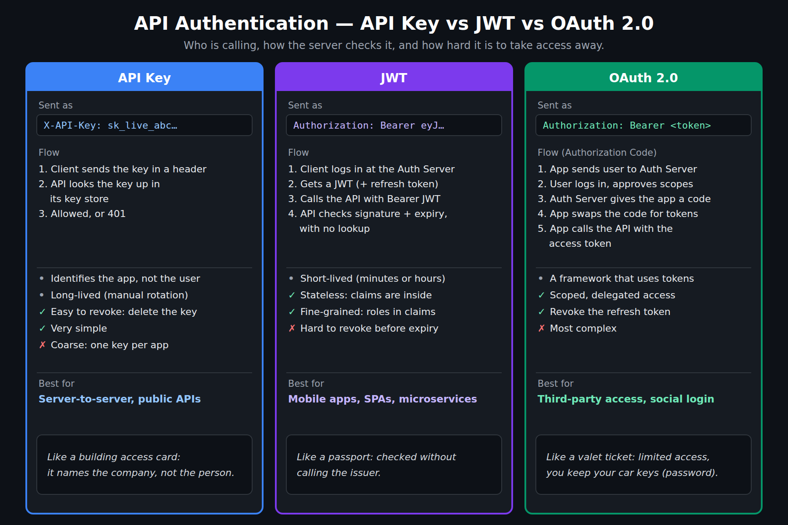

**API Key Implementation:**

```java
@Component
public class ApiKeyFilter extends OncePerRequestFilter {

    @Value("${api.keys}")
    private List<String> validApiKeys;

    @Override
    protected void doFilterInternal(HttpServletRequest request,
            HttpServletResponse response,
            FilterChain chain) throws ServletException, IOException {

        String apiKey = request.getHeader("X-API-Key");

        if (apiKey == null || !validApiKeys.contains(apiKey)) {
            response.setStatus(HttpStatus.UNAUTHORIZED.value());
            response.getWriter().write(
                    "{\"error\":\"Invalid or missing API key\"}");
            return;
        }

        chain.doFilter(request, response);
    }
}
```

**JWT Authentication Flow:**

```mermaid
sequenceDiagram
    participant Client as Client
    participant Auth as Auth Server
    participant API as API Server

    Client->>Auth: POST /auth/login (credentials)
    Auth-->>Client: JWT Access Token + Refresh Token

    Client->>API: GET /api/employees<br/>Authorization: Bearer <jwt>
    API->>API: Validate JWT signature + expiry
    API-->>Client: 200 OK + data

    Note over Client,API: Token expired

    Client->>Auth: POST /auth/refresh (refresh token)
    Auth-->>Client: New JWT Access Token

    classDef purple fill:#7C3AED,stroke:#7C3AED,color:#fff
    classDef cyan fill:#0891B2,stroke:#0891B2,color:#fff
    classDef green fill:#059669,stroke:#059669,color:#fff
```

**OAuth 2.0 Grant Types:**

| Grant Type | Use Case | Flow |
|------------|----------|------|
| **Authorization Code** | Web apps with backend | User → Auth server → Code → Token |
| **Authorization Code + PKCE** | SPAs, mobile apps | Same as above with code verifier |
| **Client Credentials** | Machine-to-machine | App → Auth server → Token (no user) |
| **Refresh Token** | Token renewal | Refresh token → New access token |

🧠 **In Simple Words:**
- **API Key** is like a building access card. It identifies the company, but not the person.
- **JWT** is like a passport. It holds your identity and credentials. The server can verify it without calling the issuer.
- **OAuth 2.0** is like a valet parking ticket. You give limited access (scope) to a third party. You do not share your car keys (password).

⚠️ **Caution — never accept a credential in a query parameter.** `GET /api/data?api_key=sk_live_...` leaks the secret into these places:
- **web-server access logs**
- **browser history**
- **proxy and CDN logs**
- the **`Referer` header**, which is sent to any third-party resource the page loads

APM (application performance monitoring) tools also often capture query strings. Send credentials in a header (`X-API-Key`, `Authorization`). Headers are not logged by default, and they are not part of the cacheable URL. Sometimes a legacy client can only send query params. Then treat those keys as leaked from the start. Give them a narrow scope and rotate them often.

🎯 **Interview Tip:** For microservices, JWT with short expiry (15 min) and refresh tokens is the standard. For third-party API access, use OAuth 2.0. For simple internal APIs, API keys are enough.

---

</details>

---

2. **🛡️ What are the best practices for input validation and sanitization in REST APIs? 🔥**

<!-- -->
<details>
<summary>Answer</summary>

**Answer:**

Input validation and sanitization are the first defense against injection attacks, data corruption, and application crashes. Treat every piece of data from the client as untrusted.

**Validation Layers:**

```yaml
Layer 1: Request-level validation (Spring @Valid)
  → Field types, required fields, size constraints

Layer 2: Business-level validation (Service layer)
  → Business rules, cross-field validation, existence checks

Layer 3: Database-level constraints (JPA/DB)
  → Unique constraints, foreign keys, NOT NULL
```

**Spring Boot Validation with Bean Validation API:**

```java
@Data
public class CreateEmployeeRequest {

    @NotBlank(message = "Name is required")
    @Size(min = 2, max = 100)
    @Pattern(regexp = "^[a-zA-Z\\s]+$",
             message = "Name must contain only letters and spaces")
    private String name;

    @NotBlank
    @Email(message = "Must be a valid email")
    private String email;

    @NotNull
    @Positive(message = "Salary must be positive")
    @DecimalMax(value = "10000000",
                message = "Salary cannot exceed 10,000,000")
    private BigDecimal salary;

    @NotBlank
    @Size(max = 50)
    private String department;

    @Past(message = "Join date must be in the past")
    private LocalDate joinDate;

    @Size(max = 500, message = "Notes cannot exceed 500 characters")
    private String notes;
}
```

**Key Validation and Sanitization Practices:**

| Threat | Prevention |
|--------|-----------|
| **SQL Injection** | Use parameterized queries (JPA/Hibernate do this by default), never concatenate user input into SQL |
| **XSS (Cross-Site Scripting)** | Sanitize HTML input, encode output, use a library like OWASP Java HTML Sanitizer (Hibernate Validator's old `@SafeHtml` is removed in new versions) |
| **Path Traversal** | Validate and normalize file paths, reject `..` sequences |
| **Mass Assignment** | Use DTOs instead of entity classes in `@RequestBody`, never bind request directly to entity |
| **Integer Overflow** | Use `BigDecimal` for financial calculations, validate ranges |
| **Regex DoS (ReDoS)** | Avoid complex regex patterns. `java.util.regex` has no timeout, so limit input length or use a linear-time engine such as RE2/J |

**Input Sanitization Example:**

```java
@Service
public class SanitizationService {

    // Sanitize HTML to prevent XSS
    public String sanitizeHtml(String input) {
        if (input == null) return null;
        PolicyFactory policy = new HtmlPolicyBuilder()
                .allowElements("b", "i", "em", "strong", "p", "br")
                .toFactory();
        return policy.sanitize(input);
    }

    // Strip CR/LF/tab to stop log injection (fake log lines)
    public String sanitizeForLog(String input) {
        if (input == null) return null;
        return input.replaceAll("[\\n\\r\\t]", "_");
    }
}
```

**DTO Pattern for Mass Assignment Prevention:**

```java
// WRONG: Binding directly to entity allows setting any field
@PostMapping("/employees")
public ResponseEntity<Employee> create(
        @RequestBody Employee employee) {  // Client can set id, role, etc.!
    return ResponseEntity.ok(employeeService.save(employee));
}

// CORRECT: Use DTO to control which fields are accepted
@PostMapping("/employees")
public ResponseEntity<Employee> create(
        @RequestBody @Valid CreateEmployeeRequest request) {
    Employee employee = new Employee();
    employee.setName(request.getName());
    employee.setEmail(request.getEmail());
    employee.setSalary(request.getSalary());
    // role, id, createdAt etc. are NOT set from request
    return ResponseEntity.status(HttpStatus.CREATED)
            .body(employeeService.save(employee));
}
```

🔑 **Key Point:** Always use DTOs (Data Transfer Objects) for request/response mapping. Never expose your JPA entities directly in the API. This prevents mass assignment attacks. It also keeps your API contract separate from your database schema.

⚠️ **Caution:** `@Valid` only triggers validation on the object it is placed on. For nested objects, you must also add `@Valid` on the nested field:

```java
@Data
public class OrderRequest {
    @Valid  // Required to validate Address fields
    @NotNull
    private Address shippingAddress;
}
```

---

</details>

---

3. **📜 What is the OWASP API Security Top 10 (2023)? ⚡**

<!-- -->
<details>
<summary>Answer</summary>

**Answer:**

The OWASP API Security Top 10 (2023) lists the ten most critical security risks for APIs. It is the API version of the well-known OWASP Top 10 for web applications.

| Rank | Risk | Description | Prevention |
|------|------|-------------|------------|
| **API1** | Broken Object Level Authorization (BOLA) | Accessing other users' objects by manipulating IDs | Validate object ownership in every request |
| **API2** | Broken Authentication | Weak auth mechanisms, credential stuffing | Strong auth, rate limiting on login, MFA |
| **API3** | Broken Object Property Level Authorization | Exposing sensitive fields or allowing mass assignment | Use DTOs, field-level access control |
| **API4** | Unrestricted Resource Consumption | No rate limiting, large payloads, expensive queries | Rate limiting, pagination limits, query complexity limits |
| **API5** | Broken Function Level Authorization | Accessing admin functions as regular user | Role-based access control on every endpoint |
| **API6** | Unrestricted Access to Sensitive Business Flows | Automated abuse of business logic (scalping, spam) | Bot detection, CAPTCHA, business logic rate limiting |
| **API7** | Server-Side Request Forgery (SSRF) | Server fetches URLs provided by user | Validate/whitelist URLs, block internal networks |
| **API8** | Security Misconfiguration | Default configs, verbose errors, missing headers | Security headers, disable debug in prod, regular audits |
| **API9** | Improper Inventory Management | Undocumented/shadow APIs, old API versions running | API catalog, deprecation policy, API gateway |
| **API10** | Unsafe Consumption of APIs | Trusting third-party API responses blindly | Validate all external data, use TLS, set timeouts |

**BOLA Prevention Example (Most Common API Vulnerability):**

```java
// VULNERABLE: No ownership check
@GetMapping("/api/orders/{orderId}")
public ResponseEntity<Order> getOrder(@PathVariable Long orderId) {
    return ResponseEntity.ok(orderService.findById(orderId));
    // Any user can access ANY order by changing the ID!
}

// SECURE (a): a custom principal that actually carries the domain id
public class CustomUserDetails extends User {   // extends Spring's User

    private final Long userId;

    public CustomUserDetails(Long userId, String username,
            String password,
            Collection<? extends GrantedAuthority> authorities) {
        super(username, password, authorities);
        this.userId = userId;
    }

    public Long getUserId() {
        return userId;
    }
}

@GetMapping("/api/orders/{orderId}")
public ResponseEntity<Order> getOrder(
        @PathVariable Long orderId,
        @AuthenticationPrincipal CustomUserDetails principal) {
    Order order = orderService.findById(orderId);

    if (!order.getUserId().equals(principal.getUserId())) {
        throw new AccessDeniedException(
                "You do not have access to this order");
    }

    return ResponseEntity.ok(order);
}

// SECURE (b) — better: never load what you are not allowed to see.
// Scope the QUERY by owner instead of filtering after the fetch.
@GetMapping("/api/orders/{orderId}")
public ResponseEntity<Order> getOrderScoped(
        @PathVariable Long orderId,
        @AuthenticationPrincipal UserDetails principal) {
    Order order = orderService
            .findByIdAndOwner(orderId, principal.getUsername())
            .orElseThrow(() -> new ResourceNotFoundException("Order"));
    return ResponseEntity.ok(order);
}
```

⚠️ **Caution — `UserDetails` has no `getUserId()`.** The `org.springframework.security.core.userdetails.UserDetails` contract is exactly `getUsername()`, `getPassword()`, `getAuthorities()` and the four `isXxx()` account-status flags. Calling `user.getUserId()` on it **does not compile**. You have two options:
- Inject a custom principal that exposes the id (variant a).
- Use `getUsername()` as the key (variant b).

💡 **Pro Tip:** Variant (b) is the stronger pattern. Filtering *after* a fetch has two problems:
- The row is already loaded. If you forget one `if`, the data goes out to the client.
- The response time differs between "exists but not yours" and "does not exist". This leaks whether an id is real.

Scope the query by owner, and return **404 rather than 403** for an object the user does not own. This removes both problems.

**Security Headers to Add:**

```java
@Configuration
@EnableWebSecurity
public class SecurityConfig {

    @Bean
    public SecurityFilterChain filterChain(
            HttpSecurity http) throws Exception {
        http.headers(headers -> headers
                .contentTypeOptions(Customizer.withDefaults())
                // Spring Security 5.8+ defaults this to "X-XSS-Protection: 0"
                // ON PURPOSE — see the note below. CSP is the real defence.
                .xssProtection(Customizer.withDefaults())
                .frameOptions(frame -> frame.deny())
                .httpStrictTransportSecurity(hsts -> hsts
                        .maxAgeInSeconds(31536000)
                        .includeSubDomains(true))
                .contentSecurityPolicy(csp -> csp
                        .policyDirectives("default-src 'self'"))
        );
        return http.build();
    }
}
```

📝 **Note — you do not want `X-XSS-Protection` turned on.** Spring Security **5.8 changed the default to `X-XSS-Protection: 0`** (kept in 6) (explicitly disabled). There are two reasons:
- Every major browser removed the XSS auditor that this header controlled.
- While the auditor existed, the filter created vulnerabilities of its own.

So `.xssProtection(Customizer.withDefaults())` emits `0`, which is correct. But in an interview, do not present this header as an XSS *defence*. **`Content-Security-Policy` is the mechanism that actually works.** `X-Content-Type-Options: nosniff`, `frameOptions`, and HSTS are the other three that are still useful.

🎯 **Interview Tip:** BOLA (API1) is the number one API vulnerability. Always say that you check resource ownership at the service layer, not only at the URL level. Checking "is the user authenticated?" is not enough. You must also check "does this user have access to THIS specific resource?"

---

</details>

---

4. **🚦 How do you implement rate limiting and throttling for API security? 🔥**

<!-- -->
<details>
<summary>Answer</summary>

**Answer:**

Rate limiting and throttling protect APIs from abuse, DDoS attacks, and resource exhaustion. They are different but related ideas:

- 🚦 **Rate Limiting:** A hard limit on requests per time window (e.g., 100 req/min). It returns 429 when the limit is exceeded.
- 🔄 **Throttling:** It slows down or queues extra requests instead of rejecting them at once.

**Rate Limiting Strategies by Scope:**

| Scope | Key | Example |
|-------|-----|---------|
| **Per User** | User ID or JWT subject | 100 requests/minute per user |
| **Per API Key** | API key | 1000 requests/hour per key |
| **Per IP** | Client IP address | 50 requests/minute per IP |
| **Per Endpoint** | Method + path | 10 POST/minute for login |
| **Global** | All traffic combined | 10,000 requests/minute total |

**Spring Cloud Gateway Rate Limiting:**

```yaml
# application.yml for API Gateway
spring:
  cloud:
    gateway:
      routes:
        - id: employee-service
          uri: lb://employee-service
          predicates:
            - Path=/api/employees/**
          filters:
            - name: RequestRateLimiter
              args:
                redis-rate-limiter.replenishRate: 10
                redis-rate-limiter.burstCapacity: 20
                redis-rate-limiter.requestedTokens: 1
                key-resolver: "#{@userKeyResolver}"
```

```java
@Configuration
public class RateLimiterConfig {

    @Bean
    public KeyResolver userKeyResolver() {
        // justOrEmpty: a missing header gives an empty key, and the
        // gateway denies it (403). Mono.just(null) would throw an NPE.
        return exchange -> Mono.justOrEmpty(
                exchange.getRequest().getHeaders()
                        .getFirst("X-API-Key"));
    }

    @Bean
    public KeyResolver ipKeyResolver() {
        return exchange -> Mono.just(
                exchange.getRequest().getRemoteAddress()
                        .getAddress().getHostAddress());
    }
}
```

**Custom Rate Limiter with Redis (Per-User):**

```java
@Component
public class RateLimitInterceptor implements HandlerInterceptor {

    private static final int MAX_REQUESTS   = 100;
    private static final int WINDOW_SECONDS = 60;

    // INCR + EXPIRE in ONE round trip — Redis runs Lua atomically
    private static final RedisScript<Long> INCR_AND_EXPIRE =
            new DefaultRedisScript<>("""
                    local current = redis.call('INCR', KEYS[1])
                    if current == 1 then
                      redis.call('EXPIRE', KEYS[1], ARGV[1])
                    end
                    return current
                    """, Long.class);

    private final StringRedisTemplate redisTemplate;

    public RateLimitInterceptor(StringRedisTemplate redisTemplate) {
        this.redisTemplate = redisTemplate;
    }

    @Override
    public boolean preHandle(HttpServletRequest request,
            HttpServletResponse response,
            Object handler) throws Exception {

        String key = "rate_limit:" + extractUserId(request);

        Long current = redisTemplate.execute(INCR_AND_EXPIRE,
                List.of(key), String.valueOf(WINDOW_SECONDS));
        // execute() is @Nullable — never unbox it blindly
        long count = current == null ? 0L : current;

        response.setHeader("RateLimit-Limit",
                String.valueOf(MAX_REQUESTS));
        response.setHeader("RateLimit-Remaining",
                String.valueOf(Math.max(0L, MAX_REQUESTS - count)));

        if (count > MAX_REQUESTS) {
            // Retry-After = time left in THIS window, not the full window.
            // getExpire() is @Nullable too: null inside a pipeline/transaction
            Long ttl = redisTemplate.getExpire(key);
            long retryAfter = ttl == null ? WINDOW_SECONDS : Math.max(1L, ttl);

            response.setStatus(HttpStatus.TOO_MANY_REQUESTS.value());
            response.setHeader(HttpHeaders.RETRY_AFTER,
                    String.valueOf(retryAfter));
            response.setContentType(MediaType.APPLICATION_JSON_VALUE);
            response.getWriter().write(
                    "{\"error\":\"Rate limit exceeded\","
                    + "\"retryAfter\":" + retryAfter + "}");
            return false;
        }

        return true;
    }
}
```

⚠️ **Caution — `INCR` then `EXPIRE` as two calls is the classic bug in this answer.** They are two separate round trips. Something can happen **between** them: the pod is killed, the connection drops, or a failover happens. Then the key survives **with no TTL**. It never expires, so that user is rate-limited **forever**. A single Lua script makes the pair atomic, because Redis executes a script as one unit. The alternatives are:
- `SET key 0 EX 60 NX` immediately before the `INCR`
- Redis 7's `INCR` + `EXPIRE key 60 NX`

📝 **Note — two smaller traps in the simple `INCR` version. The code above already avoids both.**
- `redisTemplate.opsForValue().increment(key)` returns a **`Long`**, and Spring marks it `@Nullable`. Writing `if (current == 1)` auto-unboxes it. It throws an **NPE** if Redis returns nil. Pipelined or transactional connections return nil here.
- Hard-coding `"retryAfter": WINDOW_SECONDS` is wrong. A client blocked at second 59 is told to wait a full extra minute. Read the key's remaining TTL instead.

⚠️ **Caution:** this is a **fixed-window counter**. So it has the boundary-doubling problem from §5.1: a client can send 100 requests at 00:59 and 100 more at 01:00. This is fine for rough abuse protection. Use a sliding window or a token bucket when the limit is a guarantee written in a contract.

**Tiered Rate Limiting:**

| Tier | Rate Limit | Use Case |
|------|------------|----------|
| **Free** | 100 requests/hour | Open API access |
| **Basic** | 1,000 requests/hour | Registered users |
| **Pro** | 10,000 requests/hour | Paid subscribers |
| **Enterprise** | 100,000 requests/hour | Enterprise contracts |
| **Login Endpoint** | 5 attempts/minute | Brute force protection |

⚠️ **Caution:** Always give authentication endpoints stricter rate limits than regular endpoints. A login endpoint with no rate limit is open to brute force and credential stuffing attacks.

🔑 **Key Point:** In distributed systems, implement rate limiting at the API Gateway level (Spring Cloud Gateway, Kong, AWS API Gateway). Application-level rate limiting is a fallback for single-service deployments.

---

</details>

---

5. **🌍 Explain CORS in REST APIs. How do you configure it in Spring Boot? 🔥🔥**

<!-- -->
<details>
<summary>Answer</summary>

**Answer:**

CORS (Cross-Origin Resource Sharing) is a browser security mechanism. It stops a web page from making requests to a domain other than the one that served the page. Example: a React frontend at `http://localhost:3000` calls a Spring Boot API at `http://localhost:8080`. The browser blocks the call, unless the server explicitly allows it with CORS headers.

**How CORS Works:**

```yaml
# 1. Simple Request (GET, HEAD, POST with simple headers)
Browser → Server: GET /api/employees
         Origin: http://localhost:3000
Server → Browser: Access-Control-Allow-Origin: http://localhost:3000
Browser: Allowed! Show response to JavaScript.

# 2. Preflight Request (PUT, DELETE, custom headers)
Browser → Server: OPTIONS /api/employees
         Origin: http://localhost:3000
         Access-Control-Request-Method: PUT
         Access-Control-Request-Headers: Authorization
Server → Browser: Access-Control-Allow-Origin: http://localhost:3000
                  Access-Control-Allow-Methods: GET, POST, PUT, DELETE
                  Access-Control-Allow-Headers: Authorization
                  Access-Control-Max-Age: 3600
Browser: Preflight passed! Now send the actual PUT request.
```

**CORS Configuration — Method 1: Global Configuration**

```java
@Configuration
public class WebConfig implements WebMvcConfigurer {

    @Override
    public void addCorsMappings(CorsRegistry registry) {
        registry.addMapping("/api/**")
                .allowedOrigins(
                        "http://localhost:3000",
                        "https://myapp.company.com")
                .allowedMethods("GET", "POST", "PUT",
                        "PATCH", "DELETE", "OPTIONS")
                .allowedHeaders("Authorization", "Content-Type",
                        "X-API-Key")
                .exposedHeaders("RateLimit-Limit",
                        "RateLimit-Remaining", "Retry-After")
                .allowCredentials(true)
                .maxAge(3600);  // Cache preflight for 1 hour
    }
}
```

**CORS Configuration — Method 2: Controller-Level**

```java
@RestController
@RequestMapping("/api/employees")
@CrossOrigin(origins = "http://localhost:3000",
             maxAge = 3600,
             allowedHeaders = "*")
public class EmployeeController {

    @GetMapping
    public ResponseEntity<List<Employee>> getAll() {
        return ResponseEntity.ok(employeeService.findAll());
    }
}
```

**CORS Configuration — Method 3: Spring Security**

```java
@Configuration
@EnableWebSecurity
public class SecurityConfig {

    @Bean
    public SecurityFilterChain filterChain(
            HttpSecurity http) throws Exception {
        http.cors(cors -> cors
                        .configurationSource(corsConfigurationSource()))
                .csrf(csrf -> csrf.disable())
                .authorizeHttpRequests(auth -> auth
                        .anyRequest().authenticated());
        return http.build();
    }

    @Bean
    public CorsConfigurationSource corsConfigurationSource() {
        CorsConfiguration config = new CorsConfiguration();
        config.setAllowedOrigins(List.of(
                "http://localhost:3000",
                "https://myapp.company.com"));
        config.setAllowedMethods(List.of(
                "GET", "POST", "PUT", "PATCH", "DELETE"));
        config.setAllowedHeaders(List.of(
                "Authorization", "Content-Type"));
        config.setAllowCredentials(true);
        config.setMaxAge(3600L);

        UrlBasedCorsConfigurationSource source =
                new UrlBasedCorsConfigurationSource();
        source.registerCorsConfiguration("/api/**", config);
        return source;
    }
}
```

**Key CORS Headers:**

| Header | Purpose | Example |
|--------|---------|---------|
| `Access-Control-Allow-Origin` | Which origins can access the API | `http://localhost:3000` or `*` |
| `Access-Control-Allow-Methods` | Which HTTP methods are allowed | `GET, POST, PUT, DELETE` |
| `Access-Control-Allow-Headers` | Which headers the client can send | `Authorization, Content-Type` |
| `Access-Control-Expose-Headers` | Which headers the client can read from response | `RateLimit-Remaining, Retry-After` |
| `Access-Control-Allow-Credentials` | Allow cookies/auth headers | `true` |
| `Access-Control-Max-Age` | Seconds to cache preflight response | `3600` |

⚠️ **Caution:** Never use `Access-Control-Allow-Origin: *` with `Access-Control-Allow-Credentials: true`. Browsers reject this combination. If you need credentials (cookies, Authorization header), you must list the exact origins.

📝 **Note:** When you use Spring Security, configure CORS through Spring Security's filter chain (Method 3), not only `WebMvcConfigurer`. Spring Security's filter runs before Spring MVC. If you do not configure it properly, it may block preflight requests.

🎯 **Interview Tip:** The browser enforces CORS. CORS does not affect server-to-server calls (microservices calling each other). It matters when a browser-based frontend calls your API from a different origin.

---

</details>

---
