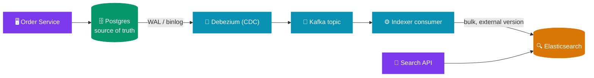

# Elasticsearch — Step by Step

**Elasticsearch — Step by Step** | A chapter for a beginner. Each section teaches one idea in small steps, and then gives the interview questions on that idea. Each section uses only the words from the sections before it. Also see: [System Design HLD](01_System_Design_HLD_Interview_Questions.md) | [Database Design & Internals](02_Database_Design_and_Internals_Interview_Questions.md) | [Kafka](04_Kafka_Interview_Questions.md)

> **How to study:** read the sections in order. In each section, read the 📖 lesson first, then try the ❓ questions from memory before you open the answers.  
> **Hands-on (do later, when a job needs it):** 🎥 [Mastering Spring Data Elasticsearch — Lilium Code (YouTube playlist)](https://www.youtube.com/playlist?list=PLXy8DQl3058P-mqOmuVu98HLhohnP_hz1) — Spring Boot 3 + Elasticsearch 8.x, built step by step. A shorter single video: 🎥 [Spring Boot + Elasticsearch 8 CRUD Example — JavaInUse](https://www.youtube.com/watch?v=vdffYlN3LIk). §8 of this file links the two.

🗺️ **Learning Path**

| Step | Section | What you learn | Builds on |
|---|---|---|---|
| 1 | [Basics — Start Here](#basics) | The words (document, index, mapping, shard) and the 4 basic API calls | — |
| 2 | [Why Elasticsearch — the Inverted Index](#why-elasticsearch) | Why a database is slow at text search, and how ES is fast | §1 |
| 3 | [Text Analysis and Mapping](#text-analysis-and-mapping) | How text becomes words; `text` vs `keyword` | §2 |
| 4 | [Searching — Queries and Relevance](#querying-and-relevance) | `match` vs `term`, `bool`, scoring, aggregations | §3 |
| 5 | [Cluster Architecture](#cluster-architecture) | Shards, replicas, routing, the master node | §1 |
| 6 | [Write Path and Read Path](#write-path-and-read-path) | Refresh, segments, updates, paging, versions | §2, §5 |
| 7 | [Elasticsearch in System Design](#elasticsearch-in-system-design) | Sync with the DB, autocomplete, logs, when not to use ES | §1–§6 |
| 8 | [Spring Boot Integration](#spring-boot-integration) | The client, the mapping in code, tests | §1–§6 |

📊 **Question Count by Section**

| # | Section | Questions |
|---|---|---|
| 1 | [Basics — Start Here](#basics) 🔥🔥 | 2 |
| 2 | [Why Elasticsearch — the Inverted Index](#why-elasticsearch) 🔥🔥 | 3 |
| 3 | [Text Analysis and Mapping](#text-analysis-and-mapping) 🔥🔥 | 3 |
| 4 | [Searching — Queries and Relevance](#querying-and-relevance) 🔥🔥 | 4 |
| 5 | [Cluster Architecture — Shards, Replicas, Nodes](#cluster-architecture) 🔥 | 4 |
| 6 | [Write Path and Read Path](#write-path-and-read-path) 🔥 | 4 |
| 7 | [Elasticsearch in System Design](#elasticsearch-in-system-design) 🔥🔥 | 5 |
| 8 | [Spring Boot Integration](#spring-boot-integration) ⚡ | 3 |
| | **Total** | **28** |

> 🔥🔥 Very High — asked in almost every Tier-1 loop &nbsp;·&nbsp; 🔥 High — very frequent in Tier-1 interviews &nbsp;·&nbsp; ⚡ Medium — commonly asked &nbsp;·&nbsp; 💤 Low — good to know, rarely asked

---

<a id="basics"></a>

## 1. Basics — Start Here 🔥🔥

### 📖 Lesson

**Step 1 — What Elasticsearch is.** Elasticsearch (ES) is a server program, written in Java. You run it like you run a database. You talk to it over **HTTP with JSON** (port 9200 by default). You give it JSON documents, and it lets you search them by words, very fast.

**Step 2 — The words you need.** Every later section uses these words. Learn them first.

| Word | What it is | Example |
|---|---|---|
| **Document** | One JSON object that you store. ES saves and searches whole documents. | One product: `{"name": "Red Running Shoe", "price": 2999}` |
| **Field** | One key inside a document | `name`, `price` |
| **Index** | A named group of similar documents | `products` |
| **Mapping** | The schema of an index: the type of each field (`text`, `keyword`, `integer`, `date` …) | `name` → `text`, `price` → `integer` |
| **Node** | One running ES server (one JVM process) | `es-node-1` |
| **Shard** | One piece of an index. A big index is cut into shards, and the shards are spread over the nodes (§5). | `products` cut into 3 shards |
| **Replica** | A copy of a shard on another node. It keeps the data safe and serves more reads (§5). | 1 copy of each shard |

**Step 3 — Compare with SQL (only to get started).**

| SQL | Elasticsearch |
|---|---|
| Table | Index |
| Row | Document |
| Column | Field |
| Schema | Mapping |

⚠️ The comparison stops working quickly. ES has **no joins** and **no transactions across documents**. So a document usually holds everything one search needs. For example, a product document also holds its brand name and category name.

**Step 4 — The four basic calls.** Create an index, store a document, read it by id, and search.

```json
PUT /products
{
  "mappings": {
    "properties": {
      "name":  { "type": "text" },
      "brand": { "type": "keyword" },
      "price": { "type": "integer" }
    }
  }
}
```

```json
PUT /products/_doc/1
{
  "name": "Red Running Shoe",
  "brand": "Nike",
  "price": 2999
}
```

```http
GET /products/_doc/1
```

```json
GET /products/_search
{
  "query": {
    "match": { "name": "red running shoes" }
  }
}
```

**Step 5 — Read the search result.** The answer is JSON too. The parts you use most:

```json
{
  "hits": {
    "total": { "value": 1 },
    "hits": [
      {
        "_id": "1",
        "_score": 0.58,
        "_source": { "name": "Red Running Shoe", "brand": "Nike", "price": 2999 }
      }
    ]
  }
}
```

- `_id` is the document id.
- `_source` is the JSON you stored.
- `_score` says how well the document matches. Higher is better (§4). The value here is only an example.

The search found the shoe because the words `red` and `running` match. `shoes` and `shoe` are different words for the default analyzer, so they do not match. §3 shows how an analyzer fixes that.

**Step 6 — See the whole picture.**

```text
Cluster
├── Node 1: products shard 0 (primary), products shard 1 (replica)
├── Node 2: products shard 1 (primary), products shard 2 (replica)
└── Node 3: products shard 2 (primary), products shard 0 (replica)
```

One index (`products`) is cut into 3 shards. Each shard has one copy on a different node. If one node dies, the other two still hold all the data.

➡️ **Next:** §2 explains *why* a search in ES is fast, when a database is slow.

### ❓ Interview Questions

1. **🧱 What are the main building blocks of Elasticsearch? 🔥🔥**

<!-- -->
<details>
<summary>Answer</summary>

**Answer:**

From small to big:

| Block | Meaning |
|---|---|
| **Document** | One JSON object — the unit you store, get and search |
| **Field** | One key in a document, with a type |
| **Mapping** | The field types of an index (its schema) |
| **Index** | A named collection of documents with one mapping |
| **Shard** | A piece of an index. Each shard is a full Lucene index with part of the documents. |
| **Replica** | A copy of a shard, always on a different node |
| **Node** | One ES server process |
| **Cluster** | All the nodes together. One of them is the elected **master** (§5 Q4). |

**SQL view (rough only):** index ≈ table, document ≈ row, field ≈ column, mapping ≈ schema. The difference: ES has no joins and no multi-document transactions. So documents are **denormalized** — each one holds all the data one search needs.

🎯 **Interview line:** "An index is a collection of JSON documents with a mapping, a bit like a table with a schema. ES cuts each index into shards. It spreads them over the nodes of a cluster, and keeps replica copies on other nodes."

---

</details>

---

2. **🛠️ How do you store a document, read it by id, and search it? 🔥**

<!-- -->
<details>
<summary>Answer</summary>

**Answer:**

ES has a **REST API with JSON**. Each action is an HTTP call:

| Action | Call | Note |
|---|---|---|
| Store with your own id | `PUT /products/_doc/1` + JSON body | If id 1 exists, the document is **replaced** by the new one |
| Store, ES makes the id | `POST /products/_doc` + JSON body | ES returns the new `_id` |
| Store only if new | `PUT /products/_create/1` | Fails with **409** if id 1 exists |
| Read by id | `GET /products/_doc/1` | **Real-time** — works even before a refresh (§6 Q1) |
| Search | `GET /products/_search` + a query in the body | Finds new documents only after the next refresh, about 1 s |
| Store many | `POST /_bulk` | Many documents in one request — much faster than one call each |

**A search result has:** `hits.total` (how many matched) and a list of hits. Each hit has `_id`, `_score` (how well it matches) and `_source` (the stored JSON).

**Common beginner trap:** you store a document and search for it at once in a test, and it is not there. A read by id would find it. A search waits for the refresh (§6 Q1).

🎯 **Interview line:** "ES is a REST and JSON API. I PUT a document into an index with an id. I GET it back by id in real time. I search with a JSON query on `_search`. For many documents I use the bulk API."

---

</details>

---

<a id="why-elasticsearch"></a>

## 2. Why Elasticsearch — the Inverted Index 🔥🔥

### 📖 Lesson

**Step 1 — What a database is good at.** A database finds a row fast when you know an **exact value**: an id, an email, a status. It keeps a sorted B-tree index, so it jumps to the right place.

**Step 2 — Where it fails.** Now search for a **word inside text**: products whose name contains "phone". The word can be anywhere in the name. A sorted index cannot help, so the database reads **every row** (Q3).

**Step 3 — The idea from a book.** A book has an index at the back: each word points to its page numbers. To find "shard", you do not read the book. You look up the word and go to the pages.

**Step 4 — ES does the same with documents.** When you store a document, ES splits its text into words. It keeps one list: **word → ids of the documents that contain it**. This list is the **inverted index** (Q2).

**Step 5 — A search is a lookup, not a scan.** For "red bike", ES looks up `red`, looks up `bike`, and joins the two lists of ids. Documents that have both words rank first.

**Step 6 — The price you pay.** The work moves to **write time**: every document is split into words when it is stored. And ES is a second copy of your data, next to the main database (Q1).

➡️ **Next:** §3 shows exactly *how* text is split into words.

### ❓ Interview Questions

1. **🔍 What is Elasticsearch, and when would you add it to a system? 🔥🔥**

<!-- -->
<details>
<summary>Answer</summary>

**Answer:**

Elasticsearch (ES) is a distributed **search and analytics engine**. It is built on **Apache Lucene**, a Java search library. You send it JSON documents over a REST API. It indexes every field so you can search them fast.

**In one line:** a database finds rows by **exact values**. Elasticsearch finds documents by **words** — fast, ranked by relevance, and it forgives typos.

**The problem it solves.** You have 10 million products. The user types **"red running shoes"**. In SQL you would write:

```sql
SELECT * FROM product
WHERE name LIKE '%red%running%shoes%';
```

This query has four problems:

1. **Slow.** A `%` at the start means the B-tree index cannot help. The DB reads all 10 million rows.
2. **Strict.** It does not find "Running Shoe – Red" (different word order, singular form).
3. **No typo help.** "runnig" finds nothing.
4. **No ranking.** The best match is not shown first.

**How ES fixes it.** ES builds an **inverted index**, like the index at the back of a book: each word points to the documents that contain it. A search looks up each word in this list. It does not read every document (Q2). Before ES stores a word, it also cleans it: "Running" → "run", "Shoes" → "shoe" (§3). So different forms of a word still match.

**Add it when the main database cannot answer a query well:**

| Need | Why a normal DB struggles | What ES does |
|---|---|---|
| Full-text search ("red running shoes") | `LIKE '%shoe%'` cannot use a B-tree index → full table scan | Inverted index: looks up each word directly |
| Ranking by relevance | SQL has no idea which row is the "best" match | Scores every hit (BM25) and sorts by score |
| Typos, plurals, synonyms | Exact string match only | Analyzers: lowercase, stemming, synonyms, fuzzy match |
| Filters on many fields at once (facets) | Needs a composite index for every combination | Every field is indexed on its own; combines them fast |
| Search over logs / events | Huge append-only data, mostly time-range queries | Time-based indices, aggregations, Kibana |

**The key rule:** ES is a **secondary store**. The source of truth stays in your main database (MySQL, Postgres). ES holds a **copy** that is built for searching. It has no multi-document transactions and no joins, and new writes become searchable about 1 second later (§6).

```
Main DB (source of truth) ──changes──> Kafka ──> Elasticsearch (copy for search)
```

You write to the DB. A copy flows into ES (§7 Q1). Users **search** in ES, then **read the full record** from the DB.

🎯 **Interview line:** "A database finds rows by exact values. Elasticsearch finds documents by words, fast, ranked by relevance, and it forgives typos. I'd keep orders in Postgres as the source of truth and send a copy to Elasticsearch for search. Postgres does the writes and transactions; Elasticsearch does free-text search, ranking and facets."

---

</details>

---

2. **📇 How does an inverted index work, and why is it fast? 🔥🔥**

<!-- -->
<details>
<summary>Answer</summary>

**Answer:**

A normal (forward) index maps **document → words**. An **inverted index** maps **word → list of documents** that contain it. That list is called a **postings list**.

Three documents:

```text
doc 1: "Fast red car"
doc 2: "Red bike"
doc 3: "Fast bike"
```

After analysis (lowercase, split on spaces), the inverted index is:

| Term | Postings list (doc ids) |
|---|---|
| `bike` | 2, 3 |
| `car` | 1 |
| `fast` | 1, 3 |
| `red` | 1, 2 |

**Search `red bike`:** look up `red` → {1, 2}, look up `bike` → {2, 3}. Doc 2 has both words, so it scores highest.

**Why it is fast:**
- The **terms are sorted**, so finding a term is a quick lookup, not a scan. Lucene keeps a compact term dictionary (an FST, a finite state transducer) in memory.
- Each postings list is **already sorted by doc id**. So AND / OR of two lists is a fast merge of sorted lists.
- The lists also store **term frequency and positions**. Positions make phrase queries possible ("red bike" as an exact phrase).
- The cost depends on **how many documents match**, not on the total number of documents.

🎯 **Interview line:** "Search does not scan documents. It looks up each word in a sorted dictionary. It gets the sorted list of documents for that word. Then it merges the lists."

---

</details>

---

3. **🐢 Why is `WHERE name LIKE '%phone%'` slow, and why is adding an index not enough? 🔥**

<!-- -->
<details>
<summary>Answer</summary>

**Answer:**

A B-tree index is sorted by the **start** of the value. It can answer `LIKE 'phone%'` (a prefix) by jumping to the "phone" part of the tree. With a **leading wildcard** (`'%phone%'`), the match can start anywhere, so the sorted order does not help. The database must read **every row**.

**Numbers:** 10 million products. A full scan reads all 10M names on every search. At even 1 µs per row that is ~10 seconds per query. One search per second would keep a whole CPU busy.

**Even when it works, `LIKE` is the wrong tool:**
- No ranking — every match is equal.
- No stemming — `phones` does not match `phone`.
- No typo tolerance — `iphnoe` matches nothing.
- Case and accents need extra functions, which also break index use.

An inverted index splits the text into words **at write time**. So a search for `phone` is one lookup, however long the names are.

**The middle option:** Postgres has built-in full-text search (`tsvector` + a **GIN** index, which is an inverted index too). It handles stemming and simple ranking. See §7 Q5 for when it is enough.

---

</details>

---

<a id="text-analysis-and-mapping"></a>

## 3. Text Analysis and Mapping 🔥🔥

### 📖 Lesson

**Step 1 — Text is cleaned before it is stored.** The tool that does this is the **analyzer**. It splits the text into words and cleans each word. With an English analyzer, "The Running Shoes" becomes `[run, shoe]` (Q1).

**Step 2 — The search text gets the same cleaning.** The user types "running shoe". It also becomes `[run, shoe]`. Now the stored words and the searched words are the same, so they match.

**Step 3 — Some fields must not be cleaned.** An order id like `ORD-2024-0001` or a status like `APPROVED` must stay **one exact value**. If ES split it into pieces, the search would find wrong documents.

**Step 4 — So there are two string types.**
- `text` — cleaned and split into words. For titles and descriptions.
- `keyword` — kept as one exact value. For ids, statuses and codes (Q2).

**Step 5 — The mapping says which field has which type.** Write the mapping before you store data. If you do not, ES guesses the types from the first document (dynamic mapping).

**Step 6 — The mapping of a field cannot change later.** The old documents are already stored as words made with the old rules. To change a field, you build a **new index** and switch an **alias** to it (Q3).

➡️ **Next:** §4 shows how to ask ES questions — queries.

### ❓ Interview Questions

1. **🔬 What is an analyzer? Walk through what happens to a sentence when it is indexed. 🔥🔥**

<!-- -->
<details>
<summary>Answer</summary>

**Answer:**

An **analyzer** turns a string into the list of **terms** that go into the inverted index. It has three steps, always in this order:

1. **Character filters** (0 or more) — change the raw text. Example: strip HTML tags.
2. **Tokenizer** (exactly 1) — split the text into tokens. Example: split on spaces and punctuation.
3. **Token filters** (0 or more) — change each token. Example: lowercase, remove stop words, stemming (`running` → `run`), synonyms.

**Example with an English analyzer:**

```text
Input:   "<b>The Quick</b> Foxes are RUNNING!"
Char filter (strip HTML) → "The Quick Foxes are RUNNING!"
Tokenizer               → [The, Quick, Foxes, are, RUNNING]
Lowercase               → [the, quick, foxes, are, running]
Stop words              → [quick, foxes, running]
Stemmer                 → [quick, fox, run]
```

The **default** is the `standard` analyzer: standard tokenizer + lowercase. It does **not** stem.

⚠️ **The key rule:** the **same analysis must run on the search text**. If you index `run` but search for the raw `RUNNING`, nothing matches. `match` queries do this for you; `term` queries do **not** (see §4 Q1).

---

</details>

---

2. **🏷️ What is the difference between a `text` field and a `keyword` field? 🔥🔥**

<!-- -->
<details>
<summary>Answer</summary>

**Answer:**

| | `text` | `keyword` |
|---|---|---|
| Analyzed? | ✅ Yes — split into terms | ❌ No — the whole value is one term |
| Good for | Full-text search (titles, descriptions) | Exact match, filters, sorting, aggregations |
| `"New York"` is stored as | `new`, `york` | `New York` (exact, case-sensitive) |
| Sort / aggregate on it | ❌ Not by default (needs `fielddata`, uses a lot of heap) | ✅ Yes (uses on-disk `doc_values`) |
| Example fields | `description`, `title` | `status`, `country_code`, `email`, `order_id` |

**Dynamic mapping trap:** if you do not define a mapping, ES maps a new string field as **both**. It makes a `text` field plus a `.keyword` sub-field (only for values up to 256 characters). So `status` is text and `status.keyword` is exact. That is why you often see queries on `field.keyword`.

**A field can be both on purpose (multi-field):** a product `name` as `text` for search, with `name.keyword` for sorting A–Z.

🎯 **Interview line:** "IDs, statuses and enums are `keyword` — exact match, filter, aggregate. Human text is `text` — analyzed for search. If I need both, I use a multi-field."

---

</details>

---

3. **🔄 Can you change a field's mapping after data is indexed? How do you change it with no downtime? 🔥**

<!-- -->
<details>
<summary>Answer</summary>

**Answer:**

**You can add new fields**, but you **cannot change the type or analyzer of an existing field**. The old documents were already split into terms with the old rules. Those terms are stored in immutable index files (segments). Changing the rule would make old and new documents disagree.

**The fix is a reindex behind an alias:**

1. Your app never uses the real index name. It reads and writes through an **alias**: `products` → `products_v1`.
2. Create `products_v2` with the new mapping.
3. Copy the data: the `_reindex` API (`products_v1` → `products_v2`), or replay from the source DB.
4. Catch up the writes that happened during the copy. Replay from Kafka / CDC from a saved position, or dual-write during the copy.
5. **Switch the alias atomically** in one `_aliases` call: remove `products_v1`, add `products_v2`. Readers see the change at once.
6. Keep `v1` for a while for rollback, then delete it.

**Prevent the problem:** use an **explicit mapping** for important indices. Set `dynamic: strict` (reject unknown fields) or `dynamic: false` (store but do not index them). Unlimited dynamic fields can cause a **mapping explosion**: thousands of fields, a huge cluster state, and slow nodes. ES has a guard limit (1,000 fields per index by default).

🎯 **Interview line:** "Mapping changes mean a new index. I always put an alias in front, reindex into v2, catch up the writes, and swap the alias atomically."

---

</details>

---

<a id="querying-and-relevance"></a>

## 4. Searching — Queries and Relevance 🔥🔥

### 📖 Lesson

**Step 1 — A query is JSON.** You send it in the body of `GET /<index>/_search`. This JSON language is called the **Query DSL**.

**Step 2 — The two basic queries.**
- `match` — cleans the search text with the field's analyzer, then looks up the words. Use it on `text` fields.
- `term` — looks up the value **exactly**, with no cleaning. Use it on `keyword`, numbers and dates.

Use the wrong one and you get no results, or wrong ones (Q1).

**Step 3 — Real searches combine conditions.** "Wireless headphones, in stock, under ₹5,000" is three conditions. The `bool` query joins them (Q2):
- The free text goes in `must`. It decides the **ranking**.
- Yes/no conditions go in `filter`. They do not change the score, and ES can cache them, so they are faster.

**Step 4 — Every hit gets a score.** ES sorts the hits by `_score`. The default formula is **BM25**. A document scores higher in three cases (Q3):
- The search word appears often in it.
- The word is rare in all the other documents.
- The field is short.

**Step 5 — ES can also count and group.** Besides the list of hits, a search can return counts like "Brand: Sony (120), Bose (85)". These are **aggregations**. They build the filter panel on a shopping site (Q4).

➡️ **Next:** §5 shows how ES spreads the data over many machines.

### ❓ Interview Questions

1. **⚖️ `match` vs `term` query — what goes wrong if you mix them up? 🔥🔥**

<!-- -->
<details>
<summary>Answer</summary>

**Answer:**

- **`match`** **analyzes the search text** with the field's analyzer, then looks up the resulting terms. Use it on `text` fields.
- **`term`** looks up the value **exactly as given**, with no analysis. Use it on `keyword`, numbers, dates and booleans.

**Mistake 1 — `term` on a `text` field:**

```json
{ "query": { "term": { "city": "New York" } } }
```

The indexed terms are `new` and `york` (lowercased, split). There is no single term `New York`, so this returns **nothing**. Fix: `match` on `city`, or `term` on `city.keyword`.

**Mistake 2 — `match` on an ID stored as `text`:**
An order id `ORD-2024-0001` in a `text` field is split by the standard analyzer into `ord`, `2024`, `0001`. A `match` for it uses OR by default, so it also matches **every other order with `2024`**. Results look "mostly right" because the best match scores highest. So the bug stays hidden. Fix: map ids as `keyword` and use `term`.

---

</details>

---

2. **🧮 Explain the `bool` query: `must`, `should`, `filter`, `must_not`. 🔥🔥**

<!-- -->
<details>
<summary>Answer</summary>

**Answer:**

`bool` combines other queries:

| Clause | Must match? | Affects the score? | Cached? |
|---|---|---|---|
| `must` | ✅ Yes | ✅ Yes | No |
| `filter` | ✅ Yes | ❌ No | ✅ Often |
| `should` | Optional (if there is a `must`/`filter`) | ✅ Yes — boosts matches | No |
| `must_not` | ❌ Must not match | ❌ No | ✅ Often |

**Example — "wireless headphones", in stock, under ₹5,000, prefer brand Sony:**

```json
{
  "query": {
    "bool": {
      "must":   [ { "match": { "title": "wireless headphones" } } ],
      "filter": [
        { "term":  { "in_stock": true } },
        { "range": { "price": { "lte": 5000 } } }
      ],
      "should": [ { "term": { "brand": "sony" } } ]
    }
  }
}
```

**The rule:** anything that is a **yes/no condition** (status, price range, date range, tenant id) goes in **`filter`**. Only the **free-text part** that should rank results goes in `must`. Filters skip scoring and can be cached, so they are faster.

---

</details>

---

3. **🏆 How does Elasticsearch decide which result is "most relevant"? 🔥**

<!-- -->
<details>
<summary>Answer</summary>

**Answer:**

The default scoring model is **BM25**. In plain words, a document scores higher when:

1. **Term frequency (TF):** the search word appears **more often** in that field. BM25 **caps** this effect. The 10th mention adds much less than the 2nd.
2. **Inverse document frequency (IDF):** the word is **rare** across all documents. "headphones" is more useful than "the" or "new".
3. **Field length:** the field is **short**. A match in a 5-word title counts more than the same match in a 500-word description.

**Ways to tune it:**
- **Boost fields:** `title^3, description` — a title match counts 3× more.
- **`function_score`:** mix in business signals — popularity, rating, recency, distance.
- **`should` clauses:** extra points for preferred matches.

⚠️ **Shard trap:** IDF is computed **per shard** by default. On a tiny test index with few documents per shard, scores can look random. On real data volumes the difference becomes small.

---

</details>

---

4. **📊 What are aggregations? Are they always exact? 🔥**

<!-- -->
<details>
<summary>Answer</summary>

**Answer:**

**Aggregations** compute summaries over the matching documents, like SQL `GROUP BY`. They power **facets** ("Brand: Sony (120), Bose (85)") and dashboards.

| Type | Example |
|---|---|
| Bucket | `terms` by brand, `date_histogram` by day, `range` by price band |
| Metric | `avg`, `sum`, `min`, `max`, `cardinality` (distinct count) |
| Pipeline | Work on other aggregations' results (moving average, derivative) |

Aggregations run on **`keyword`, number and date fields** (they use on-disk `doc_values`). They do not run on `text` fields by default.

**Not always exact:**
- **`terms` (top N):** each shard sends its own top N. The global result can miss or under-count a term that is spread thinly across shards. To reduce this, ES asks each shard for more than N (`shard_size`). For exact totals over all values, use the `composite` aggregation and page through it.
- **`cardinality`:** uses **HyperLogLog++**, an approximate algorithm. It is exact for small counts and has a small error for large ones. It uses fixed memory. An exact distinct count over billions of values would need huge memory.

🎯 **Interview line:** "Facets come from aggregations on keyword fields. Top-N terms and distinct counts are approximate across shards — fine for a UI, not for billing numbers."

---

</details>

---

<a id="cluster-architecture"></a>

## 5. Cluster Architecture — Shards, Replicas, Nodes 🔥

### 📖 Lesson

**Step 1 — One machine is not enough.** Three reasons: the data does not fit, one machine cannot handle all the searches, and one machine can die.

**Step 2 — Cut the index into shards.** An index is cut into **primary shards**. Each shard holds part of the documents. The shards sit on different nodes, so a search runs on all of them **in parallel** (Q1).

**Step 3 — Keep copies.** Each primary shard has **replica shards** on other nodes. If a node dies, a replica becomes the new primary and no data is lost. Replicas also serve searches (Q1).

**Step 4 — Each document lives in one shard.** ES picks the shard with a formula: `hash(id) % number of primary shards`. Because of this formula, the number of primary shards is **fixed** when you create the index (Q2).

**Step 5 — How big should a shard be?** About **10–50 GB** each. Too many small shards waste memory. A few huge shards make recovery slow (Q3).

**Step 6 — One node is the boss.** The **master** node keeps the cluster state: which indices exist and where each shard lives. A **majority** of the master-eligible nodes elects it. That is why you use **3** of them (Q4).

**Step 7 — Cluster health in one colour.** 🟢 green: all shards are placed. 🟡 yellow: all primaries are fine, some replicas are not placed. 🔴 red: at least one primary is missing.

➡️ **Next:** §6 shows what happens *inside* a shard when you write and search.

### ❓ Interview Questions

1. **🧩 What are shards and replicas, and why do you need both? 🔥🔥**

<!-- -->
<details>
<summary>Answer</summary>

**Answer:**

- An **index** is a logical collection of documents (like a table).
- It is split into **primary shards**. Each shard is a complete Lucene index holding part of the documents. Shards let the data **spread across nodes** and let a search run **in parallel**.
- Each primary can have **replica shards** — full copies on *other* nodes.

| | Gives you | Cost |
|---|---|---|
| More primaries | More write parallelism, more total size | Fixed at creation; too many small shards waste memory |
| More replicas | **High availability** (a node can die) + more **read** throughput (any copy can serve a search) | More disk; each write is done on every copy |

**Example:** 3 primaries × 1 replica = 6 shards on 3 nodes. ES never puts a primary and its own replica on the same node. If one node dies, a replica on another node is **promoted** to primary, and no data is lost.

Defaults today: **1 primary, 1 replica** per index. On a single-node cluster the replica cannot be placed. So the cluster shows **yellow** health (all primaries OK, some replicas unassigned). **Red** means at least one primary is missing — some data cannot be searched.

---

</details>

---

2. **🧭 How does ES decide which shard a document goes to? Why can't you just change the number of primary shards? 🔥**

<!-- -->
<details>
<summary>Answer</summary>

**Answer:**

**Routing formula (simplified):**

```text
shard = hash(_routing) % number_of_primary_shards
```

`_routing` is the document `_id` by default. So to **get** a document by id, ES computes the same formula. It goes straight to one shard and does not need to ask all shards.

**Why the primary count is fixed:** Say you change the count from 3 to 4. Now the formula sends most existing ids to a **different** shard. That is not the shard that holds them. Then every lookup by id would go to the wrong place. The same problem exists with plain `hash % N` in any sharded system (this is why consistent hashing exists).

**How you grow anyway:**
- **Reindex** into a new index with more shards, behind an alias (§3 Q3).
- The **`_split`** API: split each shard into a fixed multiple (3 → 6). It works because each new shard takes a known half of an old one.
- For logs/time data: **rollover** — start a new index when the current one is big or old. The new index can have a different shard count.

**Custom routing:** route by `tenant_id` so all of one tenant's data sits on one shard. Searches for that tenant then hit one shard, not all. The risk is a **hot shard** (one shard with much more load than the others) if one tenant is huge.

---

</details>

---

3. **📏 How do you size shards? Estimate the shards for 1 billion documents. 🔥**

<!-- -->
<details>
<summary>Answer</summary>

**Answer:**

**Elastic's rough rules:**
- Keep each shard roughly **10–50 GB**, and below about **200 million documents**.
- Too **many small shards** is the common mistake. Each shard has a fixed cost in memory and in cluster state. Also, a search must visit every shard.
- Too **few big shards** make recovery slow. Moving a 200 GB shard to a new node after a failure takes a long time.

**Worked estimate — 1 billion product documents, ~1 KB of JSON each:**

```text
Raw JSON            : 1,000,000,000 × 1 KB      = ~1 TB
On-disk index size  : ~1 TB × ~1.2 (varies a lot with mapping) ≈ 1.2 TB
Primary shards      : 1.2 TB / ~40 GB per shard   ≈ 30 primaries
With 1 replica      : 1.2 TB × 2                  ≈ 2.4 TB total, 60 shards
Nodes (data)        : ~2.4 TB / ~0.4 TB usable per node (leave disk headroom) ≈ 6 nodes
Docs per shard      : 1B / 30                     ≈ 33M (well under 200M ✅)
```

The 1.2× factor is an assumption. It depends on how many fields are indexed and stored. **Tell the interviewer this**, and say you would measure it by indexing a sample first.

**Memory:** give the JVM heap about **half of the RAM, and never above ~31 GB**. Above that, the JVM stops using compressed object pointers, so each reference takes more memory. Leave the other half to the **OS file cache**. Lucene reads its files through that cache. So the cache matters as much as the heap.

---

</details>

---

4. **👑 What node roles exist, and how does ES avoid "split brain"? 🔥**

<!-- -->
<details>
<summary>Answer</summary>

**Answer:**

**Main roles** (a small cluster gives each node several roles):

| Role | Job |
|---|---|
| **Master-eligible** | Can be elected master. The master manages **cluster state**: which indices exist, mappings, and where each shard lives. It does not handle searches. |
| **Data** | Holds shards; does indexing, search and aggregations. Uses most of the CPU, RAM and disk. Can be split into hot / warm / cold tiers. |
| **Coordinating-only** | Receives client requests, sends them to the right shards, and merges the results. Useful for heavy aggregation traffic. |
| **Ingest** | Runs pipelines that change documents before indexing (parse a log line, add a field). |

**Split brain** = two nodes both believe they are master after a network split, and both accept changes. The data then splits into two versions.

**How ES prevents it:** electing a master and changing the cluster state need a **majority (quorum) of master-eligible nodes**. With **3** master-eligible nodes, a majority is 2. After a network split, only the side with 2 nodes can have a master. The side with 1 node cannot. Since version 7, ES manages this quorum by itself. The old manual setting is gone.

**Why 3, not 2:** with 2 master-eligible nodes, the majority is 2, so losing either one stops the cluster. 3 survives the loss of one.

---

</details>

---

<a id="write-path-and-read-path"></a>

## 6. Write Path and Read Path 🔥

### 📖 Lesson

**Step 1 — A write lands in memory first.** The new document goes into an in-memory buffer. The operation is also written to the **translog**, a safety log on disk. So a crash does not lose it (Q1).

**Step 2 — About every second, a refresh.** ES turns the buffer into a new small **segment** — a small inverted index. Only now can a search find the document. This is why ES is called **near real-time** (Q1).

**Step 3 — A read by id does not wait.** `GET` by id sees the new document at once. Only **search** waits for the refresh.

**Step 4 — Segments never change.** A delete only **marks** the document as deleted. An update marks the old version deleted and writes a full new one. Later, a background **merge** joins small segments and drops the deleted documents (Q3).

**Step 5 — A search asks every shard.** Each shard sends back its best hits. One node merges them and then fetches the full documents. Going to page 1,000 is expensive, because every shard must sort 10,000 hits. Use `search_after` instead (Q2).

**Step 6 — Two writers at the same time.** Each document has a version number (`_seq_no`). A write can say "only if the version is still 42". If someone else changed it first, ES rejects the write with **409** (Q4).

➡️ **Next:** §7 puts ES inside a full system design.

### ❓ Interview Questions

1. **⏱️ Why is Elasticsearch called "near real-time"? Explain refresh, translog and flush. 🔥🔥**

<!-- -->
<details>
<summary>Answer</summary>

**Answer:**

When you index a document, it is **not searchable at once**. It becomes searchable after the next **refresh**, which by default runs about **every 1 second**. That 1-second gap is what "near real-time" (NRT) means.

**What happens on a write:**

1. The document goes into an **in-memory buffer**, and the operation is appended to the **translog** (a write-ahead log on disk).
2. By default the translog is **fsynced to disk before ES replies** "OK". So an acknowledged write survives a crash.
3. **Refresh (~1 s):** the buffer is written as a new small **segment** into the OS file cache. A segment is an immutable mini inverted index. ES then opens it for search. Now the document can be found. This is cheap because it does not force data to disk.
4. **Flush (from time to time):** a Lucene **commit** fsyncs the segments to disk. After that, the old translog can be cleared.
5. **Merge (background):** many small segments are merged into bigger ones. Deleted documents are dropped for real during merges.

**Why not refresh on every write?** Each refresh makes a new segment. Thousands of tiny segments slow both search and merging. So ES gives up 1 s of freshness to get more throughput.

**Read-your-own-write:** a `GET` by id is real-time — it reads the latest version even before a refresh. A **search** is not. Sometimes a user must see their new item in search results. Then index with `refresh=wait_for`. The request waits for the next refresh. Avoid `refresh=true` on every request. It forces a refresh and makes many tiny segments.

---

</details>

---

2. **📄 How does a search run across shards? Why is deep pagination expensive? 🔥**

<!-- -->
<details>
<summary>Answer</summary>

**Answer:**

**Query-then-fetch (two phases):**

1. **Query phase:** the coordinating node sends the query to **one copy of every shard**. Each shard finds its own top `from + size` hits and returns only their **ids and scores**.
2. The coordinating node **merges** those lists and picks the global top `size`.
3. **Fetch phase:** it asks the shards that own those documents for the full `_source` and returns them.

**Why deep pagination hurts:** for page 1,000 with 10 hits per page (`from = 9990, size = 10`), **every** shard must find and sort its top **10,000** hits. With 30 shards, the coordinator sorts **300,000** entries to return 10. Memory and CPU use grow with the page number. ES blocks `from + size` above **10,000** by default.

**What to use instead:**

| Need | Use |
|---|---|
| "Next page" in a UI / API | **`search_after`** — pass the sort values of the last hit; each page costs the same |
| Same, but stable while data changes | `search_after` + a **point in time (PIT)** |
| Export all documents | `search_after` + PIT (the older `scroll` API is no longer recommended for this) |

This is the same idea as **cursor pagination vs offset pagination** in SQL.

---

</details>

---

3. **✏️ How do updates and deletes work if segments are immutable? 🔥**

<!-- -->
<details>
<summary>Answer</summary>

**Answer:**

Segments are **never changed** after they are written. So:

- **Delete:** the document is only **marked as deleted** (in a small per-segment file). Searches skip it. The space comes back only when that segment is **merged**.
- **Update:** ES reads the old document, applies your change, **marks the old one deleted**, and **indexes a full new version**. So an update costs about the same as a new write, even if you change one field.

**Effects you can mention:**
- Many updates to the same documents create many deleted documents and a lot of merge work. An example is a "view count" updated on every view. Keep fast-changing counters **out of ES**, or batch them.
- Disk usage can be higher than the live data until merges catch up.
- Immutability also makes segments easy to **cache** and safe to read without locks.

---

</details>

---

4. **🔒 Two requests update the same document at the same time. How do you stop one from silently overwriting the other? 🔥**

<!-- -->
<details>
<summary>Answer</summary>

**Answer:**

ES uses **optimistic concurrency control**. Every document has a **`_seq_no`** (sequence number of the last change) and **`_primary_term`** (which primary wrote it).

1. Read the document → you get `_seq_no = 42`, `_primary_term = 1`.
2. Write it back with `if_seq_no=42&if_primary_term=1`.
3. Maybe someone else changed it in between. Then the seq no is now 43, so ES rejects your write with **409 Conflict**.
4. Your code re-reads and retries (or gives up).

```http
PUT /products/_doc/123?if_seq_no=42&if_primary_term=1
```

The `_update` API has a `retry_on_conflict` option for simple cases.

**Syncing from a database (§7):** use **external versioning** instead. Send the row's own version or `updated_at` as the document version with `version_type=external`. ES keeps a write only if its version is **higher** than the stored one. So an old event that arrives late cannot overwrite newer data.

---

</details>

---

<a id="elasticsearch-in-system-design"></a>

## 7. Elasticsearch in System Design 🔥🔥

### 📖 Lesson

**Step 1 — ES is a copy.** The main database stays the **source of truth**. ES holds a copy of the data, built for search.

**Step 2 — Keep the copy up to date.** Do not write to the DB and ES from the app one after the other (dual write). If the second write fails, ES misses the change forever. Instead, send every change through **Kafka**, with an **outbox** table or **CDC**. An indexer reads Kafka and writes to ES (Q1).

**Step 3 — The copy is a little late.** The pipeline and the refresh add up to about a second or two. Design the screen for this. For example, show the user's saved item from the DB (Q2).

**Step 4 — Common designs with ES.** Product search, search **autocomplete** (Q3), and **logs** (Q4).

**Step 5 — Know when not to use it.** Every extra store costs money and work. For a small catalog, Postgres full-text search may be enough (Q5).

➡️ **Next:** §8 shows how to use ES from Spring Boot.

### ❓ Interview Questions

1. **🔁 How do you keep Elasticsearch in sync with your main database? Compare the options. 🔥🔥**

<!-- -->
<details>
<summary>Answer</summary>

**Answer:**

| Option | How | Problem |
|---|---|---|
| **Dual write** | App writes to the DB, then to ES | Not atomic. If the ES write fails (or the app crashes in between), ES misses the change **forever**. Two updates at the same time can also reach ES in the wrong order. |
| **Transactional outbox** | In the **same DB transaction**, write the row **and** an event row to an `outbox` table. A relay publishes outbox rows to Kafka; a consumer indexes into ES. | One more table + relay. The event exists if and only if the change committed. |
| **CDC (change data capture)** | A tool such as **Debezium** reads the DB's change log (MySQL binlog / Postgres WAL) and publishes every change to Kafka. A consumer indexes into ES. | No app code change, but you need CDC infrastructure. Events are per row, so you may need to rebuild the full document. |
| **Batch re-sync** | A periodic job reindexes changed rows (by `updated_at`) | Data can be minutes old. Fine as a **safety net** next to the others. |



**Make the consumer safe:**
- **Idempotent:** use the DB primary key as the ES `_id`. A replayed event overwrites the document. It does not make a duplicate.
- **Ordered:** key the Kafka messages by the row id, so all changes to one row stay in one partition, in order. Also send the row version with `version_type=external` (§6 Q4). Then ES rejects a late, old event.
- **Bulk:** index in batches with the `_bulk` API. Start around 5–15 MB per request and measure.
- **Failures:** retry. After N tries, send the event to a dead-letter topic or table, and raise an alert.

🎯 **Interview line:** "Never dual-write. I'd send changes into Kafka with CDC or an outbox. An idempotent indexer writes them to ES, keyed by the primary key, with external versioning. A nightly reconcile job is the safety net. Search is eventually consistent. It is usually a second or two behind."

---

</details>

---

2. **👀 The user saves a product and immediately searches for it, but it is not there. How do you handle this? 🔥**

<!-- -->
<details>
<summary>Answer</summary>

**Answer:**

Two delays add up:
1. **Pipeline lag** — DB commit → CDC/outbox → Kafka → indexer. Usually under a second. It is longer under load.
2. **Refresh** — after indexing, it can take up to ~1 s until the document is searchable (§6 Q1).

**Options, cheapest first:**

| Option | How | Trade-off |
|---|---|---|
| **Fix it in the UI** | After save, show the saved item from the **write response**, or read it from the DB by id | No ES change. Most products do this. |
| **Read by id from the DB** | The "my items" page reads the DB, not ES | Only works when no free-text search is needed there |
| **`refresh=wait_for`** | The indexer's write waits until the doc is searchable | Only helps if the write path is synchronous. It slows the indexer. |
| **Synchronous index for this one write** | App writes to ES directly for the user's own change (still also via CDC) | More complex. It is partly a dual write again. |

**What not to do:** set `refresh_interval` very low for the whole index, or force `refresh=true` on every write. This creates many tiny segments. It slows the whole cluster to help one user.

🎯 **Interview line:** "Search is eventually consistent on purpose. For read-your-own-write, I show the user's just-saved item from the DB or from the write response. Search catches up within a second or two, and I accept that."

---

</details>

---

3. **⌨️ How would you build search autocomplete with Elasticsearch? 🔥**

<!-- -->
<details>
<summary>Answer</summary>

**Answer:**

Three common ways:

| Approach | How | Good for | Limits |
|---|---|---|---|
| **`edge_ngram` at index time** | Index `phone` as `p, ph, pho, phon, phone`; search the typed prefix with a normal match | Flexible. Works with filters, scoring, and any word in the title | Bigger index |
| **`search_as_you_type` field** | Built-in field type that creates the n-gram sub-fields for you | Quick setup of the same idea | Same as above |
| **Completion suggester** | A special in-memory structure (FST) for prefix lookups | Very fast top-N suggestions | Matches only the **start** of the value. Limited filtering. You must rebuild it to change weights. |

**Design points to mention:**
- **Latency budget:** suggestions must come back in about 50–100 ms. So keep the query small (`size: 5–10`, few fields).
- **Debounce on the client:** send a request only after the user stops typing for a short time (for example 100–200 ms). This cuts the number of requests a lot.
- **Rank by popularity:** boost by search count or sales with `function_score`.
- **Cache hot prefixes** ("i", "ip", "iph") in Redis or a CDN. A small number of prefixes get most of the traffic.

Sometimes you only need a "top searched queries" box, at very large scale. For that, the Alex Xu design uses a **trie with precomputed top-k** per node instead. See [Ch 13 Search Autocomplete](../01_insider_guide_Alex_Xu/vol_1/ch13_design_search_autocomplete_system.md).

---

</details>

---

4. **📜 How would you store and search application logs at scale with Elasticsearch? 🔥**

<!-- -->
<details>
<summary>Answer</summary>

**Answer:**

**The usual stack (ELK / Elastic Stack):**
1. Apps write logs.
2. A shipper (**Filebeat** / Fluent Bit) collects them.
3. Optionally, **Kafka** works as a buffer.
4. **Logstash** or an ingest pipeline parses and enriches them.
5. **Elasticsearch** stores them.
6. **Kibana** gives search and dashboards.

**Key design choices:**
- **Time-based indices / data streams:** write to an index per day (or per size), not one giant index. You delete old data by dropping a whole index. This is instant. There are no deletes inside segments.
- **Index Lifecycle Management (ILM):** **hot** (fast SSD, recent data, most queries) → **warm** (fewer replicas, read-only, merged) → **cold/frozen** (cheap storage) → **delete** after the retention period.
- **Rollover:** start a new index when the current one gets too big or too old. An example size limit is ~50 GB per primary shard.
- **Mapping:** only index the fields you search. Keep message bodies as `text`, and ids and levels as `keyword`. Avoid dynamic fields from free-form JSON (mapping explosion, §3 Q3).
- **Kafka in front:** acts as a buffer for sudden bursts. If ES is slow, logs wait in Kafka. They are not dropped.

**Estimate:** 200 services × 50 log lines/s × 500 bytes = **5 MB/s ≈ 430 GB/day** of raw logs. With 1 replica that is ~860 GB/day; 14 days of hot retention ≈ **12 TB**. So for logs, retention and ILM matter more than query tuning.

---

</details>

---

5. **🚫 When should you NOT use Elasticsearch? What would you choose instead? 🔥**

<!-- -->
<details>
<summary>Answer</summary>

**Answer:**

Every extra store costs you: another cluster to run, a sync pipeline, and data that can be stale. So say **when not to** add it. Interviewers want to see this kind of thinking.

| Situation | Choose instead | Why |
|---|---|---|
| Search over < ~a few million rows, simple ranking | **Postgres full-text search** (`tsvector` + GIN) | One store, no sync, transactional |
| You need exact lookups by id or a few known columns | A **normal DB index** | B-tree is enough; no text analysis needed |
| You need money, stock counts, bookings | The **main DB** (ACID) | ES has no multi-document transactions; writes are visible ~1 s later |
| Only prefix autocomplete on a small, fixed list | A **trie / Redis sorted set** in memory | Much lighter than a cluster |
| Key-value cache | **Redis** | ES is not built for very high single-key read/write rates |

**The condition that flips the decision to ES:** free-text search with relevance ranking on a large or fast-growing data set. Or many filter combinations (facets). Or log/event analytics at volume.

🎯 **Interview line:** "If the catalog is small and search is simple, I'd start with Postgres full-text search to avoid a second store. I'd move to Elasticsearch when I need typo tolerance, ranking tuning, facets, or the data outgrows one Postgres node."

---

</details>

---

<a id="spring-boot-integration"></a>

## 8. Spring Boot Integration ⚡

> 🎥 **Hands-on for this section:** [Mastering Spring Data Elasticsearch — Lilium Code (playlist)](https://www.youtube.com/playlist?list=PLXy8DQl3058P-mqOmuVu98HLhohnP_hz1) (Spring Boot 3, Elasticsearch 8.x).

### 📖 Lesson

**Step 1 — Pick a client.** Spring Data Elasticsearch gives repositories, like Spring Data JPA. The Elasticsearch Java API Client gives full control (Q1).

**Step 2 — The Java class is the mapping.** `@Document` names the index. `@Field` gives each field its type: `Text` or `Keyword`, as in §3.

**Step 3 — Create the index on purpose.** Spring Data can create the index at startup. In production, create it with a migration step and point the app at an alias (Q2).

**Step 4 — Test with a real ES.** Start ES in Docker with Testcontainers. Refresh the index before you check search results (Q3).

### ❓ Interview Questions

1. **🌱 How do you talk to Elasticsearch from Spring Boot? Which client should you use? ⚡**

<!-- -->
<details>
<summary>Answer</summary>

**Answer:**

| Option | What it is | Use when |
|---|---|---|
| **Spring Data Elasticsearch** (`spring-boot-starter-data-elasticsearch`) | Repository interfaces + `ElasticsearchOperations`, like Spring Data JPA | Normal CRUD and search in a Spring app |
| **Elasticsearch Java API Client** (`co.elastic.clients`) | Elastic's official typed client; Spring Data ES 5.x uses it underneath | You want full control: complex queries, bulk tuning, every ES feature |
| `RestHighLevelClient` | The old official client | ❌ Deprecated since ES 7.15 — do not use in new code |

**Spring Data ES — the main pieces:**

```java
@Document(indexName = "products")
public class Product {

    @Id
    private String id;

    @Field(type = FieldType.Text, analyzer = "english")
    private String title;

    @Field(type = FieldType.Keyword)
    private String brand;

    @Field(type = FieldType.Double)
    private Double price;
}

public interface ProductRepository extends ElasticsearchRepository<Product, String> {

    List<Product> findByBrand(String brand);   // derived query from the method name
}
```

- Simple queries: derived methods (`findByBrand`) or `@Query` with JSON.
- Complex queries: use `ElasticsearchOperations` with `NativeQuery`. It wraps the Java API Client's query builders.
- Connection: `spring.elasticsearch.uris`, `spring.elasticsearch.username`, `spring.elasticsearch.password`.

---

</details>

---

2. **🏗️ Should Spring Data create the index mapping for you on startup? ⚡**

<!-- -->
<details>
<summary>Answer</summary>

**Answer:**

By default, Spring Data ES **creates the index on startup** if it does not exist (`createIndex = true` on `@Document`). It builds the mapping from the `@Field` annotations.

**Fine for:** local development, tests, small apps.

**Risky in production:**
- If the index already exists with a different mapping, nothing is updated. The app runs against the old mapping, and you may not notice.
- ES may map fields you did not annotate by **dynamic mapping** (§3 Q2). So a string id can end up as `text` + `.keyword`.
- Mapping changes need a **reindex behind an alias** (§3 Q3). An app cannot do that safely at startup.

**Better in production:** keep the mapping as a JSON file in the repo. Create indices and aliases with a migration step (a script, or index templates). This is like using Flyway for SQL. Set `createIndex = false` and point the app at the **alias**.

---

</details>

---

3. **🧪 How do you test code that uses Elasticsearch? ⚡**

<!-- -->
<details>
<summary>Answer</summary>

**Answer:**

| Level | How | Catches |
|---|---|---|
| Unit | Mock the repository / `ElasticsearchOperations` | Your service logic only |
| Integration | **Testcontainers** — start a real Elasticsearch container in the test | Mapping, analyzers, real query results |

**Why mocks are not enough here:** most ES bugs are in **mapping and analysis**. Examples are a `term` query on a `text` field (§4 Q1), a wrong analyzer, or a missing `keyword`. A mock returns whatever you tell it, so it cannot catch any of these. Only a real ES instance can.

```java
@Testcontainers
@SpringBootTest
class ProductSearchIT {

    @Container
    @ServiceConnection
    static ElasticsearchContainer es =
            new ElasticsearchContainer("docker.elastic.co/elasticsearch/elasticsearch:8.15.0")
                    .withEnv("xpack.security.enabled", "false");
}
```

⚠️ **Refresh in tests:** a document indexed in the test is not searchable until the next refresh (§6 Q1). Refresh the index before you assert on search results (`operations.indexOps(Product.class).refresh()`). If you do not, the test fails at random.

---

</details>

---

## 📌 Numbers to Remember

| What | Number |
|---|---|
| Refresh interval (new docs searchable) | ~**1 s** by default |
| Max `from + size` (deep paging limit) | **10,000** by default |
| Target shard size | **10–50 GB**, under ~**200M** docs |
| JVM heap | ~**50% of RAM**, never above ~**31 GB** |
| Master-eligible nodes | **3** (majority = 2, survives losing 1) |
| `.keyword` sub-field from dynamic mapping | values up to **256** chars |
| Field limit per index | **1,000** by default |
| Starting bulk request size | ~**5–15 MB**, then measure |

---
